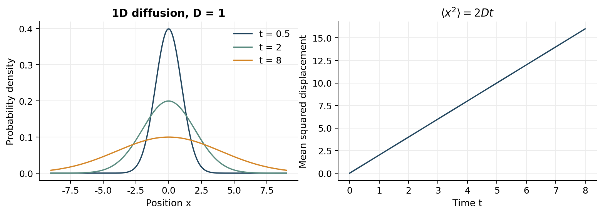

> [!abstract] 한눈에
> 확산은 개별 입자의 무작위 운동이 집단 수준에서 농도 기울기를 평탄하게 만드는 과정이다. Fick 제1법칙은 flux와 농도 기울기를, 제2법칙은 농도가 시간에 따라 바뀌는 속도를 연결한다.

## Fick 제1법칙

한 방향에서 확산 flux $J$는

$$
J=-D\frac{\partial c}{\partial x}
$$

다. $c$는 농도, $D$는 확산계수다. 음수 부호는 입자가 높은 농도에서 낮은 농도로 이동하는 방향을 나타낸다. $J$의 단위는 면적과 시간당 물질량이므로 식의 각 항 단위를 확인하면 부호와 계수를 검산하기 쉽다.

정상상태에서는 위치별 농도는 다를 수 있어도 시간에 따라 더 변하지 않는다. ‘평형’은 순 구동력이 없는 더 강한 조건이므로 정상상태와 같은 말이 아니다.

## 보존법칙과 Fick 제2법칙

들어오는 양과 나가는 양의 차이가 국소 농도를 바꾼다는 연속방정식에 제1법칙을 넣으면, 일정한 $D$에서

$$
\frac{\partial c}{\partial t}=D\frac{\partial^2c}{\partial x^2}
$$

가 된다. 확산으로 거리 $L$을 건너는 대표 시간은 대략

$$
t\sim\frac{L^2}{D}
$$

다. 거리가 두 배가 되면 시간은 약 네 배다. 이 때문에 작은 세포 안에서는 확산이 유용하지만, 큰 조직의 장거리 운반은 확산만으로 해결하기 어렵다.

## 확산과 마찰

열적 요동이 만드는 확산과 유체가 입자 운동을 방해하는 마찰은 Einstein-Smoluchowski 관계로 연결된다.

$$
D=\frac{k_BT}{\zeta}
$$

$\zeta$는 마찰계수다. 온도가 높을수록 확산이 커지고, 입자가 크거나 점성이 커져 마찰이 증가하면 확산이 작아진다. 이 관계는 미시적 무작위 운동과 거시적 수송계수를 잇는 예다.

## 기호와 단위

| 기호 | 정의 | SI 단위 |
| --- | --- | --- |
| $c$ | 단위 부피당 입자 수 또는 몰수 | $\mathrm{m^{-3}}$ 또는 $\mathrm{mol\,m^{-3}}$ |
| $J$ | 단위 면적·시간당 순이동량 | $\mathrm{m^{-2}s^{-1}}$ 또는 $\mathrm{mol\,m^{-2}s^{-1}}$ |
| $D$ | 확산계수 | $\mathrm{m^2s^{-1}}$ |
| $A$ | 수송 단면적 | $\mathrm{m^2}$ |
| $\dot n=AJ$ | 단위 시간당 몰 이동량 | $\mathrm{mol\,s^{-1}}$ |
| $b=1/\zeta$ | 입자의 기계적 이동도 $v/F$ | $\mathrm{m\,N^{-1}s^{-1}}$ |

$1\,\mathrm{mM}=1\,\mathrm{mol\,m^{-3}}$다. 농도의 mM 숫자를 SI 식에 그대로 넣을 수 있는 이유는 이 단위 대응이며, $1\,\mathrm{M}$은 $1000\,\mathrm{mol\,m^{-3}}$다. Flux $J$와 전체 이동률 $AJ$를 구분한다.

## 무작위 보행에서 확산계수

한 번에 $+\ell$ 또는 $-\ell$로 같은 확률로 이동하고, 각 보행이 독립이며 간격이 $\Delta t$라고 하자. $N$번 뒤 $x=\sum_{k=1}^N\xi_k$다. $\langle\xi_k\rangle=0$이므로 $\langle x\rangle=0$이고, 서로 다른 보행의 교차항 평균은 0이므로

$$
\langle x^2\rangle=\sum_k\langle\xi_k^2\rangle=N\ell^2
=\frac{\ell^2}{\Delta t}t=2Dt.
$$

따라서 이 1차원 모형에서 $D=\ell^2/(2\Delta t)$다. 평균 위치는 그대로지만 분포의 폭은 커진다. 오른쪽으로 이동한 횟수가 $m$이면 $x=(2m-N)\ell$이고 $m$은 이항분포를 따른다. 큰 $N$의 중심 영역에서는 Gaussian 근사가 유용하다. 독립성이나 유한 분산이 깨지는 보행에는 같은 결과를 자동으로 적용하지 않는다.

$d$차원 등방 확산에서는 $\langle r^2\rangle=2dDt$다. 1차원 변위 $x$의 분산과 3차원 거리 $r$의 제곱평균은 다른 값이다.

## 작은 구획의 보존식

단면적 $A$, 두께 $\Delta x$인 구획을 잡고 반응과 유동은 없다고 하자. 구획 안의 몰수 변화는 왼쪽 유입에서 오른쪽 유출을 뺀 값이다.

$$
A\Delta x\frac{\partial c}{\partial t}
=A J(x)-A J(x+\Delta x).
$$

$A\Delta x$로 나누고 $\Delta x\to0$ 극한을 취하면 $\partial_t c=-\partial_xJ$다. 여기에 $J=-D\partial_xc$를 대입한다.

$$
\frac{\partial c}{\partial t}
=\frac{\partial}{\partial x}\left(D\frac{\partial c}{\partial x}\right).
$$

$D$가 위치에 무관할 때만 $D\partial_x^2c$로 줄인다. 3차원에서는 $\partial_tc=\nabla\cdot(D\nabla c)$이고, 부피당 생성·소모율 $r$이 있으면 오른쪽에 $+r$을 더한다. 이 식을 풀려면 초기 농도 $c(x,0)$와 경계조건이 필요하다.

## 경계조건과 정상 확산

| 조건 | 수학 표현의 예 | 물리적 의미 |
| --- | --- | --- |
| 고정 농도 | $c(0,t)=c_L$ | 충분히 큰 저장고가 접촉면 농도를 유지한다 |
| 무유출 | $J(L,t)=0$ | 벽을 통해 물질이 나가지 않는다 |
| 고정 flux | $J(0,t)=J_0$ | 단위 면적당 주입률을 지정한다 |

일정한 $D$, 반응 없음, 고정 농도 $c(0)=c_L$, $c(L)=c_R$에서 정상상태는 $c''=0$이므로

$$
c(x)=c_L+\frac{c_R-c_L}{L}x,\qquad
J=\frac{D(c_L-c_R)}{L}.
$$

$c_L>c_R$이면 $J>0$으로 오른쪽 수송이다. 정상상태에서도 순이동이 계속되므로 열역학적 평형과 다르다. 두 저장고의 농도가 유지되지 않으면 이 직선 해를 모든 시간에 쓸 수 없다.

## 수송량 계산 예

새로 정한 모형값 $D=10^{-9}\,\mathrm{m^2/s}$, $L=100\,\mu\mathrm m$, $A=1\,\mathrm{mm^2}$, $c_L=2\,\mathrm{mM}$, $c_R=0$을 사용한다.

1. $L=10^{-4}\,\mathrm m$, $A=10^{-6}\,\mathrm{m^2}$, $c_L-c_R=2\,\mathrm{mol/m^3}$로 바꾼다.
2. $J=(10^{-9})(2)/(10^{-4})=2\times10^{-5}\,\mathrm{mol\,m^{-2}s^{-1}}$다.
3. $\dot n=AJ=2\times10^{-11}\,\mathrm{mol/s}=20\,\mathrm{pmol/s}$다.
4. 단면적을 두 배로 하면 총이동률은 두 배지만 flux는 그대로다. 두께를 두 배로 하면 flux와 총이동률이 절반이다.

## 확산 시간과 Gaussian 해

무한한 1차원 공간에 입자를 원점에 놓는 이상화된 초기조건에서는 위치 확률밀도가

$$
p(x,t)=\frac{1}{\sqrt{4\pi Dt}}\exp\left(-\frac{x^2}{4Dt}\right)
$$

다. $\int p\,dx=1$, $\langle x\rangle=0$, $\langle x^2\rangle=2Dt$다. 농도 분포는 총량과 모형의 단면적 등을 추가해 구성한다. 확률밀도와 3차원 몰농도를 그대로 같은 단위로 쓰지 않는다.

*그림 1. $D=1$인 무차원 1차원 확산의 확률밀도와 평균제곱변위. 각 분포의 적분은 1이고 분산은 $2Dt$다. 식으로 직접 계산했다.*

RMS 변위가 $L$이 되는 시간은 1차원에서 $L^2/(2D)$, 3차원 거리 기준으로 $L^2/(6D)$다. 이는 최초 도달시간이나 완전 혼합시간의 정확한 값이 아니다. 계수 없는 $L^2/D$는 차원분석의 시간척도다. $D=10^{-9}\,\mathrm{m^2/s}$에서 1차원 RMS 기준으로 $10\,\mu\mathrm m$는 $0.05$초, $1\,\mathrm{mm}$는 $500$초다.

## 외력과 Einstein 관계의 유도

위치에 따른 퍼텐셜 에너지 $U(x)$가 있고 입자에 작용하는 힘이 $F=-U'$라고 하자. 작은 힘의 선형 응답에서 평균 drift 속도는 $v=bF$다. 전체 flux는

$$
J=-D\frac{dc}{dx}+bFc.
$$

열평형에서는 $c_{eq}\propto e^{-U/(k_BT)}$이므로 $dc_{eq}/dx=-c_{eq}U'/(k_BT)$다. 이를 넣으면

$$
J_{eq}=c_{eq}U'\left(\frac{D}{k_BT}-b\right)=0.
$$

일반적인 $U'$에서 성립하려면 $D=bk_BT=k_BT/\zeta$다. 평형 분포의 정지 조건을 유도에 사용했지만 얻은 $D$는 같은 선형 응답 조건의 비평형 확산에도 쓰인다. 노트의 시간항이 없는 것은 이 평형 유도 단계 때문이며, 모든 확산이 시간에 무관하다는 의미가 아니다.

구형 입자, 희박한 용액, Newtonian 유체, 낮은 Reynolds 수와 no-slip 조건의 Stokes 마찰 $\zeta=6\pi\eta a$를 쓰면

$$
D=\frac{k_BT}{6\pi\eta a}.
$$

$T=300\,\mathrm K$, $\eta=10^{-3}\,\mathrm{Pa\,s}$, $a=1\,\mathrm{nm}$의 가정값에서는 $D\approx2.20\times10^{-10}\,\mathrm{m^2/s}$다. 분자 크기에서 연속체·구형 근사의 적합성은 별도로 확인한다.

## 적용 순서

농도와 길이의 단위를 먼저 통일한다. 정상인지 과도인지 정하고, 경계조건과 반응·유동·외력의 유무를 적는다. $J$를 구한 뒤 전체 이동량이 필요할 때만 면적과 시간을 곱한다. 최종적으로 높은 농도에서 낮은 농도로 가는 부호, 물질 보존, 길이 제곱에 비례하는 시간척도를 확인한다.

## 유의점

- 정상상태와 평형을 구분하고, 시간 계산에서 차원과 경계조건을 명시한다.
- 입자의 무작위 보행과 전체 flux의 방향은 다른 관측량이다.

## 관련 개념

- [[entropy-boltzmann|Boltzmann 분포]]
- [[thermodynamic-driving-forces|화학퍼텐셜]]

## 참고 자료

- 개인 학습 기록, Notion `Studies / 2024 Spring / BiS223 / Lecture Note / 2024 03 06 - Fick’s Law`
- K. A. Dill and S. Bromberg, _Molecular Driving Forces_, 2nd ed.
- [MIT 20.430J Lecture 3, Diffusion as a Random Walk; Stokes–Einstein Relation](https://ocw.mit.edu/courses/20-430j-fields-forces-and-flows-in-biological-systems-fall-2015/resources/mit20_430jf15_lecture3/), 무작위 보행과 확산-마찰 관계의 보충 대조.
