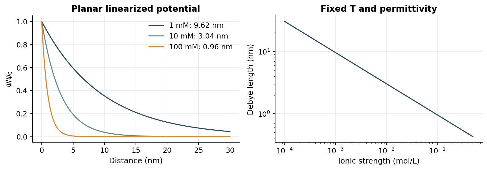

> [!abstract] 한눈에
> 매질의 분극과 용액 속 이온의 재배치는 전기적 상호작용을 바꾼다. 유전율에 의한 감소와 이동 이온에 의한 차폐는 구별되는 과정이다. 순전하가 없는 분자도 쌍극자와 유도분극을 통해 상호작용할 수 있다.

## 유전율과 분극

균일한 선형 유전체에서 점전하 사이의 힘은 $F=q_1q_2/(4\pi\epsilon r^2)$로 쓴다. $\epsilon=\epsilon_0\epsilon_r$이며 상대유전율 $\epsilon_r$는 무차원이다. 고정된 자유전하와 적절한 경계 조건에서는 분극이 전기장을 약화하는 효과를 낸다. 전압 고정과 전하 고정 조건을 혼동하지 않는다.

영구 쌍극자는 전기장 방향으로 배향하려는 경향과 열운동의 영향을 함께 받는다. 쌍극자 자체의 배향과 분극으로 생긴 결합전하의 전기장 방향은 구분한다. 영구 쌍극자가 없어도 전자구름과 원자핵의 상대적 변위로 유도 쌍극자가 생길 수 있다.

## 쌍극자와 분자 상호작용

분자의 순전하가 0이어도 전하분포가 균일하지 않으면 다극자 모멘트가 남을 수 있다. 분자 사이 거리와 방향에 따라 상호작용이 달라진다. 회전이 가능한 분자의 배향 평균과 고정된 쌍극자 사이의 특정 방향 상호작용은 같은 거리 의존성을 갖지 않을 수 있다. 유도분극도 분자 사이의 인력에 기여한다.

## 전기이중층

표면이 전하를 띠면 용액의 반대 부호 이온이 주변에 더 많이 분포하고 같은 부호 이온은 줄어든다. 표면 전하와 용액의 과잉 반대이온 분포를 함께 전기이중층으로 기술한다. 두 번째 층을 두께가 없는 평면 한 장으로만 생각하면 확산층을 설명하기 어렵다.

단순한 평면 전위 모형에서 이온은 전기적 에너지와 열운동의 균형에 따라 분포한다. 낮은 전위에서 선형화하면 전위가 대표 길이 $\lambda_D$에 따라 대략 지수적으로 감소하는 Debye 차폐를 얻는다. 같은 온도와 매질에서 이온강도가 증가하면 차폐 길이는 짧아진다. 높은 전위나 이온 크기·특이 흡착의 효과가 크면 단순 모형이 제한된다.

## 생체계와 계측

단백질 표면의 결합과 콜로이드 안정성은 pH에 따른 표면전하, 염 농도, 유전 환경의 영향을 받는다. 전극-전해질 계면에서는 전기이중층이 주파수에 따른 임피던스에 기여한다. 실제 계면의 전체 응답에는 전하 전달 반응과 확산도 포함될 수 있어 하나의 이상 커패시터만으로 충분하지 않을 수 있다.

## 기호와 에너지 척도

| 기호 | 의미 | 단위 |
| --- | --- | --- |
| $q=ze$ | 입자 전하 | C |
| $\psi$ | 전위 | V = J/C |
| $\mathbf E=-\nabla\psi$ | 전기장 | V/m |
| $\epsilon=\epsilon_0\epsilon_r$ | 유전율 | F/m |
| $\mathbf p=q\mathbf d$ | 음전하에서 양전하 방향의 쌍극자 모멘트 | C·m |
| $k_BT$ | 입자당 열에너지 | J |

전위 $\psi$와 퍼텐셜 에너지 $U=q\psi$를 구분한다. 힘의 크기 식에서 전하 곱의 절댓값을 사용하고, 부호는 인력·척력 방향 또는 벡터식으로 처리한다. 균일한 매질에서 두 점전하의 에너지는

$$
U(r)=\frac{q_1q_2}{4\pi\epsilon r},\qquad
\mathbf F_{2}=\frac{q_1q_2}{4\pi\epsilon r^2}\widehat{\mathbf r}_{1\to2}.
$$

같은 부호이면 에너지가 양수이고 멀어질수록 낮아진다. 이때 힘은 서로 멀어지는 방향이다. 반대 부호이면 에너지가 음수이고 접근이 유리하다.

## 열운동과의 비교

Bjerrum 길이 $\ell_B=e^2/(4\pi\epsilon k_BT)$는 단위 전하 두 개의 Coulomb 에너지 크기가 $k_BT$와 같아지는 거리다.

$$
\frac{U(r)}{k_BT}=z_1z_2\frac{\ell_B}{r}.
$$

계산용 가정값 $T=298\,\mathrm K$, $\epsilon_r=78.5$에서는 $\ell_B\approx0.714\,\mathrm{nm}$다. 거리 $r=1\,\mathrm{nm}$의 단가 이온 사이 에너지 크기는 약 $0.714k_BT$다. 이는 균일 유전매질·차폐 없음의 계산 예다. 실제 이온의 수화와 분자적 계면에는 단순 점전하 모형의 제한이 있다.

## 쌍극자의 배향과 유도

균일한 장에서 영구 쌍극자의 에너지는 $U=-\mathbf p\cdot\mathbf E=-pE\cos\theta$이고 토크는 $\boldsymbol\tau=\mathbf p\times\mathbf E$다. 에너지 최소는 $\mathbf p$가 장과 같은 방향인 경우다. 영구 쌍극자가 외부 장에 반대 방향으로 정렬된다는 설명과 구별한다. 분극 표면의 결합전하가 만드는 장은 조건에 따라 외부 장을 약화한다.

유도 쌍극자가 $\mathbf p=\alpha\mathbf E$인 선형 모형에서는 분극을 만드는 일까지 포함한 에너지가 $U=-\alpha E^2/2$다. 이미 고정된 영구 쌍극자의 $-pE$에 $p=\alpha E$를 단순 대입하면 계수 $1/2$를 놓친다. 분극률 $\alpha$와 상대유전율 $\epsilon_r$도 서로 다른 양이다.

고정된 두 쌍극자의 원거리 에너지는

$$
U_{dd}=\frac{\mathbf p_1\cdot\mathbf p_2
-3(\mathbf p_1\cdot\widehat{\mathbf r})(\mathbf p_2\cdot\widehat{\mathbf r})}
{4\pi\epsilon r^3}.
$$

배향에 따라 부호가 달라진다. 자유로운 열적 회전의 평균, 유도 상호작용과 분산력에서는 다른 거리·온도 의존성이 나타날 수 있으므로 고정 배향의 $r^{-3}$을 그대로 옮기지 않는다.

## 이온 분포와 Poisson 방정식

평면 표면에서 떨어진 거리 $x$를 좌표로 잡고, 벌크 전위를 0으로 둔다. 벌크의 각 이온 수밀도를 $n_{i,\infty}$라 하면, 이상적인 평균장 평형 모형은

$$
n_i(x)=n_{i,\infty}\exp\left(-\frac{z_ie\psi(x)}{k_BT}\right),
\qquad \epsilon\psi''(x)=-\rho(x),
\qquad \rho(x)=\sum_i z_i e n_i(x).
$$

양의 표면 전위 근처에서는 양이온의 Boltzmann 가중치가 작아지고 음이온이 커진다. 전위가 만드는 농도 재배치와 재배치된 전하가 만드는 전위를 동시에 풀어야 하므로 Poisson–Boltzmann 방정식이 비선형이다.

## 낮은 전위의 선형화

단가의 대칭 1:1 전해질에서 양·음이온 각각의 벌크 수밀도를 $n_0$라 두면

$$
\rho=e n_0(e^{-e\psi/(k_BT)}-e^{e\psi/(k_BT)})
\approx-\frac{2n_0e^2}{k_BT}\psi.
$$

따라서 $\psi''=\kappa^2\psi$이고

$$
\kappa^2=\frac{2n_0e^2}{\epsilon k_BT},\qquad
\lambda_D=\kappa^{-1},\qquad
\psi(x)=\psi_0e^{-x/\lambda_D}.
$$

$x\to\infty$에서 0, 표면에서 $\psi_0$인 반무한 평면 경계조건을 적용했다. 구형 점전하의 차폐 전위는 $e^{-r/\lambda_D}/r$ 형태여서 순수한 평면 지수식과 다르다.

*그림 1. $298\,\mathrm K$, $\epsilon_r=78.5$, 1:1 전해질의 선형화 모형. 염 농도가 증가하면 전위의 감쇠 길이가 줄어든다. 물성값을 고정한 계산 예다.*

## 농도와 Debye 길이 계산

수밀도 $n_i$는 $\mathrm{m^{-3}}$이고, 몰농도 $c_i$를 $\mathrm{mol/m^3}$로 넣으면 $n_i=N_Ac_i$다. 몰 단위 이온강도는 $I=\tfrac12\sum_i z_i^2c_i$이므로

$$
\lambda_D=\sqrt{\frac{\epsilon RT}{2F^2I}}.
$$

$I$를 mol/L인 M 숫자로 넣으려면 분모에 1000을 추가해야 한다. 위 물성값에서는 편의식 $\lambda_D[\mathrm{nm}]\approx0.304/\sqrt{I[\mathrm M]}$다. 따라서 단가 염 $1\,\mathrm{mM}$에서 약 $9.62$ nm, $100\,\mathrm{mM}$에서 약 $0.962$ nm다. 1:1 염에서는 $I$가 염의 몰농도와 같지만 다가 전해질에서는 각 이온의 농도와 $z_i^2$를 합산해야 한다.

선형화 조건은 모든 관련 이온에 대해 $|z_ie\psi|\ll k_BT$다. 위 온도에서 단가 이온의 열전압 $k_BT/e\approx25.7$ mV이므로 전위 크기가 이 값에 비해 충분히 작아야 한다. 농도가 높아 $\lambda_D$가 분자 크기에 가까워지면 연속체·점이온·희석 근사도 따로 검토한다.

## 두 감소 기작의 구분

유전분극은 전하 주변 매질의 반응을 $\epsilon$에 포함한다. 이동 이온에 의한 차폐는 공간적으로 재배치된 전하를 계산해 $\lambda_D$를 만든다. 같은 용액에서 둘이 함께 작용하지만 $\epsilon_r$와 $\lambda_D$를 같은 감소 계수로 쓰지 않는다. 전기이중층에는 표면 전하와 이온 분포가 포함되며, 특이 흡착이 중요하면 단순 확산층 모형만으로 충분하지 않다.

## 유의점

- 유전분극에는 이온이 장거리 이동해야 한다는 조건이 없다.
- 전기이중층과 세포의 지질 이중층은 다른 구조다.
- 물의 유전율을 모든 주파수와 계면에서 같은 상수로 사용하지 않는다.

## 관련 개념

- [[thermodynamic-driving-forces|전기화학퍼텐셜]]
- [[biomolecules-binding|생체분자 결합]]
- [[capacitors-inductors|커패시터]]

## 참고 자료

- Dill and Bromberg, Molecular Driving Forces, 전기적 상호작용 단원.
- Notion BiS223 / Final의 dielectric constant, polarizability, double layer, multipole 개념 기록.
- [David Tong, Statistical Physics §2.6](https://www.damtp.cam.ac.uk/user/tong/statphys/statmechhtml/S2.html), Boltzmann 분포와 Poisson 방정식을 결합한 차폐 모형의 공개 보충 자료. 본문은 SI 단위와 대칭 전해질의 평면 경계조건으로 직접 전개했다.
