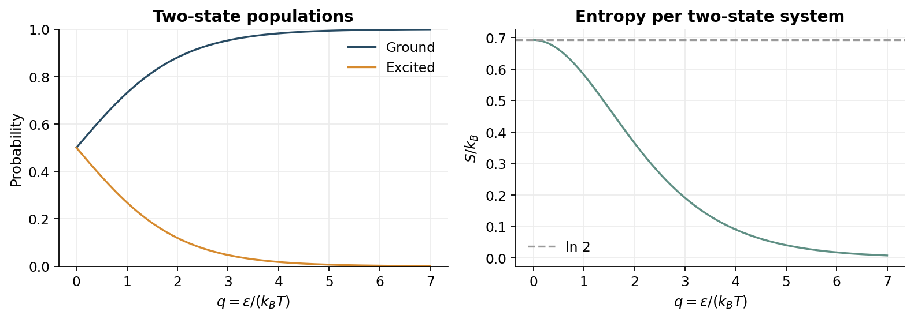

> [!abstract] 한눈에
> 앙상블은 같은 거시 조건을 만족하는 가능한 계들의 통계적 기술이다. 상태 확률의 엔트로피를 최대화하면 주어진 제약에 맞는 분포를 얻는다. 정준 앙상블에서는 에너지와 온도가 Boltzmann 가중치와 분배함수로 연결된다.

## 미시상태와 거시 조건

입자들의 세부 배치가 미시상태이고, 에너지·부피·입자수 같은 변수는 거시 조건이다. 미시정준 앙상블은 고립된 계의 에너지를 고정하고, 정준 앙상블은 열저장고와 에너지를 교환해 온도를 고정한다. 열저장고와 접촉한 작은 계의 에너지는 고정값이 아니라 요동하는 양이다.

가능한 미시상태가 $\Omega$개이고 동등한 확률을 가진 경우 $S=k_B\ln\Omega$다. 일반적인 이산 확률분포에서는

$$
S=-k_B\sum_i p_i\ln p_i
$$

로 쓴다. 열역학적 엔트로피에는 $k_B$와 물리적 상태의 정의가 필요하며, 정보 엔트로피의 숫자와 단위 없이 동일시하지 않는다.

## 정규화만 있는 경우

유한한 $M$개 상태에서 $\sum p_i=1$만 고정하고 $-\sum p_i\ln p_i$를 최대화하면 모든 $p_i$가 같다. 라그랑주 함수를 미분하면 $-\ln p_i-1-\alpha=0$이므로 $p_i=1/M$이다. 에너지 정보가 없다는 가정을 넣은 결과이며, 상태 공간과 기준 측도가 바뀌면 같은 표현의 균일성이 유지되는 것은 아니다.

## 에너지 제약

평균에너지 $\sum p_iE_i=U$도 고정하면

$$
\mathcal L=-\sum_i p_i\ln p_i-\alpha(\sum_i p_i-1)-\beta(\sum_i p_iE_i-U)
$$

의 정상조건에서 $p_i\propto e^{-\beta E_i}$를 얻는다. 정준 앙상블에서는 $\beta=1/(k_BT)$이고

$$
p_i=\frac{e^{-\beta E_i}}{Z},\qquad Z=\sum_i e^{-\beta E_i}
$$

다. 두 상태 확률의 비는 $p_j/p_i=e^{-\beta(E_j-E_i)}$이므로 절대 에너지의 기준을 바꿔도 확률은 변하지 않는다. 같은 에너지를 가진 상태가 여러 개면 그 에너지 준위의 총확률에는 축퇴도가 곱해진다.

## 분배함수와 자유에너지

$$
U=-\frac{\partial\ln Z}{\partial\beta},\qquad F=-k_BT\ln Z
$$

로 평균에너지와 Helmholtz 자유에너지를 구할 수 있다. 미분할 때 부피와 입자수 등 조건을 명시한다. $Z$의 정규화 기능과 물리량을 생성하는 기능을 함께 볼 수 있다.

두 준위 $0,\epsilon$의 예에서 $Z=1+e^{-\beta\epsilon}$이고 들뜬 상태 확률은 $1/(1+e^{\beta\epsilon})$다. 양의 온도를 높이면 두 상태 확률이 가까워지며, 낮은 온도에서는 낮은 에너지 상태가 우세하다.

## 온도와 음의 온도

열역학적 정의는 $1/T=(\partial S/\partial U)_{V,N}$다. 에너지를 더할 때 엔트로피가 감소하는 구간이 있는, 에너지 상한이 제한된 특수한 계에서는 음의 절대온도 기술이 가능할 수 있다. 이는 일상적 물질을 절대영도 아래로 냉각한 상태를 뜻하지 않는다. 일반적인 병진 운동처럼 에너지가 위로 무한한 계에 바로 적용하지 않는다.

## 미시상태 수에서 엔트로피

독립적인 두 계 A와 B의 가능한 상태 수는 $\Omega_{AB}=\Omega_A\Omega_B$다. 곱해지는 상태 수를 더해지는 양으로 바꾸는 로그를 사용하면 $S_{AB}=S_A+S_B$를 얻는다. 열역학의 온도·에너지 단위와 맞추는 상수가 $k_B$다. $\ln$은 자연로그이며, 밑 2의 정보 엔트로피를 사용하면 $\ln2$ 변환이 필요하다.

서로 독립인 $N$번의 상태 선택에서 상태 $i$가 $n_i=Np_i$번 나타나는 경우의 수는 $W=N!/\prod_i n_i!$다. 큰 $n_i$에 Stirling 근사 $\ln n!\approx n\ln n-n$을 쓰면

$$
\ln W\approx N\ln N-\sum_iNp_i\ln(Np_i)
=-N\sum_i p_i\ln p_i.
$$

따라서 전체의 엔트로피를 선택 횟수 $N$으로 나눈 양은 $-k_B\sum p_i\ln p_i$다. 이 조합적 구성은 확률 엔트로피의 형태를 설명한다. 모든 열역학적 계를 독립 입자 $N$개의 단순 모형으로 환원하는 가정은 아니다.

## Boltzmann 분포의 계산 과정

무차원 $h=S/k_B$를 최대화하면

$$
\frac{\partial\mathcal L}{\partial p_i}
=-(\ln p_i+1)-\alpha-\beta E_i=0
$$

이므로 $p_i=e^{-1-\alpha}e^{-\beta E_i}$다. 정규화로 $1=e^{-1-\alpha}\sum_ie^{-\beta E_i}$이므로 $e^{-1-\alpha}=1/Z$다. 평균에너지 제약의 승수 $\beta$는 단위가 $\mathrm{J^{-1}}$이다.

$h^*(U)$의 최적값은 승수법의 민감도에서 $dh^*/dU=\beta$를 만족한다. 반면 열역학에서 $\partial S/\partial U=1/T$이므로 $\beta=(1/k_B)(1/T)$다. $S$ 자체를 목적함수로 사용했다면 해당 승수는 $1/T$가 된다. 두 convention을 섞으면 $k_B$가 사라지거나 중복된다.

## 열저장고로부터의 유도

총에너지가 $E_{tot}$로 고정된 고립 복합계에서 작은 계가 에너지 $E_i$를 가지면 저장고는 $E_{tot}-E_i$를 가진다. 작은 계의 해당 미시상태 확률은 가능한 저장고 상태 수에 비례한다.

$$
p_i\propto\Omega_R(E_{tot}-E_i)
=\exp\left[\frac{S_R(E_{tot}-E_i)}{k_B}\right].
$$

저장고가 커서 작은 계의 에너지 변화로 온도가 거의 변하지 않으면

$$
S_R(E_{tot}-E_i)\approx S_R(E_{tot})-\frac{E_i}{T}.
$$

상태에 무관한 첫 항을 정규화에 포함하면 $p_i\propto e^{-E_i/(k_BT)}$다. 이 유도는 평균에너지 제약의 수학적 승수와 물리적 열저장고 온도를 연결한다.

## 앙상블 선택

| 앙상블 | 고정 조건 | 계가 교환할 수 있는 것 | 확률 가중치 |
| --- | --- | --- | --- |
| 미시정준 | $E,V,N$ | 고립계에서 교환 없음 | 접근 가능한 에너지 껍질 안의 동등 가중치 |
| 정준 | $T,V,N$ | 에너지 | $e^{-\beta E_i}$ |
| 큰정준 | $T,V,\mu$ | 에너지와 입자 | $e^{-\beta(E_i-\mu N_i)}$ |

큰정준 행은 앙상블을 비교하기 위한 보충이며 본문의 계산 예는 정준·미시정준에 한정한다. 고정 온도는 계의 순간 에너지가 고정되어 있다는 의미가 아니다.

## 두 준위 계산 예

새 계산 예에서 기저상태 에너지는 0, 들뜬 상태 에너지는 $\epsilon$이며 두 상태의 축퇴도는 각각 1이다. $\epsilon/(k_BT)=2$라고 하자.

$$
Z=1+e^{-2}=1.1353,\quad
p_g=\frac1Z=0.8808,\quad p_e=\frac{e^{-2}}Z=0.1192.
$$

$\langle E\rangle=\epsilon p_e=0.1192\epsilon$이고 $S/k_B=-p_g\ln p_g-p_e\ln p_e\approx0.3653$다. 에너지 차가 온도에 비해 커서 들뜬 상태의 가중치가 작다. 두 상태의 에너지를 모두 $E_0$만큼 올리면 $Z$는 $e^{-\beta E_0}$배가 되지만 확률과 엔트로피는 그대로다. $U$와 $F$의 에너지 기준은 $E_0$만큼 변한다.

*그림 1. $q=\epsilon/(k_BT)$에 따른 두 준위 점유율과 엔트로피. 양의 온도 범위에서 $q$가 0에 가까우면 두 상태가 같은 확률을 가진다. 직접 계산했다.*

에너지 준위의 축퇴도가 $g_i$이면 그 준위 전체의 확률은 $P_i=g_ie^{-\beta E_i}/Z$이고 $Z=\sum_i g_ie^{-\beta E_i}$다. 미시상태별 합에 이미 같은 에너지의 상태를 모두 셌다면 축퇴도를 다시 곱하지 않는다.

## 분배함수 미분의 전개

에너지 준위가 온도에 명시적으로 의존하지 않는 정준 모형에서

$$
\frac{\partial Z}{\partial\beta}=-\sum_iE_ie^{-\beta E_i},
\qquad -\frac{\partial\ln Z}{\partial\beta}=\sum_ip_iE_i=U.
$$

한 번 더 미분하면

$$
\frac{\partial^2\ln Z}{\partial\beta^2}
=\langle E^2\rangle-\langle E\rangle^2,
\qquad C_V=\frac{\operatorname{Var}(E)}{k_BT^2}.
$$

평균에너지의 온도 변화와 에너지 요동이 연결된다. 또한 $\ln p_i=-\beta E_i-\ln Z$를 엔트로피에 넣으면 $S=k_B(\ln Z+\beta U)$이고, $F=U-TS=-k_BT\ln Z$를 얻는다. $F$, $U$, $TS$의 단위는 모두 J다.

## 두 준위 계의 온도

입자 $N$개 중 $n$개가 에너지 $\epsilon$에 있으면 $U=n\epsilon$, $W=\binom{N}{n}$이다. 큰 계에서 $f=n/N$로 두면

$$
S\approx-Nk_B[f\ln f+(1-f)\ln(1-f)].
$$

고정 $N$에서 $dU=\epsilon\,dn$이므로

$$
\frac1T=\frac{\partial S}{\partial U}
=\frac{k_B}{\epsilon}\ln\frac{N-n}{n}
=\frac{k_B}{\epsilon}\ln\frac{1-f}{f}.
$$

$f<1/2$에서는 양의 온도, $f=1/2$에서는 $1/T=0$, $f>1/2$에서는 음의 온도 영역이다. 이 결과는 에너지 상한이 있는 두 준위 자유도에 대한 것이며, 열평형을 이루지 않은 임의의 점유분포에 온도를 부여하는 방법으로 일반화하지 않는다. 음의 온도 분포는 양의 온도 분포보다 낮은 에너지 상태가 아니다.

## 바로 계산하는 순서

에너지 목록과 미시상태·준위의 구분을 적고, 입자당 J인지 몰당 J/mol인지 확인한다. $\beta E$를 무차원으로 만든 뒤 가중치를 계산하고 합으로 나눈다. 확률 합이 1인지, 높은 에너지가 양의 온도에서 덜 점유되는지, $T\to0^+$와 $T\to\infty$ 극한을 점검한다. $Z$는 임의의 확률을 새로 만들어 주는 입력값이 아니라 해당 상태 목록의 가중치 합이다.

## 유의점

- 제약을 정하지 않은 채 최대 엔트로피 분포가 항상 균일하다고 말하지 않는다.
- $k_B$를 쓰는 입자당 에너지와 $R$을 쓰는 몰당 에너지를 구분한다.
- Boltzmann 분포는 열평형 모형이며 임의의 비평형 세포 상태에 그대로 적용되지 않는다.

## 관련 개념

- [[lagrange-multipliers|라그랑주 승수법]]
- [[thermodynamic-driving-forces|열역학적 구동력]]

## 참고 자료

- Dill and Bromberg, Molecular Driving Forces, 2판.
- Notion BiS223 / Lecture Note 및 중간 정리의 엔트로피·앙상블 개념. 평가 문항은 재현하지 않았다.
- [MIT RES.8-010 강의 노트](https://ocw.mit.edu/courses/res-8-010-introduction-to-statistical-physics-summer-2018/pages/lecture-notes/).
