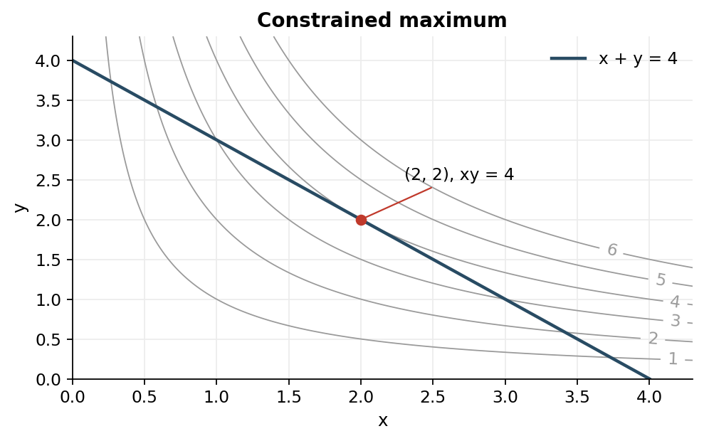

> [!abstract] 한눈에
> $g(x)=c$ 위에서 $f(x)$를 최적화할 때, 움직일 수 있는 모든 접선 방향으로 $f$가 더 이상 변하지 않는 점에서는 $\nabla f$가 $\nabla g$와 평행하다. 따라서 $\nabla f=\lambda\nabla g$를 푼다.

## 기하학적 이유

제약곡면 $g(x)=c$의 법선벡터는 $\nabla g$다. 제약을 지키며 움직일 수 있는 방향은 이 벡터에 수직인 접선 방향들이다. 최적점에서는 그 접선 방향으로 목적함수 $f$의 변화율이 모두 0이어야 한다. 따라서 $\nabla f$도 같은 법선 방향에 놓인다.

$$
\nabla f(x^*)=\lambda\nabla g(x^*),\qquad g(x^*)=c
$$

라그랑지안을

$$
\mathcal L(x,\lambda)=f(x)-\lambda(g(x)-c)
$$

로 두면 $\nabla_x\mathcal L=0$과 $\partial\mathcal L/\partial\lambda=0$을 함께 푸는 것과 같다.

## 예: 정해진 합에서 곱 최대화

$x+y=s$, $x,y>0$일 때 $xy$를 최대화하자.

$$
f(x,y)=xy,\qquad g(x,y)=x+y=s
$$

$\nabla f=(y,x)$, $\nabla g=(1,1)$이므로 $y=\lambda$, $x=\lambda$다. 따라서 $x=y=s/2$에서 곱이 최대다. 제약을 먼저 $y=s-x$로 대입해 풀 수도 있지만, 변수와 제약이 많아지면 승수법이 구조를 더 잘 보존한다.

## 승수의 의미

$\lambda$는 제약값 $c$를 조금 바꿀 때 최적 목적값이 얼마나 변하는지를 나타내는 민감도로 해석할 수 있다. 물리학에서는 보존 제약 아래 에너지 최소화, 통계역학에서는 정규화나 평균 에너지 제약 아래 엔트로피 최대화에 나타난다.

후보점을 찾았다고 최대·최소가 정해지지는 않는다. 후보점은 최대도 최소도 아닐 수 있다. 경계, 특이점, 여러 후보와 2차 조건을 따로 확인해야 한다.

## 조건식의 구성

목적함수 $f(\mathbf x)$와 제약 $g_a(\mathbf x)=c_a$를 분리한다. 미지수는 원래 변수 $n$개에 제약 수 $m$개만큼 승수를 더한 $n+m$개다.

$$
\mathcal L(\mathbf x,\boldsymbol\lambda)
=f(\mathbf x)-\sum_{a=1}^{m}\lambda_a[g_a(\mathbf x)-c_a].
$$

각 $x_i$로 미분한 식 $n$개와 원래 제약식 $m$개를 동시에 푼다. 제약식만 맞추거나 승수에 대한 미분을 빼면 충분한 방정식이 생기지 않는다. 정칙점에서는 제약의 기울기들이 독립이어야 이 정상조건을 일반적으로 적용할 수 있다.

## 접선 방향의 유도

허용된 작은 이동 $d\mathbf x$는 모든 $dg_a=\nabla g_a\cdot d\mathbf x=0$을 만족한다. 내부 최적점에서는 이 모든 방향에서 $df=\nabla f\cdot d\mathbf x=0$이어야 한다. 따라서 $\nabla f$는 제약 기울기들이 만드는 법선 공간 안에 있다. 제약 하나일 때 평행 조건이 되고, 여러 개일 때 기울기의 선형결합이 된다.

*그림 1. $x+y=4$ 위에서 $xy$를 최대화하는 예. $x=y=2$에서 목적함수의 등고선과 제약이 접한다. 직접 계산한 등고선이다.*

## 후보점의 검증

예제 $x+y=s$, $x,y\ge0$, $s>0$에서는 내부 정상조건으로 $x=y=s/2$를 얻는다. $y=s-x$를 대입하면

$$
f=x(s-x)=\frac{s^2}{4}-\left(x-\frac{s}{2}\right)^2.
$$

그러므로 해당 점이 전체 최대임을 확인할 수 있다. 두 경계 $x=0,s$에서는 곱이 0이므로 최소다. 승수 방정식이 찾은 내부점과 제약집합의 경계를 따로 확인한 예다.

제약이 곡선이면 모든 방향에서의 Hessian보다 제약에 접하는 방향의 2차 변화가 중요하다. 단순히 $\mathcal L$의 모든 변수에 대한 Hessian을 양·음 definite로 판정하는 방법은 적절하지 않을 수 있다.

## 엔트로피 최대화 예

가능한 상태가 세 개이고 확률 $p_1,p_2,p_3$의 합만 1로 고정되어 있다고 하자. 내부에서 무차원 엔트로피 $h=-\sum p_i\ln p_i$에 승수법을 적용한다.

$$
\mathcal L=-\sum_{i=1}^3p_i\ln p_i-\alpha(\sum_i p_i-1),
\qquad -\ln p_i-1-\alpha=0.
$$

따라서 세 확률이 같고 $p_i=1/3$이다. $h=\ln3$이며, $\partial^2h/\partial p_i^2=-1/p_i<0$이므로 엔트로피는 내부에서 엄격하게 오목하다. 정규화 평면과 $p_i\ge0$로 이루어진 convex 집합에서는 이 점이 전역 최대다. $p_i=0$은 $p\ln p\to0$의 극한으로 경계를 평가한다.

평균에너지도 고정하면 승수 하나를 더 도입한다. 미분식에 $-\beta E_i$가 더해져 모든 확률을 같게 놓을 수 없게 된다. 자세한 정규화와 물리적 온도의 연결은 [[entropy-boltzmann|Boltzmann 분포]]에 있다.

## 승수의 부호와 단위

위에서 사용한 $\mathcal L=f-\lambda(g-c)$ convention에서 최적값 $f^*(c)$의 매끄러운 변화를 따라가면 $df^*/dc=\lambda$다. 예제 곱 최대화에서는 $f^*=s^2/4$, $\lambda=s/2$여서 일치한다. $f$와 $g$의 단위가 다르면 $\lambda$의 단위는 $[f]/[g]$다.

라그랑지안의 승수 앞 부호를 바꾸면 승수의 숫자 부호도 바뀐다. 물리량과 연결할 때는 어떤 convention을 사용했는지 확인해야 한다. 엔트로피를 $S$로 최대화했는지 $S/k_B$로 최대화했는지도 에너지 제약 승수의 단위를 바꾼다.

## 예외와 풀이 순서

1. 변수의 허용 범위와 제약을 적는다. 확률에는 $p_i\ge0$이 있다.
2. 제약의 기울기가 0이거나 서로 종속인 특이점을 먼저 표시한다.
3. 라그랑지안을 만들고 모든 변수와 승수로 미분한다.
4. 내부 후보를 구하고 원래 제약에 대입한다.
5. 경계와 특이점도 원래 문제에서 평가한다.
6. 함수의 오목성·볼록성 또는 후보값 비교로 최대·최소를 판정한다.

부등식 제약은 등식처럼 무조건 모두 활성화하지 않는다. 활성 경계와 내부를 나누어 검토하거나 KKT 조건을 사용한다. KKT의 일반 전개는 이 노트의 등식 제약 풀이 범위 밖이다.

## 유의점

- 정상조건은 후보를 찾는 식이다. 경계와 극값 종류를 따로 검증한다.
- 승수의 부호와 단위는 목적함수·라그랑지안의 convention에 의존한다.

## 관련 개념

- [[entropy-boltzmann|최대 엔트로피]]
- [[thermodynamic-driving-forces|평형 조건]]

## 참고 자료

- 개인 학습 기록, Notion `Studies / 2024 Spring / BiS223 / Lagrange multipliers`
