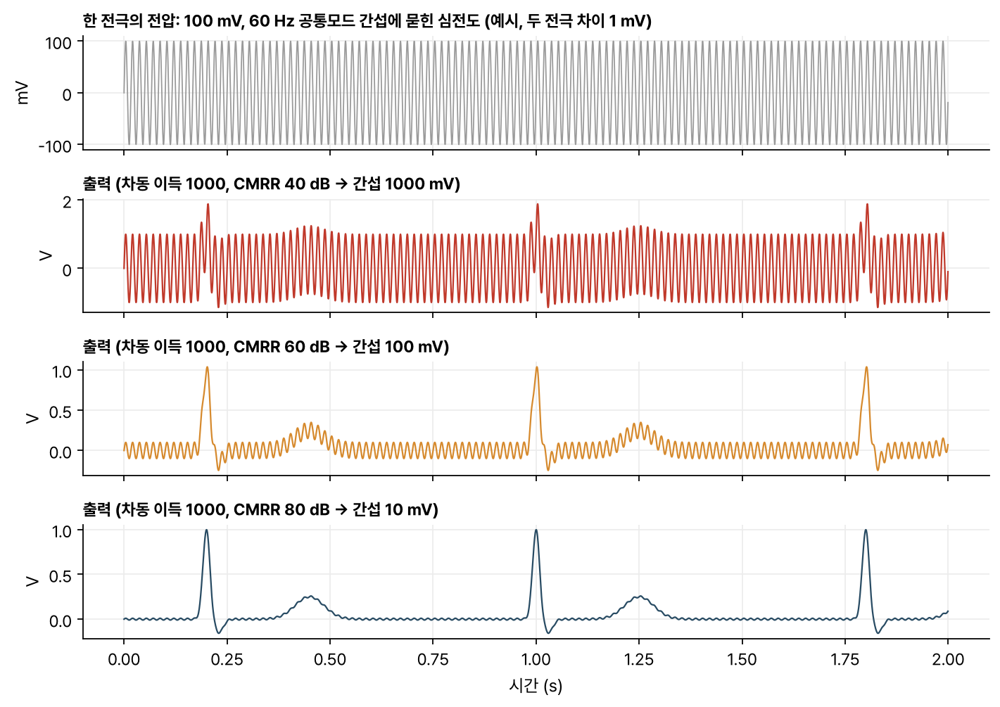
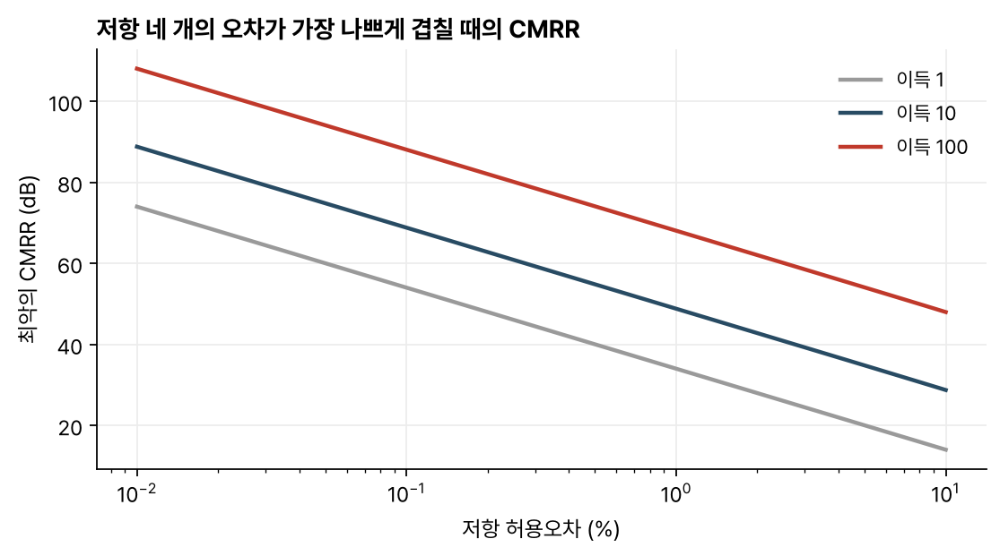

> [!abstract] 한눈에
> 생체 전극 두 개에는 원하는 신호 말고도 전원선 간섭 같은 같은 크기의 전압이 함께 실린다. 차동 증폭기는 두 입력의 차이를 키우고 공통 성분은 줄인다. 그 성능을 공통모드 제거비(CMRR)로 재는데, op-amp 하나짜리 차동 증폭기의 CMRR은 저항 네 개가 얼마나 정확히 맞는지로 정해진다.

## 차동 신호와 공통모드 신호

두 입력 $v_1$, $v_2$를 차동 성분과 공통모드 성분으로 나눈다.

$$
v_d = v_2 - v_1, \qquad v_{cm} = \frac{v_1 + v_2}{2}
$$

증폭기 출력은 두 성분에 각각의 이득을 곱한 합이다.

$$
v_o = A_d\,v_d + A_{cm}\,v_{cm}
$$

**공통모드 제거비**(common-mode rejection ratio, CMRR)는 두 이득의 비다. 보통 dB로 쓴다.

$$
\text{CMRR} = \left|\frac{A_d}{A_{cm}}\right|, \qquad \text{CMRR}_{\text{dB}} = 20\log_{10}\left|\frac{A_d}{A_{cm}}\right|
$$

심전도를 예로 들면, 두 전극 사이의 심장 신호는 1 mV 안팎이고 몸 전체에 실리는 60 Hz 간섭은 그보다 훨씬 클 수 있다. 차동 이득이 1000이어도 CMRR이 낮으면 출력에 남은 간섭이 심전도를 가린다(그림 1).

*그림 1. 1 mV 심전도 모양 신호와 100 mV, 60 Hz 공통모드 간섭을 가정한 예시다. 차동 이득 1000에서 CMRR이 40 dB면 출력 간섭이 1 V로 신호와 같은 크기이고, 80 dB면 10 mV로 줄어든다.*

## op-amp 하나로 만든 차동 증폭기

$v_1$은 $R_1$을 거쳐 반전 입력으로, $v_2$는 $R_3$, $R_4$ 분압을 거쳐 비반전 입력으로 넣고, $R_2$로 출력에서 반전 입력으로 피드백을 건다. 이상적 op-amp 가정($V_+ = V_-$, 입력 전류 0)으로 풀면

$$
v_o = \frac{R_4}{R_3 + R_4}\left(1 + \frac{R_2}{R_1}\right) v_2 - \frac{R_2}{R_1}\,v_1
$$

이다. $R_4/R_3 = R_2/R_1$이면 두 계수의 크기가 $R_2/R_1$로 같아져

$$
v_o = \frac{R_2}{R_1}\,(v_2 - v_1)
$$

이 되고, 공통모드 이득은 0이다.

### 저항 오차와 CMRR

실제 저항에는 허용오차가 있어 $R_4/R_3$와 $R_2/R_1$이 조금 어긋난다. 그러면 두 계수가 달라지고 공통모드 이득이 생긴다. 네 저항이 모두 허용오차 $\varepsilon$ 안에 있고 오차가 가장 나쁘게 겹치면, 차동 이득이 $G = R_2/R_1$일 때 CMRR은 대략

$$
\text{CMRR} \approx \frac{1 + G}{4\varepsilon}
$$

이다. 그림 2는 네 저항에 $\pm\varepsilon$을 모두 조합해 직접 계산한 최악값이고, 이 근사식과 소수 첫째 자리까지 같았다. 1% 저항으로 이득 1짜리를 만들면 34 dB, 이득 100이면 68 dB다. 0.1% 저항이면 각각 54 dB, 88 dB로 20 dB씩 오른다.

*그림 2. 저항 네 개에 $\pm\varepsilon$을 모든 조합으로 넣어 직접 계산한 최악의 CMRR. 허용오차가 10배 줄면 CMRR은 20 dB 오르고, 이득을 키워도 오른다.*

### 입력 저항 문제

이 회로의 입력 저항은 $R_1$, $R_3 + R_4$ 수준이라 크지 않다. 전극처럼 내부 저항 $R_s$가 크고 값을 모르는 신호원을 바로 연결하면, $R_s$와 입력 저항이 분압을 만들어 신호가 줄어든다. 두 전극의 $R_s$가 서로 다르면 두 입력의 분압비도 달라져, 공통모드 간섭의 일부가 차동 신호로 바뀐다. 이 경우 저항을 아무리 정밀하게 맞춰도 CMRR이 회복되지 않는다.

입력마다 전압 추종기(buffer)를 두면 신호원에서 끌어오는 전류가 아주 작아져 $R_s$의 전압 강하와 두 입력의 분압 차이가 크게 줄어든다. 버퍼의 입력 임피던스도 유한하므로 이 영향이 완전히 없어지지는 않는다.

## 계측 증폭기

**계측 증폭기**(instrumentation amplifier)는 입력 버퍼와 차동 증폭기를 합친 회로다. 가장 흔한 3 op-amp 구조는 다음 두 단으로 되어 있다.

1. 입력단: op-amp 두 개가 각 입력을 받는다. 두 op-amp 사이에 이득 저항 $R_G$ 하나, 각 op-amp의 피드백에 같은 저항 $R$을 둔다. 차동 이득은 $1 + 2R/R_G$이고, 공통모드 신호는 $R_G$에 전류를 흘리지 않으므로 이득 1로 그대로 지나간다.
2. 출력단: 위의 op-amp 하나짜리 차동 증폭기(이득 $R_2/R_1$)가 두 출력의 차이를 구한다.

전체 차동 이득은

$$
G = \left(1 + \frac{2R}{R_G}\right)\frac{R_2}{R_1}
$$

이다. 입력단이 차동 신호만 $1 + 2R/R_G$배 키우고 공통모드는 그대로 두므로, 출력단 저항 오차로 생기는 공통모드 이득은 같은데 차동 이득만 커진다. 그만큼 전체 CMRR이 오른다. 입력이 op-amp 비반전 단자로 바로 들어가므로 입력 저항도 크다. 이득은 $R_G$ 하나로 바꾼다.

## 유의점

- CMRR은 주파수에 따라 떨어진다. 데이터시트의 CMRR은 대개 직류나 낮은 주파수 값이므로, 60 Hz나 그 고조파에서의 값을 따로 확인한다.
- 증폭기 CMRR이 높아도 전극 접촉 저항이 두 전극에서 다르면 공통모드가 차동으로 바뀌어 들어온다. 이 성분은 증폭기 뒤에서 걸러낼 수 없다.
- 공통모드 전압이 op-amp 입력 허용 범위를 넘으면 CMRR 식이 성립하지 않는다. 출력이 포화되거나 크게 왜곡된다.
- 차동 이득을 첫 단에서 크게 잡을수록 CMRR에는 유리하지만, 전극의 직류 오프셋까지 함께 커져 첫 단이 포화될 수 있다. 이득은 단계별로 나눠 둔다.

## 관련 개념

- [[op-amp-biosignal-front-end|연산증폭기와 생체신호 앞단]]: 이상적 op-amp 가정과 앞단 설계 요구 조건
- [[ecg|ECG 측정 원리]]: 차동 측정으로 lead를 정의하는 이유
- [[first-order-rc-rl|RC·RL 1차 회로]]: 증폭 뒤에 오는 필터
- [[biosignal-measurement-chain|생체신호 측정 사슬]]: 전극에서 ADC까지의 전체 경로

## 참고 자료

- A. S. Sedra, K. C. Smith, *Microelectronic Circuits*, Oxford University Press, 차동 증폭기와 계측 증폭기 절
- J. G. Webster (ed.), *Medical Instrumentation: Application and Design*, Wiley, 생체전위 증폭기 장
- 개인 학습 기록, Notion `Studies / 2024 Fall / BiS252` Op-Amp 정리
