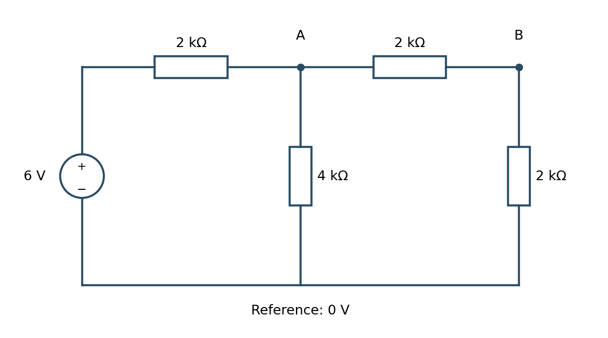

> [!abstract] 한눈에
> KCL로 절점 전압을 구하고 선형 회로의 단자 관계를 등가회로로 바꾼다. 부하의 연결은 측정 전압과 공급전력을 바꾼다. 기준 방향·종속 전원·전력 보존을 함께 확인하면 계산을 검산할 수 있다.

## 절점 전압법

기준 절점을 하나 정하고 나머지 절점 전압을 미지수로 둔다. 각 절점에서 Kirchhoff 전류법칙을 적용한다.

$$
\sum_k \frac{V_i-V_k}{R_{ik}}=I_i
$$

전류 방향을 일관되게 정하면 회로가 커져도 선형 연립방정식으로 정리된다. 전압원이 두 비기준 절점 사이에 있으면 두 절점을 supernode로 묶고 전압 제약식을 추가한다.

## 중첩 원리

선형 회로에서는 독립 전원을 하나씩 켠 응답을 더할 수 있다. 이상 전압원을 끌 때는 단락, 이상 전류원을 끌 때는 개방으로 바꾼다. 종속 전원은 회로의 선형 관계를 구성하므로 끄지 않는다.

전압과 전류는 중첩되지만 전력은 제곱에 비례하므로 각 전원의 전력을 따로 계산해 더할 수 없다.

## Thevenin 등가

두 단자에서 본 선형 회로는 이상 전압원 $V_{th}$와 직렬 저항 $R_{th}$로 바꿀 수 있다.

- $V_{th}$: 단자를 열어 둔 개방회로 전압
- $R_{th}$: 독립 전원을 끈 뒤 단자에서 본 등가저항, 또는 $V_{oc}/I_{sc}$

센서를 Thevenin 등가로 보면 측정기 입력저항이 센서 신호를 얼마나 로딩하는지 계산할 수 있다. 입력저항이 충분히 크지 않으면 측정 자체가 원래 전압을 바꾼다.

## 부호와 소자 규칙

저항 전압 $v$의 양의 단자로 전류 $i$가 들어가도록 잡으면 수동 부호 규약에서 $v=Ri$, $p=vi$다. $p>0$은 흡수, $p<0$은 공급이다. 기준 방향과 실제 방향이 다르면 계산 결과에 음수가 나올 수 있으며, 이를 오류로 지우지 않는다.

이상 전압원은 양단 전압을, 이상 전류원은 가지 전류를 고정한다. 전압원에 흐르는 전류와 전류원 양단의 전압은 주변 회로가 정한다. 이상적인 개방에서는 전류가 0이지만 전압은 0일 필요가 없고, 단락에서는 전압이 0이지만 전류는 0일 필요가 없다.

## KCL 방정식의 구성

각 미지 절점에서 밖으로 나가는 저항 전류를 $(V_i-V_k)/R_{ik}$로 쓰고, 절점에 들어오는 전원 전류를 오른쪽에 둔다. 미지 전압 $n$개면 독립 방정식 $n$개가 필요하다. 두 단자가 같은 전압인지 확인하지 않고 저항을 직렬·병렬로 묶지 않는다.

새 예제에서 절점 A는 6 V 전원에 2 kΩ로 연결되고 접지에 4 kΩ, 절점 B에 2 kΩ로 연결된다. B는 접지에 2 kΩ로 연결된다. 접지 0 V에서

$$
\frac{V_A-6}{2\,\mathrm{k\Omega}}+\frac{V_A}{4\,\mathrm{k\Omega}}+\frac{V_A-V_B}{2\,\mathrm{k\Omega}}=0,
\qquad \frac{V_B-V_A}{2\,\mathrm{k\Omega}}+\frac{V_B}{2\,\mathrm{k\Omega}}=0.
$$

*그림 1. 본문 계산 예의 회로. A=3 V, B=1.5 V가 되도록 회로식을 직접 풀었다.*

두 번째 식은 $V_A=2V_B$다. 첫 식을 정리하면 $5V_A-2V_B=12$이므로 $V_A=3$ V, $V_B=1.5$ V다. A의 유입전류는 1.5 mA이고 접지와 B로 각각 0.75 mA가 나가므로 KCL과 일치한다. 저항의 총소비전력 9 mW도 전원 공급전력 $6\times1.5=9$ mW와 같다.

## Supernode와 종속 전원

전압원이 미지 절점 A와 B 사이에서 $V_A-V_B=V_s$를 강제하면 두 절점을 하나의 supernode로 감싼다. 외부로 나가는 전류에 KCL을 쓰고 전압 제약을 별도 식으로 더한다. 전압원을 저항처럼 $(V_A-V_B)/R$로 표현하지 않는다.

예를 들어 A와 B가 각각 2 kΩ로 접지에 연결되고, A로 1 mA가 들어오며 $V_A-V_B=2$ V이면 $V_A/(2\,\mathrm{k\Omega})+V_B/(2\,\mathrm{k\Omega})=1$ mA다. $V_A+V_B=2$ V와 전압 제약을 풀어 $V_A=2$ V, $V_B=0$ V를 얻는다. 종속 전원은 제어량의 정의까지 함께 방정식에 포함한다.

## 단자 등가의 절차

부하를 분리하고 단자의 +/− 및 부하로 나가는 전류 방향을 정한다. 개방전압을 구해 $V_{th}$로 둔다. 독립 전원을 끄고 단자 저항을 구하되 종속 전원이 있으면 남겨 둔다. 필요한 경우 단자에 시험 전압 $V_t$를 걸고 회로 안으로 들어가는 $I_t$를 계산해 $R_{th}=V_t/I_t$로 구한다.

$V_{oc}/I_{sc}$는 같은 단자와 일관된 기준 방향에서 정의하고, 두 값이 모두 0인 종속 전원 회로에는 0/0을 사용할 수 없다. 능동 회로의 등가저항은 음수가 될 수도 있으므로 수동 저항망의 양수 조건을 모든 선형 회로에 강제하지 않는다.

Norton 등가는 $I_N=V_{th}/R_{th}$인 전류원과 병렬 저항이다. 시간에 따라 변하는 선형 회로에는 주파수별 임피던스나 라플라스 등가를 사용하며, 저항 하나의 DC 등가를 그대로 모든 주파수에 적용하지 않는다.

## 로딩과 최대전력 계산

센서의 개방전압이 $V_{th}=10$ mV, 출력저항이 $R_{th}=100$ kΩ인 새 예에서 측정기 입력저항 $R_L=1$ MΩ이면

$$
V_L=V_{th}\frac{R_L}{R_{th}+R_L}=9.091\,\mathrm{mV}.
$$

개방전압 대비 감소율은 $R_{th}/(R_{th}+R_L)=9.09\%$다. 이를 1% 이하로 만들려면 $R_L\ge99R_{th}=9.9$ MΩ이어야 한다. 버퍼는 이 로딩을 줄일 수 있지만 입력 바이어스·오프셋·공통모드 범위가 남는다.

수동 DC 등가에서 $P_L=V_{th}^2R_L/(R_{th}+R_L)^2$를 $R_L$로 미분하면 최대는 $R_L=R_{th}$다. 이때 부하 전압은 개방전압의 절반이다. 전력 전달 최대 조건을 전압을 덜 교란하는 계측 조건과 혼동하지 않는다.

## 검산 순서

기준 절점과 전류 화살표를 먼저 확인한다. 구한 전압을 모든 KCL에 대입하고, 저항의 소비전력이 음수가 되지 않는지 확인한다. 전원까지 포함한 전력 합은 0이어야 한다. 부하를 개방·단락하는 극한에서도 단자 관계가 맞는지 확인하면 등가회로를 검증할 수 있다.

## 유의점

- 종속 전원을 남겨 두고 시험 전원을 쓰는 조건을 확인한다.
- 전력은 전압·전류처럼 전원별로 단순 중첩하지 않는다.

## 관련 개념

- [[op-amp-circuit-families|연산증폭기]]
- [[first-order-rc-rl|시간상수]]

## 참고 자료

- 개인 학습 기록, Notion `Studies / 2024 Fall / BiS252`, Resistive Circuits, Node Voltage, Thevenin, Superposition
