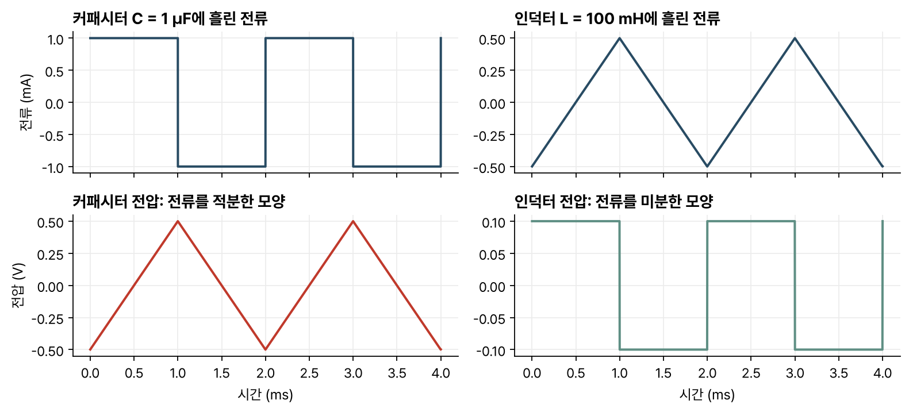

> [!abstract] 한눈에
> 커패시터는 전압에 비례하는 전하를, 인덕터는 전류에 비례하는 자속을 저장한다. 커패시터 전류는 전압의 미분에, 인덕터 전압은 전류의 미분에 비례하므로 유한한 전류·전압의 전환에서는 커패시터 전압과 인덕터 전류가 연속이며, 이 두 값이 회로의 상태가 된다.

## 정의

**커패시터**(capacitor)는 두 도체 사이에 전하를 저장한다. 저장한 전하 $q$는 양단 전압 $v$에 비례하고, 그 비례 상수가 커패시턴스 $C$다(단위 F).

$$
q = Cv, \qquad i = \frac{dq}{dt} = C\frac{dv}{dt}
$$

**인덕터**(inductor)는 코일을 지나는 전류가 만드는 자속을 저장한다. 자속 쇄교 $\lambda$는 전류에 비례하고, 그 비례 상수가 인덕턴스 $L$이다(단위 H).

$$
\lambda = Li, \qquad v = \frac{d\lambda}{dt} = L\frac{di}{dt}
$$

두 식은 전압과 전류의 자리만 바꾼 꼴이다. 이 대칭을 쌍대성(duality)이라 부른다.

## 적분과 미분

커패시터 식을 적분하면 전압이 지금까지 흘러 들어온 전류의 누적으로 정해진다.

$$
v(t) = v(t_0) + \frac{1}{C}\int_{t_0}^{t} i(\tau)\,d\tau
$$

일정한 전류를 넣으면 전압이 직선으로 오르고, 사각파 전류를 넣으면 삼각파 전압이 나온다. 인덕터는 반대로 전류의 기울기가 전압을 정하므로, 삼각파 전류에는 사각파 전압이 걸린다(그림 1).

*그림 1. 왼쪽: 1 µF 커패시터에 ±1 mA 사각파 전류를 넣으면 1 ms마다 1 V씩 오르내리는 삼각파 전압이 된다. 오른쪽: 100 mH 인덕터에 1 ms마다 1 mA씩 오르내리는 삼각파 전류를 흘리면 ±0.1 V 사각파 전압이 걸린다.*

그림 1의 크기는 식으로 확인할 수 있다. 커패시터는 $\Delta v = I\Delta t/C = (1\text{ mA})(1\text{ ms})/(1\,\mu\text{F}) = 1\text{ V}$, 인덕터는 $v = L\,\Delta i/\Delta t = (100\text{ mH})(1\text{ mA}/1\text{ ms}) = 0.1\text{ V}$다.

## 저장 에너지와 연속성

커패시터와 인덕터에 저장된 에너지는 다음과 같다.

$$
w_C = \frac{1}{2}Cv^2, \qquad w_L = \frac{1}{2}Li^2
$$

커패시터 전압이 순간적으로 바뀌려면 $dv/dt$가 무한대여서 전류도 무한대여야 한다. 실제 회로의 전류는 유한하므로 커패시터 전압은 연속이다. 같은 이유로 인덕터 전류도 연속이다. 스위치를 여닫는 순간의 회로를 풀 때 $v_C(0^-) = v_C(0^+)$, $i_L(0^-) = i_L(0^+)$를 쓰는 근거가 이것이다.

반면 커패시터 전류와 인덕터 전압은 갑자기 바뀔 수 있다. 그림 1에서 사각파로 뛰는 쪽이 바로 이 두 값이다.

## 직류에서의 동작

모든 값이 변하지 않는 직류 정상상태에서는 $dv/dt = 0$, $di/dt = 0$이다. 커패시터에는 전류가 흐르지 않아 열린 회로처럼 보이고, 인덕터 양단에는 전압이 걸리지 않아 짧은 도선처럼 보인다. 회로가 충분히 오래 켜져 있었을 때의 최종값을 구할 때 이 성질을 쓴다.

## 직렬과 병렬

| | 직렬 | 병렬 |
|---|---|---|
| 커패시터 | $\dfrac{1}{C_{eq}} = \sum \dfrac{1}{C_k}$ | $C_{eq} = \sum C_k$ |
| 인덕터 | $L_{eq} = \sum L_k$ | $\dfrac{1}{L_{eq}} = \sum \dfrac{1}{L_k}$ |

인덕터는 저항과 같은 규칙을, 커패시터는 그 반대 규칙을 따른다. 병렬 커패시터는 같은 전압에서 전하를 나눠 담으므로 커패시턴스가 더해진다.

## 초기조건을 정하는 순서

스위칭 전 회로가 충분히 오래 DC 상태였다는 조건이 있으면 $0^-$에서 커패시터는 개방, 이상 인덕터는 단락으로 놓는다. 그 회로에서 $v_C(0^-)$와 $i_L(0^-)$를 계산한다. 유한한 전압·전류의 일반적인 전환에서는 이 두 상태를 $0^+$로 옮기고, 전환 후 회로에서 나머지 전류와 전압을 다시 구한다. '오랫동안'이라는 조건이 없으면 초기값을 0으로 임의 설정하지 않는다.

전환 직후 커패시터를 초기전압의 전압원, 인덕터를 초기전류의 전류원처럼 사용하면 다른 가지의 순간값을 계산할 수 있다. 이는 $0^+$ 순간의 상태 조건 표현이며 모든 시간의 대체회로는 아니다.

## 펄스 입력과 연속성의 조건

커패시터 식을 스위칭 시각 주변에서 적분하면 $v_C(0^+)-v_C(0^-)=C^{-1}\int_{0^-}^{0^+}i(t)dt$다. 전류가 유한하면 적분이 0이어서 전압이 연속이다.

이상적인 전류 임펄스가 유한한 전하를 전달하면 전압 점프가 가능하다. 마찬가지로 전압 임펄스는 인덕터 전류의 순간 변화를 만들 수 있다. 이상적인 서로 다른 전압원을 커패시터에 즉시 연결하는 모형은 이 예외를 검토해야 한다.

## 에너지 계산 예

새 예에서 $C=2\,\mu$F, $v_C=3$ V이면 $q=Cv=6\,\mu$C, $w_C=Cv^2/2=9\,\mu$J다. 같은 커패시터의 전압을 두 배로 하면 전하는 두 배, 에너지는 네 배다. $L=10$ mH, $i_L=20$ mA이면 $w_L=Li^2/2=2\,\mu$J다. mA를 A로 바꾸지 않고 제곱하면 에너지 단위가 크게 틀어진다.

에너지 식은 수동 부호 규약의 $p=vi$를 적분해 복원할 수 있다. 커패시터는 $\int vi\,dt=\int Cv\,dv=Cv^2/2$, 인덕터는 $\int Li\,di=Li^2/2$다.

## 결합과 비이상성

직·병렬 등가식은 실제로 같은 전류 또는 같은 전압을 공유하는 연결에서 적용한다. 인덕터의 단순 등가식은 상호인덕턴스가 무시되는 경우다. 자기적으로 결합한 코일은 $M$과 dot convention을 포함해야 하며 단순히 $L_1+L_2$로 더하지 않는다. 실제 커패시터의 ESR·누설, 실제 인덕터의 도선저항·기생용량은 주파수와 손실을 바꾼다.

## 유의점

- 임펄스가 없는 전환에서는 커패시터 전압과 인덕터 전류가 연속이다. 커패시터 전류와 인덕터 전압은 스위칭 순간에 불연속일 수 있으므로, $0^-$의 값을 $0^+$로 그대로 옮겨 쓸 수 없다. $0^+$에서는 연속인 두 값으로 회로를 다시 풀어 구한다.
- 직류에서 커패시터를 열린 회로, 인덕터를 도선으로 보는 것은 정상상태에서만 맞다. 스위칭 직후의 과도 구간에는 쓸 수 없다.
- 이상적인 인덕터는 전력을 소모하지 않지만 실제 코일에는 도선 저항이 있다. 그래서 실제 인덕터는 직류에서도 작은 저항으로 보인다.
- 커패시터에 큰 전압이 남아 있으면 회로를 끈 뒤에도 에너지가 남는다. $\frac{1}{2}Cv^2$은 전원을 내린 뒤에도 그대로다.

## 관련 개념

- [[first-order-rc-rl|RC·RL 1차 회로]]: 저장 소자 하나와 저항이 만드는 과도응답과 필터
- [[thevenin-node-analysis|절점해석과 Thevenin 등가]]: 1차 회로를 풀 때 저장 소자 바깥을 Thevenin 등가로 줄인다
- [[difference-equations-feedback|차분방정식과 피드백]]: 상태를 가진 시스템의 이산시간 대응

## 참고 자료

- C. K. Alexander, M. N. O. Sadiku, *Fundamentals of Electric Circuits*, McGraw-Hill, 커패시터와 인덕터 장
- 개인 학습 기록, Notion `Studies / 2024 Spring / EE201 회로이론`
