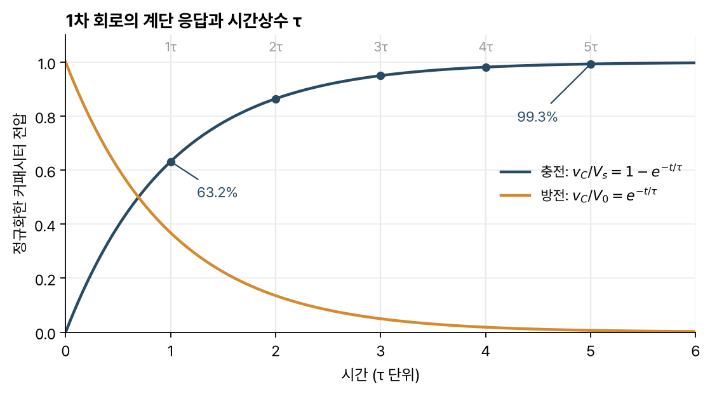
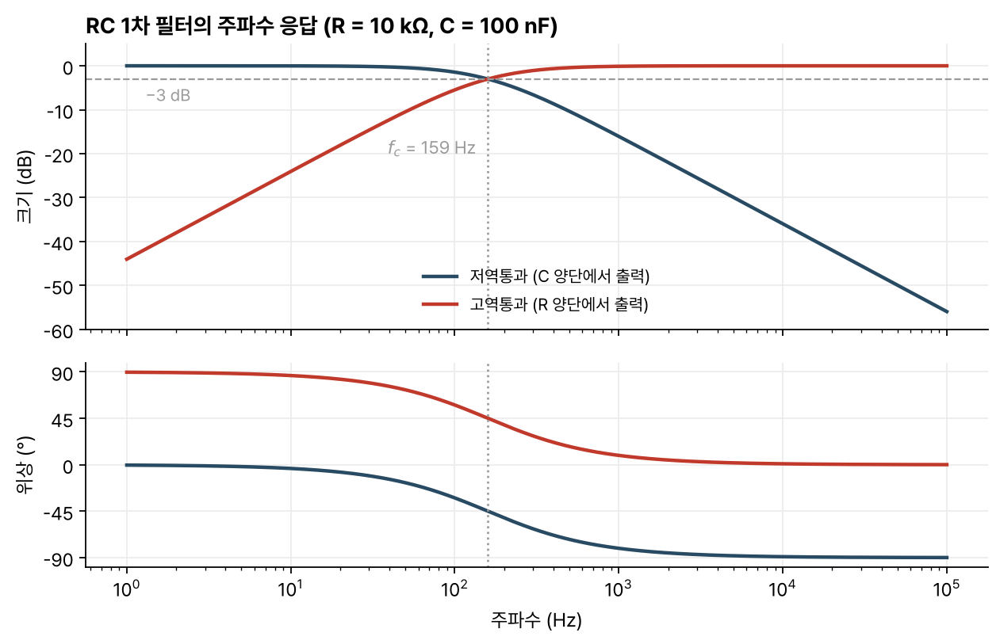

> [!abstract] 한눈에
> 커패시터나 인덕터 하나와 저항으로 된 회로는 1차 미분방정식을 따른다. 입력이 갑자기 바뀌면 출력은 지수함수로 새 값에 다가가고, 그 빠르기는 시간상수 $\tau = RC$ 또는 $\tau = L/R$가 정한다. 같은 회로를 정현파로 보면 차단주파수 $f_c = 1/(2\pi\tau)$를 가진 1차 필터다.

## 정의

저항 $R$과 커패시터 $C$를 직렬로 잇고 전압 $V_s$를 걸면, 커패시터 전압 $v_C$는 KVL과 $i = C\,dv_C/dt$에서

$$
RC\frac{dv_C}{dt} + v_C = V_s
$$

를 따른다. 미분이 한 번만 들어가므로 1차 회로라 한다. 저항 $R$과 인덕터 $L$로 된 회로도 인덕터 전류에 대해 같은 꼴이 된다.

$$
\frac{L}{R}\frac{di_L}{dt} + i_L = \frac{V_s}{R}
$$

## 계단 응답과 시간상수

$t = 0$에 입력이 바뀌고 그 뒤로 일정하면 해는 다음 꼴이다.

$$
x(t) = x(\infty) + \big[x(0^+) - x(\infty)\big]\,e^{-t/\tau}, \qquad \tau = RC \;\text{또는}\; \tau = \frac{L}{R}
$$

여기서 $x$는 커패시터 전압이나 인덕터 전류다. 초기값 $x(0^+)$는 [[capacitors-inductors|연속성]]으로, 최종값 $x(\infty)$는 직류 정상상태(커패시터는 열린 회로, 인덕터는 도선)로 구한다. 1차 회로의 과도응답은 이 두 값과 $\tau$로 정해진다.

*그림 1. 충전 곡선은 $\tau$에서 최종값의 63.2%, $5\tau$에서 99.3%에 이른다. 방전 곡선은 같은 비율로 줄어든다.*

몇 가지 숫자를 기억해 두면 편하다.

- $t = \tau$에서 $1 - e^{-1} \approx 63.2\%$, $t = 5\tau$에서 $99.3\%$에 이른다. 실무에서는 $5\tau$를 지나면 정상상태로 본다.
- 10%에서 90%까지 오르는 상승 시간은 $\tau\ln 9 \approx 2.2\tau$다.
- 시작점에서 그은 접선은 $t = \tau$에서 최종값과 만난다.

저항이 여러 개인 회로라도 저장 소자가 하나면 1차 회로다. 이때 $\tau$의 $R$은 저장 소자 양단에서 본 [[thevenin-node-analysis|Thevenin 등가 저항]]이다.

## 주파수 영역에서 본 같은 회로

입력이 정현파 $e^{j\omega t}$일 때 커패시터의 임피던스는 $1/(j\omega C)$다. RC 직렬 회로에서 커패시터 양단을 출력으로 잡으면 전달함수는

$$
H_{LP}(j\omega) = \frac{1}{1 + j\omega RC}
$$

이고, 저항 양단을 출력으로 잡으면

$$
H_{HP}(j\omega) = \frac{j\omega RC}{1 + j\omega RC}
$$

이다. 앞의 것이 저역통과, 뒤의 것이 고역통과다. 두 필터 모두 $\omega RC = 1$, 곧

$$
f_c = \frac{1}{2\pi RC}
$$

에서 크기가 $1/\sqrt{2}$(약 $-3$ dB)이고 위상이 45° 어긋난다. 차단주파수에서 멀어지면 크기는 주파수 10배마다 20 dB씩 변한다(그림 2).

*그림 2. $R$ = 10 kΩ, $C$ = 100 nF이면 $\tau$ = 1 ms, $f_c \approx$ 159 Hz다. 위는 크기, 아래는 위상이다.*

시간 영역과 주파수 영역의 숫자는 $\tau$ 하나로 이어진다. 저역통과 필터의 상승 시간 $2.2\tau$를 $f_c$로 쓰면 $t_r \approx 2.2/(2\pi f_c) \approx 0.35/f_c$다. 대역폭이 넓은 필터일수록 계단 입력을 빨리 따라간다.

## 생체신호 계측에서

- 전극의 직류 오프셋을 걷어 내는 데 고역통과 RC를 쓴다. 차단주파수를 너무 높이면 심전도의 느린 성분까지 깎여 파형이 바뀐다.
- ADC 앞에는 저역통과 필터를 둬서 나이퀴스트 주파수 위 성분이 [[sampling-aliasing|앨리어싱]]으로 접혀 들어오지 않게 한다. 1차 필터는 주파수 10배마다 20 dB밖에 줄이지 못하므로, 샘플링 주파수에 여유가 없으면 더 높은 차수가 필요하다.

## 유의점

- 시간상수의 $R$은 회로에 있는 아무 저항이 아니라, 저장 소자에서 본 등가 저항이다. 전원을 끄고(전압원은 단락, 전류원은 개방) 구한다.
- $5\tau$가 지나도 값은 최종값의 99.3%다. 지수 응답은 이론상 최종값에 정확히 닿지 않는다.
- $-3$ dB 지점은 신호가 통과와 차단으로 갈리는 경계가 아니다. $f_c$에서도 크기의 약 71%가 지나가고, 저역통과 필터에서는 $f_c$보다 낮은 주파수도 위상이 이미 늦어진다.
- 수동 RC 필터 뒤에 부하를 달면 부하 저항이 회로에 더해져 $f_c$와 이득이 바뀐다. 부하 영향을 막으려면 버퍼를 둔다.

## 관련 개념

- [[capacitors-inductors|커패시터와 인덕터]]: 1차 회로의 상태가 되는 두 값과 그 연속성
- [[difference-amplifier-cmrr|차동 증폭기와 CMRR]]: 필터 앞단에서 공통모드 간섭을 줄이는 회로
- [[sampling-aliasing|샘플링과 앨리어싱]]: 저역통과 필터가 ADC 앞에 필요한 이유
- [[difference-equations-feedback|차분방정식과 피드백]]: 1차 회로의 이산시간 대응($y[n] = a\,y[n-1] + x[n]$)

## 참고 자료

- C. K. Alexander, M. N. O. Sadiku, *Fundamentals of Electric Circuits*, McGraw-Hill, 1차 회로와 주파수 응답 장
- 개인 학습 기록, Notion `Studies / 2024 Spring / EE201 회로이론`, `Studies / 2024 Fall / BiS252` RC/RL 단원
