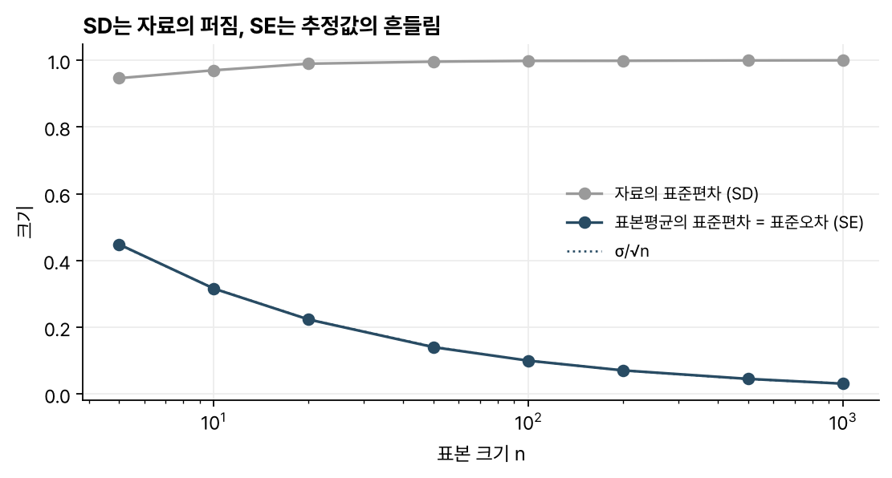
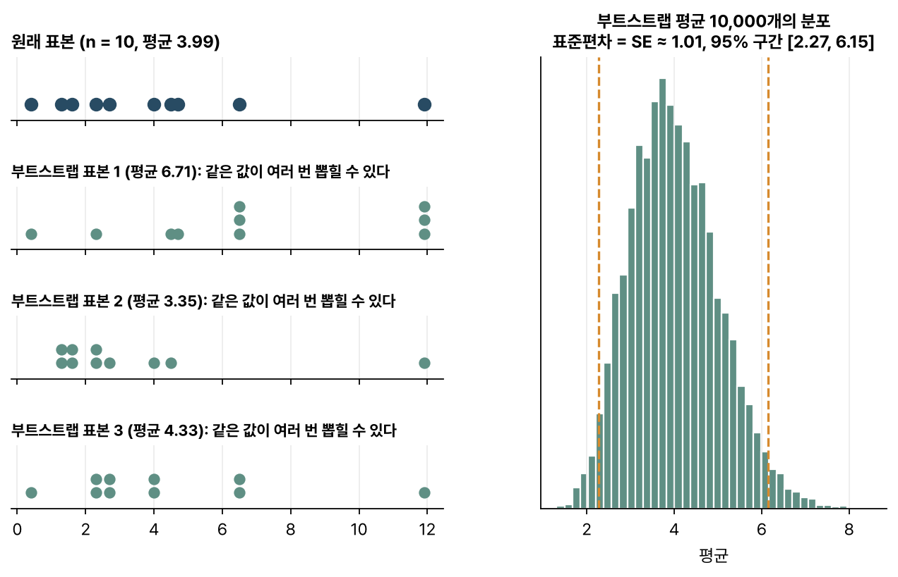
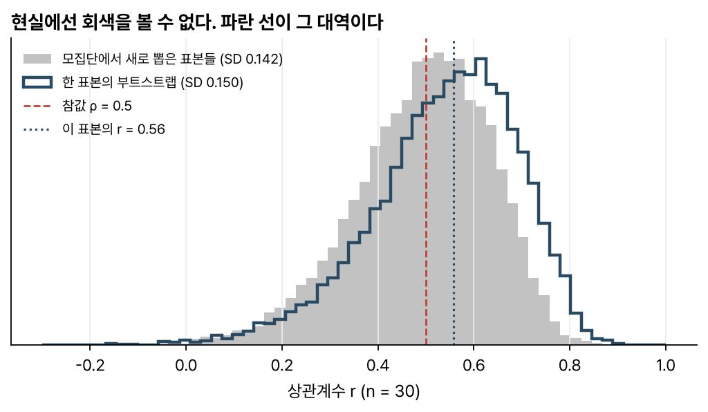

> [!abstract] 한눈에
> **표준편차(SD)** 는 자료 자체가 얼마나 퍼졌는지, **표준오차(SE)** 는 표본을 새로 뽑을 때마다 추정값(평균, 상관계수 등)이 얼마나 흔들릴지를 잰다. 평균의 SE는 $\sigma/\sqrt{n}$이라는 공식이 있지만, 중앙값이나 상관계수처럼 공식이 복잡한 추정값도 많다. **부트스트랩**은 가진 표본에서 복원추출로 표본을 다시 만들어 그 흔들림을 직접 잰다.

## 표준편차와 표준오차

두 값은 계산 모양이 비슷해서 자주 헷갈리지만 묻는 것이 다르다.

| | 표준편차 (SD) | 표준오차 (SE) |
|---|---|---|
| 무엇의 퍼짐인가 | 관측값 하나하나 | 추정값 (예: 표본평균) |
| 표본을 키우면 | 그대로 (모집단의 $\sigma$에 가까워짐) | 줄어듦 |
| 평균의 경우 | $s$ | $s/\sqrt{n}$ |

표본평균의 분산은 $\sigma^2/n$이므로 SE는 $\sigma/\sqrt{n}$이다. 표본을 4배 늘려야 SE가 반으로 준다(그림 1).

*그림 1. 표준정규분포에서 뽑은 표본. 자료의 SD는 1 근처에 머물고, 표본평균의 SE는 $1/\sqrt{n}$을 따라 줄어든다.*

## 문제: 표본은 하나뿐이다

SE를 직접 재려면 모집단에서 표본을 여러 번 새로 뽑아 추정값을 계산하고 그 퍼짐을 보면 된다. 하지만 현실에는 표본이 하나뿐이다. 평균처럼 공식이 있으면 다행이지만, 상관계수, 중앙값, 두 집단 차이의 비율 같은 추정값은 공식이 복잡하거나 강한 분포 가정이 필요하다.

## 부트스트랩: 표본을 모집단 대신 쓴다

브래들리 에프런(Bradley Efron)이 1979년에 제안한 생각은 단순하다. 모집단을 모르니 **가진 표본을 모집단의 대역**으로 쓴다.

1. 크기 $n$인 원래 표본에서 **복원추출**로 $n$개를 뽑는다. 같은 값이 여러 번 뽑힐 수 있고, 한 번도 안 뽑히는 값도 있다. 이것이 부트스트랩 표본 하나다.
2. 부트스트랩 표본으로 추정값(예: 평균)을 계산한다.
3. 1–2를 $B$번(보통 수천 번) 되풀이한다.
4. $B$개 추정값의 표준편차가 SE의 추정치다. 가운데 95%를 잘라 신뢰구간으로 쓸 수 있다(백분위수 구간).

*그림 2. 왼쪽: 원래 표본 10개와, 거기서 복원추출한 부트스트랩 표본 3개. 오른쪽: 부트스트랩 평균 1만 개의 분포. 그 표준편차가 SE의 추정치다.*

## 정말 맞는가: 상관계수의 예

그림 3은 참 상관이 0.5인 모집단에서 30개씩 표본을 뽑는 상황이다. 회색은 모집단에서 표본을 1만 번 새로 뽑아 얻은 상관계수의 진짜 분포다. 현실에서는 볼 수 없는 분포다. 파란 선은 표본 **하나**만 가지고 부트스트랩으로 만든 분포다. 중심은 그 표본의 $r$ 쪽으로 치우쳐 있지만, **퍼짐**(곧 SE)은 회색과 꽤 비슷하다. 부트스트랩이 대신 재 주는 것이 바로 이 퍼짐이다.

*그림 3. 회색: 새 표본 1만 개의 상관계수. 파란 선: 표본 하나의 부트스트랩. 퍼짐이 비슷하다.*

## 자주 하는 오해

- **"부트스트랩은 데이터를 늘려 준다."** 새 정보는 하나도 생기지 않는다. 가진 표본이 모집단을 얼마나 닮았느냐에 모든 것이 달려 있고, 표본이 작거나 치우쳤다면 부트스트랩도 그만큼 틀린다.
- **"아무 단위로나 복원추출하면 된다."** 복원추출의 단위는 **서로 독립인 단위**여야 한다. 한 사람에게서 시행을 여러 번 쟀다면 시행이 아니라 사람을 뽑아야 한다. 서로 얽힌 측정값을 독립인 것처럼 섞으면 SE가 실제보다 작게 나오고, 신뢰구간이 지나치게 좁아진다.
- **"SE와 SD는 바꿔 써도 된다."** 그림의 오차막대가 SD인지 SE인지에 따라 뜻이 완전히 달라진다. SE는 표본이 크면 얼마든지 작아진다.
- **"백분위수 구간은 언제나 정확하다."** 추정값이 치우쳐 있거나 분포가 비대칭이면 보정한 방법(BCa 등)이 더 낫다. 최댓값처럼 부트스트랩이 잘 맞지 않는 추정값도 있다.

## 관련 개념

- [[p-value|p-value]]: 부트스트랩 구간이 0을 포함하는지로도 검정의 결론을 읽을 수 있다
- [[pearson-spearman|피어슨과 스피어먼 상관]]: 그림 3에서 SE를 잰 추정값
- [[multiple-comparisons-fdr|다중비교와 FDR]]: 부트스트랩을 1,000번 하는 것과 검정을 1,000번 하는 것은 다른 문제다

## 참고 자료

- MIT OCW, [18.05 Introduction to Probability and Statistics (Spring 2022)](https://ocw.mit.edu/courses/18-05-introduction-to-probability-and-statistics-spring-2022/), 부트스트랩 신뢰구간 단원
- B. Efron, "Bootstrap methods: another look at the jackknife," *The Annals of Statistics* 7(1), 1–26 (1979)
- B. Efron, R. J. Tibshirani, *An Introduction to the Bootstrap*, Chapman & Hall (1993)
