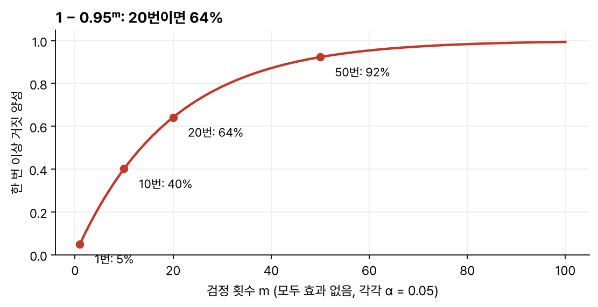
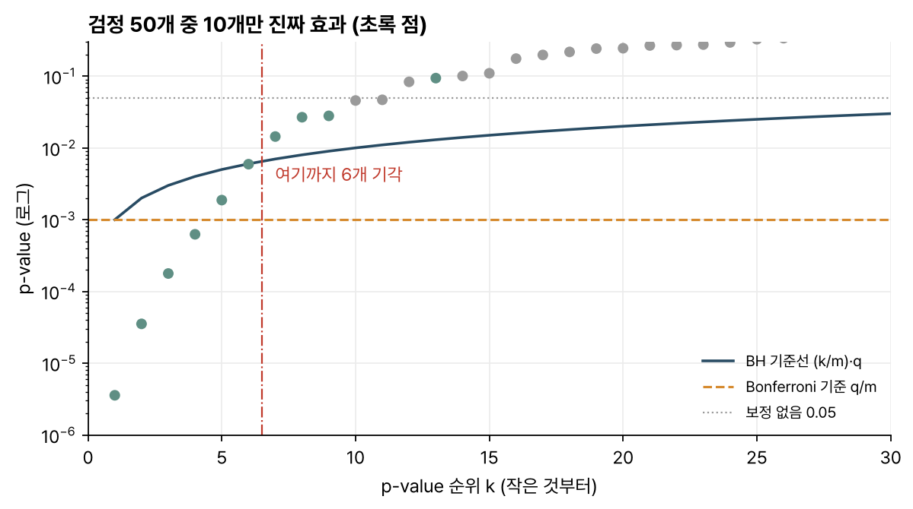
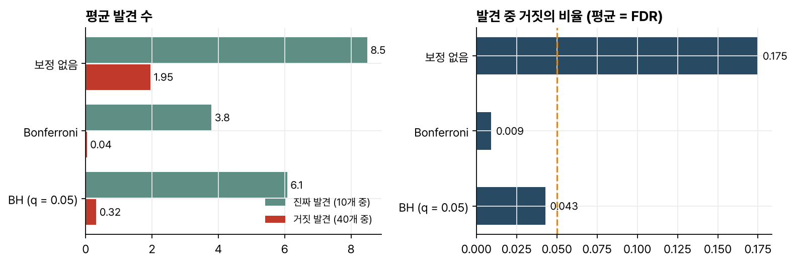

> [!abstract] 한눈에
> 효과가 없는 검정을 20번 하면 각각 유의수준이 0.05여도 한 번 이상 '유의'가 나올 확률은 64%다. 어떻게 막을지는 무엇을 통제하느냐에 달렸다. **Bonferroni**는 거짓 양성이 하나라도 나올 확률(FWER)을 묶는다. **Benjamini–Hochberg(BH)** 는 발견한 것 가운데 거짓이 차지하는 비율의 기댓값(FDR)을 묶는데, 더 많이 발견하는 대신 그중 일부가 틀릴 수 있음을 받아들인다.

## 검정이 많을 때

검정 하나를 유의수준 $\alpha = 0.05$로 하면 효과가 없을 때 '유의'로 잘못 판정할 확률이 5%다. 서로 독립인 검정을 $m$번 하면 한 번 이상 잘못 판정할 확률은

$$
1 - (1 - \alpha)^m
$$

이다. 10번이면 40%, 20번이면 64%, 50번이면 92%다(그림 1). 뇌파 채널 수십 개, 주파수 대역 여러 개, 지표 여러 개를 각각 검정하면 '유의한' 결과가 몇 개쯤 나오는 것이 보통이다.

_그림 1. 모든 검정에 효과가 없을 때 거짓 양성이 한 번 이상 나올 확률._

## FWER와 FDR

검정 $m$개 가운데 기각한 것(발견)을 $R$개, 그중 실제로는 효과가 없던 것(거짓 발견)을 $V$개라 하자.

- **FWER**(family-wise error rate) $= P(V \ge 1)$: 거짓 발견이 하나라도 있을 확률
- **FDR**(false discovery rate) $= E\!\left[\, V / R \,\right]$ ($R = 0$이면 $V/R$을 0으로 둔다): 발견들 가운데 거짓의 비율의 기댓값

FWER 통제는 발견 목록 전체가 다 맞을 확률을 보장하고 FDR 통제는 목록의 평균적인 순도를 보장한다.

## Bonferroni 보정

각 검정을 $\alpha/m$으로 판정하면 검정 사이의 의존 관계와 상관없이 FWER가 $\alpha$ 이하가 된다. 가장 단순한 방법이지만 $m$이 커지면 기준이 아주 엄격해져서 진짜 효과도 많이 놓친다.

## Benjamini–Hochberg 절차

벤야미니(Benjamini)와 호흐베르크(Hochberg)가 1995년에 제안했다. 목표 FDR은 $q$(예: 0.05)로 둔다.

1. p-value $m$개를 작은 것부터 정렬한다: $p_{(1)} \le p_{(2)} \le \dots \le p_{(m)}$.
2. $p_{(k)} \le \dfrac{k}{m}\, q$를 만족하는 가장 큰 $k$를 찾는다.
3. $p_{(1)}, \dots, p_{(k)}$에 해당하는 가설을 모두 기각한다.

그림으로 그리면 정렬한 p-value를 기울기가 $q/m$인 직선과 견주는 모양이 된다(그림 2). Bonferroni라면 이 직선 대신 높이 $q/m$의 수평선 하나를 쓴다. 두 기준은 첫 번째 칸에서만 같고 순위가 올라갈수록 BH 기준이 느슨해진다.

_그림 2. 검정 50개 중 10개만 진짜 효과(초록)인 시뮬레이션. 파란 BH 선 아래 마지막 점까지 기각한다. Bonferroni(주황 점선)는 같은 자료에서 더 적게 기각한다._

2단계는 조건을 만족하는 $k$ 가운데 가장 큰 값을 고른다. 중간에 선 위로 올라간 점이 있더라도 그보다 뒤에 선 아래 점이 있으면 거기까지 모두 기각한다.

검정들이 서로 독립이거나 특정한 양의 의존 관계(PRDS)에 있으면 BH는 FDR을 $q \cdot m_0/m$ 이하로 지킨다($m_0$은 실제로 효과가 없는 검정의 수). 의존 구조를 모르면 더 보수적인 Benjamini–Yekutieli 절차를 쓴다.

## 세 방법 비교

그림 2와 같은 상황(검정 50개 중 진짜 효과 10개)을 1,000번 반복해 평균을 냈다.

_그림 3. 보정하지 않으면 발견이 많은 대신 약 17%가 거짓이다. Bonferroni는 거짓이 거의 없지만 진짜 효과도 절반 넘게 놓친다. BH는 그 중간에서 거짓 비율을 0.05 아래로 유지한다._

## 유의점

- FDR을 0.05로 통제해도 이번 발견 중 정확히 5%가 거짓이라고 볼 수는 없다. FDR은 기댓값이라서 한 번의 연구에서는 거짓 비율이 0일 수도 20%일 수도 있다.
- FDR 0.05를 각 발견이 거짓일 확률 5%로 읽으면 안 된다. FDR은 목록 전체의 평균 순도를 보장하는 값이고 발견 하나하나의 확률과는 다르다. 기준선 근처에서 겨우 통과한 발견은 더 의심스럽다.
- Bonferroni는 보수적이지만 틀린 방법은 아니다. BH와 다른 것을 지킬 뿐이고, 하나라도 틀리면 안 되는 상황(예: 확증 임상시험)에서는 FWER이 맞는 기준이다.
- 부트스트랩 반복 횟수는 다중비교 보정의 대상이 아니다. 부트스트랩 반복은 추정값 하나의 불확실성을 재는 계산이라서 가설 1,000개를 검정하는 일과 다르다. 다중비교는 서로 다른 질문(지표, 채널, 주파수 대역 등)을 여러 개 검정할 때 생기는 문제다.
- 보정할 때는 검정 개수만 세서는 안 된다. 무엇을 한 묶음(family)으로 볼지는 연구 질문에 따라 정한다. 결과를 본 뒤에 묶음을 정하면 보정이 의미를 잃는다.

## 관련 개념

- [[p-value|p-value]]: 보정의 재료
- [[bootstrap|부트스트랩과 표준오차]]: 다중비교와 헷갈리기 쉬운 '반복 계산'

## 참고 자료

- Y. Benjamini, Y. Hochberg, "Controlling the false discovery rate: a practical and powerful approach to multiple testing," _Journal of the Royal Statistical Society: Series B_ 57(1), 289–300 (1995)
- Y. Benjamini, D. Yekutieli, "The control of the false discovery rate in multiple testing under dependency," _The Annals of Statistics_ 29(4), 1165–1188 (2001)
- MIT OCW, [18.05 Introduction to Probability and Statistics (Spring 2022)](https://ocw.mit.edu/courses/18-05-introduction-to-probability-and-statistics-spring-2022/), 유의성 검정 단원
