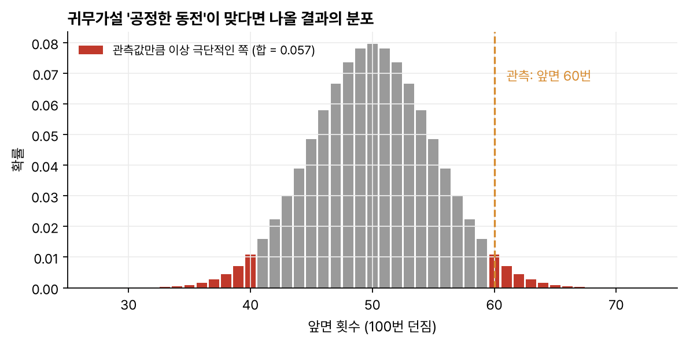
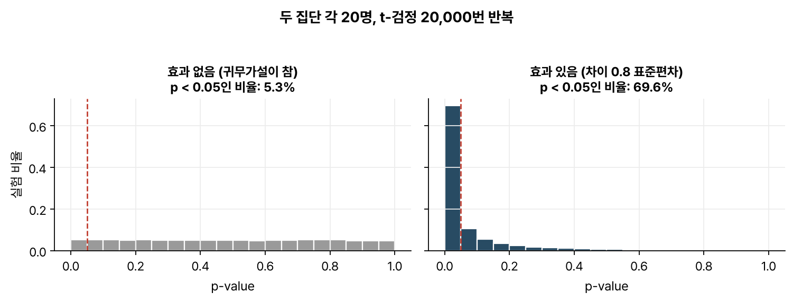
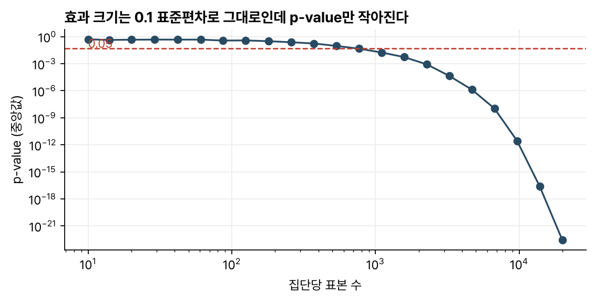

> [!abstract] 한눈에
> p-value는 귀무가설이 참이라고 가정할 때 지금 본 결과만큼, 또는 그보다 더 극단적인 결과가 나올 확률이다. 값이 작을수록 데이터가 "효과가 없다"는 가정과 잘 안 맞는다. 이 값은 귀무가설이 참일 확률도, 효과의 크기도 아니다. 효과가 아주 작아도 표본을 키우면 p-value는 얼마든지 작아질 수 있다.

## 정의

가설검정은 두 가설을 세우면서 시작한다. **귀무가설** $H_0$은 "효과가 없다", "차이가 없다" 같은 기본 가정이고 그 반대가 **대립가설** $H_1$이다. 데이터로 검정통계량 $T$를 계산해 관측값을 $t_{\text{obs}}$로 두면 p-value는 다음과 같다.

$$
p = P\big(\,T \text{가 } t_{\text{obs}} \text{만큼 또는 더 극단적} \;\big|\; H_0\,\big)
$$

'더 극단적'을 한쪽 방향으로만 볼지 양쪽으로 볼지는 대립가설이 정한다. 차이의 방향을 미리 정하지 않았으면 양쪽을 다 센다(양측검정).

## 동전 던지기 예

동전을 100번 던져 앞면이 60번 나왔고, 이 동전이 공정한지 의심스럽다. 귀무가설은 "앞면이 나올 확률은 0.5"다. 이 가정 아래서 100번 중 앞면 개수는 이항분포 $\text{Bin}(100, 0.5)$를 따른다. 관측값 60은 기댓값 50과 10 차이가 나므로, 양쪽으로 10 이상 떨어진 결과(60 이상 또는 40 이하)의 확률을 더한다.

$$
p = P(X \ge 60) + P(X \le 40) \approx 0.028 + 0.028 = 0.057
$$

_그림 1. 공정한 동전이라면 앞면 개수는 회색 막대처럼 분포한다. 60 이상과 40 이하에 해당하는 빨간 막대를 모두 더한 값이 p-value다._

유의수준을 0.05로 정했다면 0.057은 그보다 커서 귀무가설을 기각하지 못한다. 60번이면 꽤 치우쳐 보여도 공정한 동전에서 스무 번에 한 번 남짓은 이만큼 치우친다.

## p-value의 분포

귀무가설이 실제로 참이면 p-value는 0과 1 사이에 고르게 퍼진다. 효과가 전혀 없는 실험을 반복해도 약 5%에서 p < 0.05가 나온다. 유의수준 0.05로 검정하면 효과가 없는데 있다고 할 확률(1종 오류)이 5%로 묶인다.

_그림 2. 집단당 20명씩 두 집단을 t-검정하는 실험을 2만 번 반복했다. 효과가 없으면 p-value가 고르게 퍼지고(왼쪽) 효과가 있으면 0 근처로 몰린다(오른쪽)._

효과가 있을 때 p < 0.05가 나오는 비율을 **검정력**이라 한다. 그림 2 오른쪽은 차이가 표준편차의 0.8배, 집단당 20명인 경우로 검정력이 약 70%이니 진짜 효과가 있어도 열 번에 세 번은 놓친다.

## p-value와 효과 크기

p-value에는 효과의 크기와 표본의 크기가 함께 섞여 있다. 그림 3은 효과 크기를 표준편차의 0.1배로 고정한 채 표본만 늘린 결과다. 집단당 수십 명에서는 p-value가 큰 편이지만 수천 명이 되면 0.05보다 한참 작아져, 효과는 그대로인데 '유의'한 결과가 된다.

_그림 3. 효과는 0.1 표준편차로 고정했다. 표본이 늘면 p-value만 계속 작아진다._

"얼마나 확실한가"와 "얼마나 큰가"는 다른 질문이므로 결과를 보고할 때는 p-value와 함께 효과 크기와 그 신뢰구간을 적는 편이 좋다.

## 유의점

- p = 0.03을 귀무가설이 참일 확률 3%로 읽으면 안 된다. p-value는 귀무가설이 참이라고 가정하고 계산한 데이터의 확률이다. 가설이 참일 확률을 따지려면 사전확률이 필요한 베이즈 추론으로 넘어가야 한다.
- p = 0.03을 결과가 우연일 확률 3%로 읽는 것도 위와 같은 잘못을 달리 표현한 것이다. 미국통계학회(ASA)는 2016년에 p-value 성명을 따로 내 이런 해석을 경계했다.
- p > 0.05는 효과를 확인하지 못했다는 결과다. 효과가 없다는 증거로 읽으면 안 된다. 표본이 작으면 진짜 효과도 놓친다(그림 2 오른쪽의 30%).
- p-value의 크기로 효과의 크기를 판단할 수 없다. 표본이 크면 작은 효과도 아주 작은 p-value를 낸다(그림 3).
- 0.05는 관례로 정한 경계다. 0.049와 0.051은 사실상 같은 증거다.
- 검정을 여러 번 하고 작은 p-value만 보고하면 안 된다. 검정을 많이 하면 우연히 작은 p-value가 나오기 쉬우므로 [[multiple-comparisons-fdr|다중비교]] 보정이 필요하다.

## 관련 개념

- [[bootstrap|부트스트랩과 표준오차]]: 분포를 가정하지 않고 추정값의 불확실성을 재는 방법
- [[multiple-comparisons-fdr|다중비교와 FDR]]: 검정이 여러 개일 때 p-value를 읽는 법
- [[pearson-spearman|피어슨과 스피어먼 상관]]: 상관계수에도 p-value를 붙이지만 상관의 크기와는 별개 문제다

## 참고 자료

- MIT OCW, [18.05 Introduction to Probability and Statistics (Spring 2022)](https://ocw.mit.edu/courses/18-05-introduction-to-probability-and-statistics-spring-2022/), 귀무가설 유의성 검정(NHST) 단원
- R. L. Wasserstein, N. A. Lazar, "The ASA statement on p-values: context, process, and purpose," _The American Statistician_ 70(2), 129–133 (2016)
