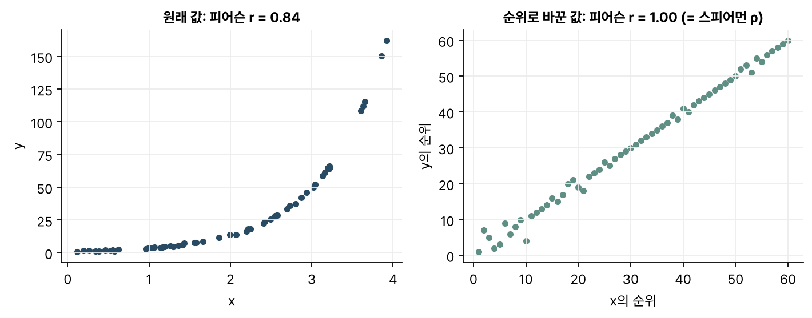
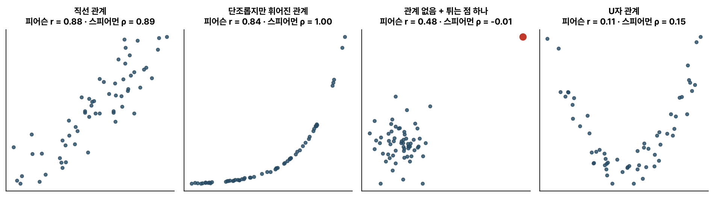

> [!abstract] 한눈에
> **피어슨 상관** $r$은 두 변수가 함께 움직이는 모양이 직선에 얼마나 가까운지를 잰다. **스피어먼 상관** $\rho$는 값을 순위로 바꾼 다음 피어슨 상관을 계산하는데, 직선이 아니어도 한쪽이 커질 때 다른 쪽도 단조롭게 커지는지를 본다. 튀는 값에는 스피어먼이 덜 흔들린다. 둘 다 0이 나와도 관계가 없다고 볼 수는 없다.

## 피어슨 상관

두 변수 $x, y$의 공분산을 각자의 표준편차로 나눈 값이다.

$$
r = \frac{\sum_i (x_i - \bar{x})(y_i - \bar{y})}{\sqrt{\sum_i (x_i - \bar{x})^2}\, \sqrt{\sum_i (y_i - \bar{y})^2}}
$$

단위가 사라지므로 값은 $-1$에서 $1$ 사이에 있다. $\pm 1$이면 점들이 정확히 한 직선 위에 놓이고, 부호는 그 직선의 기울기 방향을 나타낸다. 기하적으로는 두 변수에서 각자의 평균을 뺀 벡터 사이 각도의 코사인과 같다.

## 스피어먼 상관

각 변수의 값을 크기 순위(1등, 2등, …)로 바꾼 뒤 피어슨 상관을 계산한다. 순위로 바꾸면 '얼마나 큰가'는 사라지고 '몇 번째인가'만 남기 때문에, 관계가 휘어져 있어도 한쪽이 커질 때 다른 쪽도 늘 커지기만 하면(단조 증가) $\rho = 1$이 된다(그림 1).

_그림 1. 지수 함수 모양의 관계. 원래 값으로 구한 피어슨 $r$은 1보다 작다. 순위로 바꾸면 점들이 거의 일직선으로 늘어서서 스피어먼 $\rho$는 1에 가깝다._

동점이 없을 때는 순위 차이 $d_i$만으로 계산하는 간단한 공식도 있다.

$$
\rho = 1 - \frac{6 \sum_i d_i^2}{n(n^2 - 1)}
$$

## 네 가지 경우 비교

_그림 2. 각 60개 점. 직선 관계에서는 두 값이 비슷하고, 휘어진 단조 관계에서는 $\rho$가 더 크다. 튀는 점(빨강) 하나가 $r$은 크게 끌어올리지만 $\rho$는 거의 움직이지 않는다. U자 관계에서는 둘 다 0에 가깝다._

- **직선 관계**: 두 값이 거의 같다.
- **단조롭지만 휘어진 관계**: $\rho$는 1에 가깝고 $r$은 그보다 작다. 관계의 모양보다 방향이 일관된지를 보려면 스피어먼이 맞다.
- **튀는 값**: 관계가 없는 점들에 극단적인 점 하나를 더했더니 $r$이 0.48로 뛰었다. 피어슨은 거리를 제곱해 쓰므로 멀리 떨어진 점 하나가 값을 크게 좌우한다. 순위로 바꾸면 그 점에는 1등이라는 순위만 남는다.
- **U자 관계**: 관계가 분명히 있는데도 둘 다 0 근처다. 두 상관 모두 한쪽으로 쭉 함께 움직이는 관계만 잡기 때문이다.

## 고르는 기준

- 관계가 직선에 가깝고 극단값이 없으면 피어슨을 쓰면 된다. 정규분포를 가정한 검정과 신뢰구간 공식도 잘 갖춰져 있다.
- 관계가 휘었거나 극단값이 있을 때, 또는 등급·순위처럼 값 자체보다 순서에 의미가 있는 자료라면 스피어먼이 낫다.
- 어느 쪽을 쓰든 먼저 산점도를 그려 보는 것이 가장 좋다.

## 자주 하는 오해

- **"상관이 0이면 두 변수는 관계가 없다(독립이다)."** 그림 2의 U자처럼 관계가 있어도 0이 나올 수 있다. 독립이면 상관이 0이 되지만 거꾸로는 성립하지 않는다.
- **"상관이 크면 한쪽이 다른 쪽의 원인이다."** 상관에서 읽을 수 있는 건 둘이 함께 움직인다는 사실까지다. 둘을 함께 움직이는 제3의 변수가 있을 수 있다.
- **"스피어먼은 비모수라서 언제나 더 안전하다."** 순위로 바꾸면서 값의 크기 정보를 잃기 때문에, 직선 관계에서는 쓸 수 있던 정보 일부를 버리게 된다. 고르는 기준은 질문에 맞느냐다.
- **"$r = 0.5$면 관계의 절반을 설명한다."** 선형 회귀에서 설명되는 분산의 비율은 $r^2 = 0.25$다.
- **"p-value가 작으니 상관이 강하다."** 표본이 크면 아주 약한 상관도 유의하게 나온다. 상관의 크기와 [[p-value|p-value]]는 따로 읽어야 한다.

## 관련 개념

- [[covariance-matrix|공분산 행렬]]: 피어슨 상관은 공분산을 표준화한 값이고, 변수가 여럿이면 상관 행렬로 확장된다
- [[bootstrap|부트스트랩과 표준오차]]: 상관계수의 불확실성을 재는 방법
- [[p-value|p-value]]

## 참고 자료

- MIT OCW, [18.05 Introduction to Probability and Statistics (Spring 2022)](https://ocw.mit.edu/courses/18-05-introduction-to-probability-and-statistics-spring-2022/), 공분산과 상관 단원
- C. Spearman, "The proof and measurement of association between two things," _The American Journal of Psychology_ 15(1), 72–101 (1904)
