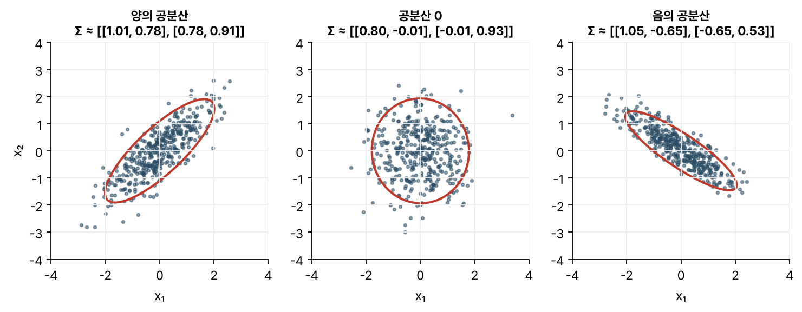
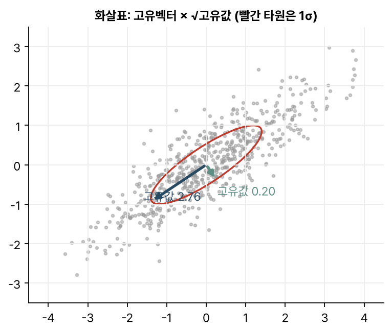
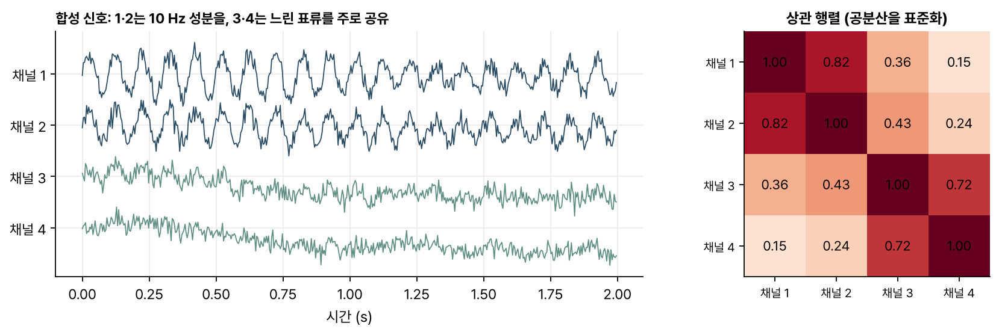

> [!abstract] 한눈에
> 변수가 $d$개인 자료의 공분산 행렬 $\Sigma$는 $d \times d$ 행렬이다. 대각선은 각 변수의 분산, 대각선 밖의 $(i, j)$ 칸은 변수 $i$와 $j$가 함께 움직이는 정도(공분산)다. 언제나 대칭이고 양의 준정부호라서, 고유벡터들이 서로 직교하고 고유값은 0 이상이다. 고유벡터는 자료가 퍼진 **방향**, 고유값은 그 방향의 **분산**이다.

## 정의

평균이 $\boldsymbol\mu$인 확률벡터 $\mathbf{x}$의 공분산 행렬은 다음과 같다.

$$
\Sigma = E\!\left[(\mathbf{x} - \boldsymbol\mu)(\mathbf{x} - \boldsymbol\mu)^\top\right],
\qquad \Sigma_{ij} = \operatorname{Cov}(x_i, x_j)
$$

자료로 추정할 때는 관측값 $n$개를 행으로 쌓은 행렬 $X$($n \times d$)에서 각 열의 평균을 뺀 $X_c$로 계산한다.

$$
S = \frac{1}{n-1} X_c^\top X_c
$$

$n$이 아니라 $n-1$로 나누는 것은 평균을 자료에서 추정하느라 자유도를 하나 썼기 때문이다.

*그림 1. 같은 개수의 점, 다른 공분산 행렬. 빨간 타원은 2σ 등고선이다. 대각선 밖 값의 부호가 타원의 기울기 방향을 정한다.*

## 성질

- **대칭이다.** $\operatorname{Cov}(x_i, x_j) = \operatorname{Cov}(x_j, x_i)$이므로 $\Sigma^\top = \Sigma$.
- **양의 준정부호다.** 어떤 방향 $\mathbf{w}$로 자료를 투영해도 그 분산은 음수가 될 수 없다.

$$
\operatorname{Var}(\mathbf{w}^\top \mathbf{x}) = \mathbf{w}^\top \Sigma\, \mathbf{w} \ge 0
$$

- **그래서 고유분해가 깔끔하다.** 대칭 행렬이라 서로 직교하는 고유벡터들로 $\Sigma = Q \Lambda Q^\top$로 분해되고, 양의 준정부호라 고유값이 모두 0 이상이다.

고유벡터 $\mathbf{q}_i$ 방향으로 투영한 분산은 $\mathbf{q}_i^\top \Sigma\, \mathbf{q}_i = \lambda_i$다. 그래서 고유벡터는 자료 타원의 **축 방향**이고, 고유값은 그 축 방향의 **분산**이다(그림 2). 가장 큰 고유값의 고유벡터가 분산이 가장 큰 방향이고, 이것이 [[pca-svd|PCA]]의 첫 주성분이다.

*그림 2. 화살표는 고유벡터에 표준편차($\sqrt{\lambda}$)를 곱한 것이다. 긴 화살표 방향으로 자료가 가장 넓게 퍼진다.*

## 상관 행렬

공분산의 크기는 변수의 단위에 따라 달라진다. 밀리볼트로 잰 채널과 마이크로볼트로 잰 채널을 바로 비교할 수 없다. 각 공분산을 두 변수의 표준편차로 나누면 단위가 사라진 **상관 행렬**이 된다. 대각선은 모두 1이고, 나머지 칸은 [[pearson-spearman|피어슨 상관계수]]다.

$$
R_{ij} = \frac{\Sigma_{ij}}{\sqrt{\Sigma_{ii}\,\Sigma_{jj}}}
$$

## 예: 여러 채널 신호의 공간 공분산

뇌파처럼 채널 $C$개를 시간 $T$표본 동안 잰 신호는 $C \times T$ 행렬 $X$로 쓴다. 각 채널의 평균을 빼고 $XX^\top/(T-1)$을 계산하면 $C \times C$ **공간 공분산 행렬**이 나온다. 어느 채널끼리 함께 흔들리는지를 담은 이 행렬이 [[csp|CSP]] 같은 공간 필터와 리만 기하 기반 분류기의 출발점이다.

*그림 3. 합성한 4채널 신호. 1·2번은 10 Hz 성분을, 3·4번은 느린 변동을 주로 공유하도록 섞었다. 상관 행렬에 그 묶음이 그대로 드러난다.*

## 자주 하는 오해

- **"공분산이 크면 관계가 강하다."** 공분산의 크기는 단위와 분산에 따라 달라진다. 관계의 강도를 비교하려면 상관을 봐야 한다.
- **"공분산이 0이면 두 변수는 독립이다."** 공분산은 선형으로 함께 움직이는 정도만 잰다. U자 같은 비선형 관계는 공분산이 0이어도 강하게 얽혀 있을 수 있다.
- **"표본 공분산 행렬은 언제나 역행렬이 있다."** 표본 수가 변수 수보다 적으면($n \le d$) 계수(rank)가 부족해 역행렬이 없다. 채널은 많은데 시행이 적은 뇌파 자료에서 흔한 일이고, 대각선에 작은 값을 더하는 축소(shrinkage) 추정으로 보완한다.
- **"$n$으로 나누나 $n-1$로 나누나 같다."** 표본이 작으면 차이가 난다. $n-1$로 나눠야 분산 추정이 평균적으로 치우치지 않는다.

## 관련 개념

- [[pca-svd|PCA와 SVD]]: 공분산 행렬의 고유분해를 차원 축소에 쓰는 방법
- [[pearson-spearman|피어슨과 스피어먼 상관]]: 상관 행렬의 각 칸
- [[csp|CSP (공통 공간 패턴)]]: 두 조건의 공분산 행렬을 함께 대각화하는 공간 필터

## 참고 자료

- 강완모, 「데이터과학을 위한 선형대수학」(Linear Algebra for Data Science), KAIST, Version 1.2 (2023), *Covariance Matrices* 절(161쪽~)
- MIT OCW, [18.06 Linear Algebra (Spring 2010)](https://ocw.mit.edu/courses/18-06-linear-algebra-spring-2010/), Lecture 25 *Symmetric matrices and positive definiteness*
- MIT OCW, [18.05 Introduction to Probability and Statistics (Spring 2022)](https://ocw.mit.edu/courses/18-05-introduction-to-probability-and-statistics-spring-2022/), 공분산과 상관 단원
