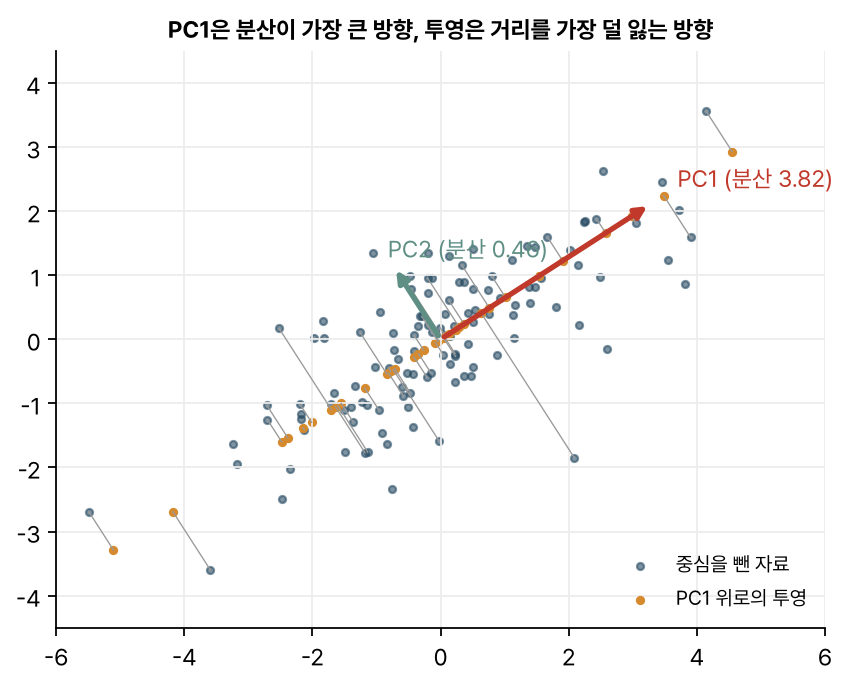
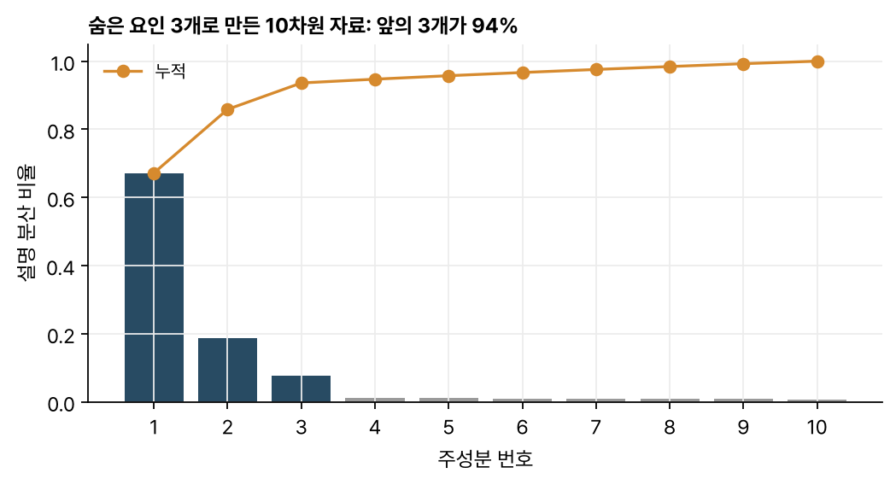
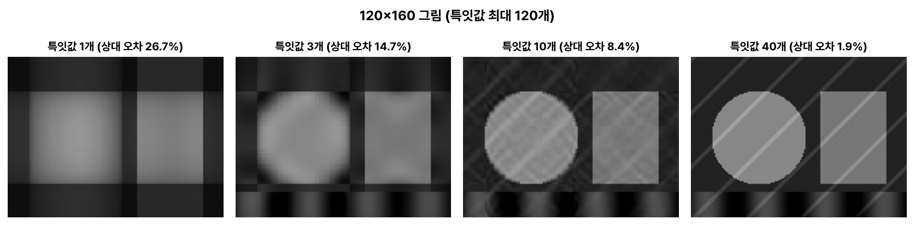

> [!abstract] 한눈에
> **PCA**는 자료의 분산이 가장 큰 방향부터 차례로 서로 직교하는 축을 찾아, 그 축들로 좌표를 바꾼다. 그 축들은 [[covariance-matrix|공분산 행렬]]의 고유벡터다. **SVD**는 어떤 행렬이든 $A = U\Sigma V^\top$로 쪼개는 분해로, 중심을 뺀 자료 행렬에 적용하면 $V$의 열이 곧 주성분이다. 큰 특잇값 $k$개만 남기면 자료를 가장 적은 오차로 근사하는 계수 $k$ 행렬을 얻는다.

## PCA: 분산이 큰 방향으로 좌표 바꾸기

$n$개 관측, $d$개 변수의 자료에서 각 변수의 평균을 뺀 행렬을 $X_c$($n \times d$)라 하자. 단위 벡터 $\mathbf{w}$ 방향으로 투영한 값들의 분산은 $\mathbf{w}^\top S\,\mathbf{w}$다($S$는 공분산 행렬). 이것을 가장 크게 만드는 $\mathbf{w}$가 **첫 번째 주성분**(PC1)이고, $S$의 가장 큰 고유값의 고유벡터다. 그다음 주성분은 앞의 것과 직교하는 방향 가운데 분산이 가장 큰 방향이다.

주성분들을 열로 모은 행렬을 $W$라 하면, 새 좌표는

$$
Z = X_c W
$$

이다. 좌표축을 돌렸을 뿐이므로 $d$개 주성분을 모두 쓰면 정보는 하나도 잃지 않는다. 앞의 몇 개만 남길 때 차원이 줄어든다.

*그림 1. PC1(빨강)은 자료가 가장 길게 늘어선 방향이다. 점들을 PC1 위로 투영하면(주황) 투영 거리(회색 선)의 제곱합이 가장 작다.*

분산을 가장 크게 하는 방향은 동시에 **투영으로 잃는 거리가 가장 작은 방향**이기도 하다. 피타고라스 정리로 보면, 각 점까지의 거리 제곱은 '축 위 성분 제곱 + 축에 수직인 성분 제곱'이고 전자를 키우는 것이 곧 후자를 줄이는 것이다.

## SVD

**특잇값 분해**(singular value decomposition)는 크기가 $n \times d$인 어떤 행렬 $A$든 다음처럼 쪼갠다.

$$
A = U \Sigma V^\top = \sum_{i=1}^{r} \sigma_i\, \mathbf{u}_i \mathbf{v}_i^\top
$$

$U$와 $V$의 열은 각각 정규직교이고, $\Sigma$의 대각선에는 **특잇값** $\sigma_1 \ge \sigma_2 \ge \dots \ge 0$이 놓인다. $\mathbf{v}_i$는 입력 공간의 방향, $\mathbf{u}_i$는 출력 공간의 방향, $\sigma_i$는 그 방향으로 얼마나 늘어나는지를 뜻한다. 오른쪽 식은 행렬을 계수 1인 행렬들의 가중합으로 본 것이다.

### PCA를 SVD로 계산하기

중심을 뺀 자료 $X_c = U\Sigma V^\top$를 공분산 행렬 식에 넣으면

$$
S = \frac{1}{n-1} X_c^\top X_c = V \,\frac{\Sigma^2}{n-1}\, V^\top
$$

가 된다. 그러므로

- $V$의 열 = 공분산 행렬의 고유벡터 = **주성분 방향**
- $\lambda_i = \dfrac{\sigma_i^2}{n-1}$ = $i$번째 주성분 방향의 **분산**
- $U\Sigma$ = 주성분 좌표 $Z$

이다. 실제 계산에서는 $X_c^\top X_c$를 직접 만들지 않고 SVD를 쓰는 편이 수치적으로 안정하다.

## 몇 개를 남길까: 설명 분산 비율

$i$번째 주성분이 전체 분산에서 차지하는 비율은 $\lambda_i / \sum_j \lambda_j$다. 그림 2는 숨은 요인 3개를 섞고 잡음을 더해 만든 10차원 자료다. 앞의 세 주성분이 분산의 대부분을 차지하고, 나머지는 잡음 수준으로 평평하다.

*그림 2. 앞의 세 막대가 숨은 요인 셋에 해당한다. 그 뒤가 고르게 낮은 것은 잡음의 몫이다.*

## 저계수 근사

SVD에서 큰 특잇값 $k$개만 남긴 $A_k = \sum_{i=1}^{k} \sigma_i \mathbf{u}_i \mathbf{v}_i^\top$는, 계수가 $k$ 이하인 모든 행렬 가운데 $A$와의 오차(프로베니우스 노름)가 가장 작다. 이를 에커트–영(Eckart–Young) 정리라 한다. 그림 3은 120×160 그림을 특잇값 몇 개만으로 다시 만든 것이다.

*그림 3. 특잇값 1개는 가로·세로 패턴의 곱 하나뿐이라 거친 격자만 남는다. 10개면 모양이 드러나고, 40개면 대각선 무늬까지 거의 돌아온다.*

## 자주 하는 오해

- **"분산이 큰 주성분이 중요한 정보다."** 분산이 크다는 것과 풀려는 문제(예: 두 조건의 분류)에 유용하다는 것은 다르다. 조건을 가르는 정보가 분산이 작은 방향에 있을 수 있다. 라벨을 쓰는 [[csp|CSP]]나 [[lda|LDA]]가 따로 있는 이유다.
- **"중심을 빼지 않아도 된다."** 평균을 빼지 않으면 첫 주성분이 '평균 쪽 방향'을 가리키게 된다. 단위가 다른 변수가 섞였다면 표준화도 고려한다.
- **"PCA는 전처리라서 전체 자료에 한 번 맞추면 된다."** 학습·시험 자료로 나눠 평가할 때는 주성분을 학습 자료로만 구하고 시험 자료에는 그 변환만 적용해야 한다. 전체에 맞추면 시험 자료의 정보가 새어 들어간다([[data-leakage|데이터 누수]]).
- **"주성분의 부호에 의미가 있다."** 고유벡터는 $-1$을 곱해도 고유벡터다. 계산 방법에 따라 부호가 뒤집힐 수 있다.

## 관련 개념

- [[covariance-matrix|공분산 행렬]]: 주성분은 그 고유벡터다
- [[csp|CSP (공통 공간 패턴)]]: 라벨을 써서 '조건 사이 분산 비'가 큰 방향을 찾는 방법
- [[data-leakage|데이터 누수와 피험자 단위 검증]]: PCA를 어디에 맞추느냐의 문제

## 참고 자료

- 강완모, 「데이터과학을 위한 선형대수학」(Linear Algebra for Data Science), KAIST, Version 1.2 (2023), *Singular Value Decomposition*(109쪽~), *Application to Statistics: PCA from SVD*(124쪽~)
- MIT OCW, [18.06 Linear Algebra (Spring 2010)](https://ocw.mit.edu/courses/18-06-linear-algebra-spring-2010/), Lecture 29 *Singular value decomposition*
- C. Eckart, G. Young, "The approximation of one matrix by another of lower rank," *Psychometrika* 1(3), 211–218 (1936)
- I. T. Jolliffe, J. Cadima, "Principal component analysis: a review and recent developments," *Philosophical Transactions of the Royal Society A* 374, 20150202 (2016)
