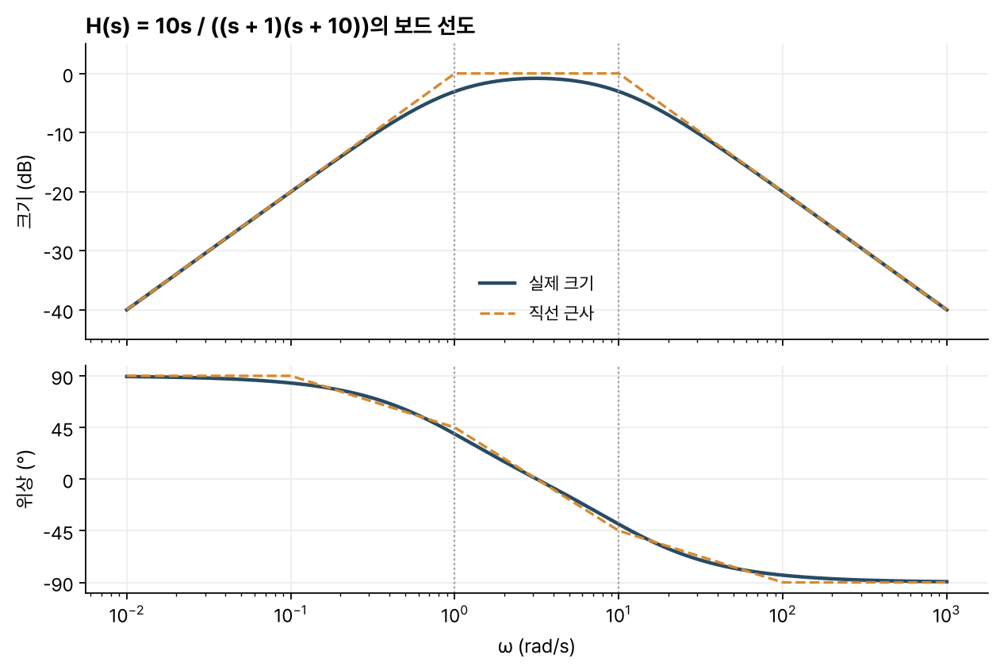
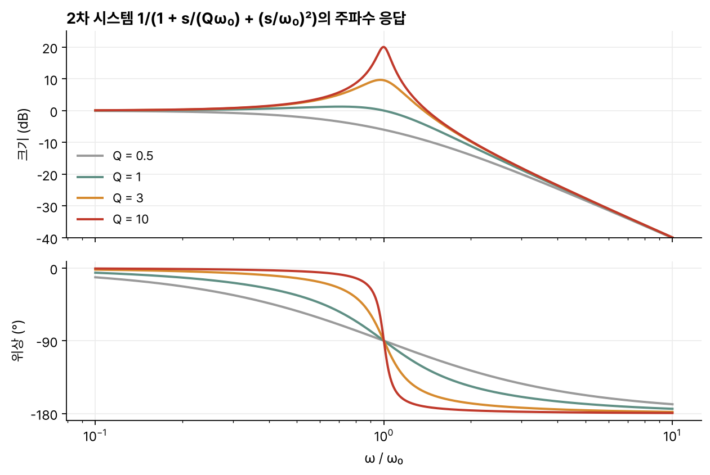

> [!abstract] 한눈에
> 시스템 함수 $H(s)$를 극점과 영점의 곱으로 쓰면, 주파수 응답의 크기는 각 인수 크기의 곱이고 위상은 각 인수 위상의 합이다. 크기를 로그로 그리면 곱도 합이 되므로, 극점 하나·영점 하나의 그림을 더하기만 하면 전체 그림이 나온다. 이렇게 로그 주파수 축에 크기(dB)와 위상을 그린 것이 보드 선도다.

## 주파수 응답

복소지수 $e^{s_0 t}$는 LTI 시스템의 고유함수다. 출력은 $H(s_0)e^{s_0 t}$이고, 영원히 계속되는 코사인을 넣으면 같은 주파수의 코사인이 크기와 위상만 바뀌어 나온다.

$$
\cos\omega_0 t \;\longrightarrow\; |H(j\omega_0)|\cos\big(\omega_0 t + \angle H(j\omega_0)\big)
$$

주파수 응답은 $H(s)$를 $j\omega$축 위에서 본 값 $H(j\omega)$다.

## 극점과 영점으로 그리기

$H(s)$를 인수분해하면

$$
H(s_0) = K\,\frac{(s_0 - z_1)(s_0 - z_2)\cdots}{(s_0 - p_1)(s_0 - p_2)\cdots}
$$

이다. 분자의 각 인수 $s_0 - z_q$는 복소평면에서 영점 $z_q$에서 $s_0$로 가는 벡터다. 그래서

- 크기 $|H(j\omega)|$는 영점 벡터 길이의 곱을 극점 벡터 길이의 곱으로 나눈 값에 $|K|$를 곱한 것이다.
- 위상 $\angle H(j\omega)$는 영점 벡터 각도의 합에서 극점 벡터 각도의 합을 뺀 값에 $\angle K$를 더한 것이다.

$s_0$를 $j\omega$축 위로 움직이면서 벡터를 읽으면 주파수 응답의 모양이 보인다. 극점에 가까운 주파수에서는 극점 벡터가 짧아져 크기가 커진다.

## 극점 하나, 영점 하나

$H(s) = s - z_1$의 크기는 $\omega \ll |z_1|$에서 $|z_1|$, $\omega \gg |z_1|$에서 $\omega$에 가깝다. 로그-로그 축에서는 기울기 0인 직선과 기울기 1인 직선 두 개로 근사되고, 두 직선은 $\omega = |z_1|$에서 만난다. 극점 하나 $H(s) = 1/(s - p_1)$은 같은 꼴에서 높은 주파수의 기울기가 $-1$이다. dB로 쓰면 각각 주파수 10배마다 +20 dB, −20 dB다.

위상은 세 직선으로 근사한다. 왼쪽 반평면의 영점 하나는 꺾이는 주파수의 1/10까지 0, 10배부터 $\pi/2$이고, 그 사이에서 $\log\omega$에 비례해 오른다. 극점은 같은 모양으로 $-\pi/2$까지 내려간다.

극점 위치만 바꾸면 그림은 평행 이동한다. $1/(s+1)$과 $1/(s+10)$의 로그 크기 그림은 모양이 같고, 가로로 한 디케이드, 세로로 한 디케이드 옮긴 관계다.

## 곱을 합으로

로그를 취하면 곱이 합이 된다.

$$
\log|H(j\omega)| = \log|K| + \sum_q \log|j\omega - z_q| - \sum_p \log|j\omega - p_p|
$$

위상은 원래부터 합이다. 그래서 각 인수의 직선 근사를 따로 그려 더하면 된다. 그림 1은 $H(s) = 10s/((s+1)(s+10))$의 예다. 원점의 영점이 +20 dB/디케이드로 올라가다가, $\omega = 1$의 극점에서 평평해지고, $\omega = 10$의 극점부터 −20 dB/디케이드로 내려간다. 위상은 영점 덕분에 +90°에서 시작해 두 극점을 지나며 −90°까지 내려간다.

*그림 1. $H(s) = 10s/((s+1)(s+10))$의 크기와 위상. 실선은 실제 값, 주황 파선은 극점·영점별 직선 근사의 합이다. 회색 세로선은 극점 위치다.*

## 직선 근사의 오차

$1/(j\omega + 1)$에서 크기 근사의 오차가 가장 큰 곳은 꺾이는 점 $\omega = 1$이고, 실제 값은 $1/\sqrt2$, 곧 약 −3 dB다. 한 옥타브 떨어진 곳의 오차는 약 1 dB다. 위상 근사의 최대 오차는 약 0.1 rad(약 6°)다. 직접 계산하면 위상 오차의 최댓값은 0.0997 rad로, $\omega = 0.1$과 $\omega = 10$에서 생긴다.

dB 환산에서 기억해 둘 값은 다음과 같다.

| 크기 비 | dB |
|---|---|
| $\sqrt2$ | 약 3 |
| 2 | 약 6 |
| 10 | 20 |
| 100 | 40 |

## 2차 시스템과 Q

공진하는 2차 시스템을 다음 꼴로 쓴다.

$$
H(s) = \frac{1}{1 + \dfrac{1}{Q}\dfrac{s}{\omega_0} + \left(\dfrac{s}{\omega_0}\right)^2}
$$

$Q$가 크면 두 극점이 $j\omega$축에 가까워진다. 극점의 실수부가 $-\omega_0/(2Q)$이기 때문이다. 그 결과 다음 세 가지가 함께 일어난다(그림 2). 아래 근사는 $Q > 3$ 정도에서 잘 맞는다.

- 최대 크기는 약 $Q$다. $\omega = \omega_0$에서 가까운 극점 벡터의 길이가 $\omega_0/(2Q)$, 먼 극점 벡터의 길이가 약 $2\omega_0$여서 그 곱이 $\omega_0^2/Q$이다. 위 $H(s)$는 $\omega_0^2/((s-p_1)(s-p_2))$와 같으므로 크기가 $\omega_0^2/(\omega_0^2/Q) = Q$가 된다.
- 3 dB 대역폭(크기가 최댓값의 $1/\sqrt2$ 이상인 구간)은 약 $\omega_0/Q$다.
- 그 대역폭 안에서 위상은 약 $\pi/2$ 변한다.

*그림 2. $Q$ = 0.5, 1, 3, 10일 때 2차 시스템의 크기와 위상.*

직접 계산하면 $Q = 10$에서 최대 크기 10.01, 3 dB 대역폭 $0.100\,\omega_0$, 그 안의 위상 변화 90.1°다.

## 유의점

- 보드 선도의 크기 축은 dB($20\log_{10}|H|$)이고, 전력 비를 dB로 쓸 때의 $10\log_{10}$과 다르다.
- 직선 근사는 꺾이는 점에서 3 dB 틀린다. 극점과 영점이 가까이 붙어 있으면 오차가 겹친다.
- 크기만 보고 시스템을 정할 수 없다. 오른쪽 반평면의 영점은 왼쪽 반평면 영점과 크기 그림이 같고 위상만 다르다.
- 상수 $K$가 음수면 위상이 $\pi$만큼 더해진다. 실수 계수 미분방정식에서 $\angle K$는 0이나 $\pi$다.

## 관련 개념

- [[first-order-rc-rl|RC·RL 1차 회로]]: 극점 하나짜리 시스템의 실제 회로
- [[fourier-series|푸리에 급수]]: 주파수 응답이 각 고조파에 곱해진다는 것
- [[z-transform|z 변환]]: 이산시간에서는 $j\omega$축 대신 단위원 위에서 같은 그림을 그린다
- [[op-amp-biosignal-front-end|연산증폭기와 생체신호 앞단]]: 앞단 필터의 차단주파수 설계

## 참고 자료

- MIT OCW, [6.003 Signals and Systems (Fall 2011)](https://ocw.mit.edu/courses/6-003-signals-and-systems-fall-2011/), Lecture 11 _Continuous-time frequency response and Bode plots_
- A. V. Oppenheim, A. S. Willsky, _Signals and Systems_, 2nd ed., Ch. 6
