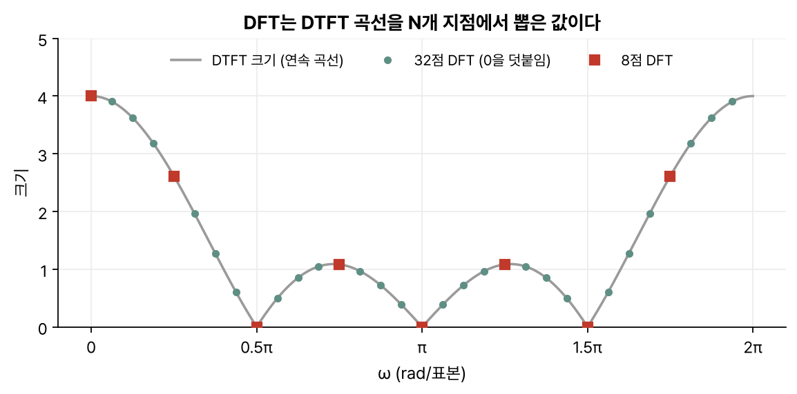
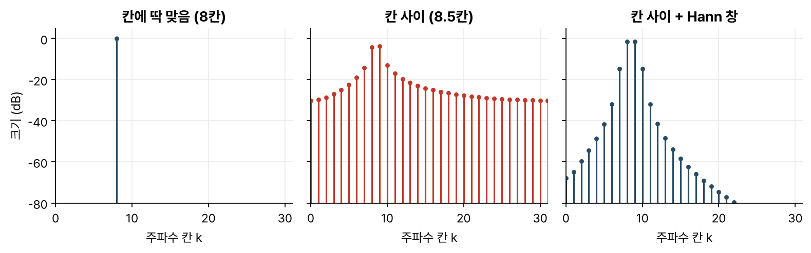
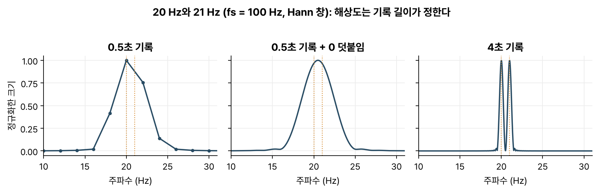
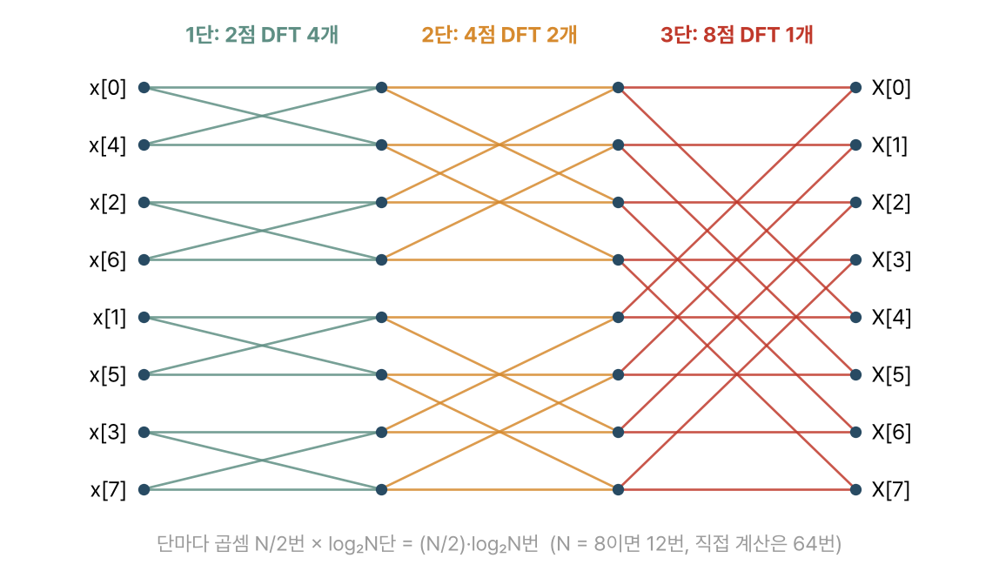
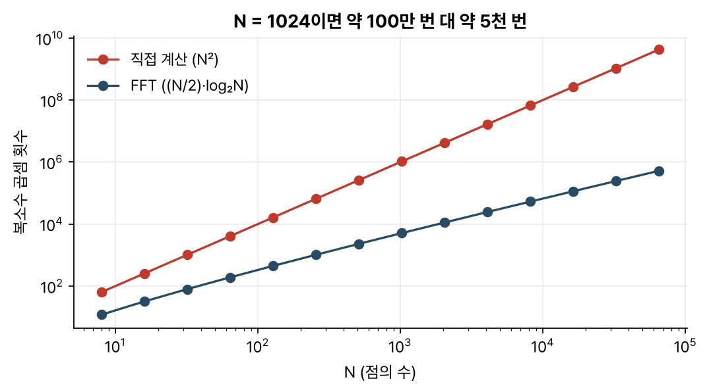

> [!abstract] 한눈에
> **DFT**는 길이 $N$인 신호를 주파수 $N$개로 나눈 결과로, [[dtft|DTFT]] 곡선을 $2\pi/N$ 간격으로 뽑은 값과 같다. 실제 신호를 유한한 길이로 잘라 계산하기 때문에 누설과 해상도 한계가 따라온다. **FFT**는 DFT를 $N^2$번 대신 $N\log_2 N$번 정도의 계산으로 구하는 알고리즘이다.

## 정의

길이 $N$인 신호 $x[0], \dots, x[N-1]$의 DFT는 다음과 같다.

$$
X[k] = \sum_{n=0}^{N-1} x[n]\, e^{-j 2\pi k n / N}, \qquad k = 0, 1, \dots, N-1
$$

역변환도 거의 같은 꼴이다.

$$
x[n] = \frac{1}{N} \sum_{k=0}^{N-1} X[k]\, e^{j 2\pi k n / N}
$$

$X[k]$는 $k$번째 주파수 칸에 신호가 얼마나 들어 있는지 나타낸다. 샘플링 주파수가 $f_s$이면 칸 하나의 너비는 $f_s/N$ Hz이고 $k$번째 칸은 $k f_s / N$ Hz에 해당한다. $k$가 $N/2$를 넘는 칸은 음의 주파수인데, 실수 신호에서는 $X[N-k]$가 $X[k]$의 켤레라서 앞쪽 절반만 보면 된다.

## DTFT와의 관계

길이 $N$ 바깥을 0으로 보면 이 신호의 [[dtft|DTFT]] $X(e^{j\omega})$는 $\omega$에 대한 연속 곡선이다. DFT는 그 곡선을 $\omega_k = 2\pi k / N$ 지점 $N$개에서 뽑은 값과 정확히 같다.

$$
X[k] = X(e^{j\omega})\big|_{\omega = 2\pi k / N}
$$

신호 끝에 0을 덧붙여(zero-padding) $N$을 늘려도 같은 곡선 위의 점이 촘촘해질 뿐 곡선은 그대로다(그림 1).

*그림 1. 앞의 4개만 1인 신호. 8점 DFT(빨강)도, 0을 덧붙인 32점 DFT(초록)도 같은 회색 곡선 위에 놓인다.*

DFT는 길이 $N$인 조각을 한 주기로 놓고 무한히 반복한 신호의 이산시간 푸리에 급수 계수와도 같다(정의에 따라 $N$배 차이가 날 수 있다). 이 때문에 DFT의 여러 성질은 '주기적'으로 행동한다. 예를 들어 두 DFT를 곱하면 시간 영역에서는 보통의 컨볼루션과 달리 끝이 앞으로 감겨 들어오는 **원형 컨볼루션**이 된다. 두 신호의 길이가 $L$과 $M$일 때 보통의 컨볼루션을 얻으려면 DFT 길이를 $L + M - 1$ 이상으로 잡고 0을 덧붙여야 감겨 들어올 자리가 없어진다.

## 스펙트럼 누설

사인파의 주파수가 칸 하나에 딱 맞으면 DFT 앞쪽 절반에서 값이 생기는 칸은 하나뿐이다(실수 코사인은 거울 쪽 칸 $N-k$에도 하나 생긴다). 주파수가 칸과 칸 사이에 떨어지면 에너지가 이웃 칸들로 번지는데, 이것을 **스펙트럼 누설(leakage)** 이라고 한다(그림 2 가운데).

*그림 2. 64점 DFT. 왼쪽은 정확히 8칸짜리 코사인이고, 가운데는 8.5칸이라 멀리까지 번진다. 오른쪽처럼 Hann 창을 곱하면 번짐이 빨리 줄어든다.*

누설은 신호를 갑자기 잘라서 생긴다. DFT는 잘린 조각이 반복된다고 보므로 주기가 맞지 않으면 이어 붙인 경계에서 신호가 툭 끊기고, 이 불연속이 넓은 대역에 걸친 성분을 만든다. 이를 줄이려고 조각 양 끝을 부드럽게 0으로 내리는 **창 함수**(Hann, Hamming 등)를 곱한다. 다만 멀리 번지는 양은 줄어도 봉우리가 넓어져서 가까운 두 주파수를 가르기는 더 어려워진다.

## 기록 길이와 해상도

가까운 두 주파수를 갈라 볼 수 있는지는 얼마나 오래 쟀느냐에 달렸다. 기록 길이가 $T$초면 주파수 칸의 간격이 $1/T$ Hz이고 창을 곱한 봉우리의 폭도 $1/T$에 비례한다(Hann 창이면 주엽의 반폭이 약 $2/T$). 그림 3의 20 Hz와 21 Hz는 0.5초 기록에서 한 봉우리로 뭉치며, 0을 아무리 덧붙여도 그 봉우리가 매끄러워지기만 할 뿐 둘로 나뉘지 않는다. 4초를 재면 뚜렷하게 갈라진다.

*그림 3. $f_s = 100$ Hz, Hann 창. 0을 덧붙이면 그림만 매끄러워지고, 두 봉우리는 기록이 길어야 갈라진다.*

## FFT

정의대로 계산하면 $X[k]$ 하나에 곱셈이 $N$번이고 칸이 $N$개이니 모두 $N^2$번이다. 그런데 이 계산 안에는 같은 곱이 여러 번 되풀이되고, **FFT**(고속 푸리에 변환)는 그 중복을 이용한다. 가장 널리 쓰는 쿨리-튜키(Cooley–Tukey) 방식은 $N$이 2의 거듭제곱일 때 표본을 짝수 번째와 홀수 번째로 나눈다.

$$
X[k] = \underbrace{\sum_{m} x[2m]\, e^{-j2\pi km/(N/2)}}_{\text{짝수 표본의 } N/2\text{점 DFT}} \;+\; e^{-j2\pi k/N} \underbrace{\sum_{m} x[2m+1]\, e^{-j2\pi km/(N/2)}}_{\text{홀수 표본의 } N/2\text{점 DFT}}
$$

그러면 $N$점 DFT 하나가 $N/2$점 DFT 두 개와 약간의 곱셈으로 바뀐다. 길이가 1이 될 때까지 이렇게 $\log_2 N$번 쪼개면 그림 4의 '나비' 구조가 나온다. 단마다 곱셈이 $N/2$번이므로 전체는 $(N/2)\log_2 N$번이다.

*그림 4. 8점 FFT. 입력을 비트 역순(0, 4, 2, 6, …)으로 놓으면 출력은 제 순서로 나온다.*

*그림 5. $N = 1024$일 때 직접 계산하면 약 100만 번, FFT로는 약 5천 번이다.*

이 차이로 실시간 스펙트럼 분석, 긴 신호의 필터링(FFT로 바꿔 곱한 뒤 되돌리는 방식), 영상 압축 같은 일을 현실적으로 계산할 수 있게 되었다.

## 자주 하는 오해

- **"0을 덧붙이면 주파수 해상도가 좋아진다."** 점이 촘촘해질 뿐이고, 가까운 두 주파수를 가르는 능력은 실제 기록 길이에 달렸다.
- **"FFT는 DFT와 다른 변환이다."** 같은 값을 빨리 계산하는 방법이라 반올림 오차를 빼면 결과도 같다.
- **"DFT 크기 그래프의 봉우리 높이가 곧 그 주파수의 진폭이다."** 칸에 딱 맞는 진폭 $A$의 코사인이라도 봉우리 높이는 $NA/2$다. 창 $w[n]$을 곱했다면 $2/\sum_n w[n]$을 곱해야 진폭이 나온다. 주파수가 칸 사이에 떨어지면 이렇게 보정해도 봉우리가 낮게 나오고 옆으로 번진다.
- **"$k$가 클수록 높은 주파수다."** $k = N/2$까지만 맞다. 그 위 칸은 음의 주파수이고, 실수 신호에서는 앞쪽 절반을 거울에 비춘 값이다.

## 관련 개념

- [[dtft|이산시간 푸리에 변환]]: DFT가 점을 뽑아 오는 원래 곡선
- [[sampling-aliasing|샘플링과 앨리어싱]]: 칸 $k$를 실제 주파수 $kf_s/N$으로 읽으려면 샘플링 주파수가 필요하다
- [[z-transform|z 변환]]: DTFT와 DFT를 단위원 위의 값으로 보는 더 넓은 틀

## 참고 자료

- MIT OCW, [6.003 Signals and Systems (Fall 2011)](https://ocw.mit.edu/courses/6-003-signals-and-systems-fall-2011/), Lecture 18 *Discrete-time Fourier representations*, Lecture 19 *Relations among Fourier representations*
- MIT OCW, [HST.582J Biomedical Signal and Image Processing](https://ocw.mit.edu/courses/hst-582j-biomedical-signal-and-image-processing-spring-2007/), 이산 스펙트럼 방법(DFT) 단원
- J. W. Cooley, J. W. Tukey, "An algorithm for the machine calculation of complex Fourier series," *Mathematics of Computation* 19, 297–301 (1965)
- A. V. Oppenheim, R. W. Schafer, *Discrete-Time Signal Processing*, 3rd ed., Ch. 8–10 (DFT, FFT, DFT를 이용한 푸리에 분석)
