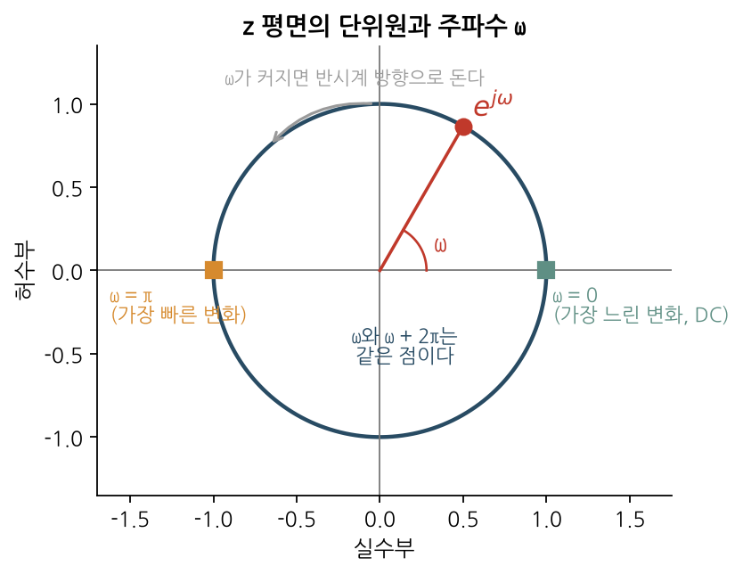
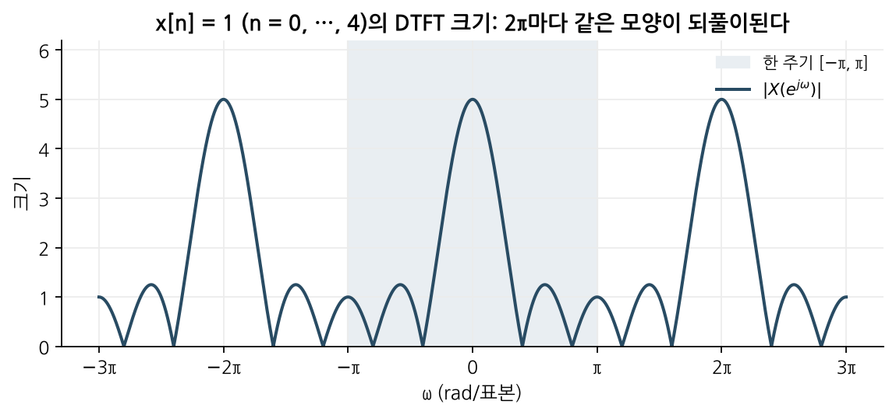
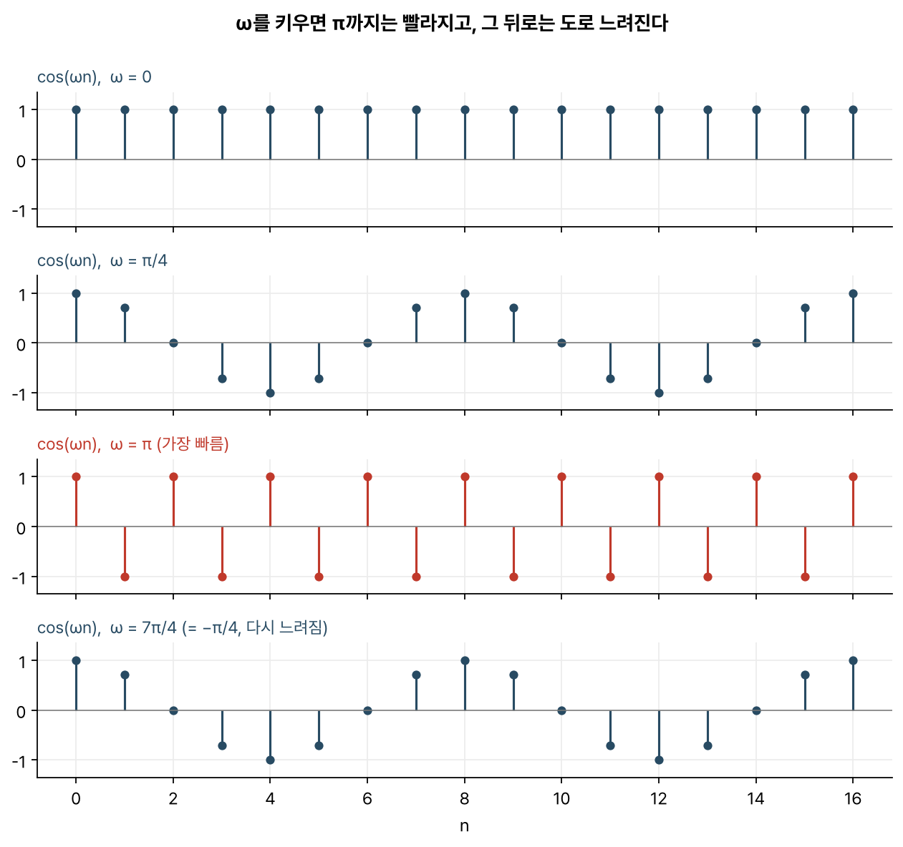

> [!abstract] 한눈에
> DTFT는 이산시간 신호 $x[n]$을 복소지수 $e^{j\omega n}$들의 합으로 나눠, 주파수 $\omega$마다 얼마만큼 들어 있는지를 나타낸다. $n$이 정수라서 $\omega$와 $\omega + 2\pi$는 구별되지 않는다. 이 때문에 스펙트럼은 $2\pi$마다 반복되고, 의미 있는 범위는 $-\pi$에서 $\pi$까지다. $\omega = \pi$가 이산시간에서 낼 수 있는 가장 빠른 진동이다.

## 정의

이산시간 신호 $x[n]$의 DTFT는 다음과 같다.

$$
X(e^{j\omega}) = \sum_{n=-\infty}^{\infty} x[n]\, e^{-j\omega n}
$$

되돌리는 식(역변환)은 한 주기에 걸친 적분이다.

$$
x[n] = \frac{1}{2\pi} \int_{-\pi}^{\pi} X(e^{j\omega})\, e^{j\omega n}\, d\omega
$$

역변환은 $x[n]$을 $e^{j\omega n}$들의 가중합으로 쓰고, 그 가중치가 $X(e^{j\omega})$다. 정변환은 $x[n]$과 $e^{j\omega n}$의 내적을 구해서 그 가중치를 뽑아낸다.

$\omega$의 단위는 라디안/표본이다. 실제 주파수 $f$(Hz)로 바꾸려면 샘플링 주파수 $f_s$가 있어야 한다.

$$
\omega = 2\pi \frac{f}{f_s}
$$

## 단위원 위의 한 점

$e^{j\omega}$는 복소평면에서 반지름 1인 원 위의 점이다. $\omega$가 0에서 $2\pi$까지 커지면 이 점은 원을 한 바퀴 돌아 제자리로 온다(그림 1). 따라서 DTFT는 z 변환을 단위원 위에서만 본 것으로 이해할 수 있다. 시스템 함수 $H(z)$에 $z = e^{j\omega}$를 넣으면 주파수 응답 $H(e^{j\omega})$가 된다. 이 때문에 극점과 영점이 단위원의 어느 쪽에 가까운지를 보면 어떤 주파수가 커지고 작아질지 짐작할 수 있다.

_그림 1. $\omega = 0$은 원의 오른쪽 끝, $\omega = \pi$는 왼쪽 끝이다. 한 바퀴 돌면 같은 점으로 돌아온다._

## 2π 주기성

$n$이 정수이므로 다음이 성립한다.

$$
e^{j(\omega + 2\pi)n} = e^{j\omega n} \cdot e^{j2\pi n} = e^{j\omega n}
$$

$\omega$와 $\omega + 2\pi$로 만든 신호는 표본 하나하나가 모두 같다. 같은 신호이므로 같은 성분으로 세게 되고, $X(e^{j\omega})$는 $\omega$에 대해 주기 $2\pi$인 함수가 된다. 그림 2는 길이 5인 사각 펄스의 DTFT 크기다. 회색으로 칠한 한 주기 바깥에는 같은 모양이 되풀이된다.

$$
x[n] = \begin{cases} 1 & 0 \le n \le 4 \\ 0 & \text{그 밖} \end{cases}
\quad\Longrightarrow\quad
X(e^{j\omega}) = e^{-j2\omega}\, \frac{\sin(5\omega/2)}{\sin(\omega/2)}
$$

_그림 2. $|X(e^{j\omega})|$는 $\omega = 0$에서 5(펄스의 합)이고, $2\pi$마다 같은 모양이 반복된다._

이 반복은 [[sampling-aliasing|샘플링]]에서 스펙트럼 복사본이 $f_s$ 간격으로 생기는 것과 같은 현상이다. $f = f_s$를 위의 변환식에 넣으면 $\omega = 2\pi$가 된다.

## 가장 빠른 진동

연속시간에서는 주파수를 높일수록 끝없이 빨라지지만, 이산시간에서는 그렇지 않다. $\cos(\omega n)$에서 $\omega$를 0부터 키우면 $\pi$까지는 빨라지지만, 그 다음부터는 도로 느려진다(그림 3). $\omega = \pi$이면 $\cos(\pi n) = (-1)^n$으로 표본마다 부호가 바뀌는데, 이보다 빨리 변할 방법이 없다. $\omega = 7\pi/4$는 $-\pi/4$와 같은 점이므로 $\pi/4$와 똑같이 느리게 보인다.

_그림 3. $\omega = 0$, $\pi/4$, $\pi$, $7\pi/4$. 마지막 줄은 두 번째 줄과 같은 신호다._

$\omega = \pi$는 실제 주파수로 $f_s/2$, 곧 나이퀴스트 주파수다. 같은 이유로 저역통과 필터를 설계할 때 '높은 주파수'라고 하면 $\pi$ 근처를, '낮은 주파수'라고 하면 0과 $2\pi$ 근처를 가리킨다.

## 컨볼루션과 곱셈

LTI 시스템에 $e^{j\omega n}$을 넣으면 모양은 그대로이고 크기와 위상만 $H(e^{j\omega})$만큼 바뀌어 나온다. 복소지수가 LTI 시스템의 **고유함수**이기 때문이다. 그래서 시간 영역의 컨볼루션은 주파수 영역의 곱셈이 된다.

$$
y[n] = (x * h)[n] \quad\Longleftrightarrow\quad Y(e^{j\omega}) = X(e^{j\omega})\, H(e^{j\omega})
$$

필터가 무엇을 통과시키고 무엇을 막는지를 $|H(e^{j\omega})|$ 그래프 하나로 읽을 수 있는 것은 이 성질 덕분이다.

## 네 가지 푸리에 표현 사이에서

푸리에 표현은 시간 축이 연속인지 이산인지, 신호가 주기적인지 아닌지에 따라 네 가지로 갈린다. 규칙은 하나다. **한쪽이 이산이면 다른 쪽은 주기적이고, 한쪽이 주기적이면 다른 쪽은 이산이다.**

|                             | 시간 영역    | 주파수 영역      |
| --------------------------- | ------------ | ---------------- |
| 연속시간 푸리에 급수 (CTFS) | 연속, 주기적 | 이산, 비주기     |
| 연속시간 푸리에 변환 (CTFT) | 연속, 비주기 | 연속, 비주기     |
| 이산시간 푸리에 급수 (DTFS) | 이산, 주기적 | 이산, 주기적     |
| 이산시간 푸리에 변환 (DTFT) | 이산, 비주기 | **연속, 주기적** |

DTFT의 결과는 $\omega$에 대한 연속 함수라서 컴퓨터가 그대로 다룰 수 없다. 컴퓨터가 실제로 계산하는 것은 길이 $N$인 신호의 [[dft-fft|DFT]]이고, 이는 DTFT를 $\omega_k = 2\pi k / N$ 지점 $N$개에서 뽑아낸 값과 같다. **FFT**는 이 DFT를 $N^2$번 대신 $N \log N$번 정도의 연산으로 구하는 알고리즘의 이름이다. 새로운 변환이 아니라 빠른 계산법이다.

## 자주 하는 오해

- **"$\omega$가 클수록 빠른 진동이다."** $\pi$까지만 그렇다. $\pi$를 넘으면 다시 느려지고 $2\pi$에서는 상수가 된다.
- **"$-\pi$에서 $\pi$ 밖에도 다른 정보가 있다."** 없다. 같은 한 주기가 반복될 뿐이다.
- **"$\omega$의 단위는 Hz다."** 라디안/표본이다. Hz로 읽으려면 $f_s$를 알아야 한다. 같은 $\omega = \pi/2$도 $f_s$가 1 kHz면 250 Hz, 200 Hz면 50 Hz다.
- **"FFT와 DTFT는 같은 것이다."** FFT는 DFT를 빨리 계산하는 방법이고, DFT는 DTFT의 표본이다. 유한한 길이로 잘라서 계산하는 만큼 해상도 한계와 누설(leakage)이 따라온다.

## 관련 개념

- [[sampling-aliasing|샘플링과 앨리어싱]]: $2\pi$ 주기성과 스펙트럼 복사가 같은 현상이라는 것
- [[dft-fft|DFT와 FFT]]: 컴퓨터가 실제로 계산하는, DTFT의 표본
- [[z-transform|z 변환]]: DTFT를 단위원 위의 값으로 품는 더 넓은 틀
- [[matched-filter|정합 필터]]: 주파수 영역에서 보면 정합 필터는 신호 스펙트럼의 켤레를 곱하는 필터다

## 참고 자료

- MIT OCW, [6.003 Signals and Systems (Fall 2011)](https://ocw.mit.edu/courses/6-003-signals-and-systems-fall-2011/), Lecture 17 _Discrete-time frequency representations_, Lecture 18 _Discrete-time Fourier representations_, Lecture 19 _Relations among Fourier representations_
- A. V. Oppenheim, R. W. Schafer, _Discrete-Time Signal Processing_, 3rd ed., Ch. 2
