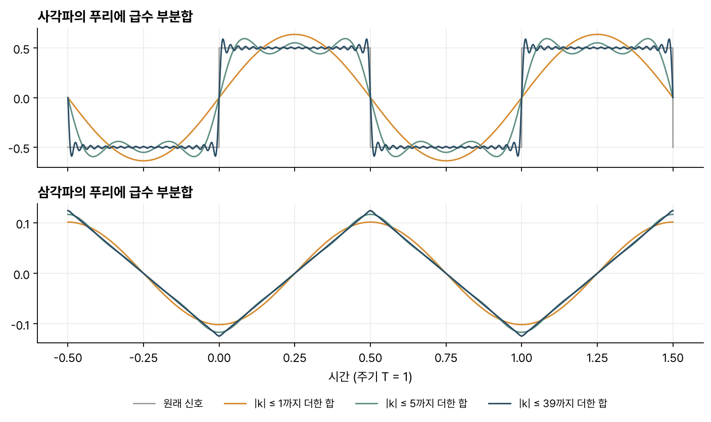
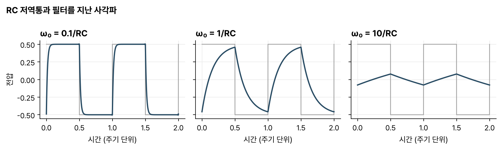

> [!abstract] 한눈에
> 주기 $T$인 신호는 기본 주파수 $\omega_0 = 2\pi/T$의 정수배 복소지수들의 합으로 쓸 수 있다. 각 성분의 계수 $a_k$는 한 주기 동안 신호에 $e^{-jk\omega_0 t}$를 곱해 적분하면 나온다. 복소지수는 LTI 시스템을 지나도 모양이 바뀌지 않으므로, 시스템은 각 성분의 크기와 위상만 바꾸는 필터로 볼 수 있다.

## 정의

주기 $T$인 신호 $x(t) = x(t+T)$를 고조파(harmonic)의 합으로 쓴다. $k$번째 고조파는 주파수가 $k\omega_0$인 복소지수 $e^{jk\omega_0 t}$이고, $k = 0$은 직류, $k = 1$은 기본파다.

$$
x(t) = \sum_{k=-\infty}^{\infty} a_k\, e^{jk\omega_0 t} \qquad \text{(합성식)}
$$

$$
a_k = \frac{1}{T}\int_T x(t)\, e^{-jk\omega_0 t}\, dt \qquad \text{(분석식)}
$$

고조파는 모두 주기 $T$로 반복하므로, 이렇게 나타낼 수 있는 신호는 주기 신호뿐이다.

## 직교성

분석식이 $a_k$를 골라내는 근거는 두 가지다.

1. 고조파끼리 곱하면 다시 고조파가 된다. $e^{jk\omega_0 t}\, e^{jl\omega_0 t} = e^{j(k+l)\omega_0 t}$.
2. 고조파를 한 주기 동안 적분하면 직류($k=0$)만 $T$이고 나머지는 0이다.

합성식 양변에 $e^{-jl\omega_0 t}$를 곱하고 한 주기 적분하면, $k = l$인 항만 남아 $T a_l$이 된다. 3차원 벡터에서 $x = \bar r\cdot\hat x$로 성분을 구하는 것과 같은 구조이고, 신호의 내적은 다음처럼 정의한다.

$$
\langle a, b\rangle = \frac{1}{T}\int_T a^*(t)\, b(t)\, dt
$$

켤레를 취하기 때문에 서로 다른 고조파의 내적은 0, 같은 고조파끼리는 1이다.

직교는 적분 구간에 따라 달라진다. 구간 $T = 3$에서 $\cos 2\pi t$와 $\sin 2\pi t$, $\cos 2\pi t$와 $\cos 4\pi t$는 직교한다. $\cos 2\pi t$와 $\sin \pi t$는 곱 $\tfrac12\sin 3\pi t - \tfrac12 \sin \pi t$의 적분이 0이 아니어서 직교하지 않는다. $\sin\pi t$의 주기 2가 구간 3에 정수 번 들어가지 않기 때문이다.

## 사각파와 삼각파

주기 1, 높이 $\pm\tfrac12$인 사각파의 계수는

$$
a_k = \begin{cases} \dfrac{1}{j\pi k} & k \text{ 홀수}\\[4pt] 0 & k \text{ 짝수}\end{cases}
$$

다. 짝수 고조파는 없고, 계수는 순허수이며, 크기가 $1/k$로 줄어든다.

신호를 미분하면 계수에 $jk\omega_0$가 곱해진다. 합성식을 항별로 미분하면 바로 나온다. 거꾸로 적분하면 $1/(jk\omega_0)$가 곱해진다. 진폭 $\pm\tfrac18$인 삼각파는 이 사각파의 적분이므로

$$
b_k = \frac{1}{j\pi k}\cdot\frac{1}{j2\pi k} = -\frac{1}{2\pi^2 k^2}, \quad k \text{ 홀수}
$$

이고, 계수가 $1/k^2$로 줄어든다. 사각파보다 고조파가 빨리 작아진다.

*그림 1. $|k| \le N$인 항만 더한 부분합. 위는 사각파, 아래는 삼각파이고 $N$ = 1, 5, 39다.*

## 깁스 현상

그림 1에서 삼각파의 부분합은 몇 항만 더해도 원래 모양에 가까워진다. 사각파의 부분합은 불연속점 근처에서 출렁이고, 항을 늘려도 출렁임의 높이가 줄지 않는다. 출렁임이 차지하는 폭만 좁아진다. 이것을 **깁스 현상**(Gibbs phenomenon)이라 하고, 최대 오버슈트는 점프 크기의 약 9%다. $N = 99$까지 더해 직접 계산하면 높이 0.5인 점에서 최댓값이 0.5895로, 점프 1의 9.0%만큼 넘친다.

원인은 계수가 줄어드는 속도다. 사각파 계수는 $1/k$로만 줄어 높은 고조파가 끝까지 남는다. 높은 주파수의 계수를 일부러 줄이면 출렁임을 줄이거나 없앨 수 있다.

## 시스템을 필터로 보기

복소지수는 LTI 시스템의 고유함수다. 입력 $e^{jk\omega_0 t}$는 출력 $H(jk\omega_0)\, e^{jk\omega_0 t}$가 된다. 주기 입력을 푸리에 급수로 나누면 출력은

$$
y(t) = \sum_k a_k\, H(jk\omega_0)\, e^{jk\omega_0 t}
$$

이다. 출력에는 입력에 있던 주파수만 있고, 각 성분의 크기와 위상만 $H$에 따라 바뀌므로, LTI 시스템은 새 주파수를 만들지 못한다.

RC 저역통과 회로($H(s) = 1/(1+sRC)$)에 사각파를 넣어 보면 이 관점이 잘 보인다(그림 2). 기본 주파수가 $1/RC$보다 훨씬 낮으면 고조파 대부분이 통과해 출력이 사각파와 거의 같다. 기본 주파수가 $1/RC$ 근처면 높은 고조파가 깎여 모서리가 둥글어진다. 훨씬 높으면 각 고조파가 $1/(jk\omega_0 RC)$배로 줄어, 사각파를 적분한 삼각파 모양이 작게 남는다.

*그림 2. 같은 사각파를 RC 저역통과 필터에 넣었을 때의 출력. 기본 각주파수 $\omega_0$와 $1/RC$의 비를 0.1, 1, 10으로 바꿨다. 회색은 입력이다.*

## 음성의 원천-필터 모델

모음은 거의 주기적인 신호다. 성대가 떨려 만든 주기적 버즈(원천)가 목과 코, 입의 공간(필터)을 지나 소리가 된다. 같은 성대 신호라도 입 모양에 따라 필터가 바뀌면 다른 모음이 된다.

필터의 공진 주파수를 포먼트(formant)라 부르고, 듣는 사람은 주로 이 필터의 차이로 모음을 구별한다. 강의는 높은 음으로 노래하면 모음 구별이 흐려지는 예도 함께 보여 준다. 강의 자료의 표에서 성인 남성의 "heed" 모음은 F1 270 Hz, F2 2290 Hz이고 "who'd"는 F1 300 Hz, F2 870 Hz다. 두 모음은 F1이 비슷하고 F2가 크게 다르다.

## 유의점

- 푸리에 급수는 주기 신호에만 쓴다. 주기가 없는 신호는 [[fourier-transform|푸리에 변환]]으로 다룬다.
- 깁스 현상의 오버슈트는 항을 늘려도 약 9%에서 줄지 않는다. 항을 늘리면 출렁이는 구간의 폭만 좁아진다.
- 계수 $a_k$는 일반적으로 복소수다. 실수 신호면 $a_{-k} = a_k^*$이므로, $k$와 $-k$ 두 항을 합치면 실수 정현파 하나가 된다.
- 주파수가 서로 다른 복소지수 $e^{jk\omega_0 t}$와 $e^{jl\omega_0 t}$($k \ne l$)는 적분 구간이 기본 주기 $T$의 정수배일 때 직교한다. 구간이 맞지 않으면 직교하지 않을 수 있고, $\cos 2\pi t$와 $e^{j2\pi t}$처럼 같은 주파수 성분을 공유하면 구간이 맞아도 직교하지 않는다.

## 관련 개념

- [[fourier-transform|연속시간 푸리에 변환]]: 주기를 무한대로 보내 비주기 신호로 넓힌 것
- [[bode-plot|보드 선도]]: 필터 $H(j\omega)$의 크기와 위상을 그리는 방법
- [[first-order-rc-rl|RC·RL 1차 회로]]: 그림 2에 쓴 RC 저역통과 회로
- [[dtft|이산시간 푸리에 변환]]: 이산시간에서 같은 생각을 편 것

## 참고 자료

- MIT OCW, [6.003 Signals and Systems (Fall 2011)](https://ocw.mit.edu/courses/6-003-signals-and-systems-fall-2011/), Lecture 14 _Fourier representations_, Lecture 15 _Fourier series_
- A. V. Oppenheim, A. S. Willsky, _Signals and Systems_, 2nd ed., Ch. 3
