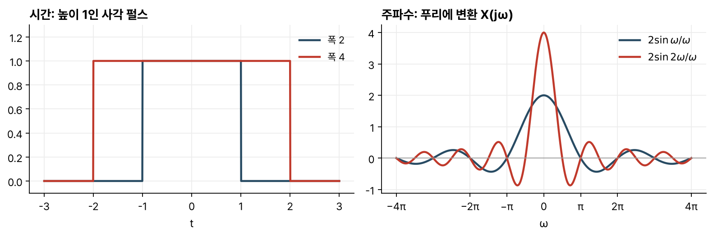
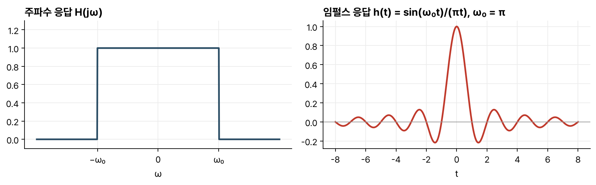

> [!abstract] 한눈에
> 주기가 없는 신호는 주기가 무한히 긴 주기 신호로 볼 수 있다. 주기를 늘리면 푸리에 급수의 고조파 간격이 좁아지고, 극한에서 계수는 주파수의 연속 함수 $X(j\omega)$가 된다. 이것이 푸리에 변환이다. 변환식과 역변환식의 모양이 거의 같아서, 한 쌍을 알면 시간과 주파수를 바꾼 쌍도 얻는다.

## 급수에서 변환으로

$-S \le t \le S$에서만 1인 펄스 $x(t)$를 주기 $T$로 반복한 신호 $x_T(t)$를 생각한다. 그 푸리에 급수 계수는

$$
a_k = \frac{1}{T}\int_{-S}^{S} e^{-j\frac{2\pi}{T}kt}\, dt = \frac{2}{T}\,\frac{\sin \omega S}{\omega}\bigg|_{\omega = k\frac{2\pi}{T}}
$$

이다. $T a_k$는 $T$와 상관없이 같은 함수 $2\sin(\omega S)/\omega$ 위의 점들이다.

주기를 두 배로 늘리면 같은 주파수 구간 안에 고조파가 두 배로 들어간다. $T\to\infty$이면 점들이 촘촘해져 연속 함수가 되고, 합성식의 합은 적분이 된다. 그 결과가 푸리에 변환 쌍이다.

$$
X(j\omega) = \int_{-\infty}^{\infty} x(t)\, e^{-j\omega t}\, dt \qquad \text{(분석식)}
$$

$$
x(t) = \frac{1}{2\pi}\int_{-\infty}^{\infty} X(j\omega)\, e^{j\omega t}\, d\omega \qquad \text{(합성식)}
$$

## 라플라스 변환과의 관계

라플라스 변환이 존재하고 그 수렴영역이 $j\omega$축을 포함하면, 푸리에 변환은 라플라스 변환을 $s = j\omega$에서 본 값이다.

$$
X(j\omega) = X(s)\big|_{s = j\omega}
$$

그래서 선형성, 시간 이동($e^{-j\omega t_0}$ 곱하기), 미분($j\omega$ 곱하기), 컨볼루션(곱하기) 같은 성질을 그대로 물려받는다. 차이도 있다. $x(t) = e^{-t}u(t)$의 라플라스 변환 $1/(1+s)$는 복소평면 위의 함수이고, 푸리에 변환 $1/(1+j\omega)$는 실수 $\omega$의 함수다. 주파수 축 하나로 그릴 수 있어서 직관을 얻기 쉽다.

## 스케일링

$-1 \le t \le 1$에서 1인 펄스의 변환은 $2\sin\omega/\omega$이고, 폭을 두 배로 늘린 $-2\le t\le 2$의 펄스는 $4\sin 2\omega/(2\omega)$다. 원점 높이는 2에서 4로 커지고, 첫 영점은 $\pi$에서 $\pi/2$로 가까워진다(그림 1).

*그림 1. 높이 1, 폭 2와 폭 4인 사각 펄스와 그 푸리에 변환.*

일반적으로 $x_2(t) = x_1(at)$이면

$$
x_1(at) \;\longleftrightarrow\; \frac{1}{|a|}\, X_1\!\left(\frac{j\omega}{a}\right)
$$

이다. $0 < a < 1$이면 시간이 늘어나고, 주파수는 그만큼 좁아지면서 높이가 커진다.

## 원점의 값

$\omega = 0$을 넣으면 $X(j0) = \int x(t)\,dt$다. 스펙트럼의 원점 값은 신호의 넓이다. 거꾸로 $t = 0$을 넣으면

$$
x(0) = \frac{1}{2\pi}\int_{-\infty}^{\infty} X(j\omega)\, d\omega
$$

이다. 폭 2 펄스의 스펙트럼 $2\sin\omega/\omega$는 넓이가 $2\pi$이고, $x(0) = 1$과 맞다.

펄스를 계속 늘리면 스펙트럼은 점점 좁고 높아지면서 넓이 $2\pi$를 유지한다. 극한에서 상수 1의 변환은 $2\pi\delta(\omega)$가 된다.

## 역변환과 이상적 저역통과 필터

$|\omega| < \omega_0$에서 1, 나머지에서 0인 이상적 저역통과 필터의 임펄스 응답은 합성식으로 바로 구한다.

$$
h(t) = \frac{1}{2\pi}\int_{-\omega_0}^{\omega_0} e^{j\omega t}\, d\omega = \frac{\sin \omega_0 t}{\pi t}
$$

$h(t)$는 $t < 0$에서도 0이 아니다(그림 2). 이상적 저역통과 필터는 미래 입력을 써야 하므로 실시간으로 만들 수 없다.

*그림 2. 이상적 저역통과 필터의 주파수 응답과 임펄스 응답. 오른쪽은 $\omega_0 = \pi$일 때이고, 원점 높이는 $\omega_0/\pi = 1$이다.*

## 쌍대성

변환식과 역변환식은 지수의 부호와 $2\pi$만 다르다. 그래서 $f(t) \leftrightarrow g(\omega)$이면

$$
g(t) \;\longleftrightarrow\; 2\pi f(-\omega)
$$

이다. 이것을 쓰면 새 쌍을 계산 없이 얻는다.

| 시간 | 주파수 |
|---|---|
| $\delta(t)$ | $1$ |
| $1$ | $2\pi\delta(\omega)$ |
| $\delta(t - T)$ | $e^{-j\omega T}$ |
| $e^{j\omega_0 t}$ | $2\pi\delta(\omega - \omega_0)$ |

상수 1은 라플라스 변환이 없지만 푸리에 변환은 있다. 영원히 계속되는 정현파도 마찬가지다.

## 급수와 변환의 관계

주기 신호의 푸리에 변환은 급수의 각 항을 임펄스로 바꾼 것이다.

$$
x(t) = \sum_k a_k e^{jk\frac{2\pi}{T}t} \;\longleftrightarrow\; X(j\omega) = \sum_k 2\pi a_k\, \delta\!\left(\omega - k\frac{2\pi}{T}\right)
$$

이 표현을 쓰면 주기 신호와 비주기 신호를 같은 변환으로 다룰 수 있다.

## 유의점

- 푸리에 변환이 라플라스 변환의 $s = j\omega$ 값과 같으려면 수렴영역이 $j\omega$축을 포함해야 한다. $e^{t}u(t)$처럼 자라는 신호는 라플라스 변환은 있어도 푸리에 변환은 없다.
- 시간 폭과 주파수 폭은 반비례한다. 짧은 펄스는 넓은 대역을 차지한다.
- $X(j\omega)$의 $\omega$는 rad/s다. Hz로 쓰는 교재는 $f$를 변수로 쓰고, 이때는 역변환 앞의 $1/(2\pi)$가 없어진다.
- 이상적 필터는 비인과적이라 그대로 만들 수 없다. 실제 필터는 통과대역과 차단대역 사이에 전이대역을 둔다.

## 관련 개념

- [[fourier-series|푸리에 급수]]: 주기 신호에서 출발한 같은 생각
- [[bode-plot|보드 선도]]: $H(j\omega)$를 로그 축에 그리는 방법
- [[modulation|변조]]: 곱셈이 주파수 이동이 된다는 성질을 쓰는 응용
- [[sampling-aliasing|샘플링과 앨리어싱]]: 표본화가 스펙트럼을 주기적으로 복사하는 현상
- [[dtft|이산시간 푸리에 변환]]: 이산시간 신호의 푸리에 변환

## 참고 자료

- MIT OCW, [6.003 Signals and Systems (Fall 2011)](https://ocw.mit.edu/courses/6-003-signals-and-systems-fall-2011/), Lecture 16 _Fourier transform_
- A. V. Oppenheim, A. S. Willsky, _Signals and Systems_, 2nd ed., Ch. 4
