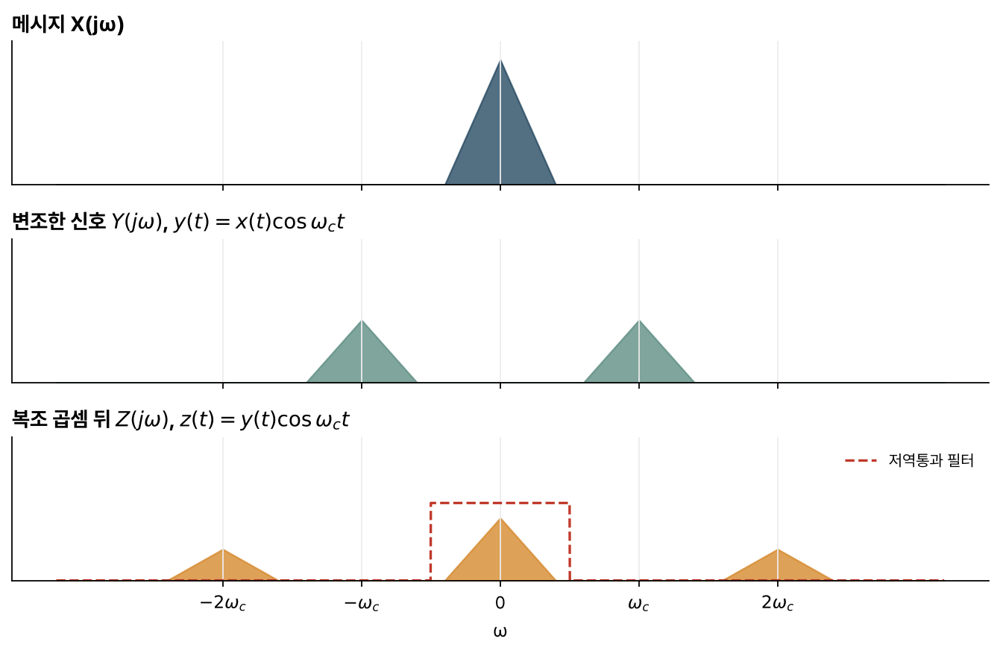
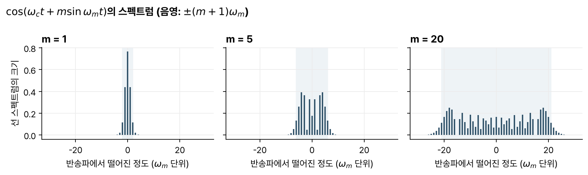

> [!abstract] 한눈에
> 신호에 정현파 반송파를 곱하면 스펙트럼이 반송파 주파수로 옮겨 간다. 이것이 진폭 변조이고, 받는 쪽에서 같은 반송파를 한 번 더 곱해 저역통과 필터를 지나면 원래 신호가 돌아온다. 반송파 주파수를 다르게 하면 여러 신호가 한 매체를 함께 쓸 수 있다. 주파수 변조는 반송파의 순간 주파수에 신호를 싣는데, 변조 지수가 크면 대역이 넓어지는 대신 잡음에 강하다.

## 신호와 매체의 짝

안테나는 길이가 파장 정도일 때 효율이 좋다. 전화 음성은 200–3000 Hz이고, 파장 $\lambda = c/f$로 계산하면 200 Hz에서 1500 km, 3000 Hz에서 100 km다. 음성을 그대로 전파로 보내려면 수백 km짜리 안테나가 필요하다. 거꾸로 길이 10 cm인 안테나는 $f = c/\lambda \approx 3$ GHz에 맞고, 실제 휴대전화는 2 GHz 근처를 쓴다.

변조(modulation)는 신호를 매체에 맞는 주파수 대역으로 옮기는 방법이다.

## 진폭 변조

메시지 $x(t)$에 반송파 $\cos\omega_c t$를 곱한다.

$$
y(t) = x(t)\cos\omega_c t = \tfrac12 x(t)e^{j\omega_c t} + \tfrac12 x(t)e^{-j\omega_c t}
$$

$e^{j\omega_c t}$를 곱하면 스펙트럼이 $\omega_c$만큼 옮겨 가므로

$$
Y(j\omega) = \tfrac12 X\big(j(\omega - \omega_c)\big) + \tfrac12 X\big(j(\omega + \omega_c)\big)
$$

다. 메시지의 스펙트럼이 $\pm\omega_c$로 복사되고 높이는 절반이 된다(그림 1의 가운데).

## 동기 복조

받은 신호에 같은 반송파를 한 번 더 곱한다.

$$
z(t) = y(t)\cos\omega_c t = x(t)\cos^2\omega_c t = \tfrac12 x(t) + \tfrac12 x(t)\cos 2\omega_c t
$$

$\tfrac12 x(t)$는 원점에, 나머지는 $\pm2\omega_c$에 놓인다. 저역통과 필터로 $\pm2\omega_c$ 성분을 걸러내면 메시지가 남는다. 이것을 **동기 복조**(synchronous demodulation)라 한다.

*그림 1. 대역이 제한된 메시지의 스펙트럼(위), 반송파를 곱한 뒤(가운데), 같은 반송파를 한 번 더 곱한 뒤(아래). 아래의 점선은 복조에 쓰는 저역통과 필터다.*

## 주파수 분할 다중화

송신기마다 반송파 주파수를 다르게 하면, 스펙트럼이 겹치지 않는 한 여러 신호를 더해 한 매체로 보낼 수 있다. 받는 쪽은 원하는 송신기의 반송파 주파수로 복조하고 저역통과 필터를 지나 그 신호만 꺼낸다. 이것이 **주파수 분할 다중화**(frequency-division multiplexing)다. 상업 AM 라디오는 채널마다 10 kHz를 배정하고, 중심 주파수는 540–1600 kHz에 106개 채널이 있다.

## 위상 오차

동기 복조에는 반송파를 정확히 알아야 한다. 수신기의 반송파가 위상 $\phi$만큼 어긋나면

$$
x(t)\cos\omega_c t\cos(\omega_c t + \phi) = \tfrac12 x(t)\cos\phi + \tfrac12 x(t)\cos(2\omega_c t + \phi)
$$

이고, 저역통과 필터를 지난 출력은 $\tfrac12 x(t)\cos\phi$다. $\phi = \pi/2$면 출력이 0이 되고, $\phi$가 시간에 따라 변하면 소리가 커졌다 작아졌다 한다(fading).

## 반송파를 함께 보내는 AM

송신 쪽에서 반송파를 같이 보내면 수신기가 위상을 맞추지 않아도 된다.

$$
z(t) = x(t)\cos\omega_c t + C\cos\omega_c t = \big(x(t) + C\big)\cos\omega_c t
$$

$x(t) + C$가 항상 양수가 되도록 $C$를 크게 잡으면, 메시지는 반송파의 포락선(envelope)이 된다. 반송파 주파수가 메시지의 최고 주파수보다 훨씬 높으면 다이오드와 RC로 된 피크 검출기로 포락선을 읽을 수 있다. AM 라디오는 메시지 최고 주파수가 5 kHz이고 반송파가 500–1500 kHz여서 이 조건을 만족한다.

이 방식은 전력이 많이 든다. 음성은 파고율(최댓값/실효값)이 커서, $C$가 최댓값보다 커야 하는 조건 때문에 실효값의 35배 넘게 잡아야 할 수 있다. 그러면 반송파를 보내는 전력이 메시지 전력의 $35^2 \approx 1000$배가 된다. 방송국에는 괜찮지만 배터리로 동작하는 일대일 통신에는 맞지 않는다.

포락선 검출로는 여러 송신기를 가를 수도 없다.

## 디지털 수신기

AM 라디오 대역 전체를 디지털로 처리하려면 1600 kHz 성분까지 표본화해야 한다. 나이퀴스트 조건에서 표본 주기 $T$는 $1/(2\times1600\text{ kHz}) \approx 0.3\ \mu$s 이하다. 디지털 쪽에서는 대역통과 필터, 반송파 곱셈, 저역통과 필터를 차례로 구현한다.

## 위상 변조와 주파수 변조

반송파에 메시지를 싣는 방법은 진폭 말고도 있다.

| 방식 | 송신 신호 |
|---|---|
| 반송파를 함께 보내는 AM | $\big(x(t) + C\big)\cos\omega_c t$ |
| 위상 변조(PM) | $\cos\big(\omega_c t + kx(t)\big)$ |
| 주파수 변조(FM) | $\cos\Big(\omega_c t + k\int_{-\infty}^{t} x(\tau)\,d\tau\Big)$ |

FM에서 $\phi(t) = k\int x\,d\tau$라 하면, 전체 위상 $\omega_c t + \phi(t)$를 미분한 순간 주파수는 $\omega_i(t) = \omega_c + \phi'(t) = \omega_c + kx(t)$로 메시지에 따라 바뀐다. FM은 포락선이 일정해서 송신 전력이 일정하고, 직류 성분이 중요하지 않으면 반송파를 따로 보낼 필요가 없다.

### 대역폭

초기에는 $k$를 작게 하면 FM의 대역을 얼마든지 좁힐 수 있다고 생각했다. $k\to0$이면 $\cos(k\int x) \to 1$, $\sin(k\int x)\to k\int x$이므로

$$
y(t) \approx \cos\omega_c t - \sin\omega_c t\cdot k\int_{-\infty}^{t} x(\tau)\,d\tau
$$

이다. 적분은 신호의 최고 주파수를 바꾸지 않으므로, 협대역 FM의 대역폭은 AM과 같다.

메시지가 정현파 $\sin\omega_m t$일 때 $y(t) = \cos(\omega_c t + m\sin\omega_m t)$의 스펙트럼은 반송파 주위에 $\omega_m$ 간격으로 늘어선 선들이다. 변조 지수 $m$이 커질수록 선이 넓게 퍼진다(그림 2). 강의 자료의 $m = 50$ 그림에서는 스펙트럼이 반송파 주위로 약 $100\,\omega_m$ 폭에 걸친다.

*그림 2. $\cos(\omega_c t + m\sin\omega_m t)$의 선 스펙트럼 크기. $k$번째 선의 크기는 1종 베셀 함수 $|J_k(m)|$이고, 음영은 $\pm(m+1)\omega_m$ 구간이다. 값은 직접 계산했다.*

선의 크기는 베셀 함수 $J_k(m)$이다. 직접 계산하면 $\pm(m+1)\omega_m$ 안에 전력의 98% 이상이 들어 있다($m$ = 1, 5, 10, 50에서 각각 99.9%, 99.4%, 99.0%, 98.5%). 이 구간 폭 $2(m+1)\omega_m$을 FM 대역폭의 어림값으로 쓰고, 카슨 규칙(Carson's rule)이라 부른다. 카슨 규칙은 강의 자료에 없고, 통신 교재(예: Haykin, _Communication Systems_)의 FM 장에 나온다.

광대역 FM은 같은 메시지를 넓은 대역에 중복해서 싣는 셈이라 더해지는 잡음에 강하다.

## 유의점

- 진폭 변조는 시간 영역의 곱셈이고 주파수 영역에서는 컨볼루션이다. 반송파의 스펙트럼이 $\pm\omega_c$의 임펄스여서 결과가 이동으로 보인다.
- 반송파 주파수는 메시지 대역폭보다 커야 한다. 그렇지 않으면 $\pm\omega_c$로 옮긴 두 복사본이 겹쳐 복조할 수 없다.
- 동기 복조 출력은 위상 오차에 $\cos\phi$로 민감하다. 위상이 90° 어긋나면 출력이 없다.
- 변조 지수를 줄여도 FM의 대역폭은 AM보다 좁아지지 않는다.

## 관련 개념

- [[fourier-transform|연속시간 푸리에 변환]]: $e^{j\omega_c t}$를 곱하면 스펙트럼이 옮겨 가는 성질
- [[sampling-aliasing|샘플링과 앨리어싱]]: 디지털 수신기의 표본 주기를 정하는 조건
- [[first-order-rc-rl|RC·RL 1차 회로]]: 포락선 검출기의 RC
- [[fourier-series|푸리에 급수]]: 정현파로 변조한 FM 신호의 선 스펙트럼

## 참고 자료

- MIT OCW, [6.003 Signals and Systems (Fall 2011)](https://ocw.mit.edu/courses/6-003-signals-and-systems-fall-2011/), Lecture 23 _Modulation, part 1_, Lecture 24 _Modulation, part 2_
- A. V. Oppenheim, A. S. Willsky, _Signals and Systems_, 2nd ed., Ch. 8
- S. Haykin, _Communication Systems_, Wiley (카슨 규칙)
