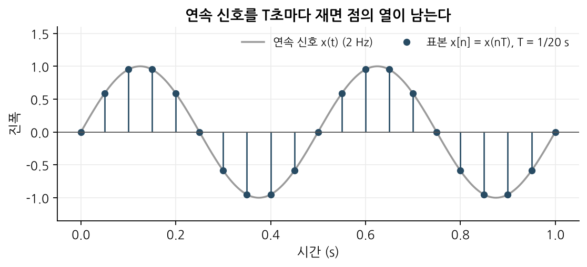
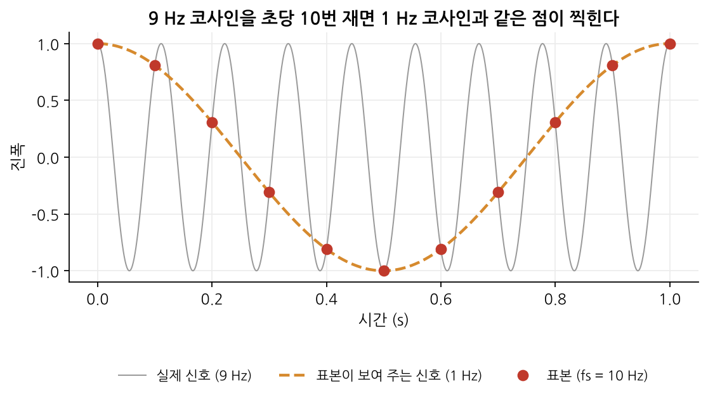
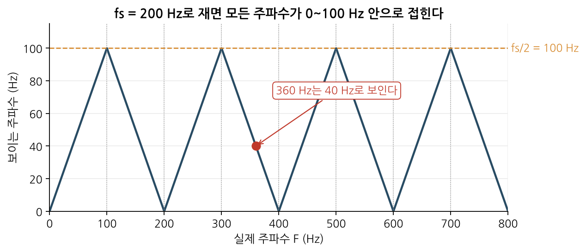
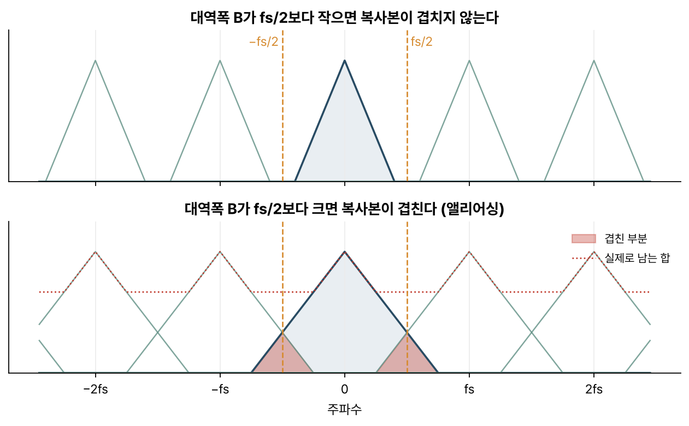

> [!abstract] 한눈에
> 연속 신호를 $T$초마다 재는 일을 **샘플링**이라 한다. 신호에 $f_s/2$보다 높은 성분이 있으면 그 성분은 사라지지 않고 더 낮은 주파수 성분처럼 표본에 섞여 드는데 이를 **앨리어싱**이라 한다. 한번 섞인 성분은 표본만 보고 되돌릴 수 없어서 재기 전에 높은 성분을 걸러 내야 한다.

## 정의

**샘플링**(sampling, 표본화)은 연속시간 신호 $x(t)$의 값을 일정한 간격 $T$마다 읽어 이산시간 신호를 만드는 과정이다.

$$
x[n] = x(nT), \qquad f_s = \frac{1}{T}
$$

$f_s$는 초당 몇 번 재는지를 나타내며 **샘플링 주파수**라고 부른다. ADC(아날로그-디지털 변환기)가 하는 일 가운데 절반이 샘플링이고 나머지 절반은 읽은 값을 유한한 비트로 반올림하는 [[quantization-adc|양자화]]다.

*그림 1. 2 Hz 사인파를 초당 20번 재면 컴퓨터에는 파란 점들만 남는다.*

## 앨리어싱

표본은 점뿐이어서 점 사이에서 신호가 어떻게 움직였는지는 알 수 없다. 서로 다른 연속 신호가 똑같은 점을 남길 수도 있다. 그림 2처럼 9 Hz 코사인을 초당 10번 재면 찍힌 점들이 1 Hz 코사인 위에 정확히 올라앉아서 표본만 받은 사람은 원래 신호가 9 Hz였는지 1 Hz였는지 구별할 수 없다.

*그림 2. 회색 9 Hz 신호를 빨간 점에서만 재면 점들은 주황색 1 Hz 신호와 구별되지 않는다.*

높은 주파수가 이처럼 낮은 주파수로 보이는 현상을 **앨리어싱**(aliasing)이라 한다. alias는 '가명'을 뜻한다.

### 보이는 주파수 계산

이산시간에서 $n$은 정수이므로 코사인의 주파수에 $f_s$의 정수배를 더하거나 빼도 표본값은 그대로다.

$$
\cos\!\left(2\pi \frac{F}{f_s} n\right) = \cos\!\left(2\pi \frac{F - k f_s}{f_s} n\right) \quad (k \text{는 정수})
$$

$F = 9$, $f_s = 10$에서 $k = 1$을 고르면 $F - f_s = -1$이다. 코사인은 부호를 가리지 않으니 이 신호는 1 Hz로 보인다. 일반적으로 표본에서 보이는 주파수는

$$
f_{\text{보임}} = \left| F - k f_s \right|, \qquad k = F/f_s \text{에 가장 가까운 정수}
$$

이고, 이 값은 언제나 $0$과 $f_s/2$ 사이에 놓인다. 실제 주파수를 가로축에 놓고 보이는 주파수를 그리면 톱니가 접힌 모양이 나온다(그림 3). 이 모양을 따서 앨리어싱을 **주파수 접힘**(folding)이라고도 부른다. 접히는 경계인 $f_s/2$는 **나이퀴스트 주파수**다.

*그림 3. $f_s = 200$ Hz인 경우. 360 Hz 성분은 $|360 - 2 \times 200| = 40$ Hz로 접혀 들어온다.*

## 스펙트럼의 복사

스펙트럼으로 보면 샘플링은 원래 스펙트럼 $X(f)$를 $f_s$ 간격으로 복사해 이어 붙이는 일과 같다. 연속 신호에 간격 $T$의 임펄스열을 곱하면 표본만 남은 신호가 되고 그 스펙트럼이 아래 $X_s(f)$다.

$$
X_s(f) = f_s \sum_{k=-\infty}^{\infty} X(f - k f_s)
$$

원래 신호의 대역폭 $B$가 $f_s/2$보다 작으면 복사본들이 서로 떨어져 있으므로 가운데 하나만 저역통과 필터로 잘라 내 원래 신호를 되살릴 수 있다. 반대로 $B$가 $f_s/2$를 넘으면 이웃한 복사본의 꼬리가 가운데로 넘어와 겹친다. 겹친 부분은 서로 더해져서 무엇이 원래 것이었는지 구별할 수 없다(그림 4의 빨간 부분).

*그림 4. 위: 대역폭이 좁아 복사본이 떨어져 있다. 아래: 대역폭이 넓어 복사본이 겹친다.*

## 나이퀴스트-섀넌 샘플링 정리

> [!note] 샘플링 정리
> 신호에 $B$ Hz보다 높은 성분이 전혀 없다면 $f_s > 2B$로 잰 표본만으로 원래 연속 신호를 완벽하게 되살릴 수 있다.

정리의 조건은 그림 4의 위쪽 상황에 해당한다. 조건의 부등호에 등호가 없다는 데 주의해야 한다. 경계인 $f_s = 2B$에서는 $B$ Hz 사인파를 반 주기마다 한 번씩 재게 된다. 재는 순간이 마침 0을 지나는 순간과 겹치면 표본이 전부 0이 되어 신호가 통째로 사라진다. 겹치지 않더라도 표본은 같은 크기로 부호만 번갈아 바뀌므로 진폭과 위상을 서로 구별할 수 없다.

## 실제 대응

샘플링 전에 아날로그 저역통과 필터를 두어 $f_s/2$ 위의 성분을 미리 깎아 내면 접혀 들어올 거리가 없어진다. 이 필터를 **앤티앨리어싱 필터**라고 한다. 현실의 필터는 경계에서 칼같이 끊기지 않아서 보통은 관심 대역의 두 배보다 넉넉히 빠르게 잰다.

생체 신호 장비도 같은 이유로 ADC 앞에 아날로그 필터를 꼭 둔다. 뇌파나 심전도처럼 측정하려는 대역 자체는 낮아도 근전도나 전원 잡음의 고조파 같은 더 높은 주파수의 잡음이 함께 들어온다. 이 잡음이 접히면 관심 대역 한가운데에 가짜 성분이 생긴다.

## 자주 하는 오해

- **"샘플링한 뒤 디지털 필터로 앨리어싱을 걷어 내면 된다."** 안 된다. 이미 접힌 40 Hz 성분은 표본 위에서 진짜 40 Hz 성분과 똑같이 생겨서 걸러 낼 근거가 남아 있지 않다.
- **"앨리어싱이 일어나면 높은 주파수 성분이 사라진다."** 사라지지 않고 낮은 주파수 성분으로 바뀌어 남는다. 있는 정보를 오염시키므로 정보가 빠지는 것보다 나쁘다.
- **"신호의 최고 주파수만 따지면 된다."** 잡음도 똑같이 접힌다. 관심 신호가 대역 안에 있어도 대역 밖 잡음이 $f_s/2$를 넘으면 문제가 된다.
- **"$f_s = 2B$면 충분하다."** 정리의 부등호는 엄격하다. 실무에서는 필터가 완벽하지 않아서 그보다 꽤 여유를 둔다.

## 관련 개념

- [[dtft|이산시간 푸리에 변환]]: 이산시간 스펙트럼이 $2\pi$마다 반복되는 현상은 위의 '복사본'과 같고 주파수 축의 단위만 다르다. $\omega = 2\pi f / f_s$이므로 $f_s/2$는 $\omega = \pi$에 해당한다.
- [[quantization-adc|양자화와 ADC]]: ADC가 하는 일의 나머지 절반, 값의 축을 나누는 쪽

## 참고 자료

- MIT OCW, [6.003 Signals and Systems (Fall 2011)](https://ocw.mit.edu/courses/6-003-signals-and-systems-fall-2011/), 샘플링 단원
- MIT OCW, [HST.582J Biomedical Signal and Image Processing](https://ocw.mit.edu/courses/hst-582j-biomedical-signal-and-image-processing-spring-2007/), Chapter 1 *Data acquisition: ADC*
- A. V. Oppenheim, A. S. Willsky, *Signals and Systems*, 2nd ed., Ch. 7 *Sampling*
