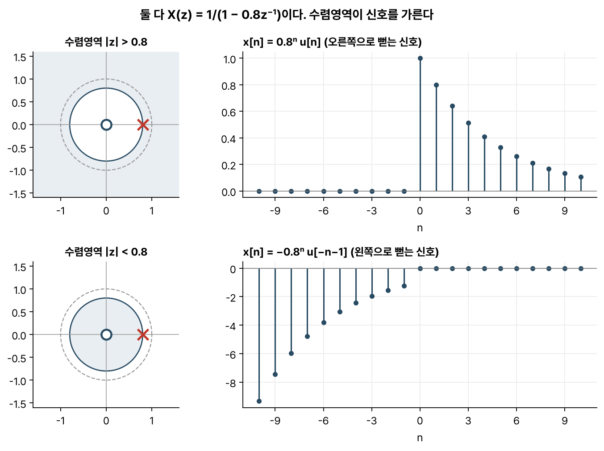
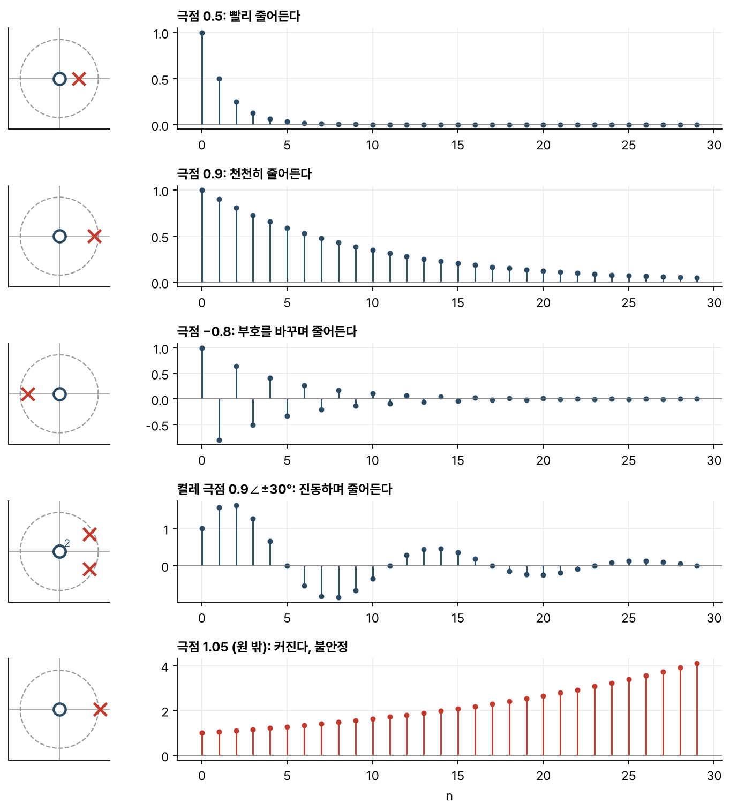
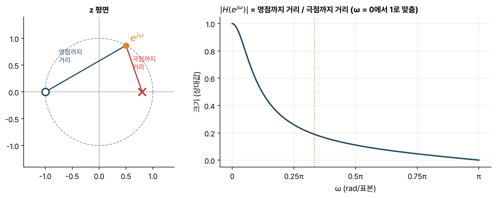

> [!abstract] 한눈에
> z 변환은 신호 $x[n]$을 복소수 $z$의 함수 $X(z)$로 바꾼다. 식이 같아도 수렴영역(ROC)이 다르면 다른 신호이므로 둘은 늘 함께 적는다. 시스템을 z 변환하면 극점과 영점을 얻는데, 인과 시스템이 안정한지는 극점이 단위원 안에 있는지로 정해진다. 단위원 위의 값만 떼어 보면 주파수 응답이다.

## 정의

$$
X(z) = \sum_{n=-\infty}^{\infty} x[n]\, z^{-n}
$$

$z$는 복소수다. 이 합이 수렴하는 $z$의 범위를 **수렴영역(ROC, region of convergence)** 이라 한다. $z^{-1}$을 곱하면 시간 영역에서 신호가 한 칸 늦어지므로 $z^{-1}$을 '지연 연산자'로 읽어도 된다.

## 수렴영역과 신호

$x[n] = a^n u[n]$(0부터 오른쪽으로 뻗는 신호)을 변환하면 등비급수가 나온다.

$$
\sum_{n=0}^{\infty} a^n z^{-n} = \frac{1}{1 - a z^{-1}}, \qquad |z| > |a|
$$

그런데 $x[n] = -a^n u[-n-1]$(−1부터 왼쪽으로 뻗는 신호)을 변환해도 같은 식 $1/(1 - az^{-1})$이 나온다. 수렴영역이 $|z| < |a|$로 다를 뿐이어서 식만으로는 어느 신호인지 알 수 없다(그림 1).

*그림 1. $X(z) = z/(z - 0.8)$의 극점(×)은 0.8, 영점(○)은 원점에 있다. 수렴영역이 원 바깥이면 오른쪽으로 뻗는 신호이고 원 안쪽이면 왼쪽으로 뻗는 신호다.*

일반적으로 오른쪽으로 뻗는 신호는 수렴영역이 가장 바깥 극점보다 바깥에, 왼쪽으로 뻗는 신호는 가장 안쪽 극점보다 안쪽에 놓인다. 인과 시스템(현재와 과거 입력만 쓰는 시스템)은 임펄스 응답이 오른쪽으로 뻗으므로 수렴영역도 바깥쪽에 있다.

## 시스템 함수와 극점

차분방정식으로 적힌 시스템을 z 변환하면 출력과 입력의 비인 **시스템 함수** $H(z)$를 얻는다. 예를 들어

$$
y[n] = a\, y[n-1] + x[n] \quad\Longrightarrow\quad H(z) = \frac{Y(z)}{X(z)} = \frac{1}{1 - a z^{-1}}
$$

이다. 분모를 0으로 만드는 $z$를 **극점**, 분자를 0으로 만드는 $z$를 **영점**이라 한다. 이 예의 극점은 $z = a$ 하나다.

극점이 어디 있는지 보면 단위 표본 응답의 모양을 거의 다 알 수 있다(그림 2).

- 극점이 원점에 가까우면 응답이 금방 사라지고 단위원에 가까우면 오래 남는다.
- 음의 실수축 위에 있으면 응답의 부호가 표본마다 바뀐다.
- 켤레 복소수 쌍이면 응답이 진동하며 진동 주파수는 극점의 각도가 정한다.
- 단위원 밖에 있으면 응답이 계속 커진다. 인과 시스템이 안정하려면 극점이 모두 단위원 안에 있어야 한다.

*그림 2. 왼쪽은 극점(×)과 영점(○)의 위치, 오른쪽은 단위 표본 응답 $h[n]$이다. $H(z)$를 $z$의 거듭제곱으로 고쳐 쓰면(예: $\frac{1}{1-az^{-1}} = \frac{z}{z-a}$) 원점에 극점 개수만큼 영점이 생긴다. 마지막 줄은 극점이 단위원 밖에 있어서 응답이 커진다.*

## 주파수 응답

$H(z)$에 $z = e^{j\omega}$를 넣어 단위원 위의 값만 보면 [[dtft|DTFT]]가 된다. 이것을 시스템의 **주파수 응답** $H(e^{j\omega})$라 한다. 수렴영역이 단위원을 포함해야 이렇게 할 수 있다.

극점과 영점의 위치에서 주파수 응답의 크기를 기하적으로 구할 수도 있다. 단위원 위의 점 $e^{j\omega}$에서 각 영점까지의 거리를 모두 곱한 뒤 각 극점까지의 거리로 나누면 된다(상수배는 뺀다).

$$
|H(e^{j\omega})| \propto \frac{\prod_i |e^{j\omega} - z_i|}{\prod_k |e^{j\omega} - p_k|}
$$

그림 3의 극점은 0.8, 영점은 −1에 있다. $\omega = 0$ 근처는 극점과 가까워 응답이 크고 $\omega = \pi$에서는 점이 영점 위에 놓여 응답이 0이 되므로 이 시스템은 저역통과 필터다.

*그림 3. $H(z) = (1 + z^{-1})/(1 - 0.8z^{-1})$. 단위원 위의 점이 극점에 다가갈수록 크기가 커지고 영점에 닿으면 0이 된다.*

## 자주 하는 오해

- **"z 변환은 식만 맞으면 된다."** 수렴영역이 빠지면 신호가 하나로 정해지지 않는다. 그림 1의 두 신호가 그런 경우다.
- **"극점이 단위원 안에 있으면 언제나 안정하다."** 인과 시스템에서만 맞는 말이다. 일반적으로는 수렴영역이 단위원을 포함하면 안정하다.
- **"DTFT는 언제나 z 변환에 $z = e^{j\omega}$를 넣으면 나온다."** 수렴영역이 단위원을 포함할 때만 그렇다. 불안정한 시스템에는 주파수 응답이 정의되지 않는다.
- **"영점은 출력을 0으로 만든다."** 영점이 단위원 위에 있을 때 그 각도에 해당하는 주파수 성분 하나만 0이 된다. 근처 주파수는 줄어들기만 한다. 단위원 안이나 밖에 있는 영점은 어떤 주파수도 완전히 지우지 않는다.

## 관련 개념

- [[dtft|이산시간 푸리에 변환]]: z 변환을 단위원 위로 제한한 경우
- [[dft-fft|DFT와 FFT]]: 단위원 위의 $N$개 점에서 뽑은 값
- [[sampling-aliasing|샘플링과 앨리어싱]]: z 변환이 다루는 이산시간 신호는 연속 신호를 샘플링해서 얻는다

## 참고 자료

- MIT OCW, [6.003 Signals and Systems (Fall 2011)](https://ocw.mit.edu/courses/6-003-signals-and-systems-fall-2011/), Lecture 5 *Z transform*
- MIT OCW, [HST.582J Biomedical Signal and Image Processing](https://ocw.mit.edu/courses/hst-582j-biomedical-signal-and-image-processing-spring-2007/), 이산 스펙트럼 방법(Z 변환) 단원
- A. V. Oppenheim, R. W. Schafer, *Discrete-Time Signal Processing*, 3rd ed., Ch. 3
