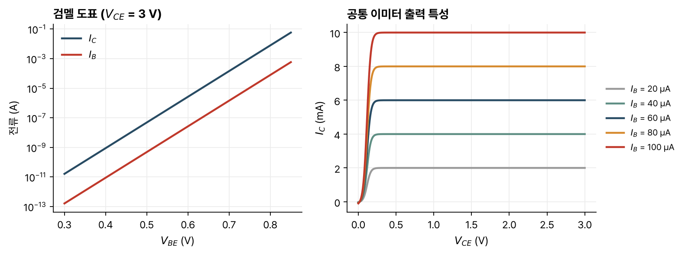

> [!abstract] 한눈에
> npn 바이폴라 트랜지스터는 이미터-베이스, 베이스-컬렉터 두 pn 접합을 아주 가깝게 붙인 소자다. 이미터-베이스 접합을 순방향, 베이스-컬렉터 접합을 역방향으로 걸면 이미터가 베이스로 주입한 전자를 컬렉터가 거둬들인다. 컬렉터 전류는 $V_{BE}$에 지수적으로 의존하고 $V_{BC}$와는 거의 무관하다. 그 대가로 베이스가 이미터로 정공을 주입하는 작은 베이스 전류가 흐르고, 두 전류의 비가 전류 이득 $\beta_F$다.

## 구조

집적회로의 npn 트랜지스터는 n⁺ 이미터, p 베이스, n 컬렉터를 위에서 아래로 쌓고, n⁺ 매립층과 n⁺ 플러그로 컬렉터 접촉을 위로 끌어올린 구조다. 이미터 띠의 면적이 이미터-베이스 접합 면적 $A_E$다. 강의는 BJT의 특징으로 입력 커패시턴스당 전류 구동 능력이 커서 빠르다는 점을 들고, 아날로그와 통신 앞단 회로에 알맞다고 적는다.

1차원으로 보면 BJT는 두 pn 접합을 등지게 붙인 것이다. 두 접합은 다음 조건을 함께 만족해야 한다.

- 소수 캐리어가 베이스를 빨리 확산해 지나갈 만큼 가깝다.
- 두 공핍층이 서로 닿지 않을 만큼 떨어져 있다(닿으면 펀치스루).

두 접합의 바이어스 방향에 따라 동작 영역이 넷으로 나뉜다.

| 영역 | $V_{BE}$ | $V_{BC}$ | 쓰임 |
|---|---|---|---|
| 순방향 활성 | $> 0$ | $< 0$ | 이득과 격리가 좋다. 가장 많이 쓴다 |
| 포화 | $> 0$ | $> 0$ | 격리가 없고 소수 캐리어가 넘친다. 빠져나오는 데 시간이 걸려 피한다 |
| 역방향 | $< 0$ | $> 0$ | 이득이 낮아 쓰지 않는다 |
| 차단 | $< 0$ | $< 0$ | 전류가 거의 없어 열린 회로에 가깝다. 유용한 영역이다 |

## 순방향 활성 영역의 동작

$V_{BE} > 0$이면 이미터가 베이스로 전자를, 베이스가 이미터로 정공을 주입한다. $V_{BC} < 0$이면 컬렉터가 베이스의 전자를 추출한다. 트랜지스터 동작은 이미터가 주입한 전자를 컬렉터가 거둬들이는 데서 나온다.

- 컬렉터 전류 $I_C$: 이미터에서 베이스로 주입된 전자가 컬렉터로 모인다.
- 베이스 전류 $I_B$: 베이스가 이미터로 주입한 정공이 흐른다.
- 이미터 전류: $I_E = -I_C - I_B$.

그래서 $V_{BE}$가 $I_C$를 정하고(트랜지스터 효과), $I_C$는 $V_{BC}$와 무관하며(격리), 그 제어의 대가로 $I_B$가 흐른다.

| 비교 | 포화 영역의 이상적 MOSFET | 순방향 활성 영역의 이상적 BJT |
|---|---|---|
| 제어 단자 | 게이트 | 베이스 |
| 공통 단자 | 소스 | 이미터 |
| 제어되는 단자 | 드레인 | 컬렉터 |
| 제어되는 전류의 의존성 | 2차 | 지수 |
| 제어 단자의 직류 전류 | 0 | 지수 |

## 전류 식

### 컬렉터 전류

베이스에서 전자의 확산을 본다. 이미터 쪽 경계에서는 [[pn-diode|pn 다이오드]]처럼 $n_{pB}(0) = n_{pBo}e^{qV_{BE}/kT}$이고, 컬렉터 쪽 경계에서는 역방향 바이어스로 추출되어 $n_{pB}(W_B) = 0$이다. 그 사이의 분포는 직선 $n_{pB}(x) = n_{pB}(0)(1 - x/W_B)$이므로 전자 전류 밀도는 $J_{nB} = -qD_n n_{pB}(0)/W_B$다. 컬렉터 전류는 이미터-베이스 접합 면적에 비례한다.

$$
I_C = qA_E\frac{D_n}{W_B}n_{pBo}\,e^{qV_{BE}/kT} = I_S\,e^{qV_{BE}/kT}
$$

$I_S$는 컬렉터 포화 전류이고, $n_{pBo} = n_i^2/N_{aB}$다.

### 베이스 전류

이미터에서 정공의 주입과 접촉에서의 재결합을 본다. 경계조건은 $p_{nE}(-x_{BE}) = p_{nEo}e^{qV_{BE}/kT}$, 이미터 접촉에서 평형값 $p_{nEo}$이고, 분포는 직선이다. 이미터 폭을 $W_E$라 하면

$$
I_B = qA_E\frac{D_p}{W_E}p_{nEo}\left(e^{qV_{BE}/kT} - 1\right) = \frac{I_S}{\beta_F}\left(e^{qV_{BE}/kT} - 1\right)
$$

이다. $V_{BE}$가 $kT/q$보다 몇 배 크면 $I_B \approx I_C/\beta_F$다.

### 전류 이득

$$
\beta_F = \frac{I_C}{I_B} = \frac{N_{dE}}{N_{aB}}\frac{D_n}{D_p}\frac{W_E}{W_B}
$$

$\beta_F$를 키우려면 이미터 도핑을 베이스 도핑보다 훨씬 높이고($N_{dE} \gg N_{aB}$), 이미터를 베이스보다 두껍게 하고($W_E \gg W_B$), 전자의 확산 계수가 크므로 pnp보다 npn으로 만든다. 강의 자료는 당시 집적회로 BJT의 전형적인 값을 $I_C$ 0.1–1 mA, $\beta_F$ 50–300으로 들고, 공정에서 $\beta_F$를 정밀하게 맞추기 어려워 $\beta_F$ 변화에 둔감한 회로 기법이 필요하다고 적는다.

### 검멜 도표

$I_C$와 $I_B$를 $V_{BE}$에 대해 반로그 축에 그린 것이 검멜 도표다. 두 전류 모두 상온에서 60 mV마다 10배씩 늘어나는 평행한 직선이고, 두 전류의 비가 $\beta_F$다(그림 1 왼쪽). 강의의 측정에서 $\beta_F$는 중간 전류에서 거의 일정하고 큰 전류에서 떨어지는데, 그림 1의 모형은 이 감소를 담지 않는다.

*그림 1. 아래의 대신호 모형으로 계산한 npn BJT의 검멜 도표($V_{CE} = 3$ V)와 공통 이미터 출력 특성. 소자 값은 예로 정한 $I_S = 10^{-16}$ A, $\beta_F = 100$, $\beta_R = 1$, $kT/q = 25$ mV다.*

그림 1의 값으로 계산하면 $I_C = 1$ mA에 필요한 $V_{BE}$는 약 0.75 V다.

## 나머지 동작 영역

역방향 영역($V_{BE} < 0$, $V_{BC} > 0$)에서는 컬렉터가 베이스로 전자를 주입하고 이미터가 거둬들인다. $I_E = I_S e^{qV_{BC}/kT}$이고, 베이스가 컬렉터로 정공을 주입해 $I_B = \frac{I_S}{\beta_R}(e^{qV_{BC}/kT} - 1)$이 흐른다. 강의 자료에 따르면 역방향 이득 $\beta_R$은 0.1–5 정도로 $\beta_F$보다 훨씬 작다. 이미터와 컬렉터의 도핑과 구조가 대칭이 아니기 때문이다(덧붙인 설명).

차단 영역($V_{BE} < 0$, $V_{BC} < 0$)에서는 베이스가 이미터와 컬렉터 양쪽에서 정공을 추출할 뿐이라, 강의 자료의 어림으로 $10^{-12}$ A 정도의 누설 전류만 흐른다.

포화 영역($V_{BE} > 0$, $V_{BC} > 0$)은 순방향 활성과 역방향의 중첩이다. 베이스와 컬렉터가 초과 소수 캐리어로 가득 차서, 트랜지스터를 포화에서 빼내는 데 시간이 오래 걸린다. $I_C$와 $I_E$의 부호는 두 접합 전압과 $\beta_F$, $\beta_R$의 상대적 크기에 따라 어느 쪽이든 될 수 있다.

## 대신호 모형

네 영역을 함께 나타내는 식은 다음 셋이다.

$$
I_C = I_S\left(e^{qV_{BE}/kT} - e^{qV_{BC}/kT}\right) - \frac{I_S}{\beta_R}\left(e^{qV_{BC}/kT} - 1\right)
$$

$$
I_B = \frac{I_S}{\beta_F}\left(e^{qV_{BE}/kT} - 1\right) + \frac{I_S}{\beta_R}\left(e^{qV_{BC}/kT} - 1\right)
$$

$$
I_E = -\frac{I_S}{\beta_F}\left(e^{qV_{BE}/kT} - 1\right) - I_S\left(e^{qV_{BE}/kT} - e^{qV_{BC}/kT}\right)
$$

등가회로로는 베이스-이미터, 베이스-컬렉터 사이의 두 다이오드와 컬렉터-이미터 사이의 전류원 $I_S(e^{qV_{BE}/kT} - e^{qV_{BC}/kT})$로 나타내고, 강의는 이를 비선형 하이브리드-π 모형이라 부른다. 매개변수는 $I_S$, $\beta_F$, $\beta_R$ 셋이고, 교재의 에버스-몰(Ebers-Moll) 모형과 같다.

바이어스 계산에서는 영역별로 단순화한다. 강의 자료가 든 당시 기술의 값은 다음과 같다.

- 순방향 활성: 베이스-이미터는 전압원 $V_{BE,on} \approx 0.7$ V, 컬렉터는 전류원 $\beta_F I_B$
- 역방향: 베이스-컬렉터가 $V_{BC,on} \approx 0.5$ V
- 포화: 두 접합이 모두 켜져 $V_{CE,sat} = V_{BE,on} - V_{BC,on} \approx 0.2$ V
- 차단: 모든 단자가 열린 회로

순방향 활성과 역방향에서는 $I_B$를, 포화에서는 $I_B$와 $I_C$를 소자 바깥의 회로가 정한다.

## 출력 특성

$I_B$를 고정하고 $I_C$를 $V_{CE}$에 대해 그리면 공통 이미터 출력 특성이 된다(그림 1 오른쪽). $V_{CE}$가 $V_{CE,sat}$ 근처보다 작은 곳이 포화 영역이고, 그보다 큰 곳에서 $I_C \approx \beta_F I_B$로 평평하다. $V_{CE} = V_{CB} + V_{BE}$이므로, $I_C$를 $V_{CB}$에 대해 그린 그림을 $V_{BE}$만큼 옮긴 모양이다. 이 모형에는 베이스 폭 변조가 없어 활성 영역의 곡선이 완전히 평평하다.

## 유의점

- 트랜지스터 동작은 이미터가 주입한 전자가 베이스에서 재결합하지 않고 컬렉터에 닿는 데 달려 있어서 베이스를 얇게 만든다.
- 컬렉터 전류는 $V_{BC}$와 무관하지만 $V_{BE}$에는 지수적으로 민감하다. 그래서 회로에서는 바이어스를 보통 $V_{BE}$보다 전류로 정한다(강의 자료 밖의 설명).
- $\beta_F$는 공정에 따라 크게 흩어지는 값이다. 강의 자료가 말하듯 회로는 $\beta_F$ 변화에 둔감하게 설계한다.
- $V_{BE,on} \approx 0.7$ V는 바이어스 계산의 어림값이다. 실제 $V_{BE}$는 전류가 10배 바뀔 때마다 60 mV씩 바뀐다.
- 베이스 전류를 줄이려고 이미터를 높게 도핑한다. 이미터와 컬렉터를 바꿔 쓰면 이득이 $\beta_R$로 떨어진다.

## 관련 개념

- [[pn-diode|pn 다이오드]]: 소수 캐리어 주입과 확산 전류
- [[mosfet-iv|MOSFET의 전류-전압 특성]]: 같은 역할의 전계효과 트랜지스터
- [[pn-junction-electrostatics|pn 접합의 정전기]]: 공핍층과 볼츠만 관계

## 참고 자료

- MIT OCW, [6.012 Microelectronic Devices and Circuits (Fall 2005)](https://ocw.mit.edu/courses/6-012-microelectronic-devices-and-circuits-fall-2005/), Lecture 17 _The Bipolar Junction Transistor (I): Forward Active Regime_, Lecture 18 _The Bipolar Junction Transistor (II): Regimes of Operation_
- R. T. Howe, C. G. Sodini, _Microelectronics: An Integrated Approach_, Prentice Hall, Ch. 7
