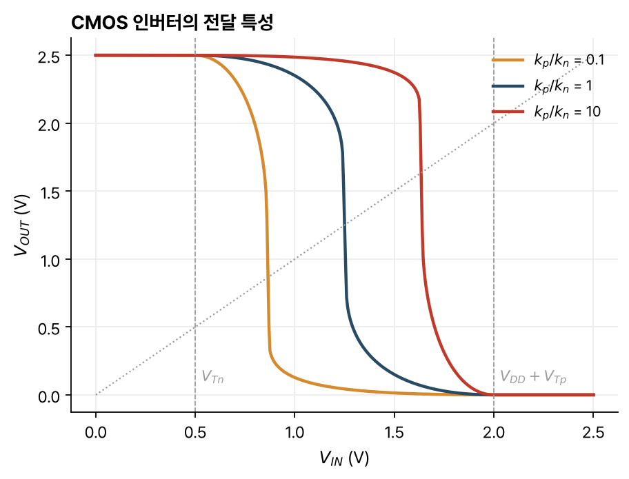

> [!abstract] 한눈에
> CMOS 인버터는 NMOS와 PMOS를 직렬로 두고 게이트를 함께 묶은 회로다. 어느 논리 상태에서든 한 트랜지스터가 꺼져 있어 대기 중에는 전류가 흐르지 않고, 출력이 0과 $V_{DD}$까지 완전히 흔들린다. 논리 문턱은 두 트랜지스터의 크기 비로 정하고, 문턱 근처의 이득이 커서 잡음 여유가 크다. 대신 출력이 바뀔 때마다 부하 커패시턴스를 충방전하므로 $fC_LV_{DD}^2$의 동적 전력을 쓴다.

## 동작

PMOS는 전원 $V_{DD}$와 출력 사이에, NMOS는 출력과 접지 사이에 있고, 두 게이트가 입력에 묶여 있다.

- $V_{IN} = 0$: $V_{GSn} = 0 < V_{Tn}$이라 NMOS가 꺼지고, $V_{SGp} = V_{DD} > -V_{Tp}$라 PMOS가 켜져 $V_{OUT} = V_{DD}$다.
- $V_{IN} = V_{DD}$: NMOS가 켜지고 PMOS가 꺼져 $V_{OUT} = 0$이다.

두 경우 모두 한 트랜지스터가 꺼져 있으므로 대기 중에는 전원에서 접지로 전류가 흐르지 않는다. 출력 수준이 0과 $V_{DD}$인 레일 투 레일(rail-to-rail) 논리다.

두 트랜지스터의 전압은 $V_{SGp} = V_{DD} - V_{IN}$, $V_{SDp} = V_{DD} - V_{OUT}$, 전류는 $I_{Dn} = -I_{Dp}$로 묶인다. 두 출력 특성을 $V_{OUT}$ 축 하나에 겹쳐 교점을 따라가면 전달 특성이 나온다. 입력을 올리면 NMOS 차단·PMOS 선형, NMOS 포화·PMOS 선형, 둘 다 포화, NMOS 선형·PMOS 포화, NMOS 선형·PMOS 차단 순으로 지난다.

## 논리 문턱

$V_M$에서는 두 트랜지스터가 모두 포화 영역이다. $k_n = \mu_n C_{ox}W_n/L_n$, $k_p = \mu_p C_{ox}W_p/L_p$로 두고 $\tfrac12 k_n(V_M - V_{Tn})^2 = \tfrac12 k_p(V_{DD} - V_M + V_{Tp})^2$를 풀면

$$
V_M = \frac{V_{Tn} + \sqrt{k_p/k_n}\,(V_{DD} + V_{Tp})}{1 + \sqrt{k_p/k_n}}
$$

이다. 보통 $V_{Tn} = -V_{Tp}$로 공정이 정하므로 $V_M$은 $k_p/k_n$ 비로 설계한다.

- $k_n = k_p$이면 $V_M = V_{DD}/2$로 대칭이다. $\mu_n \approx 2\mu_p$이고 보통 $L_p \approx L_n$이므로 $W_p \approx 2W_n$으로 잡는다.
- $k_n \gg k_p$이면 $V_M \approx V_{Tn}$이다. 입력이 $V_{Tn}$을 넘자마자 NMOS가 출력을 끌어내린다.
- $k_n \ll k_p$이면 $V_M \approx V_{DD} + V_{Tp}$다.

$V_M$은 $V_{Tn}$과 $V_{DD} + V_{Tp}$ 사이 어디에나 둘 수 있다(그림 1).

*그림 1. $k_p/k_n$에 따른 CMOS 인버터의 전달 특성. 소자 값은 예로 정한 $V_{DD} = 2.5$ V, $V_{Tn} = 0.5$ V, $V_{Tp} = -0.5$ V, $k_n = 1$ mA/V², $\lambda = 0.05$ V⁻¹이고, 각 입력에서 $I_{Dn} = -I_{Dp}$를 수치로 풀었다. 점선 대각선은 $V_{OUT} = V_{IN}$이다.*

## 잡음 여유

$V_M$에서 두 트랜지스터의 소신호 모델을 합치면, 입력이 두 게이트에 함께 걸리므로

$$
A_v = -(g_{mn} + g_{mp})(r_{on}\,/\!/\,r_{op})
$$

이다. 두 트랜스컨덕턴스가 더해지고 출력 저항이 둘 다 크므로 이득이 크다. $V_{OL} = 0$, $V_{OH} = V_{DD}$이므로 [[inverter-noise-margin|잡음 여유]]의 근사식은

$$
NM_L = V_M - \frac{V_{DD} - V_M}{|A_v|}, \qquad NM_H = V_{DD} - V_M\left(1 + \frac{1}{|A_v|}\right)
$$

가 된다. $|A_v| \to \infty$이면 $NM_L \to V_M$, $NM_H \to V_{DD} - V_M$이고, $V_M = V_{DD}/2$이면 두 여유가 모두 $V_{DD}/2$다.

그림 1의 대칭 경우를 수치로 미분하면 $|A_v| \approx 57$이고, 근사식으로는 두 잡음 여유가 약 1.23 V다. 같은 모형에서 기울기 $-1$인 점을 수치로 찾으면 $V_{IL} \approx 1.04$ V, $V_{OH} \approx 2.31$ V, $V_{IH} \approx 1.46$ V, $V_{OL} \approx 0.19$ V이고, 정의대로 계산한 두 잡음 여유는 약 0.85 V다. 근사식은 $V_{OL} = 0$, $V_{OH} = V_{DD}$로 두고 전달 특성을 직선으로 바꾸므로 여유를 크게 잡는다.

## 전파 지연

전파 지연은 논리 속도의 지표다. 강의 자료는 전형적인 값을 1 ns 미만으로 들고, 복잡한 논리 시스템에서는 한 클록 주기에 전파 지연 20–50개가 들어간다고 적는다.

출력이 내려가는 $t_{PHL}$부터 본다. 입력이 0에서 $V_{DD}$로 바뀐 직후 출력은 아직 $V_{DD}$이므로 NMOS는 포화, PMOS는 차단이다. $C_L$에 있던 전하 $C_LV_{DD}$의 절반을 포화 전류로 내보내는 시간으로 어림한다.

$$
t_{PHL} \approx \frac{\tfrac12 C_LV_{DD}}{\tfrac12 k_n(V_{DD} - V_{Tn})^2} = \frac{C_LV_{DD}}{k_n(V_{DD} - V_{Tn})^2}
$$

출력이 올라가는 $t_{PLH}$는 같은 방식으로 PMOS가 포화, NMOS가 차단인 상태에서

$$
t_{PLH} \approx \frac{C_LV_{DD}}{k_p(V_{DD} + V_{Tp})^2}
$$

이다. $V_{DD}$를 올리면 전하는 늘지만 전류가 더 빨리 늘어 지연이 줄고, 대신 전력이 는다. $L$을 줄이면 전류가 늘어 지연이 줄지만 제조 비용이 든다. 그림 1의 값에 $C_L = 100$ fF를 넣으면 $t_{PHL} \approx 63$ ps다.

부하 커패시턴스는 출력이 이어진 다음 단 모든 트랜지스터의 게이트 커패시턴스, 배선, 그리고 자기 드레인-몸체 커패시턴스의 합이다.

$$
C_L = C_G + C_{wire} + C_{DBn} + C_{DBp}
$$

## 동적 전력

어느 논리 상태에서든 한 트랜지스터가 꺼져 있으므로 정적 전력은 0이다. 전력은 출력이 바뀔 때 쓰인다.

충전할 때, 출력이 0에서 $V_{DD}$로 오르는 동안 전원이 내놓는 에너지는

$$
E_S = \int_0^\infty V_{DD}\,i_C(t)\,dt = V_{DD}C_L\int_0^{V_{DD}} dv_{OUT} = C_LV_{DD}^2
$$

이다. 그 가운데 $\tfrac12 C_LV_{DD}^2$가 커패시터에 저장되고, 나머지 $\tfrac12 C_LV_{DD}^2$는 PMOS에서 열로 사라진다.

방전할 때는 출력이 내려가는 동안 전원은 에너지를 내놓지 않고, 커패시터에 있던 $\tfrac12 C_LV_{DD}^2$가 NMOS에서 열로 사라진다.

한 번의 완전한 전환(충전과 방전)에서 쓰는 에너지는 $E_D = C_LV_{DD}^2$이고, 초당 $f$번 전환하면

$$
P_D = fC_LV_{DD}^2
$$

이다. 주파수, 부하 커패시턴스, 전원 전압이 클수록 전력이 커진다. 전원 전압을 올리면 빨라지지만 전력은 $V_{DD}^2$로 늘어난다. 앞의 예($C_L = 100$ fF, $V_{DD} = 2.5$ V)를 1 GHz로 전환하면 0.625 mW다.

## 유의점

- 전파 지연 식은 포화 전류가 50% 지점까지 일정하다고 본 어림값이다. 출력이 내려가면서 트랜지스터는 선형 영역으로 들어가 전류가 줄어든다.
- 동적 에너지 $C_LV_{DD}^2$는 트랜지스터의 크기나 저항과 상관없다. 충전 경로의 저항이 얼마든 저장 에너지와 같은 양이 열로 사라진다.
- 대기 전력이 0이라는 것은 이상적 모형의 결과다. 실제 소자는 꺼진 상태에서도 누설 전류가 있고, 입력이 바뀌는 순간 두 트랜지스터가 잠시 함께 켜져 관통 전류가 흐른다(강의 자료 밖의 내용).
- $W_p \approx 2W_n$은 이동도 비가 약 2라는 가정에서 나온 값이다. 공정마다 비가 다르다.

## 관련 개념

- [[inverter-noise-margin|인버터와 잡음 여유]]: 논리 수준, 잡음 여유, 전파 지연의 정의
- [[mosfet-iv|MOSFET의 전류-전압 특성]]: 포화 전류 식
- [[mosfet-small-signal|MOSFET 소신호 모델]]: $V_M$에서의 이득
- [[capacitors-inductors|커패시터와 인덕터]]: 커패시터에 저장되는 에너지 $\tfrac12 CV^2$
- [[timing-memory-rtl|타이밍·메모리·RTL]]: 게이트 지연이 클록 주기를 정하는 회로 수준

## 참고 자료

- MIT OCW, [6.012 Microelectronic Devices and Circuits (Fall 2005)](https://ocw.mit.edu/courses/6-012-microelectronic-devices-and-circuits-fall-2005/), Lecture 13 _Digital Circuits (II): MOS Inverter Circuits_, Lecture 14 _Digital Circuits (III): CMOS_
- R. T. Howe, C. G. Sodini, _Microelectronics: An Integrated Approach_, Prentice Hall, Ch. 5
