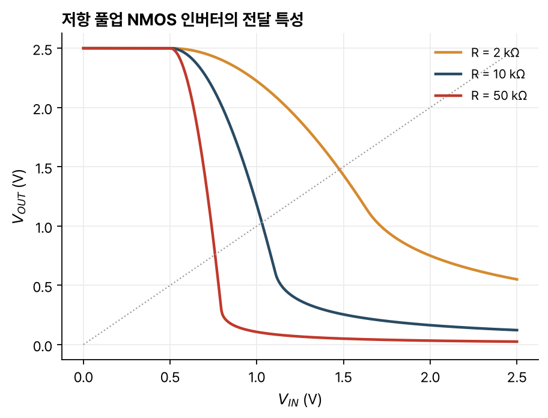

> [!abstract] 한눈에
> 디지털 회로는 두 전압 범위로 0과 1을 나타내고, 가장 단순한 논리 게이트가 인버터다. 좋은 인버터는 잡음이 섞인 입력에서도 깨끗한 0과 1을 다시 만들어 내는데, 이 신호 재생의 근거가 논리 문턱 근처의 큰 전압 이득이다. 이득이 클수록 잡음 여유가 커진다. 저항을 풀업으로 쓴 NMOS 인버터는 잡음 여유를 키우려 저항을 키우면 느려지는 절충이 있고, 전류원 풀업이 그 절충을 풀지만 대기 전력을 쓴다.

## 논리 수준

디지털 회로는 정보를 두 전압 범위로 나타낸다.

- 논리 0: $V_{MIN} \le V \le V_{OL}$
- 논리 1: $V_{OH} \le V \le V_{MAX}$
- 그 사이는 정의되지 않은 영역이다.

입력을 뒤집는 인버터가 가장 단순한 논리 연산이다.

## 이상적 인버터

출력과 입력이 같아지는 입력 전압을 **논리 문턱**(logic threshold) $V_M$이라 한다. 이상적 인버터는 $V_{IN} < V_M$이면 $V^+$, $V_{IN} > V_M$이면 0을 낸다. 입력에 전압 스파이크나 누화(crosstalk) 같은 잡음이 섞여도 문턱을 넘지 않는 한 출력은 깨끗한 0이나 $V^+$다. 이것이 **신호 재생**이다. 논리 수준이 복원되고, 잡음이 억제되고, 펄스 모서리가 날카로워진다.

## 실제 인버터의 네 전압

실제 인버터의 전달 특성은 매끄러운 곡선이고, 기울기 $-1$인 두 점으로 논리 수준을 정한다.

| 전압 | 정의 |
|---|---|
| $V_{MAX}$ | $V_{IN} = 0$일 때의 출력 |
| $V_{MIN}$ | $V_{IN} = V^+$일 때의 출력 |
| $V_{OH}$ | 기울기가 $-1$인 점 가운데 출력이 큰 쪽의 출력 |
| $V_{OL}$ | 기울기가 $-1$인 점 가운데 출력이 작은 쪽의 출력 |
| $V_{IL}$ | 기울기가 $-1$인 점 가운데 작은 쪽의 입력 |
| $V_{IH}$ | 기울기가 $-1$인 점 가운데 큰 쪽의 입력 |

$V_{IL}$보다 낮은 입력과 $V_{IH}$보다 높은 입력에서는 $|A_v| < 1$이라 잡음이 줄고, 그 사이에서는 $|A_v| > 1$이라 모서리가 날카로워진다. 신호를 재생하려면 올바른 논리 출력을 내는 입력 범위가 유효한 논리 수준의 범위보다 넓어야 하고, 그 근거가 큰 전압 이득이다.

## 잡음 여유

인버터 두 개를 이은 사슬에서, 앞 인버터의 출력에 잡음이 더해져도 뒤 인버터가 같은 논리로 읽을 수 있는 여유를 **잡음 여유**(noise margin)라 한다.

$$
NM_H = V_{OH} - V_{IH}, \qquad NM_L = V_{IL} - V_{OL}
$$

기울기 $-1$인 점은 손으로 구하기 어려워서 근사를 쓴다. $V_{OL} \approx V_{MIN}$, $V_{OH} \approx V_{MAX}$로 두고, $V_M$에서 전달 특성의 접선(기울기는 소신호 이득 $A_v(V_M)$)을 그어 $V_{OUT} = V_{MAX}$, $V_{OUT} = V_{MIN}$과 만나는 입력을 $V_{IL}$, $V_{IH}$로 쓴다.

$$
V_{IL} \approx V_M - \frac{V_{MAX} - V_M}{|A_v(V_M)|}, \qquad V_{IH} \approx V_M\left(1 + \frac{1}{|A_v(V_M)|}\right) - \frac{V_{MIN}}{|A_v(V_M)|}
$$

$|A_v| \to \infty$이면 $NM_L \to V_M - V_{MIN}$, $NM_H \to V_{MAX} - V_M$이다. 잡음 여유를 키우려면 $V_M$에서의 이득을 키운다.

## 전파 지연

입력과 출력의 시간 관계는 다음 값으로 나타낸다.

- 상승 시간 $t_R$, 하강 시간 $t_F$: 전체 진폭의 10%와 90% 사이를 지나는 시간
- $t_{PHL}$: 출력이 높은 값에서 낮은 값으로 바뀔 때, 입력과 출력의 50% 지점 사이 시간
- $t_{PLH}$: 출력이 낮은 값에서 높은 값으로 바뀔 때의 같은 시간
- 전파 지연 $t_P = \tfrac12(t_{PHL} + t_{PLH})$

손으로 계산할 때는 입력을 이상적인 사각파로 두고 출력이 50%에 이르는 시간을 쓴다. 정확한 값은 SPICE 같은 회로 시뮬레이터로 구한다.

## 저항 풀업 NMOS 인버터

전원 $V_{DD}$와 출력 사이에 저항 $R$을, 출력과 접지 사이에 NMOS를 둔다. 출력에 달린 커패시턴스 $C_L$은 다음 단의 게이트와 배선을 모은 부하다. 입력이 $V_T$보다 낮으면 트랜지스터가 꺼져 $V_{OUT} = V_{DD}$이고, 높으면 켜져 저항과 트랜지스터가 나누는 작은 전압이 나온다.

전달 특성은 $I_R = I_D$를 풀어 얻는다. 트랜지스터의 출력 특성 위에 저항의 직선(부하선)을 겹쳐 그리면 교점이 동작점이다.

- $V_{MAX}$: 트랜지스터가 차단이라 $I_D = 0$, $V_{MAX} = V_{DD}$
- $V_{MIN}$: 트랜지스터가 선형 영역. $\frac{W}{L}\mu_n C_{ox}\big(V_{DD} - \frac{V_{MIN}}{2} - V_T\big)V_{MIN} = \frac{V_{DD} - V_{MIN}}{R}$을 푼다.
- $V_M$: 트랜지스터가 포화 영역. $\frac{W}{2L}\mu_n C_{ox}(V_M - V_T)^2 = \frac{V_{DD} - V_M}{R}$을 푼다.

$V_M$에서의 이득은 소신호 등가회로에서 $A_v = -g_m(r_o\,/\!/\,R) \approx -g_m R$이다.

*그림 1. 저항 값에 따른 저항 풀업 NMOS 인버터의 전달 특성. 소자 값은 예로 정한 $V_{DD} = 2.5$ V, $V_T = 0.5$ V, $\mu_n C_{ox}W/L = 1$ mA/V², $\lambda = 0.05$ V⁻¹이다. 점선은 $V_{OUT} = V_{IN}$이다.*

그림 1의 값으로 계산하면 $R = 10$ kΩ에서 $V_{MIN} \approx 0.12$ V, $V_M \approx 1.03$ V다. 저항이 클수록 $V_M$ 근처의 기울기가 가파르고 $V_{MIN}$이 낮다.

### 속도와 잡음 여유의 절충

출력을 내릴 때는 트랜지스터 전류가 $C_L$을 방전하고, 올릴 때는 저항이 $C_L$을 충전한다. 충전은 $t_{PLH} \sim RC_L$ 정도라 보통 더 느리다. 잡음 여유를 키우려면 $|A_v| \approx g_m R$을 키워야 하는데, $R$을 키우면 $RC_L$이 커져 느려지고, $g_m$을 키우려 $W$를 늘리면 트랜지스터가 커져 앞 단의 부하가 늘어 역시 느려진다.

## 전류원 풀업

출력을 올리는 동안 큰 전류(빠른 충전)와 큰 소신호 저항(큰 이득)이 함께 필요하다. 전류원은 전압 범위 전체에서 거의 일정한 전류 $I_{SUP}$를 내면서 소신호 저항 $r_{oc}$가 크므로 두 조건을 모두 만족한다. 커패시터를 일정한 전류로 충전하므로 풀업이 빨라지고, $r_{oc}$가 커서 잡음 여유도 크다.

게이트를 고정 전압 $V_B$에 묶은 PMOS를 포화 영역에서 쓰면 전류원이 된다. 증가형 PMOS의 문턱전압은 음수이고, 포화 영역에서 $-I_{Dp} \propto (V_{SG} + V_{Tp})^2$다. 두 트랜지스터가 모두 포화된 $V_M$에서 $I_{Dn} = -I_{Dp}$로 풀면

$$
V_M = V_{Tn} + \sqrt{\frac{\mu_p W_p/L_p}{\mu_n W_n/L_n}}\,(V_{DD} - V_B + V_{Tp})
$$

이고, 이득은 $A_v = -g_{mn}(r_{on}\,/\!/\,r_{op})$이다.

대가는 대기 전력이다. 입력이 높으면 NMOS가 켜진 채로 PMOS 전류원이 계속 전류를 흘려, 인버터가 아무 일도 하지 않는 동안에도 전원에서 접지로 전류가 흐른다. 입력이 높을 때 스스로 꺼지는 전류원이 있으면 이 문제가 풀리고, 그것이 [[cmos-inverter|CMOS 인버터]]다.

## 유의점

- 잡음 여유의 근사식은 $V_M$에서의 소신호 이득 하나로 전달 특성을 직선 셋으로 바꾼 것이다. 실제 $V_{IL}$, $V_{IH}$는 기울기 $-1$인 점이라 조금 다르다.
- 이득이 클수록 잡음 여유가 커지지만, 잡음 여유의 상한은 $V_M$의 위치로 정해진다. $V_M$이 한쪽으로 치우치면 이득이 커도 한쪽 여유가 작다.
- 저항 풀업 인버터는 출력이 낮을 때도 저항으로 전류가 흐른다. 정적 전력 소모가 있다.
- 손 계산은 동작 영역을 맞게 고를 때만 의미가 있다. $V_{MIN}$에서는 선형, $V_M$에서는 포화로 풀어야 한다.

## 관련 개념

- [[cmos-inverter|CMOS 인버터]]: 대기 전력 없이 이득과 속도를 얻는 구조
- [[mosfet-iv|MOSFET의 전류-전압 특성]]: 동작 영역별 전류 식
- [[mosfet-small-signal|MOSFET 소신호 모델]]: $V_M$에서의 이득 계산
- [[combinational-sequential-logic|조합논리와 순차논리]]: 논리 게이트를 쓰는 회로 수준

## 참고 자료

- MIT OCW, [6.012 Microelectronic Devices and Circuits (Fall 2005)](https://ocw.mit.edu/courses/6-012-microelectronic-devices-and-circuits-fall-2005/), Lecture 12 _Digital Circuits (I): The inverter_, Lecture 13 _Digital Circuits (II): MOS Inverter Circuits_
- R. T. Howe, C. G. Sodini, _Microelectronics: An Integrated Approach_, Prentice Hall, Ch. 5
