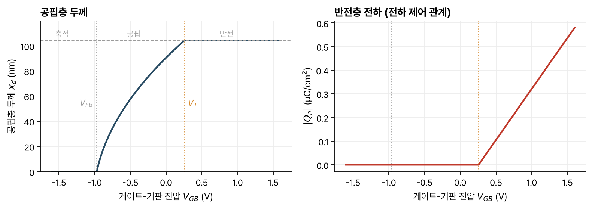

> [!abstract] 한눈에
> MOS 구조는 게이트와 반도체 사이에 얇은 산화막을 둔 것이다. 산화막 때문에 전류가 흐르지 않으므로, 게이트 전압은 반도체 표면의 전하 분포만 바꾼다. p형 기판에 양의 게이트 전압을 올리면 표면의 정공이 밀려나 공핍층이 넓어지고, 문턱전압을 넘으면 표면에 전자가 모인 반전층이 생긴다. 문턱전압 위에서 반전층 전하는 $C_{ox}(V_{GB} - V_T)$로 게이트 전압에 비례하고, 이것이 MOSFET 동작의 바탕이다.

## 구조

n⁺ 다결정 실리콘 게이트, 이산화규소 산화막, p형 실리콘 기판을 차례로 쌓고, 게이트와 기판에 금속 접촉을 단다. 유전율은 산화막이 $\epsilon_{ox} = 3.9\epsilon_0$, 실리콘이 $\epsilon_s = 11.7\epsilon_0$다. CMOS 회로의 MOSFET, DRAM과 플래시 메모리, CCD 영상 센서, 액티브 매트릭스 디스플레이가 모두 이 구조를 쓴다.

1차원으로 이상화하면 세 층의 성질이 다르다.

- 게이트(금속처럼 다룬다)는 부피 전하를 가질 수 없어 전하가 산화막과의 경계면에 얇은 판으로만 생긴다.
- 산화막은 절연체라 자유 캐리어도 도펀트도 없어 부피 전하가 없다.
- 반도체에는 공간전하 영역이 생길 수 있다.

## 전압을 걸지 않았을 때

서로 다른 물질을 붙였으므로 [[pn-junction-electrostatics|pn 접합]]처럼 캐리어가 옮겨 가 내장 전위가 생긴다. 산화막으로는 전하가 오갈 수 없어서, 바깥 도선으로 게이트와 기판을 이어 평형을 맞춘다. 대부분의 게이트 물질과 p형 실리콘에서는 경계면 근처의 정공이 줄어 이온화된 억셉터가 드러나고, 게이트 쪽 경계에는 같은 크기의 양전하 판 $Q_G$가 생긴다.

반도체 쪽은 공핍 근사로 다룬다. 전하 밀도는 $0 < x < x_{do}$에서 $-qN_a$이고, 경계면에서는 변위 전속이 연속이므로 $\epsilon_{ox}E_{ox} = \epsilon_s E_s$, 곧 $E_{ox}/E_s = \epsilon_s/\epsilon_{ox} \approx 3$이다. 산화막 안의 전기장은 일정하다.

내장 전위는 게이트와 기판의 볼츠만 전위 차다.

$$
\phi_B = \phi_{n^+} - \phi_p = \phi_{n^+} + \frac{kT}{q}\ln\frac{N_a}{n_i}
$$

이 전위가 반도체 공핍층과 산화막에 나눠 걸린다.

$$
\phi_B = \frac{qN_a x_{do}^2}{2\epsilon_s} + \frac{qN_a x_{do}}{C_{ox}}, \qquad C_{ox} = \frac{\epsilon_{ox}}{t_{ox}}
$$

$C_{ox}$는 산화막의 단위 면적당 커패시턴스다. 이 2차식을 풀면

$$
x_{do} = \frac{\epsilon_s}{C_{ox}}\left[\sqrt{1 + \frac{4\phi_B}{\gamma^2}} - 1\right], \qquad \gamma = \frac{\sqrt{2\epsilon_s q N_a}}{C_{ox}}
$$

이다. $\gamma$를 몸체 계수(body factor)라 하고 단위는 $\text{V}^{1/2}$다.

강의 자료의 수치 예는 게이트 $N_d = 10^{20}$, 기판 $N_a = 10^{17}$ cm⁻³, $t_{ox} = 8$ nm다. $\phi_B = 550 + 420 = 970$ mV, $C_{ox} = 4.3\times10^{-7}$ F/cm², $\gamma = 0.43\ \text{V}^{1/2}$, $x_{do} = 91$ nm다. 같은 식으로 직접 계산하면 $\gamma = 0.42\ \text{V}^{1/2}$, $x_{do} = 91$ nm다.

## 바이어스와 동작 영역

게이트에 기판 기준으로 $V_{GB}$를 걸어도 산화막 때문에 전류는 흐르지 않는다. 반도체 안에서는 전류가 0인 준평형이 유지되므로 볼츠만 관계와 $np = n_i^2$이 모든 곳에서 성립한다. 구조 전체에 걸린 전위는 $\phi_B + V_{GB}$가 되고, 그만큼을 담도록 전하 쌍극자의 크기가 바뀐다. 쉽게 기억하면, 양의 게이트 전압은 전자를 끌어당기고 정공을 밀어낸다.

| 영역 | 게이트 전압 | 반도체 표면 |
|---|---|---|
| 축적 | $V_{GB} < V_{FB}$ | 정공이 경계면에 모인다 |
| 플랫밴드 | $V_{GB} = V_{FB} = -\phi_B$ | 공간전하와 전기장이 없다 |
| 공핍 | $V_{FB} < V_{GB} < V_T$ | 정공이 밀려나 이온화된 억셉터가 드러난다 |
| 반전 | $V_{GB} > V_T$ | 표면 전자 농도가 $N_a$를 넘는다 |

### 공핍

공핍 영역에서는 전압이 0일 때의 결과에서 $\phi_B$를 $\phi_B + V_{GB}$로 바꾸면 된다.

$$
x_d(V_{GB}) = \frac{\epsilon_s}{C_{ox}}\left[\sqrt{1 + \frac{4(\phi_B + V_{GB})}{\gamma^2}} - 1\right]
$$

$$
V_B = \frac{qN_a x_d^2}{2\epsilon_s}, \qquad V_{ox} = \frac{qN_a x_d t_{ox}}{\epsilon_{ox}}
$$

$V_B$는 반도체 공핍층, $V_{ox}$는 산화막에 걸린 전압이다.

### 플랫밴드와 축적

게이트 전압을 음으로 내리다 $V_{GB} = -\phi_B$가 되면 공핍층이 사라지고 어디에도 전하와 전기장이 없다. 이 전압이 **플랫밴드 전압** $V_{FB} = -\phi_B$다. 더 내리면 정공이 경계면에 모여 축적 상태가 된다.

## 문턱전압

게이트 전압을 올리면 표면 전자 농도 $n(0)$이 커지다가 기판 도핑 $N_a$와 같아진다. 이때를 문턱(threshold)이라 하고, 그 너머에서는 전자의 전하를 무시할 수 없다. 문턱에서는 아직 공핍의 정전기를 쓴다고 보고 세 단계로 **문턱전압** $V_T$를 구한다.

1. 반도체에 걸린 전압. $n(0) = n_i e^{q\phi(0)/kT} = N_a$에서 $\phi(0) = -\phi_p$이고, 기판 깊은 곳은 $\phi_p$이므로 $V_B(V_T) = -2\phi_p$다.
2. 산화막에 걸린 전압. $V_B = qN_a x_d^2/(2\epsilon_s) = -2\phi_p$에서 $x_d(V_T) = x_{dmax} = \sqrt{2\epsilon_s(-2\phi_p)/(qN_a)}$이고, $V_{ox}(V_T) = qN_a x_{dmax}/C_{ox} = \gamma\sqrt{-2\phi_p}$다.
3. 합. $V_T + \phi_B = V_B + V_{ox}$이므로

$$
V_T = V_{FB} - 2\phi_p + \gamma\sqrt{-2\phi_p}
$$

이다. 기판 도핑이 높을수록 표면을 반전시키는 데 전압이 더 필요해 $V_T$가 커진다. 산화막이 얇을수록($C_{ox}$가 클수록) 산화막에 걸리는 전압이 줄어 $V_T$가 작아진다.

위 수치 예를 이 식에 넣으면 $\phi_p = -420$ mV, $V_{FB} = -0.97$ V이므로 $V_T = -0.97 + 0.84 + 0.42\times\sqrt{0.84} \approx 0.26$ V, $x_{dmax} \approx 104$ nm다. 이 두 값은 강의 자료에 없고 직접 계산한 것이다.

## 반전과 전하 제어 관계

$V_{GB} > V_T$이면 경계면의 전자가 억셉터보다 많아진다. 이 전자 층이 **반전층**이고, 게이트 전압으로 그 양을 조절할 수 있다는 것이 MOSFET의 핵심이다. 반전층은 산화막이나 공핍층보다 훨씬 얇으므로 표면의 전하 판으로 근사한다.

반전층 전하는 $|Q_n| \propto n(0) \propto e^{q\phi(0)/kT}$로 표면 전위에 지수적으로 커지고, 공핍층 전하 $|Q_B| = qN_a x_d$는 공핍층에 걸린 전압의 제곱근에 비례해 천천히 변한다. 따라서 문턱을 넘은 뒤에는

- 표면 전위가 거의 늘지 않아 $V_B \approx -2\phi_p$에 머물고,
- 공핍층 두께도 $x_{dmax}$에서 거의 늘지 않으며,
- 문턱을 넘는 전압은 모두 반전층 전하를 늘리는 데 쓰인다.

게이트를 위 판, 반전층을 아래 판으로 하는 커패시터로 보면

$$
Q_n = -C_{ox}(V_{GB} - V_T), \qquad V_{GB} > V_T
$$

이다. 이것을 **전하 제어 관계**라 한다(그림 1).

*그림 1. 수치 예($N_a = 10^{17}$ cm⁻³, $t_{ox} = 8$ nm, n⁺ 게이트)의 공핍층 두께와 반전층 전하. 공핍 근사와 전하 제어 관계로 계산했다. 회색 점선은 $V_{FB}$, 주황 점선은 $V_T$, 왼쪽 회색 파선은 $x_{dmax}$다.*

## 유의점

- 게이트 전압을 바꿔도 MOS 구조에는 직류 전류가 흐르지 않는다. 바뀌는 것은 전하 분포뿐이다.
- MOS 구조의 반도체에서는 $np = n_i^2$이 성립한다. 전류가 흐르는 pn 접합이나 바이폴라 트랜지스터에서는 성립하지 않는다.
- 문턱전압 계산은 문턱에서 전자 전하를 무시하는 근사다. 문턱 근처에서는 반전층 전하가 0에서 갑자기 생기지 않고 지수적으로 자란다.
- 문턱을 넘은 뒤 공핍층이 $x_{dmax}$에서 멈추는 것은 근사다. 실제로는 아주 조금 더 넓어진다.
- 강의의 $\phi$는 진성 농도를 기준으로 잰 전위다. $\phi_p$가 음수이므로 $-2\phi_p$가 양수다.

## 관련 개념

- [[pn-junction-electrostatics|pn 접합의 정전기]]: 공핍 근사, 볼츠만 관계, 내장 전위
- [[semiconductor-carriers|반도체의 캐리어와 전류]]: 도핑과 캐리어 농도
- [[capacitors-inductors|커패시터와 인덕터]]: $Q = CV$로 보는 반전층

## 참고 자료

- MIT OCW, [6.012 Microelectronic Devices and Circuits (Fall 2005)](https://ocw.mit.edu/courses/6-012-microelectronic-devices-and-circuits-fall-2005/), Lecture 7–8 _PN Junction and MOS Electrostatics (IV)–(V): Electrostatics of Metal-Oxide-Semiconductor Structure_
- R. T. Howe, C. G. Sodini, _Microelectronics: An Integrated Approach_, Prentice Hall, Ch. 3
