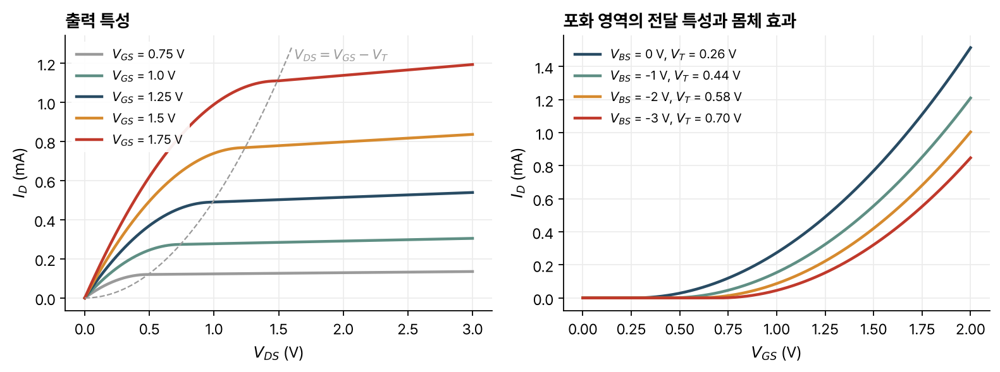

> [!abstract] 한눈에
> MOSFET은 게이트 아래에 생기는 반전층으로 소스와 드레인을 잇는 트랜지스터다. 게이트 전압이 반전층 전하를, 드레인 전압이 채널 방향 전기장을 정해 드레인 전류가 흐른다. 드레인 전압을 올리면 드레인 쪽 채널이 얇아져 전류가 덜 늘고, $V_{DS} = V_{GS} - V_T$에서 포화된다. 포화 전류는 $(V_{GS} - V_T)^2$에 비례한다.

## 구조와 기호

n채널 MOSFET은 p형 기판 위에 [[mos-capacitor-threshold|MOS 구조]]를 만들고, 게이트 양옆에 높게 도핑된 n⁺ 소스와 드레인을 둔 것이다. n⁺ 영역이 게이트 밑까지 들어와 있어서, 게이트 아래에 반전층이 생기면 소스와 드레인이 전기적으로 이어진다. 단자는 게이트(G), 소스(S), 드레인(D), 몸체(B) 넷이고, 몸체 전압도 동작에 영향을 준다. n형 기판 위에 정공 반전층을 쓰는 p채널 MOSFET이 짝을 이루고, 둘을 함께 쓰는 회로가 CMOS다.

## 세 동작 영역

먼저 소스와 몸체를 묶고($V_{BS} = 0$), $V_{DS} > 0$이라 한다. 동작은 게이트-소스 전압과 드레인-소스 전압 두 가지로 정해진다.

| 영역 | 조건 | 채널 |
|---|---|---|
| 차단(cut-off) | $V_{GS} < V_T$, $V_{GD} < V_T$ | 반전층이 없어 $I_D = 0$ |
| 선형(triode) | $V_{GS} > V_T$, $V_{GD} > V_T$ | 소스에서 드레인까지 반전층이 있다 |
| 포화(saturation) | $V_{GS} > V_T$, $V_{GD} < V_T$ | 드레인 쪽 끝에서 반전층이 끊긴다(핀치오프) |

## 1차 전류 식

채널을 따라 $y$축을 두고, 소스($y = 0$)에서 드레인($y = L$)까지 채널 전압을 $V_c(y)$라 한다. 폭이 $W$인 채널에서 드레인 전류는 반전층 전하와 전자 속도의 곱이다.

$$
I_D = -W Q_n(y)\, v_y(y)
$$

전기장이 너무 크지 않으면 $v_y = \mu_n\, dV_c/dy$이고, 반전층 전하는 그 위치의 전하 제어 관계 $Q_n(y) = -C_{ox}(V_{GS} - V_c(y) - V_T)$를 따른다. 합치면

$$
I_D = W\mu_n C_{ox}\big(V_{GS} - V_c(y) - V_T\big)\frac{dV_c}{dy}
$$

이다. 변수를 나누고 $V_c(0) = 0$, $V_c(L) = V_{DS}$로 적분하면 선형 영역의 식이 나온다.

$$
I_D = \frac{W}{L}\mu_n C_{ox}\left(V_{GS} - \frac{V_{DS}}{2} - V_T\right)V_{DS}
$$

$V_{DS}$가 작으면 $I_D \approx \frac{W}{L}\mu_n C_{ox}(V_{GS} - V_T)V_{DS}$로, 게이트 전압이 저항값을 정하는 저항처럼 동작한다. $V_{GS}$를 올리면 전자가 많아져서, $V_{DS}$를 올리면 채널 방향 전기장이 세져서, $W$를 넓히면 통로가 넓어져서 전류가 늘고, $L$을 늘리면 전기장이 약해져 전류가 준다.

### 채널 탈바이어스

$V_{DS}$가 커지면 전류가 덜 늘어나는 이유는 채널을 따라 바뀌는 국소 게이트 오버드라이브 $V_{GS} - V_c(y)$에 있다. 소스에서 드레인으로 가면서 $V_c(y)$가 오르므로 반전층 전하가 줄고, 같은 전류를 나르려면 전기장이 세져야 한다. $V_{DS}$가 클수록 이 효과가 커져 $I_D$-$V_{DS}$ 곡선이 휜다. 식에서는 $-V_{DS}/2$ 항이 그 역할을 한다.

이 식은 채널 모든 곳에서 $V_{GS} - V_c(y) \ge V_T$일 때만 맞다. 가장 나쁜 곳은 드레인 끝이므로 조건은 $V_{DS} \le V_{GS} - V_T$다.

## 포화

$V_{DS}$가 $V_{DSsat} = V_{GS} - V_T$에 이르면 전기장 증가와 반전층 전하 감소가 상쇄되어 전류가 더 늘지 않는다. 포화 전류는 선형 식에 $V_{DS} = V_{GS} - V_T$를 넣은 값이다.

$$
I_{Dsat} = \frac{W}{2L}\mu_n C_{ox}(V_{GS} - V_T)^2
$$

이때 드레인 끝에서 전하 제어 관계는 $Q_n(L) = 0$을 준다. 이것을 **핀치오프**라 한다. 핀치오프 지점에서도 전자가 사라지지는 않는다. 전하 제어 관계가 문턱 근처에서 부정확할 뿐 전자 농도는 작지만 0이 아니고, 전기장이 매우 커서 전자가 빠르게 지나간다.

핀치오프 지점의 전압 $V_{GS} - V_T$가 채널 방향 전기장을 정하고 반전층 전자 농도도 $V_{GS} - V_T$에 비례하므로, 포화 전류는 $(V_{GS} - V_T)^2$에 비례한다. $L$을 줄이면 전기장이 세져 $I_{Dsat}$가 $1/L$로 커진다.

### 채널 길이 변조

$V_{DS}$를 $V_{DSsat}$보다 더 올리면, 핀치오프 지점과 드레인 사이의 공핍층이 역방향 바이어스된 pn 접합처럼 넓어진다. 1차 근사로는 전류가 그대로지만, 실제 채널 길이가 $L - \Delta L$로 줄어 전류가 조금 늘어난다. 실험적으로 $\Delta L/L = \lambda(V_{DS} - V_{DSsat})$이고 $\lambda \propto 1/L$이다.

$$
I_{Dsat} = \frac{W}{2L}\mu_n C_{ox}(V_{GS} - V_T)^2\big[1 + \lambda(V_{DS} - V_{DSsat})\big]
$$

*그림 1. 위 식으로 계산한 n채널 MOSFET의 특성. 소자 값은 예로 정한 $\mu_n C_{ox}W/L = 1$ mA/V², $\lambda = 0.05$ V⁻¹이고, 문턱전압과 몸체 효과는 [[mos-capacitor-threshold|MOS 구조]] 글의 수치 예($V_{To} = 0.26$ V, $\gamma = 0.42\ \text{V}^{1/2}$, $-2\phi_p = 0.84$ V)를 썼다. 왼쪽 점선은 선형과 포화의 경계, 오른쪽은 $V_{DS} = 3$ V에서 채널 길이 변조를 뺀 전달 특성이다.*

## 몸체 효과

몸체(기판) 전압을 소스보다 낮추면($V_{BS} < 0$, 소스-몸체 pn 접합의 역방향) 반도체에 걸리는 전위가 $-2\phi_p$에서 $-2\phi_p - V_{BS}$로 커진다. 그만큼 공핍층이 넓어져 공핍 전하 $|Q_B|$가 늘어난다. $V_{GS}$가 그대로면 산화막 전기장과 게이트 전하도 그대로이므로, 늘어난 공핍 전하만큼 반전층 전하가 줄어든다. 같은 전류를 얻으려면 게이트 전압이 더 필요하고, 문턱전압이 오른다.

문턱전압 식에서 $-2\phi_p$를 $-2\phi_p - V_{BS}$로 바꾸고 게이트-소스 기준으로 다시 쓰면

$$
V_T(V_{BS}) = V_{To} + \gamma\left(\sqrt{-2\phi_p - V_{BS}} - \sqrt{-2\phi_p}\right)
$$

이다. $V_{To}$는 $V_{BS} = 0$일 때의 문턱전압이다. MOSFET의 문턱전압은 항상 게이트-소스 전압으로 정의한다. 그림 1의 수치로 계산하면 $V_{BS}$ = 0, −1, −2, −3 V에서 $V_T$는 0.26, 0.44, 0.58, 0.70 V다.

## 유의점

- 선형 영역의 식은 $V_{DS} \le V_{GS} - V_T$에서만 쓴다. 그 너머에서 선형 식을 계속 쓰면 전류가 줄어드는 잘못된 결과가 나온다.
- 핀치오프 지점에서도 전자는 흐른다. 드레인 끝에서 전자 농도는 작아지고 속도는 커진다.
- 1차 모형은 이동도가 일정하다고 본다. 전기장이 아주 큰 짧은 채널 소자에서는 속도 포화로 전류가 $(V_{GS} - V_T)^2$보다 천천히 늘어난다(강의 자료 밖의 내용).
- 몸체 효과는 소스가 몸체에 묶이지 않은 회로에서 생긴다. 직렬로 쌓은 트랜지스터의 위쪽 소자가 그 예다(강의 자료 밖의 예).
- p채널 MOSFET은 전압과 전류의 부호를 모두 바꿔 같은 식을 쓴다(강의 자료는 n채널을 중심으로 유도한다).

## 관련 개념

- [[mos-capacitor-threshold|MOS 구조와 문턱전압]]: 전하 제어 관계와 문턱전압 식
- [[mosfet-small-signal|MOSFET 소신호 모델]]: 이 특성을 동작점 근처에서 선형화한 것
- [[semiconductor-carriers|반도체의 캐리어와 전류]]: 드리프트와 이동도

## 참고 자료

- MIT OCW, [6.012 Microelectronic Devices and Circuits (Fall 2005)](https://ocw.mit.edu/courses/6-012-microelectronic-devices-and-circuits-fall-2005/), Lecture 9 _MOSFET (I): MOSFET I-V Characteristics_, Lecture 10 _MOSFET (II): MOSFET I-V Characteristics (cont.)_
- R. T. Howe, C. G. Sodini, _Microelectronics: An Integrated Approach_, Prentice Hall, Ch. 4
