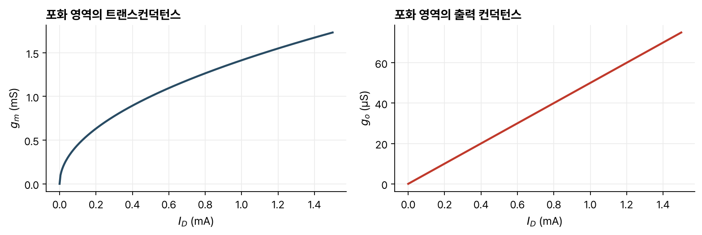

> [!abstract] 한눈에
> 증폭기에서 MOSFET은 직류 바이어스 위에 작은 신호를 얹어 쓴다. 신호가 작으면 비선형 특성을 동작점에서 1차 테일러 전개로 선형화할 수 있고, 그 계수가 소신호 등가회로의 소자다. 포화 영역에서 트랜스컨덕턴스는 $\sqrt{I_D}$에, 출력 컨덕턴스는 $I_D$에 비례한다. 높은 주파수에서는 게이트와 접합의 커패시턴스를 더한다.

## 소신호 모델

각 단자 전압이 바이어스와 작은 신호의 합 $V_{GS} + v_{gs}$, $V_{DS} + v_{ds}$, $V_{BS} + v_{bs}$이면, 드레인 전류를 동작점 $Q$에서 전개한다.

$$
i_D \approx I_D(Q) + \frac{\partial I_D}{\partial V_{GS}}\bigg|_Q v_{gs} + \frac{\partial I_D}{\partial V_{DS}}\bigg|_Q v_{ds} + \frac{\partial I_D}{\partial V_{BS}}\bigg|_Q v_{bs}
$$

신호가 작아서 응답이 선형이 되므로 바이어스와 신호의 응답을 따로 다룰 수 있고, 여러 신호의 효과는 중첩된다. 신호 성분만 쓰면

$$
i_d = g_m v_{gs} + g_o v_{ds} + g_{mb} v_{bs}
$$

이다. $g_m$은 트랜스컨덕턴스, $g_o$는 출력(드레인) 컨덕턴스, $g_{mb}$는 몸체 트랜스컨덕턴스다. 단위는 모두 지멘스(S)다.

## 트랜스컨덕턴스

포화 영역의 [[mosfet-iv|전류 식]]에서 채널 길이 변조를 무시하고 미분하면

$$
g_m = \frac{W}{L}\mu_n C_{ox}(V_{GS} - V_T) = \sqrt{2\frac{W}{L}\mu_n C_{ox} I_D}
$$

이다. 등가회로에서는 드레인과 소스 사이의 전압 제어 전류원 $g_m v_{gs}$로 나타낸다. 같은 전류에서 $W/L$을 키우면 $g_m$이 커진다. 차단 영역에서는 0이고, 포화 영역에서 $V_{GS} - V_T$에 비례해 커진다.

## 출력 컨덕턴스

채널 길이 변조 항을 $V_{DS}$로 미분하면

$$
g_o = \frac{W}{2L}\mu_n C_{ox}(V_{GS} - V_T)^2\lambda \approx \lambda I_D, \qquad r_o = \frac{1}{g_o} \propto \frac{L}{I_D}
$$

이다. $\lambda \propto 1/L$이어서 $g_o \propto I_D/L$이다. 등가회로에서는 드레인과 소스 사이의 저항 $r_o$로 나타낸다.

*그림 1. [[mosfet-iv|전류-전압 특성]] 글의 그림 1과 같은 예시 값($\mu_n C_{ox}W/L = 1$ mA/V², $\lambda = 0.05$ V⁻¹)으로 계산한 포화 영역의 $g_m$과 $g_o$. 예를 들어 $I_D = 0.5$ mA에서 $g_m = 1$ mS, $g_o = 25$ µS다.*

## 몸체 트랜스컨덕턴스

몸체 전압은 문턱전압을 바꿔 전류를 바꾼다. 강의는 몸체를 또 하나의 게이트(backgate)로 본다.

$$
g_{mb} = \frac{\partial I_D}{\partial V_{BS}} = \frac{W}{L}\mu_n C_{ox}(V_{GS} - V_T)\left(-\frac{\partial V_T}{\partial V_{BS}}\right), \qquad \frac{\partial V_T}{\partial V_{BS}} = \frac{-\gamma}{2\sqrt{-2\phi_p - V_{BS}}}
$$

이므로

$$
g_{mb} = \frac{\gamma\, g_m}{2\sqrt{-2\phi_p - V_{BS}}}
$$

이다. $g_m$의 바이어스 의존성을 모두 가지고, $V_{BS}$에도 의존한다. 등가회로에서는 전류원 $g_{mb}v_{bs}$로 나타낸다.

저주파 소신호 등가회로는 드레인과 소스 사이에 $g_m v_{gs}$, $g_{mb} v_{bs}$ 두 전류원과 $r_o$를 병렬로 둔 것이다. 저주파에서 게이트 단자는 개방이다.

## 고주파 모델

높은 주파수에서는 전하 저장을 나타내는 커패시턴스를 더한다. 포화 영역에서는 다음과 같다.

- $C_{gs}$: 고유 게이트 커패시턴스와 게이트-소스 겹침 커패시턴스 $WC_{ov}$의 합($C_{ov}$는 단위 폭당 겹침 커패시턴스)
- $C_{gd}$: 게이트-드레인 겹침 커패시턴스만
- $C_{gb}$: 기생 성분만
- $C_{sb}$, $C_{db}$: 소스·드레인 접합의 공핍 커패시턴스(바닥과 측벽)

### 고유 게이트 커패시턴스

포화 영역에서 반전층 전체 전하 $Q_N = W\int_0^L Q_n(y)\,dy$를 구한다. $dy = -W\mu_n Q_n\,dV_c/I_D$로 변수를 바꾸고 전하 제어 관계를 넣어 적분한 뒤 포화 전류를 대입하면

$$
Q_N = -\frac{2}{3}WLC_{ox}(V_{GS} - V_T)
$$

이다. 게이트 전하 $Q_G = -Q_N - Q_{B,max}$를 $V_{GS}$로 미분하면 고유 커패시턴스가 $\frac{2}{3}WLC_{ox}$다. 겹침 커패시턴스를 더하면

$$
C_{gs} = \frac{2}{3}WLC_{ox} + WC_{ov}, \qquad C_{gd} = WC_{ov}
$$

이다. 포화 영역에서는 드레인 끝이 핀치오프되어 있어 드레인 전압이 반전층 전하를 거의 바꾸지 못하므로 $C_{gd}$에는 겹침 성분만 남는다(강의 자료는 이 결과만 적고, 이유는 덧붙인 설명이다).

### 접합 커패시턴스

소스와 드레인은 기판과 pn 접합을 이룬다. n⁺ 확산 영역과 p형 기판의 접합이므로 기판 도핑 $N_a$가 [[pn-junction-electrostatics|공핍 커패시턴스]]를 정한다. 바닥 성분은 단위 면적당 공핍 커패시턴스에 확산 영역의 넓이 $WL_{diff}$를 곱하고, 측벽 성분은 단위 길이당 측벽 커패시턴스 $C_{JSW}$에 둘레 $(2L_{diff} + W)$를 곱한다. $\phi_B$는 이 접합의 내장 전위다.

$$
C_{sb} = WL_{diff}\sqrt{\frac{q\epsilon_s N_a}{2(\phi_B - V_{BS})}} + (2L_{diff} + W)C_{JSW}
$$

$C_{db}$는 $V_{BS}$ 대신 $V_{BD}$를 쓴 같은 식이다.

## 유의점

- 소신호 모델은 동작점에 따라 값이 바뀐다. 바이어스 전류를 바꾸면 $g_m$, $g_o$, 커패시턴스가 모두 바뀐다.
- $g_m \propto \sqrt{I_D}$와 $g_m \propto (V_{GS} - V_T)$는 같은 식을 다르게 쓴 것이다. 무엇을 고정하고 비교하는지에 따라 의존성이 달라 보인다.
- 신호가 작아야 선형화가 맞는다. 포화 전류 식을 전개하면 2차 항이 1차 항보다 작으려면 $v_{gs} \ll 2(V_{GS} - V_T)$여야 한다(강의 자료 밖의 조건).
- 고유 커패시턴스 $\frac{2}{3}WLC_{ox}$는 포화 영역의 값이다. 강의 자료는 포화 영역의 식만 유도한다.

## 관련 개념

- [[mosfet-iv|MOSFET의 전류-전압 특성]]: 이 모델을 얻는 대신호 식
- [[pn-junction-electrostatics|pn 접합의 정전기]]: 접합 커패시턴스 식
- [[op-amp-biosignal-front-end|연산증폭기와 생체신호 앞단]]: 트랜지스터로 만든 증폭기를 회로 수준에서 쓰는 예
- [[bode-plot|주파수 응답과 보드 선도]]: 커패시턴스가 만드는 극점과 대역폭

## 참고 자료

- MIT OCW, [6.012 Microelectronic Devices and Circuits (Fall 2005)](https://ocw.mit.edu/courses/6-012-microelectronic-devices-and-circuits-fall-2005/), Lecture 11 _MOSFET (III): MOSFET Equivalent Circuit Models_
- R. T. Howe, C. G. Sodini, _Microelectronics: An Integrated Approach_, Prentice Hall, Ch. 4
