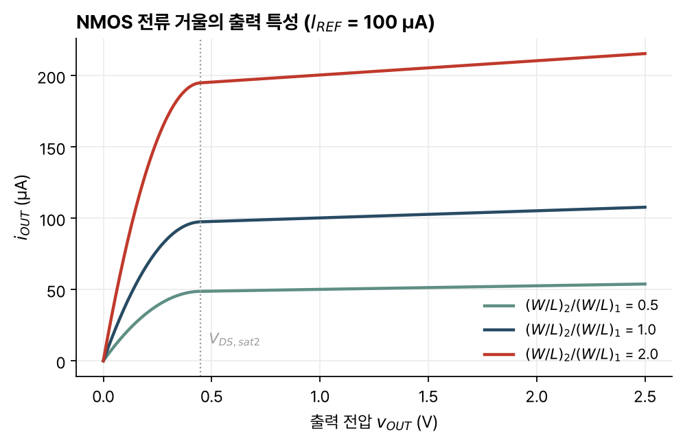

> [!abstract] 한눈에
> 단일 트랜지스터 증폭단 하나로는 높은 이득, 높은 입력 저항, 낮은 출력 저항을 함께 얻기 어려워 여러 단을 잇는다. 이때 앞 단의 출력 저항과 뒤 단의 입력 저항이 만드는 전압 분배(단간 부하)와, 직결할 때 단마다 바뀌는 직류 전압을 함께 따져야 한다. 바이어스에 필요한 전압원과 전류원은 다이오드 연결 MOSFET과 전류 거울로 만들고, 기준 전류 하나에서 여러 전류원을 복제한다.

## 왜 여러 단인가

증폭기는 특정 신호원과 부하에 맞아야 하고 이득도 충분해야 한다. [[single-stage-amplifiers|단일 증폭단]]은 할 수 있는 일이 제한적이다. 다단 증폭기를 설계할 때는 어떤 단을 어떤 순서로 쓸지, BJT와 MOSFET 가운데 무엇을 쓸지, 바이어스를 어떻게 잡을지를 정한다.

강의 자료는 BJT 단(공통 이미터 CE, 공통 컬렉터 CC, 공통 베이스 CB)을 MOSFET 단과 나란히 정리한다. 두 소자의 차이는 다음과 같다.

| | BJT | MOSFET |
|---|---|---|
| 제어 단자 전류 | $I_B = I_C/\beta$ | $I_G = 0$ |
| 트랜스컨덕턴스 | $g_m = qI_C/kT$ (더 크다) | $g_m = \sqrt{2\frac{W}{L}\mu C_{ox}I_D}$ |
| 출력 저항 | $r_o = V_A/I_C$ (더 크다) | $r_o = 1/(\lambda I_D)$ |

BJT의 입력 저항 $r_\pi$는 유한하고, MOSFET의 게이트 입력 저항은 무한대다.

## CMOS 다단 전압 증폭기

목표는 높은 전압 이득, 높은 $R_{in}$, 낮은 $R_{out}$이다.

1. 공통 소스(CS) 단 하나로 시작한다. $R_{in} = \infty$이지만 $A_{vo} = -g_m(r_o\,/\!/\,r_{oc})$는 부족할 수 있고 $R_{out} = r_o\,/\!/\,r_{oc}$가 너무 크다.
2. CS 단을 하나 더 이으면 이득이 곱해져 $A_{vo} = g_{m1}(r_{o1}/\!/r_{oc1})\,g_{m2}(r_{o2}/\!/r_{oc2})$가 된다. 출력 저항은 여전히 크다.
3. 출력에 공통 드레인(CD) 단을 달면 이득에 $\frac{g_{m3}}{g_{m3} + g_{mb3}}$가 곱해질 뿐이고, $R_{out} = \frac{1}{g_{m3} + g_{mb3}}$로 작아진다.

CS 단의 입력 저항이 무한대여서 앞 단 출력을 깎지 않으므로 CS-CS-CD 구성이 자연스럽다.

## BiCMOS 다단 증폭기

BJT의 $g_m$과 $r_o$가 더 커서 CE 단의 이득이 CS 단보다 크다. 그래도 첫 단은 $R_{in} = \infty$인 CS 단이 맞다.

### CS-CE 연결

앞 단의 출력 저항 $r_{o1}/\!/r_{oc1}$이 뒤 단의 입력 저항 $r_{\pi2}$보다 훨씬 커서, 단 사이의 전압 분배

$$
\frac{R_{in2}}{R_{out1} + R_{in2}} = \frac{r_{\pi2}}{r_{o1}/\!/r_{oc1} + r_{\pi2}} \approx \frac{r_{\pi2}}{r_{o1}/\!/r_{oc1}} \ll 1
$$

이 CE 단이 더한 이득보다 많이 깎는다.

### CS-CS-CC 연결

CC 단의 입력 저항 $r_{\pi3} + \beta_3(r_{o3}/\!/r_{oc3}/\!/R_L)$이 커서 CE보다는 낫지만 손실은 여전히 크다. 출력 저항은 $\frac{1}{g_{m3}} + \frac{r_{o2}/\!/r_{oc2}}{\beta_3}$로 좋아진다. BJT의 $g_m$이 더 크므로 $r_{o2}/\!/r_{oc2}$가 너무 크지 않으면 CD 출력단보다 나을 수 있다.

### CS-CS-CD-CC 연결

CD 단의 입력 저항이 무한대이므로 CD를 먼저 두어 CS 단의 출력을 깎지 않게 하고, 그 뒤에 CC를 둔다(CS-CS-CD-CC). 두 단 사이의 전압 분배는 거의 1이고, 출력 저항은

$$
R_{out} = \frac{1}{g_{m4}} + \frac{1}{\beta_4(g_{m3} + g_{mb3})}
$$

로 매우 작다.

## BiCMOS 전류 버퍼

목표는 전류 이득 1, 아주 낮은 $R_{in}$, 아주 높은 $R_{out}$이다. 공통 베이스(CB) 단은 $A_{io} = -1$, $R_{in} = 1/g_m$이고, $R_S$가 너무 작지 않으면 $R_{out} \approx r_{oc}/\!/(\beta r_o)$다.

CB 단을 하나 더 이으면(CB-CB) 두 번째 단의 $r_{\pi2}$가 앞 단의 출력 저항보다 작아 $R_{out}$이 다시 $r_{oc2}/\!/(\beta_2r_{o2})$에 머문다. 베이스 전류 때문에 출력 저항을 높이는 CB 단은 하나로 끝난다. 게이트 전류가 없는 공통 게이트(CG) 단을 뒤에 두면(CB-CG)

$$
R_{out} = r_{oc2}\,/\!/\,\big[r_{o2}g_{m2}(r_{oc1}/\!/\beta_1r_{o1})\big]
$$

로 약 $g_{m2}r_{o2}$배 커진다. 다만 $r_{oc2}$가 충분히 클 때만 그만큼 이득을 본다.

## 단 사이의 결합

**용량성 결합**은 큰 커패시터로 단을 이어 신호는 통과시키고 직류 바이어스는 단마다 따로 잡는다. 각 단의 바이어스를 최적으로, 진폭이 가장 크도록 전원 중간에 둘 수 있지만, 교류에서 단락처럼 보이려면 커패시터가 커서 면적을 많이 쓴다.

**직결 결합**은 커패시터 없이 바이어스를 단 사이에 공유한다. 작지만 바이어스가 묶여 설계가 제약되고, 단을 지날 때마다 직류 전압이 이동해 범위 가운데에서 멀어질 수 있다. 강의 자료의 예에서 5 V 전원의 CD-CC 버퍼는 $V_{GS} = 1.5$ V, $V_{BE} = 0.7$ V를 가정해 출력 직류 전압이 크게 내려간다. NMOS CD 단 대신 PMOS CD 단을 쓰면 직류 이동 방향이 반대가 되어 이를 보정할 수 있다. 대신 PMOS의 $g_m$이 작아 출력 저항이 커진다.

BJT와 MOSFET은 단 사이 직류 이동에서 중요한 차이가 있다. npn의 $V_{BE}$는 크기와 전류에 거의 상관없이 $V_{BE,on}$ 근처에 있고, nMOSFET의 $V_{GS} = V_T + \sqrt{2I_DL/(\mu_n C_{ox}W)}$는 바이어스 전류와 크기로 조절할 수 있다.

## 직류 전압원

전압원은 전압이 잘 정해지고, 끌어가는 전류에 따라 전압이 바뀌지 않아야(내부 저항이 작아야) 한다.

게이트와 드레인을 묶은 다이오드 연결 MOSFET은 문턱을 넘으면 항상 포화 영역이어서 2차 전류-전압 특성을 가진 다이오드처럼 동작한다. 기준 전류 $I_{REF}$를 흘리면 $V_{GS} = V_{DS}$가 그 전류를 흘리는 값으로 정해진다.

$$
v_{OUT} = V_T + \sqrt{\frac{I_{REF} + i_{OUT}}{\frac{W}{2L}\mu C_{ox}}}
$$

$I_{REF}$를 키우면 $v_{OUT}$이 오르고, $W/L$을 키우면 내려간다. 소신호 출력 저항은 $R_{out} = \frac{1}{g_m}/\!/r_o \approx \frac{1}{g_m}$로 작다. PMOS로도 같은 전압원을 만들 수 있는데, 같은 $R_{out}$을 얻으려면 더 커야 한다.

## 전류 거울

전류원은 전류가 잘 정해지고, 양단 전압에 따라 전류가 바뀌지 않아야(내부 저항이 커야) 한다.

다이오드 연결 트랜지스터 M1이 만든 전압 $V_{REF}$를 다른 트랜지스터 M2의 게이트에 걸면, 두 트랜지스터가 모두 포화 영역일 때 $V_{GS}$가 같으므로

$$
I_{OUT} = I_{REF}\,\frac{(W/L)_2}{(W/L)_1}
$$

이다. 출력 전류는 두 트랜지스터의 $W/L$ 비만큼 기준 전류를 복제한다. 이것이 **전류 거울**(current mirror)이고, 두 트랜지스터가 잘 맞아야(matching) 한다. 소신호로 보면 M2의 게이트 전압이 고정되므로 출력 저항은 $R_{out} = r_{o2}$이고, M2가 포화 영역에 머무는 $v_{OUT} > V_{DS,sat2}$에서 전류원으로 동작한다(그림 1).

*그림 1. $W/L$ 비에 따른 NMOS 전류 거울의 출력 특성. 소자 값은 예로 정한 $\mu_n C_{ox}(W/L)_1 = 1$ mA/V², $V_T = 0.5$ V, $\lambda = 0.05$ V⁻¹, $I_{REF} = 100$ µA이고, 기울기 $1/r_{o2}$는 채널 길이 변조에서 온다. 세로 점선은 M2가 포화 영역에 들어가는 전압이다.*

그림 1의 값으로 계산하면 $V_{REF} \approx 0.95$ V, $W/L$ 비가 1일 때 $r_{o2} = 1/(\lambda I_{OUT}) \approx 200$ kΩ이다.

NMOS 전류 거울은 전류를 접지로 끌어내리고(sink), PMOS 전류 거울은 양의 전원에서 전류를 내보낸다(source). MOSFET은 게이트 직류 전류가 없으므로 기준 트랜지스터 하나에 여러 거울을 매달 수 있다. 각 출력은 $I_{OUT,n} = I_{REF}(W/L)_n/(W/L)_R$이고, NMOS 거울의 출력을 PMOS 거울의 기준으로 쓰면 하나의 기준 전류에서 여러 전류원과 전류 싱크를 함께 만든다.

### 기준 전류 만들기

가장 단순한 방법은 저항 $R$로 다이오드 연결 트랜지스터에 전류를 흘리는 것이다.

$$
I_{REF} = \frac{V_{DD} - V_{OUT}}{R}, \qquad V_{OUT} = V_T + \sqrt{\frac{I_{REF}}{\frac{W}{2L}\mu C_{ox}}}
$$

$W/L$이 크면 $V_{OUT} \to V_T$이므로 $I_{REF} \approx (V_{DD} - V_T)/R$로 저항값이 전류를 정한다. 하지만 $V_{DD}$가 바뀌면 $I_{REF}$도 바뀌고, $V_T$와 $R$이 온도에 따라 바뀌어 $I_{REF}$가 온도에 의존한다. 실제로는 전원과 온도에 둔감한 더 정교한 회로를 쓴다.

## 유의점

- 단을 이을 때는 앞 단의 출력 저항과 뒤 단의 입력 저항을 함께 본다. 이득이 큰 단을 더해도 단간 부하로 그보다 더 잃을 수 있다.
- 출력 저항을 높이는 CB 단은 하나로 끝난다. 베이스 전류가 다음 단의 출력 저항을 제한하기 때문이다.
- 직결 결합에서는 단마다 직류 전압이 이동한다. 마지막 단의 출력이 전원 범위 가운데에서 멀어지면 진폭이 줄어든다.
- 전류 거울의 복제 비는 두 트랜지스터가 같은 문턱전압과 이동도를 가진다는 가정에서 나온다. 출력 트랜지스터가 포화 영역을 벗어나면 전류원으로 동작하지 않는다.
- 다이오드 연결 MOSFET은 pn 다이오드가 아니라 2차 특성을 가진 두 단자 소자다.

## 관련 개념

- [[single-stage-amplifiers|단일 트랜지스터 증폭단]]: CS, CD, CG 단의 이득과 입출력 저항
- [[bjt|바이폴라 접합 트랜지스터]]: BJT 단의 바탕이 되는 소자
- [[mosfet-iv|MOSFET의 전류-전압 특성]]: 포화 전류와 채널 길이 변조

## 참고 자료

- MIT OCW, [6.012 Microelectronic Devices and Circuits (Fall 2005)](https://ocw.mit.edu/courses/6-012-microelectronic-devices-and-circuits-fall-2005/), Lecture 21 _Multistage Amplifiers (I)_, Lecture 22 _Multistage Amplifiers (II): DC Voltage and Current Sources_
- R. T. Howe, C. G. Sodini, _Microelectronics: An Integrated Approach_, Prentice Hall, Ch. 9
