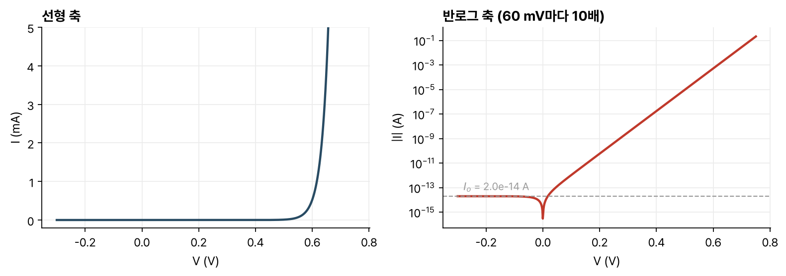
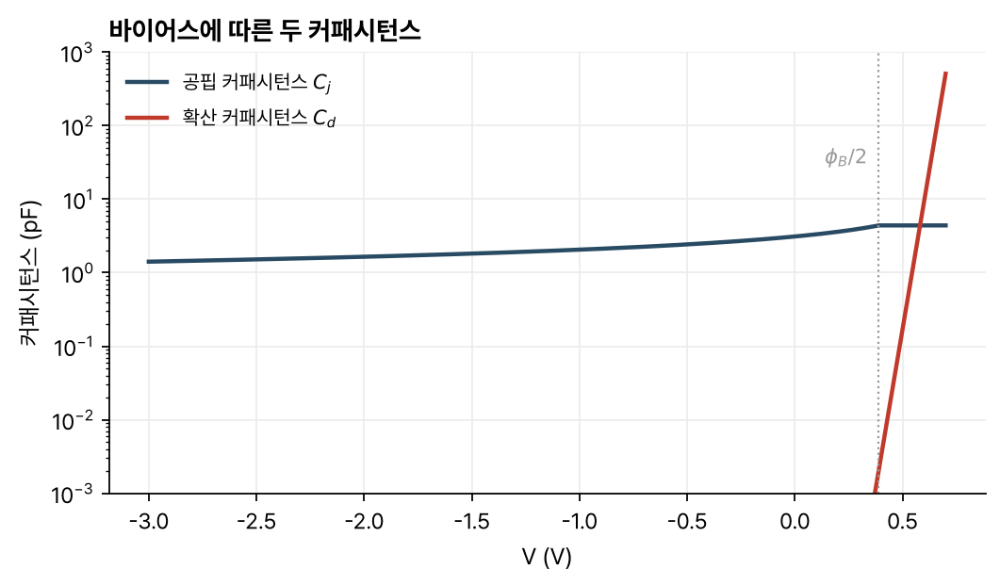

> [!abstract] 한눈에
> pn 접합에 전압을 걸면 공핍층에서 드리프트와 확산의 균형이 깨진다. 순방향에서는 소수 캐리어가 준중성 영역으로 주입되고, 역방향에서는 추출된다. 공핍층 경계의 소수 캐리어 농도가 $e^{qV/kT}$로 바뀌고, 그 캐리어가 준중성 영역을 확산해 지나가는 속도가 전류를 정한다. 그 결과가 다이오드 방정식 $I = I_o(e^{qV/kT} - 1)$이다. 작은 신호에 대해 다이오드는 컨덕턴스 하나와 커패시턴스 두 개로 나타낸다.

## 바이어스를 건 접합의 물리

[[pn-junction-electrostatics|열평형의 pn 접합]]에서는 공핍층 안에서 전자와 정공 각각의 드리프트 전류와 확산 전류가 같은 크기로 상쇄된다. 전압을 걸면 공핍층의 전위 장벽이 $\phi_B - V$가 되어 이 균형이 깨진다.

- 순방향($V > 0$): 장벽이 낮아져 공핍층 전기장과 드리프트 전류가 줄어 확산 전류가 드리프트 전류보다 커진다. 공핍층에서 준중성 영역으로 알짜 확산이 일어나 소수 캐리어가 주입되고, 준중성 영역의 소수 캐리어가 평형보다 많아진다. 주입할 캐리어는 반대편의 다수 캐리어여서 양이 많고, 전류가 클 수 있다.
- 역방향($V < 0$): 장벽이 높아져 드리프트 전류가 확산 전류보다 커진다. 공핍층이 준중성 영역의 소수 캐리어를 끌어내(추출) 그 농도가 평형보다 낮아진다. 끌어낼 소수 캐리어가 원래 적어서 전류가 작다.

### 생성과 재결합

소수 캐리어 농도가 평형에서 벗어나면 생성과 재결합의 균형도 깨진다. 주입으로 캐리어가 많아지면 재결합이, 추출로 적어지면 생성이 우세해진다. 현대 소자에서는 이 일이 주로 표면에서 일어난다. 표면에서는 결정의 주기성이 끊겨 끊어진 결합이 많고, 소자가 작아 부피에 비해 표면이 넓다.

생성·재결합이 활발한 표면에서는 캐리어 농도가 평형값에서 거의 벗어나지 못한다.

순방향에서는 주입된 소수 캐리어가 준중성 영역을 확산해 지나가 표면(접촉)에서 재결합하고, 역방향에서는 표면에서 생성된 소수 캐리어가 준중성 영역을 확산해 와서 공핍층으로 추출된다. 전류의 크기는 준중성 영역을 지나는 확산 속도가 정한다. 표면의 생성·재결합과 공핍층의 주입·추출은 이보다 빠르다.

## 다이오드 전류 식

세 단계로 구한다.

### 1. 공핍층 경계의 소수 캐리어 농도

바이어스를 걸어도 공핍층 안의 드리프트와 확산의 차이는 각각의 크기에 비해 작다. 그래서 공핍층 양 끝의 농도 비에 [[pn-junction-electrostatics|볼츠만 관계]]를 그대로 쓸 수 있다. 이것을 준평형(quasi-equilibrium)이라 한다.

$$
\frac{n(x_n)}{n(-x_p)} \approx \exp\frac{q(\phi_B - V)}{kT}
$$

다수 캐리어 농도는 주입되는 소수 캐리어보다 훨씬 많아 도핑 값 그대로라고 본다($p(-x_p) \approx N_a$, $n(x_n) \approx N_d$). 이것을 저준위 주입 근사라 한다. $\phi_B = \frac{kT}{q}\ln\frac{N_aN_d}{n_i^2}$을 넣으면

$$
n(-x_p) \approx \frac{n_i^2}{N_a}e^{qV/kT}, \qquad p(x_n) \approx \frac{n_i^2}{N_d}e^{qV/kT}
$$

이다. 평형($V = 0$)에서는 평형 소수 캐리어 농도이고, 순방향에서는 지수적으로 커지며, 역방향에서는 0으로 사라져 역방향 전류가 작은 값에서 포화된다. 다이오드의 정류 특성은 공핍층 경계의 이 경계조건에서 나온다.

### 2. 준중성 영역의 확산 전류

p쪽 준중성 영역에서 전자는 확산해 접촉에 이르러 재결합한다. 그 사이에서 전자 전류가 일정하므로 $n(x)$는 직선이다. 경계조건은 공핍층 끝에서 위의 값, 접촉($x = -W_p$)에서 평형값 $n_i^2/N_a$다. 기울기로 전류를 구하면

$$
J_n = qD_n\frac{dn}{dx} = q\frac{n_i^2}{N_a}\frac{D_n}{W_p - x_p}\left(e^{qV/kT} - 1\right)
$$

이고, n쪽 준중성 영역의 정공도 같은 방식으로

$$
J_p = q\frac{n_i^2}{N_d}\frac{D_p}{W_n - x_n}\left(e^{qV/kT} - 1\right)
$$

이다.

### 3. 합

$$
I = qAn_i^2\left(\frac{1}{N_a}\frac{D_n}{W_p - x_p} + \frac{1}{N_d}\frac{D_p}{W_n - x_n}\right)\left(e^{qV/kT} - 1\right) = I_o\left(e^{qV/kT} - 1\right)
$$

$I_o$를 포화 전류라 한다. 경계조건이 순방향과 역방향을 모두 담고 있으므로 이 식은 양쪽에서 성립한다.

### 의존성

- 전류는 공핍층 경계의 초과 소수 캐리어 농도 $\frac{n_i^2}{N}(e^{qV/kT} - 1)$에 비례한다. 순방향에서는 주입량이 늘수록, 역방향에서는 $-n_i^2/N$으로 포화된다.
- 확산 계수 $D$가 클수록, 확산해 지나갈 준중성 영역 $W_{QNR}$이 짧을수록, 면적 $A$가 넓을수록 전류가 크다.
- 두 쪽의 $D/W$가 비슷하면, 도핑이 낮은 쪽으로 주입되는 소수 캐리어가 많아 그쪽 항이 전류를 주로 정한다.
- 반로그 축에서 순방향 전류는 상온에서 60 mV마다 10배씩 늘어난다($\frac{kT}{q}\ln 10$).

*그림 1. 위 식으로 계산한 다이오드의 전류-전압 특성. 소자 값은 예로 정한 면적 100 µm × 100 µm, $N_a = 10^{17}$, $N_d = 10^{16}$ cm⁻³, $D_n = 25$, $D_p = 10$ cm²/s, 두 준중성 영역의 폭 1 µm, $n_i = 10^{10}$ cm⁻³, $kT/q = 25$ mV다. 왼쪽은 선형 축, 오른쪽은 전류 크기의 로그 축이다.*

그림 1의 값으로 직접 계산하면 $I_o \approx 2.0\times10^{-14}$ A이고, 0.6 V에서 약 0.53 mA가 흐른다. 이 가운데 p쪽으로 주입된 전자의 몫은 20%이고, 나머지 80%는 도핑이 낮은 n쪽으로 주입된 정공이 나른다.

## 소신호 모델

### 컨덕턴스

바이어스 $V$ 위에 작은 신호 $v$를 얹고 지수를 선형화하면

$$
I + i = I_o\left(e^{qV/kT}e^{qv/kT} - 1\right) \approx I_o\left(e^{qV/kT} - 1\right) + I_oe^{qV/kT}\frac{qv}{kT}
$$

이므로 $i = g_d v$이고

$$
g_d = \frac{q(I + I_o)}{kT} \approx \frac{qI}{kT} \quad (\text{순방향})
$$

이다. 컨덕턴스는 바이어스 전류에 비례한다. 순방향 1 mA에서는 $g_d = 1\text{ mA}/25\text{ mV} = 40$ mS이고, 역방향에서는 거의 0이다.

### 공핍 커패시턴스

[[pn-junction-electrostatics|공핍층의 전하]]가 전압에 따라 바뀌는 데서 오는 커패시턴스다.

$$
C_j = \frac{C_{jo}}{\sqrt{1 - V/\phi_B}}
$$

### 확산 커패시턴스

순방향에서 준중성 영역에 소수 캐리어가 쌓이면, 준중성을 지키기 위해 같은 양의 다수 캐리어도 쌓인다. n쪽 준중성 영역에 쌓인 초과 정공의 전하는 삼각형 분포의 넓이로

$$
q_{Pn} = qA\frac{W_n - x_n}{2}\frac{n_i^2}{N_d}\left(e^{qV/kT} - 1\right) = -q_{Nn}
$$

이다. 전압을 조금 올리면 $q_{Pn}$과 $|q_{Nn}|$이 함께 늘어나므로 커패시터처럼 동작하고, 그 커패시턴스가 $C_{dn} = dq_{Pn}/dV$다.

$q_{Pn}$을 정공 전류 $I_p$로 다시 쓰면

$$
q_{Pn} = \tau_{Tp}I_p, \qquad \tau_{Tp} = \frac{(W_n - x_n)^2}{2D_p}
$$

이다. $\tau_{Tp}$는 정공이 n쪽 준중성 영역을 확산해 지나가는 평균 시간인 **통과 시간**(transit time)이다. 따라서 $C_{dn} \approx \frac{q}{kT}\tau_{Tp}I_p$다. p쪽도 같은 방식으로 $\tau_{Tn} = (W_p - x_p)^2/(2D_n)$을 쓰고, 두 커패시턴스는 병렬이다.

$$
C_d = C_{dn} + C_{dp} = \frac{q}{kT}\tau_T I, \qquad \tau_T = \frac{\tau_{Tn}I_n + \tau_{Tp}I_p}{I}
$$

다이오드의 소신호 등가회로는 $g_d$, $C_j$, $C_d$를 병렬로 둔 것이다.

### 두 커패시턴스의 바이어스 의존성

- 확산 커패시턴스는 전류에 비례하므로 순방향에서 $e^{qV/kT}$로 커지고, 강한 순방향에서 지배적이다.
- 공핍 커패시턴스는 $1/\sqrt{\phi_B - V}$로 천천히 변하고, 역방향과 약한 순방향에서 지배적이다.
- 공핍 근사의 $C_j$ 식은 $V$가 $\phi_B$에 가까워지면 발산해 강한 순방향에서는 맞지 않는다. 흔히 $V = \phi_B/2$ 이상에서는 그 값 $\sqrt2\,C_{jo}$로 고정한다.

*그림 2. 그림 1과 같은 다이오드의 공핍 커패시턴스와 확산 커패시턴스. $C_j$는 $\phi_B/2$ 위에서 $\sqrt2\,C_{jo}$로 고정했다. 세로축은 로그다.*

그림 2의 값에서 $\phi_B$는 [[pn-junction-electrostatics|60 mV 규칙]]으로 780 mV다($kT/q = 25$ mV로 계산하면 748 mV). 같은 값에서 $C_{jo} \approx 3.1$ pF, $\tau_T \approx 440$ ps이고, 약 0.58 V에서 두 커패시턴스가 같아진다.

## 유의점

- 다이오드 방정식의 $-1$은 역방향 포화 전류를 나타낸다. 순방향에서 $V$가 $kT/q$보다 몇 배 크면 무시해도 된다.
- $I_o$에는 도핑과 함께 준중성 영역의 폭과 확산 계수가 들어간다. 확산이 전류를 제한하기 때문이다.
- 이 유도는 준중성 영역이 짧아 소수 캐리어가 재결합하기 전에 표면에 닿는 경우(짧은 다이오드)다. 영역이 길어 내부에서 재결합하면 $W$ 대신 확산 거리가 들어간다(강의 자료 밖의 내용).
- 저준위 주입 근사는 주입된 소수 캐리어가 다수 캐리어보다 훨씬 적을 때만 맞는다. 큰 순방향 전류에서는 이 조건이 깨진다(강의 자료 밖의 내용).
- 확산 커패시턴스는 순방향에서만 의미가 있다. 역방향에서는 저장된 소수 캐리어 전하가 거의 없다.

## 관련 개념

- [[pn-junction-electrostatics|pn 접합의 정전기]]: 공핍 근사, 볼츠만 관계, 공핍 커패시턴스
- [[semiconductor-carriers|반도체의 캐리어와 전류]]: 확산 전류와 생성·재결합
- [[mosfet-small-signal|MOSFET 소신호 모델]]: 소스·드레인 접합의 커패시턴스

## 참고 자료

- MIT OCW, [6.012 Microelectronic Devices and Circuits (Fall 2005)](https://ocw.mit.edu/courses/6-012-microelectronic-devices-and-circuits-fall-2005/), Lecture 15 _The pn Junction Diode (I): I-V Characteristics_, Lecture 16 _The pn Junction Diode (II): Equivalent Circuit Model_
- R. T. Howe, C. G. Sodini, _Microelectronics: An Integrated Approach_, Prentice Hall, Ch. 6
