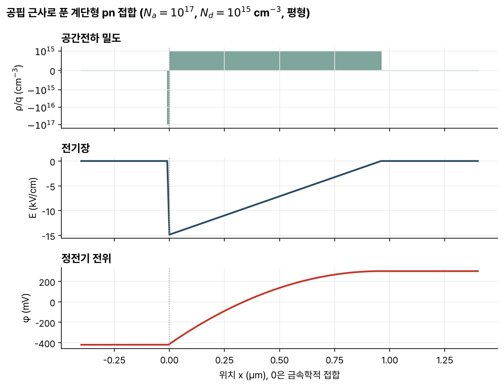
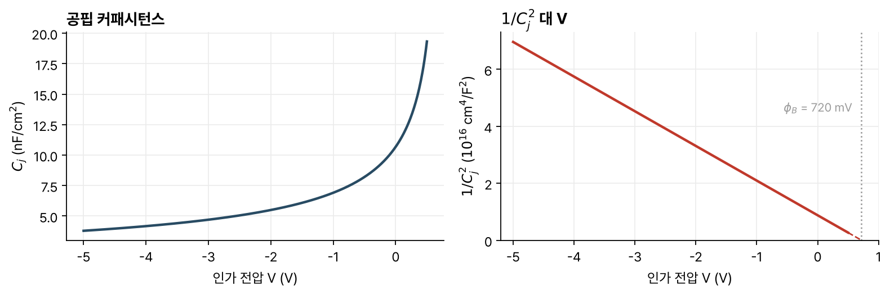

> [!abstract] 한눈에
> 열평형에서는 모든 곳에서 드리프트 전류와 확산 전류가 상쇄된다. 이 조건에서 전위와 캐리어 농도가 지수 관계로 묶이고, 상온 실리콘에서는 농도가 10배 바뀔 때마다 전위가 60 mV 바뀐다. p형과 n형이 맞닿은 pn 접합에는 캐리어가 거의 없는 공핍층이 생기고, 그 양쪽 전위 차가 내장 전위다. 바깥에서 건 전압은 거의 모두 공핍층에 걸려 공핍층의 폭과 전하를 바꾸므로, 접합은 전압에 따라 값이 바뀌는 커패시터처럼 동작한다.

## 열평형의 전기장

도핑이 고른 n형 실리콘에서는 $n_o = N_d$이고 공간전하가 0이다. 도핑이 위치에 따라 달라지면 사정이 다르다.

- 모든 곳에서 $n_o(x) = N_d(x)$라면 전자 농도에 기울기가 있어 확산 전류가 흐른다. 열평형이 아니다.
- 전자 농도가 고르다면 $N_d(x) - n_o$가 0이 아닌 곳에 공간전하가 생기고, 전기장이 드리프트 전류를 만든다. 역시 열평형이 아니다.

열평형에서는 모든 점에서 전자 전류와 정공 전류가 각각 0이어야 한다. 확산이 드리프트와 정확히 상쇄되도록 $n_o(x)$가 도핑을 조금 덜 따라가고, 그 차이만큼 공간전하와 전기장이 생긴다. 열평형인 반도체 안에도 전기장이 있을 수 있다.

전하 밀도 $\rho = q(N_d - n_o)$, 가우스 법칙 $dE/dx = \rho/\epsilon_s$, 전위 $d\phi/dx = -E$, 그리고 $J_n = 0$을 합치면 $n_o(x)$에 대한 식 하나가 된다. 일반적으로 해석해는 없다. 도핑이 천천히 바뀌면 $n_o(x) \approx N_d(x)$로 따라가고 공간전하가 작다. 이것을 준중성(quasi-neutral)이라 한다.

## 볼츠만 관계와 60 mV 규칙

$J_n = qn\mu_n E + qD_n\,dn/dx = 0$에 $E = -d\phi/dx$와 [[semiconductor-carriers|아인슈타인 관계]] $D_n/\mu_n = kT/q$를 넣으면 $\frac{q}{kT}\frac{d\phi}{dx} = \frac{d\ln n_o}{dx}$이다. 적분하고 $n_o = p_o = n_i$인 곳을 $\phi = 0$으로 잡으면

$$
n_o = n_i\, e^{q\phi/kT}, \qquad p_o = n_i\, e^{-q\phi/kT}
$$

이다. 이것을 **볼츠만 관계**라 한다. 거꾸로 쓰면 $\phi = \frac{kT}{q}\ln\frac{n_o}{n_i} = -\frac{kT}{q}\ln\frac{p_o}{n_i}$다.

상온에서 $kT/q \approx 25$ mV이고 $25\ \text{mV}\times\ln 10 \approx 60$ mV이므로

$$
\phi \approx (60\ \text{mV})\log_{10}\frac{n_o}{10^{10}}
$$

이다. 전자 농도가 10배 늘 때마다 전위가 60 mV 오른다. $n_o = 10^{18}$ cm⁻³이면 480 mV, 정공 농도 $p_o = 10^{15}$ cm⁻³인 곳은 −300 mV다. 강의 자료는 $\phi$의 범위를 ±550 mV로 두고, 그 밖에서는 다른 물리가 작용한다고 적는다. pn 다이오드의 전류와 바이폴라 트랜지스터의 컬렉터 전류도 전압 60 mV마다 10배씩 바뀐다.

## pn 접합의 열평형

p형 영역과 n형 영역이 붙어 있는 구조를 pn 접합이라 한다. CMOS의 소스·드레인과 웰처럼 거의 모든 반도체 소자 안에 있다.

두 영역을 붙이면 다수 캐리어가 농도가 낮은 반대편으로 확산한다. 접합 근처에서 캐리어가 빠져나가면 움직이지 않는 이온화된 도펀트가 드러나 공간전하가 생기고, 그 전기장이 확산을 막는 드리프트를 만들어 균형을 이룬다. 결과적으로 반도체는 세 영역으로 나뉜다.

- 접합에서 먼 두 개의 준중성 영역(QNR)
- 접합 근처의 공간전하 영역(SCR)

### 공핍 근사

정확한 해 대신 다음을 가정한다.

1. 준중성 영역은 완전히 전하 중성이다.
2. 공간전하 영역에는 캐리어가 없다(공핍).
3. 두 영역의 경계는 날카롭다.

계단형 접합($x<0$에서 $N_a$, $x>0$에서 $N_d$)에서 공핍층이 $-x_{po} < x < x_{no}$에 있다고 하면 전하 밀도는 p쪽에서 $-qN_a$, n쪽에서 $+qN_d$다. 가우스 법칙을 적분한 전기장은 삼각형이고, 접합에서 크기가 가장 크다.

$$
E(x) = -\frac{qN_a}{\epsilon_s}(x + x_{po}) \quad (-x_{po}<x<0), \qquad E(x) = \frac{qN_d}{\epsilon_s}(x - x_{no}) \quad (0<x<x_{no})
$$

전위는 이것을 한 번 더 적분한 포물선 두 조각이다. 양 끝의 전위는 볼츠만 관계로 바로 정해진다. p쪽은 $\phi_p = -\frac{kT}{q}\ln\frac{N_a}{n_i}$, n쪽은 $\phi_n = \frac{kT}{q}\ln\frac{N_d}{n_i}$이고, 그 차가 **내장 전위**(built-in potential)다.

$$
\phi_B = \phi_n - \phi_p = \frac{kT}{q}\ln\frac{N_aN_d}{n_i^2}
$$

이 식은 공핍 근사를 쓰지 않고 얻은 것이다.

남은 미지수 $x_{no}$, $x_{po}$는 전체 전하 중성 $qN_a x_{po} = qN_d x_{no}$와 $x = 0$에서 전위가 연속이라는 조건으로 구한다.

$$
x_{no} = \sqrt{\frac{2\epsilon_s\phi_B N_a}{q(N_a+N_d)N_d}}, \qquad x_{po} = \sqrt{\frac{2\epsilon_s\phi_B N_d}{q(N_a+N_d)N_a}}
$$

$$
x_{do} = x_{no} + x_{po} = \sqrt{\frac{2\epsilon_s\phi_B(N_a+N_d)}{qN_aN_d}}, \qquad |E_o| = \sqrt{\frac{2q\phi_B N_aN_d}{\epsilon_s(N_a+N_d)}}
$$

$N_a = 10^{17}$, $N_d = 10^{15}$ cm⁻³이면 60 mV 규칙으로 $\phi_B = 420 + 300 = 720$ mV다. 위 식으로 직접 계산하면 $x_{no} \approx 0.96$ µm, $x_{po} \approx 9.6$ nm, $|E_o| \approx 15$ kV/cm다(그림 1).

*그림 1. $N_a = 10^{17}$, $N_d = 10^{15}$ cm⁻³인 계단형 접합의 공간전하 밀도(대칭 로그 축), 전기장, 전위. 공핍 근사의 식으로 계산했다.*

도핑이 같으면 공핍층이 양쪽에 같은 폭으로 생긴다. 도핑이 다르면 낮게 도핑된 쪽으로 더 넓게 퍼지고, $N_a \gg N_d$인 p⁺n 접합에서는 거의 전부가 n쪽에 있다.

$$
x_{do} \approx x_{no} \approx \sqrt{\frac{2\epsilon_s\phi_B}{qN_d}}, \qquad |E_o| \approx \sqrt{\frac{2q\phi_B N_d}{\epsilon_s}}
$$

낮게 도핑된 쪽이 접합의 정전기를 정한다.

### 접촉 전위

다이오드 양 끝에 전압계를 대도 $\phi_B$는 읽히지 않고, 단자를 단락해도 전류가 흐르지 않는다. 금속과 반도체가 닿는 곳에도 접촉 전위 $\phi_{mn}$, $\phi_{mp}$가 생겨 $\phi_B = \phi_{mn} + \phi_{mp}$로 상쇄되기 때문이다. 단자에서 단자까지의 전위 합은 0이다.

## 바이어스를 건 접합

p쪽에 n쪽보다 높은 전압 $V$를 거는 것을 순방향($V>0$), 반대를 역방향($V<0$)이라 한다. 걸린 전압은 금속 접촉, 준중성 영역, 공핍층 가운데 거의 모두 공핍층에 걸린다. 접합 양쪽의 전위 장벽은 $\phi_B$에서 $\phi_B - V$가 된다.

공핍층 안의 물리는 그대로이고 전하 쌍극자의 크기만 바뀌므로, 평형의 식에서 $\phi_B$를 $\phi_B - V$로 바꾸면 된다.

$$
x_d(V) = x_{do}\sqrt{1 - \frac{V}{\phi_B}}, \qquad |E|(V) = |E_o|\sqrt{1 - \frac{V}{\phi_B}}
$$

순방향에서는 공핍층이 좁아지고 전기장이 약해지며, 역방향에서는 넓어지고 강해진다. 위 예에서 $V = -5$ V이면 $x_d \approx 2.7$ µm다.

## 공핍 커패시턴스

바이어스 위에 작은 전압 $\Delta V$를 더하면 공핍층 양 끝에서 전하 $\pm\Delta Q_j$가 바뀐다. 두 판 사이 거리가 $x_d$인 평행판 커패시터와 같은 모양이어서, 단위 면적당 **공핍 커패시턴스**는

$$
C_j(V) = \frac{\epsilon_s}{x_d(V)} = \sqrt{\frac{q\epsilon_s N_aN_d}{2(\phi_B - V)(N_a+N_d)}} = \frac{C_{jo}}{\sqrt{1 - V/\phi_B}}
$$

이다. 커패시턴스는 바이어스에 따라 바뀌고, 도핑이 높을수록 크다. p⁺n 접합에서는 $C_j \approx \sqrt{q\epsilon_s N_d/(2(\phi_B - V))}$로 낮게 도핑된 쪽이 정한다.

공핍 전하는 $Q_j(V) = Q_{jo}\sqrt{1 - V/\phi_B}$이고, 커패시턴스는 그 기울기 $C_j = dQ_j/dV$다. $Q_j/V$가 아니다.

이 관계는 세 가지로 쓰인다.

1. 전압으로 값을 바꾸는 가변 커패시터(varactor). 전압 제어 발진기에 쓴다.
2. 다이오드의 동특성. 전압이 바뀔 때마다 이 전하를 채우고 비워야 한다.
3. 도핑 측정. p⁺n 접합에서 $1/C_j^2 = 2(\phi_B - V)/(q\epsilon_s N_d)$는 $V$에 대해 직선이다. 기울기에서 $N_d$를, $V$축과 만나는 점에서 $\phi_B$를 읽는다(그림 2).

*그림 2. 그림 1과 같은 접합의 공핍 커패시턴스(왼쪽)와 $1/C_j^2$(오른쪽). 오른쪽 점선은 직선을 $1/C_j^2 = 0$까지 늘린 것이다.*

접합에 전압을 걸면 전하만 바뀌는 것이 아니라 전류도 흐른다. pn 다이오드의 전류-전압 특성은 강의에서 MOSFET과 CMOS 회로 다음에 다룬다.

## 유의점

- 내장 전위는 전압계로 잴 수 없다. 금속 접촉의 전위가 그만큼을 상쇄한다.
- 공핍 근사는 공핍층 경계에 캐리어가 조금 남아 있는 것을 무시한다. 순방향 전압이 $\phi_B$에 가까워지면 공핍층이 얇아져 근사가 맞지 않는다.
- 공핍층은 도핑이 낮은 쪽으로 넓게 퍼진다. 도핑이 높은 쪽의 폭은 전하 중성 조건 $N_a x_p = N_d x_n$에 따라 그만큼 좁다.
- 볼츠만 관계는 전류가 0인 열평형(또는 준평형)에서 유도했다. 바이어스로 전류가 흐르는 pn 접합의 준중성 영역 경계에서는 그대로 쓰지 않는다.
- 커패시턴스는 전하를 전압으로 나눈 값이 아니라 전하-전압 곡선의 기울기다.

## 관련 개념

- [[semiconductor-carriers|반도체의 캐리어와 전류]]: 드리프트, 확산, 아인슈타인 관계
- [[mos-capacitor-threshold|MOS 구조와 문턱전압]]: 같은 공핍 근사를 금속-산화막-반도체 구조에 쓴 것
- [[capacitors-inductors|커패시터와 인덕터]]: 평행판 커패시터와 저장 에너지

## 참고 자료

- MIT OCW, [6.012 Microelectronic Devices and Circuits (Fall 2005)](https://ocw.mit.edu/courses/6-012-microelectronic-devices-and-circuits-fall-2005/), Lecture 4–6 _PN Junction and MOS Electrostatics (I)–(III)_
- R. T. Howe, C. G. Sodini, _Microelectronics: An Integrated Approach_, Prentice Hall, Ch. 3
