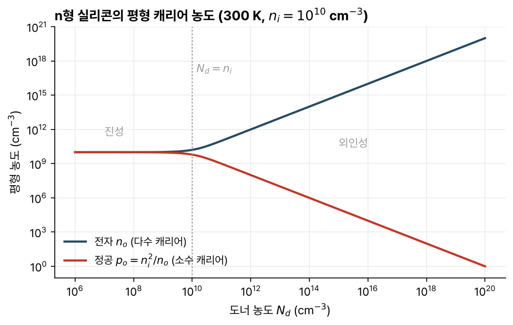

> [!abstract] 한눈에
> 반도체에서 전류를 나르는 입자는 자유 전자와 정공 두 가지다. 열평형에서는 두 농도의 곱이 온도만으로 정해지고, 실리콘의 상온 값은 $n_i^2 \approx 10^{20}$ cm⁻⁶이다. 도너나 억셉터를 넣으면 한쪽 캐리어를 크게 늘리고 다른 쪽을 그만큼 줄일 수 있다. 캐리어는 전기장에 끌려 움직이는 드리프트와, 농도가 높은 곳에서 낮은 곳으로 퍼지는 확산으로 전류를 만든다.

## 전자와 정공

실리콘은 주기율표 IV족 원소로, 원자마다 결합에 쓰는 원자가 전자가 4개다. 결정에서는 이웃한 네 원자와 전자를 하나씩 공유해 공유결합을 이룬다. 원자 밀도는 약 $5\times10^{22}$ cm⁻³이다.

0 K에서는 모든 결합이 채워져 있어 움직일 수 있는 전하가 없다. 온도가 올라가면 열에너지로 일부 결합이 끊어지고, 결합에서 풀려난 **자유 전자**(전하 $-q$)와 전자가 빠져나간 빈자리인 **정공**(hole, 전하 $+q$)이 함께 생긴다. 둘 다 결정 안을 움직이며 전하를 나르므로 캐리어라 부른다. 전자 농도를 $n$, 정공 농도를 $p$로 쓴다.

결합이 끊어져 전자-정공 쌍이 생기는 것을 생성, 전자와 정공이 만나 결합을 다시 채우는 것을 재결합이라 한다. 끊어질 수 있는 결합은 사실상 무한히 많으므로 생성률은 $n$, $p$와 상관없고, 재결합은 전자 하나와 정공 하나가 필요하므로 $R \propto np$다.

## 열평형과 질량 작용 법칙

외부 에너지 없이 정상상태에 있으면 열평형이다. 열평형에서는 생성률과 재결합률이 같다. 생성률은 온도만의 함수이고 재결합률은 $n_o p_o$에 비례하므로

$$
n_o\, p_o = n_i^2(T)
$$

가 된다. 첨자 $o$는 열평형 값을 뜻한다. 이 곱은 반도체와 온도만으로 정해진다. 물에서 $[\mathrm{H^+}][\mathrm{OH^-}]$가 일정한 것과 같은 꼴이라 질량 작용 법칙이라 부른다.

불순물이 없는 진성 반도체에서는 결합이 끊어질 때 전자와 정공이 쌍으로 생기므로 $n_o = p_o = n_i$다. 실리콘의 상온(300 K) 진성 캐리어 농도는 $n_i \approx 10^{10}$ cm⁻³이고, 온도가 오르면 빠르게 커진다.

## 도핑

V족 원자(P, As, Sb)를 실리콘 자리에 넣으면 전자 4개는 결합에 쓰이고 5번째 전자는 쉽게 풀려나 자유 전자가 된다. 이런 원자를 **도너**(donor)라 한다. 도너는 전자를 내주고 움직이지 않는 양이온으로 남는다.

III족 원자(B)는 결합 하나가 비어 있어 이웃 결합의 전자를 받아들이고 정공을 만든다. 이것이 **억셉터**(acceptor)이고, 음이온으로 남는다. 상온에서는 도펀트 원자마다 캐리어를 하나씩 내놓는다고 본다.

도너 농도 $N_d$가 $n_i$보다 훨씬 크면

$$
n_o \approx N_d, \qquad p_o = \frac{n_i^2}{N_d}
$$

인 n형 반도체가 된다. 전자가 다수 캐리어, 정공이 소수 캐리어다. $N_d = 10^{17}$ cm⁻³이면 $n_o = 10^{17}$, $p_o = 10^{3}$ cm⁻³이다.

억셉터 농도 $N_a \gg n_i$이면 p형이고 $p_o \approx N_a$, $n_o = n_i^2/N_a$다. $N_a = 10^{16}$ cm⁻³이면 $n_o = 10^4$ cm⁻³이다. 실제 도핑 농도는 $10^{15}$–$10^{20}$ cm⁻³ 범위다.

도핑 농도가 $n_i$보다 작으면 도핑의 영향이 없어 진성 반도체처럼 동작한다(그림 1).

*그림 1. 도너 농도에 따른 평형 전자·정공 농도. 전하 중성 $n_o = p_o + N_d$와 $n_o p_o = n_i^2$을 함께 풀어 그렸다.*

## 열운동

열평형에서도 캐리어는 멈춰 있지 않다. 진동하는 실리콘 원자, 이온화된 도펀트와 부딪히며 무작위로 움직인다. 충돌 사이 평균 시간 $\tau_c$는 $10^{-14}$–$10^{-13}$ s, 그동안의 열속도 $v_{th}$는 약 $10^7$ cm/s여서 평균 자유 경로 $\lambda = v_{th}\tau_c$는 1–10 nm다. 무작위 운동이라 평균적으로는 어디로도 가지 않는다.

## 드리프트

전기장 $E$를 걸면 충돌 사이에 정공은 전기장 방향으로, 전자는 그 반대 방향으로 가속되고, 충돌할 때마다 속도가 무작위로 바뀐다. 평균하면 전기장에 비례하는 알짜 속도가 남는다. 이것이 **드리프트 속도**이고 비례 상수가 **이동도**(mobility) $\mu$다.

$$
v_{dn} = -\mu_n E, \qquad v_{dp} = \mu_p E, \qquad \mu = \frac{q\tau_c}{2m}
$$

충돌 사이 시간이 길수록, 입자가 가벼울수록 이동도가 크다. 정공은 전자보다 무거워 같은 도핑에서 $\mu_n > \mu_p$다. 도핑이 낮으면 격자와의 충돌이, 도핑이 높으면 이온화된 불순물과의 충돌이 이동도를 정한다.

드리프트 전류 밀도는 전하·농도·속도의 곱이다.

$$
J^{drift} = q(n\mu_n + p\mu_p)E = \sigma E, \qquad \rho = \frac{1}{q(n\mu_n + p\mu_p)}
$$

옴의 법칙과 같은 꼴이다. n형에서는 $\rho_n \approx 1/(qN_d\mu_n)$이어서 비저항으로 도핑 농도를 나타내기도 한다.

강의 자료의 수치 예는 $N_d = 3\times10^{16}$ cm⁻³인 실리콘이다. $\mu_n \approx 1000$ cm²/V·s이므로 $\rho_n \approx 0.21\ \Omega\cdot$cm다. 1 kV/cm를 걸면 드리프트 속도는 약 $10^6$ cm/s로 열속도보다 작고, 전류 밀도는 약 $4.8\times10^3$ A/cm²다. 0.1 µm를 지나는 데 10 ps가 걸린다.

## 확산

농도가 고르지 않으면 무작위 운동만으로도 농도가 높은 쪽에서 낮은 쪽으로 알짜 흐름이 생긴다. 흐름(단위 면적·단위 시간당 입자 수)은 농도 기울기에 비례한다(픽의 제1법칙).

$$
F_n = -D_n\frac{dn}{dx}, \qquad F_p = -D_p\frac{dp}{dx}
$$

$D$는 확산 계수다. 전류는 전하를 곱해 얻는데, 전자는 전하가 음수라 부호가 바뀐다.

$$
J_n^{diff} = qD_n\frac{dn}{dx}, \qquad J_p^{diff} = -qD_p\frac{dp}{dx}
$$

### 아인슈타인 관계

드리프트와 확산은 같은 충돌 과정에서 나오므로 두 계수가 이어져 있다.

$$
\frac{D}{\mu} = \frac{kT}{q}
$$

$kT/q$는 열전압으로 300 K에서 약 25 mV다. $N_d = 3\times10^{16}$ cm⁻³에서 $\mu_n \approx 1000$이면 $D_n \approx 25$ cm²/s, $\mu_p \approx 400$이면 $D_p \approx 10$ cm²/s다.

## 전체 전류

$$
J_n = qn\mu_n E + qD_n\frac{dn}{dx}, \qquad J_p = qp\mu_p E - qD_p\frac{dp}{dx}, \qquad J = J_n + J_p
$$

드리프트든 확산이든 입자 흐름 $F$와 전류 밀도의 관계는 같다. $J_n = -qF_n = -qnv_n$, $J_p = qF_p = qpv_p$.

## 유의점

- 정공은 실제 입자가 아니라 빈 결합이 움직이는 것을 양전하 입자처럼 다루는 방법이다. 결합 모형의 그림처럼 원자 하나에 붙어 있지 않고 여러 원자에 걸쳐 퍼져 있다.
- $n_o p_o = n_i^2$은 열평형에서만 성립한다. 빛을 비추거나 접합에 전압을 걸면 곱이 $n_i^2$에서 벗어난다.
- 도핑으로 다수 캐리어를 늘리면 소수 캐리어는 같은 비율로 줄어든다. $N_d$를 10배 늘리면 $p_o$는 10분의 1이 된다.
- 전자 전류의 방향은 전자의 운동 방향과 반대다. 확산 전류의 부호를 셀 때 흐름의 방향과 전하의 부호를 따로 따진다.
- 드리프트 속도가 전기장에 비례하는 것은 전기장이 작을 때다. 아주 큰 전기장에서는 속도가 포화된다(강의 자료 밖의 내용).

## 관련 개념

- [[pn-junction-electrostatics|pn 접합의 정전기]]: 도핑이 바뀌는 경계에서 드리프트와 확산이 균형을 이루는 방식
- [[mos-capacitor-threshold|MOS 구조와 문턱전압]]: 게이트 전압으로 표면의 캐리어 농도를 바꾸는 구조
- [[diffusion-ficks-law|확산과 픽의 법칙]]: 같은 법칙을 생체 물질 이동에 적용한 것

## 참고 자료

- MIT OCW, [6.012 Microelectronic Devices and Circuits (Fall 2005)](https://ocw.mit.edu/courses/6-012-microelectronic-devices-and-circuits-fall-2005/), Lecture 2 _Semiconductor Physics (I)_, Lecture 3 _Semiconductor Physics (II): Carrier Transport_
- R. T. Howe, C. G. Sodini, _Microelectronics: An Integrated Approach_, Prentice Hall, Ch. 2
