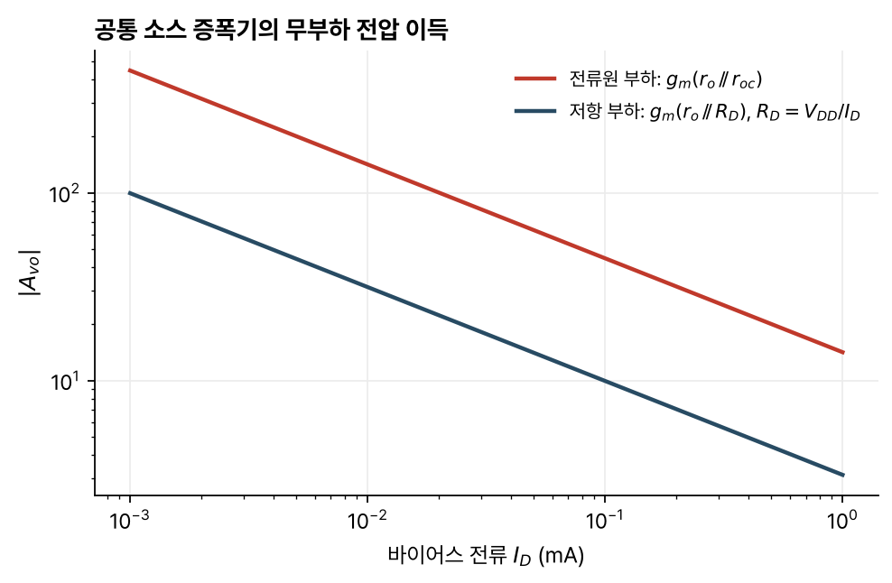

> [!abstract] 한눈에
> 증폭기는 입력 신호를 모양 그대로 키워 낸다. 신호를 전압으로 다루는지 전류로 다루는지에 따라 증폭기는 네 종류로 나뉘고, 각각 바라는 입력·출력 저항이 다르다. MOSFET 하나와 전류원으로 만드는 세 증폭단은 역할이 다르다. 공통 소스는 전압 이득과 트랜스컨덕턴스를, 공통 드레인은 낮은 출력 저항의 전압 버퍼를, 공통 게이트는 낮은 입력 저항의 전류 버퍼를 맡는다.

## 증폭기의 기본

증폭기의 출력은 입력을 충실히 닮되 크기가 커야 한다. 그 중심에는 능동 소자가 있고, 왜곡이 없으려면 전달 특성이 선형이어야 한다. 실제 전달 특성은 제한된 전압 범위에서만 선형이어서 그 밖에서는 증폭기가 포화되고, 이것이 신호 진폭(swing)을 제한한다. 진폭의 한계는 바이어스 점(동작점, quiescent point) $Q$를 어디에 두는지에도 달려 있다.

그 밖에 바라는 성질로 강의 자료는 낮은 전력 소모, 넓은 주파수 응답, 공정과 온도 변화에 대한 강인함, 싼 가격(특이한 부품을 피하고 칩 면적이 작을 것)을 든다.

신호를 전압과 전류 가운데 무엇으로 나타내는지에 따라 증폭기는 넷으로 나뉜다.

| 종류 | 입력 → 출력 | 바라는 $R_{in}$ | 바라는 $R_{out}$ |
|---|---|---|---|
| 전압 증폭기 | 전압 → 전압 | 높음 | 낮음 |
| 트랜스컨덕턴스 증폭기 | 전압 → 전류 | 높음 | 높음 |
| 트랜스레지스턴스 증폭기 | 전류 → 전압 | 낮음 | 낮음 |
| 전류 증폭기 | 전류 → 전류 | 낮음 | 높음 |

## 2포트 모형

전압 증폭기의 소신호 동작은 입력 저항 $R_{in}$, 출력 저항 $R_{out}$, 무부하 전압 이득 $A_{vo}$로 요약한다. 신호원 저항 $R_S$와 부하 $R_L$을 붙이면 입력과 출력에서 각각 전압 분배가 일어나므로

$$
A_v = \frac{v_{out}}{v_s} = \frac{R_{in}}{R_{in} + R_S}\,A_{vo}\,\frac{R_L}{R_L + R_{out}}
$$

이다. $R_{in}$은 출력에 $R_L$을 단 채 입력에 시험 전압을 걸고 흐르는 전류로 구하고, $R_{out}$은 입력에 $R_S$를 단 채 출력에 시험 전압을 걸어 구한다.

## 공통 소스 증폭기

소스를 음의 전원 $V_{SS}$에, 드레인을 저항 $R_D$를 거쳐 $V_{DD}$에 잇고, 게이트에 바이어스 $V_{GG}$와 신호를 넣는다. $v_{GS}$가 오르면 $i_D$가 늘고, $R_D$의 전압 강하가 커져 $v_{out}$이 내려간다. 출력은 입력과 위상이 반대다.

### 바이어스

트랜지스터가 포화 영역에 있고 출력 바이어스가 0 V가 되도록 $V_{GG}$, $W/L$, $R_D$를 고른다. $I_D = \frac{W}{2L}\mu_n C_{ox}(V_{GG} - V_{SS} - V_T)^2 = V_{DD}/R_D$에서

$$
V_{GG} = V_{SS} + V_T + \sqrt{\frac{2V_{DD}}{R_D\frac{W}{L}\mu_n C_{ox}}}
$$

이다.

### 이득

소신호 등가회로에서 $v_{out} = -g_m v_{in}(r_o\,/\!/\,R_D)$이므로

$$
A_{vo} = -g_m(r_o\,/\!/\,R_D)
$$

이다.

### 진폭

위로는 트랜지스터가 차단될 때까지 $v_{out,max} = V_{DD}$, 아래로는 선형 영역에 들어갈 때까지 $v_{out,min} = V_{GG} - V_T$다.

### 부하의 영향

출력 바이어스가 0 V이므로 부하를 달아도 바이어스는 그대로다. 게이트로는 전류가 흐르지 않아 $R_{in} = \infty$이고 입력 쪽 부하 효과가 없다. 출력 쪽은 $R_{out} = r_o\,/\!/\,R_D$이고, $R_L$이 전류를 끌어가 이득이 $|A_v| = g_m(r_o\,/\!/\,R_D\,/\!/\,R_L)$로 줄며, 위쪽 진폭도 $V_{DD}R_L/(R_L + R_D)$로 줄어든다.

### 저항 부하의 한계

$|A_{vo}| \approx g_mR_D$이고 출력 바이어스 조건 $R_D = V_{DD}/I_D$를 넣으면

$$
|A_{vo}| \approx \sqrt{2\frac{W}{L}\mu_n C_{ox}I_D}\,\frac{V_{DD}}{I_D} \propto \frac{V_{DD}}{\sqrt{I_D}}
$$

이다. 이득을 키우려면 $V_{DD}$를 올리거나 $I_D$를 줄여야 하고, 둘 다 $R_D$를 키운다. 큰 저항은 칩 면적을 많이 차지하고 주파수 응답을 해친다. 강의는 저항을 아예 쓰지 않는 쪽이 낫다고 적는다.

### 전류원 부하

$R_D$ 대신 출력 저항 $r_{oc}$가 큰 전류원을 쓰면

$$
|A_{vo}| = g_m(r_o\,/\!/\,r_{oc})
$$

로 저항 부하보다 훨씬 크다. 전류원은 게이트를 고정 전압 $V_B$에 묶은 p채널 MOSFET으로 만든다.

*그림 1. 바이어스 전류에 따른 공통 소스 증폭기의 무부하 전압 이득. 소자 값은 예로 정한 $\mu_n C_{ox}W/L = 1$ mA/V², $\lambda = 0.05$ V⁻¹, $V_{DD} = 2.5$ V이고, 전류원은 같은 $\lambda$의 트랜지스터로 두어 $r_{oc} = r_o$다.*

그림 1의 값으로 계산하면 $I_D = 0.1$ mA에서 저항 부하는 $|A_{vo}| \approx 9.9$, 전류원 부하는 약 45다.

$g_m = \sqrt{2\frac{W}{L}\mu_n C_{ox}I_D}$와 $r_o \approx 1/(\lambda I_D) \propto L/I_D$에서, 다른 값이 바뀌지 않도록 $V_{GG}$를 맞춘다고 할 때 소자 변수에 따른 변화는 다음과 같다.

| 소자 변수를 키우면 | $\|A_{vo}\|$ | $R_{in}$ | $R_{out}$ |
|---|---|---|---|
| $I_{SUP}$ | 줄어든다 | 무한대 그대로 | 줄어든다 |
| $W$ | 커진다 | 무한대 그대로 | 그대로 |
| $\mu_n C_{ox}$ | 커진다 | 무한대 그대로 | 그대로 |
| $L$ | 커진다 | 무한대 그대로 | 커진다 |

전류원 부하 공통 소스 증폭기는 $R_{in}$과 $|A_{vo}|$가 커서 괜찮은 전압 증폭기지만 $R_{out}$도 커서, $R_L$이 $r_o\,/\!/\,r_{oc}$보다 작으면 이득이 떨어진다. 대신 트랜스컨덕턴스 증폭기로는 훌륭하다($G_{mo} = g_m$, $R_{in}$과 $R_{out}$ 모두 크다). 트랜스레지스턴스 증폭기나 전류 증폭기로는 맞지 않는다.

## 공통 드레인 증폭기 (소스 팔로워)

드레인을 $V_{DD}$에 잇고, 소스에서 출력을 꺼내며 소스 아래에 전류원을 둔다. 전류원이 $i_D$를 고정하므로 $v_G$가 오르면 $v_{OUT}$도 같이 오른다. 1차로 $v_{out} \approx v_s$이고 전압 이득이 없지만, 출력 저항이 작아 전압 버퍼로 쓴다. 공통 소스 단과 함께 쓰면 좋은 전압 증폭기가 된다.

몸체를 소스에 묶은 경우의 소신호 해석은

$$
A_{vo} = \frac{g_m}{g_m + \frac{1}{r_o/\!/r_{oc}}} \approx 1, \qquad R_{in} = \infty, \qquad R_{out} = \frac{1}{g_m + \frac{1}{r_o/\!/r_{oc}}} \approx \frac{1}{g_m}
$$

이다. 출력 저항이 작아 부하를 달아도 $A_v = A_{vo}\frac{R_L}{R_L + R_{out}} \approx 1$이다.

### 몸체 효과

격리된 p-웰이 없으면 몸체가 기판($V_{SS}$)에 묶인다. 그러면 $V_{BS} = V_{SS} - V_{OUT} \neq 0$이어서 [[mosfet-iv|문턱전압]]이 바뀌고, 신호가 몸체와 소스 사이에도 나타나($v_{bs} = -v_{out}$) [[mosfet-small-signal|몸체 트랜스컨덕턴스]] $g_{mb}$가 작용한다.

$$
A_{vo} \approx \frac{g_m}{g_m + g_{mb}} < 1, \qquad R_{out} \approx \frac{1}{g_m + g_{mb}}
$$

## 공통 게이트 증폭기

전류 신호원을 다루려면 소스로 신호를 넣고 드레인에서 꺼낸다. 소스가 신호 입력 단자이므로 몸체를 소스에 묶을 수 없다. 소스 전류가 늘면 드레인 전류가 줄고, 게이트 전류가 0이므로 $i_s = -i_{out}$, 곧 $A_{io} = -1$이다. 전류 이득은 없고 전류 버퍼로 쓴다.

바이어스는 $I_{SUP} + I_{OUT} + I_{BIAS} = 0$, $I_{OUT} = 0$이 되도록 고른다. $I_D = \frac{W}{2L}\mu_n C_{ox}(V_{GS} - V_T)^2$에서 $V_T$가 $V_{BS}$에 따라 바뀌므로 두 식을 반복해서 풀어 소스 전압을 구한다.

입력 노드에서 KCL을 세우면

$$
R_{in} = \frac{1 + \frac{r_{oc}/\!/R_L}{r_o}}{g_m + g_{mb} + \frac{1}{r_o}} \approx \frac{1}{g_m + g_{mb}}
$$

로 매우 작다. 출력 저항은 소스 쪽 $R_S$가 되먹임을 걸어

$$
R_{out} = r_{oc}\,/\!/\,\left\{r_o\left[1 + R_S\left(g_m + g_{mb} + \frac{1}{r_o}\right)\right]\right\} \approx r_{oc}\,/\!/\,\big[r_o(1 + g_mR_S)\big]
$$

로 매우 크다.

## 세 증폭단 정리

| 증폭단 | 이득 | $R_{in}$ | $R_{out}$ | 역할 |
|---|---|---|---|---|
| 공통 소스 | $G_{mo} = g_m$ | $\infty$ | $r_o\,/\!/\,r_{oc}$ | 트랜스컨덕턴스 증폭기 |
| 공통 드레인 | $A_{vo} \approx \frac{g_m}{g_m + g_{mb}}$ | $\infty$ | $\frac{1}{g_m + g_{mb}}$ | 전압 버퍼 |
| 공통 게이트 | $A_{io} \approx -1$ | $\frac{1}{g_m + g_{mb}}$ | $r_{oc}\,/\!/\,[r_o(1 + g_mR_S)]$ | 전류 버퍼 |

요구 성능을 맞추려면 이 단들을 이어 [[multistage-amplifiers-current-mirrors|다단 증폭기]]를 만든다.

## 유의점

- 무부하 이득 $A_{vo}$와 부하를 단 이득 $A_v$는 다르다. 출력 저항이 큰 단에 작은 부하를 달면 이득이 크게 준다.
- 공통 소스 단의 이득은 음수다. 출력이 입력과 위상이 반대다.
- 공통 드레인 단은 전압 이득이 1보다 조금 작다. 몸체가 기판에 묶이면 $g_m/(g_m + g_{mb})$로 더 줄어든다.
- 저항 부하로 이득을 키우려면 저항이 커져야 하고, 집적회로에서는 면적과 주파수 응답 때문에 전류원 부하를 쓴다.
- 표의 입출력 저항은 소신호 값이다. 신호 진폭의 한계는 바이어스 점과 트랜지스터가 포화 영역에 머무는 범위로 따로 따진다.

## 관련 개념

- [[mosfet-small-signal|MOSFET 소신호 모델]]: $g_m$, $r_o$, $g_{mb}$
- [[multistage-amplifiers-current-mirrors|다단 증폭기와 전류 거울]]: 단을 잇는 방법과 전류원을 만드는 방법
- [[op-amp-biosignal-front-end|연산증폭기와 생체신호 앞단]]: 증폭기를 블록으로 쓰는 회로 수준

## 참고 자료

- MIT OCW, [6.012 Microelectronic Devices and Circuits (Fall 2005)](https://ocw.mit.edu/courses/6-012-microelectronic-devices-and-circuits-fall-2005/), Lecture 19 _Transistor Amplifiers (I): Common-Source Amplifier_, Lecture 20 _Transistor Amplifiers (II): Other Amplifier Stages_
- R. T. Howe, C. G. Sodini, _Microelectronics: An Integrated Approach_, Prentice Hall, Ch. 8
