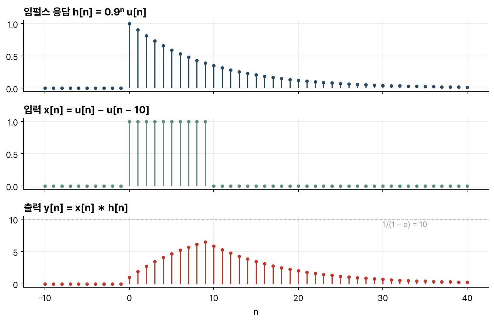

> [!abstract] 한눈에
> 디지털 필터는 현재 출력을 과거 출력과 현재·과거 입력의 가중합으로 계산한다. 과거 출력을 쓰지 않는 필터를 FIR, 과거 출력을 쓰는 필터를 IIR로 나눈다. FIR의 임펄스 응답은 유한하고, IIR의 임펄스 응답은 대개 끝없이 이어진다. 선형 시불변(LTI) 시스템은 임펄스 응답 하나로 완전히 정해지고, 어떤 입력에 대한 출력도 입력과 임펄스 응답의 컨볼루션으로 구한다.

## 차분방정식으로 정의한 필터

선형 상수계수 차분방정식(LCCDE)은 다음 꼴이다.

$$
y[n] = \sum_{k=1}^{K} a_k\, y[n-k] + \sum_{m=0}^{M} b_m\, x[n-m]
$$

$M$과 $K$ 중 큰 값을 필터의 차수라 한다. 입력이 $n_0$부터 주어지면 그 직전의 출력 $K$개와 입력 $M$개를 알아야 계산을 시작할 수 있고, 오랫동안 입력이 없었다면 0으로 둔다.

자주 쓰는 예는 다음과 같다.

| 필터 | 식 |
|---|---|
| 이득 | $y[n] = Gx[n]$ |
| $n_0$ 표본 지연 | $y[n] = x[n-n_0]$ |
| 2점 이동평균 | $y[n] = \tfrac12(x[n] + x[n-1])$ |
| 오일러 미분 근사 | $y[n] = (x[n] - x[n-1])/T_s$ |
| 사다리꼴 적분 | $y[n] = y[n-1] + \tfrac{T_s}{2}(x[n] + x[n-1])$ |
| 누설 적분기(1차 저역통과) | $y[n] = a\,y[n-1] + x[n],\ 0 < a < 1$ |
| 디지털 공진기 | $y[n] = a_1 y[n-1] + a_2 y[n-2] + bx[n],\ a_1^2 + 4a_2 < 0$ |

모든 디지털 필터는 이득과 지연의 조합이다. 누설 적분기는 아날로그 RC 회로에 해당하고, 공진기는 조화 진동자에 해당한다.

## FIR과 IIR

- $a_k$가 모두 0이면 출력이 유한한 개수의 입력으로만 정해진다. 이것을 **FIR**(finite impulse response) 필터라 하고, 이동평균(MA) 필터 또는 영점만 있는 필터라고도 한다. 위 표에서 이득부터 오일러 미분까지가 FIR이다.
- $a_k$ 중 하나라도 0이 아니면 **IIR**(infinite impulse response) 필터다. $b_0$ 말고 $b_m$이 모두 0이면 자기회귀(AR) 필터 또는 극점만 있는 필터, 둘 다 있으면 ARMA 필터다. 누설 적분기와 공진기는 AR, 사다리꼴 적분은 ARMA다.

같은 2차 차분방정식 $y[n] = a_1 y[n-1] + a_2 y[n-2] + x[n]$도 $y[n-1]$이나 $y[n-2]$에 대해 풀면 다른 필터가 된다. 이 가운데 재귀적으로 계산할 수 있는 것은 과거 값으로 현재를 구하는 인과 필터와, 미래 값으로 과거를 구하는 반인과 필터뿐이다. 둘은 시간축을 뒤집은 관계여서 인과 필터만 다뤄도 된다.

## LTI 시스템과 컨볼루션

선형성(중첩과 스케일링)과 시불변성(입력을 $n_0$만큼 늦추면 출력도 $n_0$만큼 늦어짐)을 함께 가진 시스템을 LTI 시스템이라 한다. 상수계수 차분방정식으로 정의한 필터는 모두 LTI다. 계수가 $n$에 따라 바뀌면 선형이지만 시불변이 아니다. 진폭 변조 $y[n] = ax[n]\cos(2\pi f_c n + \theta)$가 그 예다.

입력을 지연된 단위 표본의 가중합으로 쓴다.

$$
x[n] = \sum_{m=-\infty}^{\infty} x[m]\,\delta[n-m]
$$

단위 표본 $\delta[n]$에 대한 응답을 $h[n]$이라 하면, 시불변성으로 $\delta[n-m]$의 응답은 $h[n-m]$, 스케일링으로 $x[m]\delta[n-m]$의 응답은 $x[m]h[n-m]$, 중첩으로 전체 응답은

$$
y[n] = \sum_{m=-\infty}^{\infty} x[m]\,h[n-m] = x[n] * h[n]
$$

이다. 이 식이 **컨볼루션 합**이다. 임펄스 응답을 알면 어떤 입력에 대한 출력도 구할 수 있다. 비선형이거나 시변인 시스템에서는 성립하지 않는다.

FIR 필터의 임펄스 응답은 계수 그대로 $h[m] = b_m$이다. IIR 필터는 차분방정식에 단위 표본을 넣어 차례로 계산하면 되고, 누설 적분기는 $h[n] = a^n u[n]$이다.

### 컨볼루션의 성질

- 교환법칙 $x * h = h * x$, 결합법칙 $x * (h_1 * h_2) = (x * h_1) * h_2$, 분배법칙 $x * h_1 + x * h_2 = x * (h_1 + h_2)$가 성립한다.
- 두 필터를 직렬로 이으면 전체 임펄스 응답은 $h_1 * h_2$이고, 순서를 바꿔도 출력이 같다. IIR 필터를 FIR 부분과 순수 재귀 부분의 직렬로 나눈 뒤 순서를 바꾸면, 지연 소자를 필터 차수만큼만 쓰는 구현이 된다.
- 두 필터를 병렬로 놓고 출력을 더하면 전체 임펄스 응답은 $h_1 + h_2$다.

## 컨볼루션 예

누설 적분기 $h[n] = a^n u[n]$에 길이 $N$인 사각 펄스 $x[n] = u[n] - u[n-N]$을 넣는다. 출력은 세 구간으로 나뉜다.

$$
y[n] = \begin{cases}
0 & n < 0\\[4pt]
\dfrac{1 - a^{n+1}}{1-a} & 0 \le n \le N-1\\[8pt]
\dfrac{1 - a^{N}}{1-a}\, a^{\,n-N+1} & n \ge N
\end{cases}
$$

펄스가 들어오는 동안 출력은 $1/(1-a)$를 향해 지수적으로 오르고, 펄스가 끝나면 지수적으로 줄어든다. $a = 0.9$, $N = 10$이면 점근값은 10이고, $n = 9$에서 최댓값 $(1 - 0.9^{10})/0.1 \approx 6.51$에 이른 뒤 줄어든다(그림 1).

*그림 1. $h[n] = 0.9^n u[n]$, 길이 10인 사각 펄스 입력, 그리고 두 신호의 컨볼루션. 점선은 펄스가 끝없이 이어질 때의 점근값이다.*

## 인과성

$n_0$의 출력이 $n \le n_0$의 입력에만 의존하면 인과(causal) 시스템이다. LTI 필터에서는 $n < 0$에서 $h[n] = 0$인 것과 같다. 실시간 처리에는 인과성이 필요하지만, 이미 기록한 신호를 처리할 때는 과거와 미래의 구분이 약속에 가깝다. 영상처럼 독립변수가 시간이 아니면 인과성이 별 의미가 없다.

$y[n] = \sum_{m=-M}^{M} b_m x[n-m]$처럼 원점 양쪽으로 계수가 있는 FIR 필터에서 $b_m = b_{-m}$이면 지연이 없어서 영위상(zero-phase) 필터라 한다. 임펄스 응답을 길이의 절반만큼 늦추면 인과 필터가 된다.

## 안정성

유계 입력에 대해 출력이 항상 유계이면 안정(BIBO stable)하다고 한다. LTI 시스템이 안정할 필요충분조건은 임펄스 응답이 절대 합산 가능한 것이다.

$$
\sum_{n=-\infty}^{\infty} |h[n]| < \infty
$$

$|x[n]| \le B$이면 $|y[n]| \le B\sum|h[m]|$이므로 이 조건은 충분조건이다. FIR 필터는 항이 유한하므로 항상 안정하고, IIR 필터는 안정하지 않을 수 있다. 누설 적분기는 $|a| \ge 1$이면 $a^n u[n]$의 합이 발산해 불안정하다.

## 필터라는 이름의 비선형 처리

중앙값 필터는 일정 개수 표본의 중앙값을 출력한다. 이동평균과 비슷하게 생겼지만 비선형이고, 시불변이다. 적응 필터는 계수를 입력과 출력에 따라 천천히 바꾼다. 짧은 시간 동안은 LTI처럼 동작하지만 긴 시간으로 보면 선형도 시불변도 아니다.

## 유의점

- FIR과 IIR은 차분방정식의 계수 $a_k$로 나눈다. 과거 출력 항이 있어도 극점과 영점이 상쇄되면 임펄스 응답이 유한할 수 있다. 재귀적으로 계산하는 이동합 $y[n] = y[n-1] + x[n] - x[n-4]$의 임펄스 응답은 $1, 1, 1, 1$에서 끝난다.
- 컨볼루션으로 출력을 구할 수 있는 것은 LTI 시스템일 때뿐이다. 중앙값 필터처럼 비선형인 처리에는 임펄스 응답이라는 요약이 없다.
- 직렬 연결에서 순서를 바꿔도 되는 것은 이상적인 LTI 필터일 때다. 실제 고정소수점 구현에서는 중간 값의 범위와 반올림 오차가 순서에 따라 달라진다.
- 영위상 필터는 미래 표본을 쓰므로 실시간에는 쓸 수 없다. 기록된 생체 신호를 오프라인으로 처리할 때 파형의 시점을 보존하려고 쓴다.

## 관련 개념

- [[difference-equations-feedback|차분방정식과 피드백]]: 같은 차분방정식을 블록 다이어그램과 극점으로 본 것
- [[first-order-rc-rl|RC·RL 1차 회로]]: 누설 적분기에 해당하는 아날로그 회로
- [[z-transform|z 변환]]: IIR 필터의 임펄스 응답과 안정성을 극점으로 판단하는 방법
- [[random-signals-autocorrelation|랜덤 신호와 자기상관]]: 랜덤 신호를 디지털 필터에 넣었을 때의 출력 전력

## 참고 자료

- MIT OCW, [HST.582J Biomedical Signal and Image Processing (Spring 2007)](https://ocw.mit.edu/courses/hst-582j-biomedical-signal-and-image-processing-spring-2007/), Chapter 2 _Digital Filters_ (B. Delgutte, J. Greenberg)
- A. V. Oppenheim, R. W. Schafer, _Discrete-Time Signal Processing_, 3rd ed., Ch. 2
