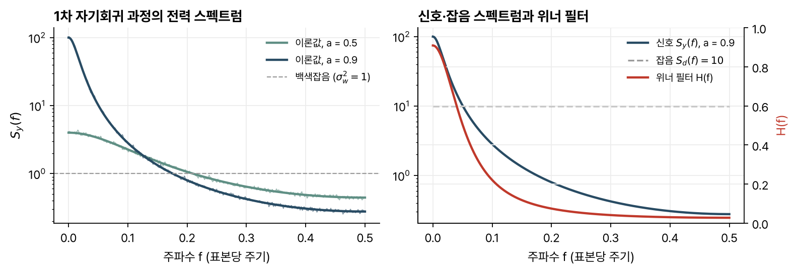

> [!abstract] 한눈에
> 랜덤 신호를 LTI 필터에 넣으면 출력의 자기상관은 입력의 자기상관에 필터의 결정론적 자기상관을 컨볼루션한 것이다. 자기상관을 푸리에 변환한 전력 스펙트럼으로 옮기면 컨볼루션이 곱이 되어, 출력 스펙트럼은 입력 스펙트럼에 $|H(f)|^2$을 곱한 것이 된다. 신호와 잡음의 스펙트럼을 알면, 오차 전력을 가장 작게 하는 필터인 위너 필터도 이 관계로 쓸 수 있다.

## LTI 시스템을 지난 랜덤 신호

$y[n] = h[n] * x[n]$이면 출력 평균은 $\mu_y = \mu_x\sum h[n]$이고, 출력 자기상관은

$$
R_y[k] = R_x[k] * \tilde R_h[k], \qquad \tilde R_h[k] = \sum_n h[n]\,h[n+k]
$$

이다. $\tilde R_h$는 임펄스 응답의 결정론적 자기상관이다.

입력이 분산 $\sigma_w^2$인 백색잡음이면 출력 분산은

$$
\sigma_y^2 = \sigma_w^2 \sum_n h[n]^2
$$

로, 입력 분산에 임펄스 응답의 에너지를 곱한 값이다. 이 간단한 관계는 입력이 백색일 때만 성립한다.

- 1차 저역통과 $h[n] = a^n u[n]$에 평균 0 백색잡음을 넣으면 $R_y[k] = \sigma_w^2 a^{|k|}/(1-a^2)$이다.
- 길이 $N$인 사각(boxcar) 필터는 결정론적 자기상관이 너비 $2N-1$, 높이 $N$인 삼각형이다. 백색잡음을 넣으면 출력 분산이 $N\sigma_w^2$이고, $|k| < N$인 이웃 표본 사이에 상관이 생긴다.

같은 신호를 두 필터에 넣으면 두 출력은 일반적으로 상관된다. 두 입력이 무상관이면 출력도 무상관이다.

## 전력 스펙트럼

자기상관의 DTFT를 **전력 스펙트럼**(power spectrum)이라 한다.

$$
S_x(f) = \sum_{k=-\infty}^{\infty} R_x[k]\, e^{-j2\pi f k}, \qquad R_x[k] = \int_{-1/2}^{1/2} S_x(f)\, e^{j2\pi f k}\, df
$$

$f$는 표본당 주기 단위의 주파수다. 자기상관이 실수이고 짝함수이므로 전력 스펙트럼도 실수이고 짝함수다. 컨볼루션 정리를 쓰면 LTI 시스템의 입출력 관계가 곱이 된다.

$$
S_y(f) = S_x(f)\,|H(f)|^2
$$

### 의미

$k = 0$을 넣으면 $P_x = R_x[0] = \int_{-1/2}^{1/2} S_x(f)\,df$로, 신호 전력은 전력 스펙트럼의 넓이다. 중심 $f_0$, 폭 $\Delta f$인 좁은 대역통과 필터를 지난 신호의 전력은 약 $S_x(f_0)\Delta f$다.

$S_x(f_0)$는 $f_0$ 근처 성분이 전체 전력에 보태는 몫이다. 필터 출력의 전력은 음수일 수 없으므로 $S_x(f) \ge 0$이고, 특히 $\sum_k R_x[k] = S_x(0) \ge 0$이다. 이 조건 때문에 아무 짝함수나 자기상관이 될 수는 없다.

### 예

| 신호 | 자기상관 | 전력 스펙트럼 |
|---|---|---|
| 정현파, 진폭 $A$, 주파수 $f_0$ | $\tfrac{A^2}{2}\cos 2\pi f_0 k$ | $\pm f_0$의 임펄스, 각 높이 $A^2/4$ |
| 평균 0 백색잡음 | $\sigma_w^2\delta[k]$ | $\sigma_w^2$ (상수) |
| 미분기 $w[n] - w[n-1]$의 출력 | $\sigma_w^2(2\delta[k] - \delta[k-1] - \delta[k+1])$ | $2\sigma_w^2(1 - \cos 2\pi f)$ |
| 1차 자기회귀 $y[n] = a\,y[n-1] + w[n]$ | $\sigma_w^2 a^{\vert k\vert }/(1-a^2)$ | $\sigma_w^2/(1 - 2a\cos 2\pi f + a^2)$ |
| 길이 $N$ 사각 필터의 출력 | $\sigma_w^2(N - \vert k\vert )$, $\vert k\vert  < N$ | $\sigma_w^2 \sin^2(\pi N f)/\sin^2(\pi f)$ |

전력 스펙트럼의 임펄스는 주기 성분을 나타낸다. 직류도 원점의 임펄스로 나타나므로, 스펙트럼을 추정하기 전에 평균과 주기 성분을 빼는 것이 좋다.

미분기 출력은 $f = 0$에서 0이고 $f = 1/2$에서 $4\sigma_w^2$까지 오른다. 1차 자기회귀 과정은 $a$가 1에 가까워질수록 원점 근처에 전력이 몰린다(그림 1 왼쪽). 사각 필터의 출력은 원점 높이가 $N^2\sigma_w^2$이고 첫 영점이 $f = 1/N$이어서, $N$이 길수록 저역통과 모양이 뚜렷해진다.

백색잡음의 출력 스펙트럼이 $\sigma_w^2|H(f)|^2$이라는 사실에서 두 가지를 얻는다. 임펄스가 없는 임의의 전력 스펙트럼은 단위 분산 백색잡음을 $|H(f)| = \sqrt{S_x(f)}$인 필터에 넣은 결과로 볼 수 있다. 그래서 스펙트럼 추정 문제를 필터의 매개변수 추정 문제로 바꿀 수 있다(자기회귀 스펙트럼 추정). 거꾸로 원하는 스펙트럼의 잡음을 만들려면 백색잡음을 그 제곱근 크기의 필터에 넣으면 된다.

*그림 1. 왼쪽: $a$ = 0.5, 0.9인 1차 자기회귀 과정의 전력 스펙트럼. 굵은 선은 이론값, 가는 선은 400,000개 표본을 길이 1024의 구간(해닝 창, 50% 겹침)으로 나눠 평균한 추정값이다. 오른쪽: $a = 0.9$인 신호 스펙트럼, 분산 10인 백색잡음 스펙트럼, 그리고 두 스펙트럼으로 만든 위너 필터.*

### 물리 단위

연속시간 신호의 전력 스펙트럼은 V²/Hz 단위를 가진다. 표본 간격 $T_s$로 표본화한 신호에서는 $S'_x(F) = T_s\,S_x(F/F_s)$로 바꾸면 같은 단위가 된다. 위의 정의는 단위가 없는 수학적 정의다.

## 위너 필터

관측 $x[n]$으로 원하는 신호 $y[n]$을 추정하는 필터 $h[n]$ 가운데, 오차 $e[n] = y[n] - \hat y[n]$의 평균 전력을 가장 작게 하는 것을 찾는다. 오차 전력은 필터 계수의 2차 함수라 최솟값이 하나이고, 미분을 0으로 놓으면

$$
R_{xy}[k] = \sum_l h[l]\, R_x[k-l]
$$

이 나온다. 이 조건이 성립하면 오차가 관측과 무상관이다. 선형 최소제곱 추정의 일반적인 성질이다.

필터에 제약이 없으면 우변이 컨볼루션이므로 푸리에 변환으로 푼다. 이것이 비인과 이산시간 **위너 필터**다.

$$
H(f) = \frac{S_{xy}(f)}{S_x(f)}
$$

### 더해진 잡음 걸러내기

관측이 원하는 신호와 무상관 잡음의 합 $x[n] = y[n] + d[n]$이면 $S_{xy} = S_y$, $S_x = S_y + S_d$이므로

$$
H(f) = \frac{S_y(f)}{S_y(f) + S_d(f)}
$$

이다. 신호 대 잡음비 $S_y/S_d$가 큰 주파수에서는 1에 가깝고, 작은 주파수에서는 0에 가깝다. $H(f)$가 실수이고 짝함수여서 $h[n]$이 원점 대칭이고 비인과적이다. 실시간에 쓰려면 FIR로 근사한 뒤 길이의 절반만큼 늦춘다.

강의 자료의 예는 신호가 $a = 0.9$인 1차 자기회귀 과정(구동 잡음 분산 1), 더해진 잡음이 분산 $\sigma_d^2 = 10$인 백색잡음인 경우다. $H(f) = 1/\big(1 + \sigma_d^2(1 - 2a\cos 2\pi f + a^2)\big)$를 계산하면 $f = 0$에서 0.91, $f = 0.1$에서 0.22, $f = 0.5$에서 0.027이다(그림 1 오른쪽).

위너 필터는 두 가지로 쓴다. 시스템 식별에서는 미지의 시스템과 같은 입력(직접 식별)이나 그 출력(역 식별)으로 시스템을 모델링한다.

역 식별은 선형 예측의 바탕이다. 신호 조정에서는 잡음을 지우거나 신호를 검출한다. 심전도 기록에서 60 Hz 성분을 지우는 것이 그 예다.

## 유의점

- $S_y = S_x|H|^2$은 크기만 담는다. 출력 전력 스펙트럼으로는 필터의 위상을 알 수 없다.
- 백색잡음 입력의 출력 분산이 $\sigma_w^2\sum h^2$인 것은 입력이 백색일 때뿐이다. 상관된 입력에서는 0이 아닌 지연의 공분산 $C_x[k]$도 출력 분산에 들어간다.
- 위너 필터는 신호 파형이 아니라 신호와 잡음의 스펙트럼을 안다고 가정한다. 신호 파형을 정확히 알 때는 [[matched-filter|정합 필터]]가 맞는 도구다.
- 위너 필터의 최적성은 선형 필터 가운데, 평균 제곱 오차 기준에서다. 다른 기준이나 비선형 추정에서는 다른 답이 나온다.

## 관련 개념

- [[random-signals-autocorrelation|랜덤 신호와 자기상관]]: 전력 스펙트럼의 출발점인 자기상관
- [[dtft|이산시간 푸리에 변환]]: 자기상관을 주파수로 옮기는 변환
- [[dft-fft|DFT와 FFT]]: 유한한 데이터로 스펙트럼을 추정할 때 쓰는 계산
- [[matched-filter|정합 필터]]: 알려진 파형을 백색잡음 속에서 찾는 최적 필터
- [[least-squares|최소제곱]]: 위너 필터가 푸는 문제의 행렬 버전

## 참고 자료

- MIT OCW, [HST.582J Biomedical Signal and Image Processing (Spring 2007)](https://ocw.mit.edu/courses/hst-582j-biomedical-signal-and-image-processing-spring-2007/), Chapter 12 _Random Signals and Linear Systems_ (B. Delgutte)
- A. V. Oppenheim, R. W. Schafer, _Discrete-Time Signal Processing_, 3rd ed., Ch. 2 (랜덤 신호)
