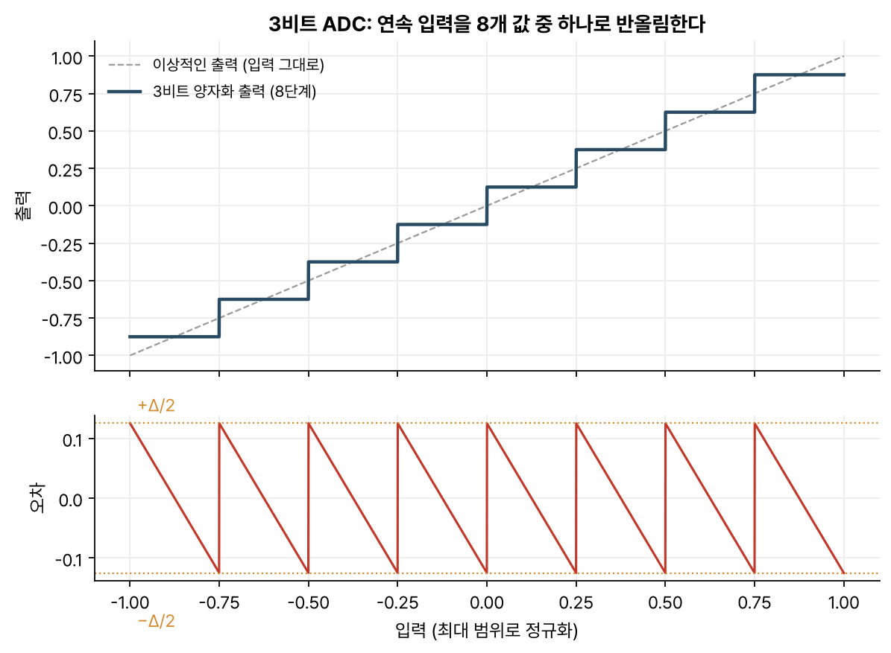
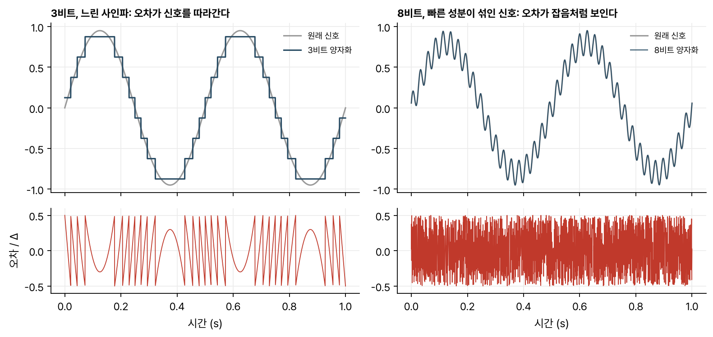
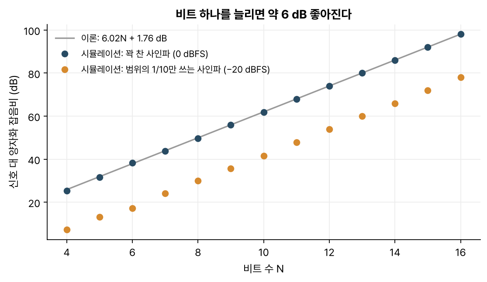

> [!abstract] 한눈에
> ADC는 신호를 두 번 이산화한다. 시간 축은 [[sampling-aliasing|샘플링]]으로, 값의 축은 **양자화**로 나눈다. $N$비트 양자화는 범위를 $2^N$칸으로 나누고, 그 반올림 오차는 잡음처럼 더해진다. 꽉 찬 사인파 기준으로 비트 하나에 약 6 dB씩 좋아진다. 신호가 범위의 일부만 쓰면 그만큼 유효 비트가 줄어든다.

## 정의

**ADC**(analog-to-digital converter)는 연속 전압을 숫자로 바꾼다. 일정한 간격 $T$마다 값을 재는 것이 샘플링이고, 잰 값을 정해진 단계 가운데 가장 가까운 것으로 반올림하는 것이 **양자화**(quantization)다.

$N$비트 ADC는 입력 범위(예: $-V$에서 $+V$)를 $2^N$칸으로 나눈다. 한 칸의 너비를 **양자화 간격** $\Delta$라 한다.

$$
\Delta = \frac{\text{입력 범위}}{2^N} = \frac{2V}{2^N}
$$

_그림 1. 3비트면 단계가 8개다. 출력은 계단 모양이 되고, 오차(아래)는 $\pm\Delta/2$ 사이를 오가는 톱니 모양이다._

## 양자화 잡음 모델

양자화한 값 $Q(x)$와 원래 값 $x$의 차이를 $e = Q(x) - x$라 하자. 범위 안에서 $e$는 언제나 $-\Delta/2$와 $\Delta/2$ 사이에 있다. 신호가 여러 단계를 바쁘게 오가면 $e$를 이 구간에 고르게 퍼진 잡음으로 다룰 수 있다. 그렇게 보면 그 전력(분산)은

$$
\sigma_e^2 = \frac{\Delta^2}{12}
$$

이다. 양자화한 신호는 '원래 신호 + 전력이 $\Delta^2/12$인 잡음'으로 볼 수 있다. 다만 이 근사는 신호가 여러 단계를 넘나들 때만 맞는다(그림 2).

_그림 2. 왼쪽: 3비트로 양자화한 느린 사인파. 오차가 신호를 따라 규칙적으로 움직여 잡음이라기보다 왜곡이다. 오른쪽: 비슷한 느린 사인파에 작은 고주파 성분을 더하고 8비트로 양자화하면, 오차(확대)가 불규칙한 잡음처럼 보인다. 아래 줄은 오차를 $\Delta$ 단위로 그린 것이다._

## 비트 하나에 6 dB

범위를 꽉 채우는 사인파의 진폭은 $V = 2^{N-1}\Delta$이고 전력은 $V^2/2$다. 이것을 양자화 잡음 전력으로 나누면

$$
\text{SQNR} = \frac{V^2/2}{\Delta^2/12} = \frac{3}{2}\cdot 2^{2N}
\quad\Longrightarrow\quad
10\log_{10}\text{SQNR} \approx 6.02N + 1.76\ \text{dB}
$$

가 된다. 비트가 하나 늘면 $\Delta$가 반으로 줄고, 잡음 전력은 1/4, 곧 약 6 dB 줄어든다. 16비트면 약 98 dB다.

_그림 3. 파란 점은 범위를 꽉 채운 사인파로 계산한 값이고, 이론선과 거의 겹친다. 주황 점은 진폭이 범위의 1/10인 사인파로, 약 20 dB 낮다(비트가 적을 때는 조금 어긋난다)._

## 입력 범위와 유효 비트

그림 3의 주황 점처럼 신호가 입력 범위의 1/10만 쓰면 SQNR이 20 dB, 비트로 치면 3비트 넘게 줄어든다. 16비트 ADC를 써도 실제로는 13비트에 조금 못 미치는(약 12.7비트) 정밀도로 재게 된다.

생체 신호에서 이 문제가 크다. 뇌파는 수십 마이크로볼트, 심전도는 밀리볼트 수준이라 그대로 ADC에 넣으면 범위의 극히 일부만 쓴다. 이를 보완하는 방법은 두 가지다.

1. 앞에서 증폭한다. ADC 앞의 아날로그 앞단(AFE)에서 신호를 키워 범위를 채운다. 대신 전극 오프셋이나 움직임 잡음 때문에 신호가 범위를 넘어 잘리지 않도록 이득을 너무 크게 잡지 않는다.
2. 비트를 많이 쓴다. 증폭을 적게 하는 대신 ADC의 비트 수로 정밀도를 확보한다. 뇌파용 아날로그 앞단 칩 중에는 24비트 ADC를 넣은 것이 흔하다(예: TI ADS1299).

## 유의점

- 비트 수를 늘린다고 언제나 정확해지지는 않는다. 양자화 잡음이 앞단의 열잡음이나 전극 잡음보다 이미 작다면, 비트를 더 늘려도 잡음 바닥은 그대로다. 그 아래를 재는 비트는 잡음을 정밀하게 기록할 뿐이다.
- 양자화 오차를 고르게 퍼진 백색 잡음으로 보는 모델은 신호가 여러 단계를 바쁘게 넘나들 때 맞는 근사다. 신호가 아주 작아 한두 단계만 오가거나 표본 주기와 맞물린 주기 신호라면, 오차가 신호를 따라 움직이는 왜곡이 된다. 일부러 작은 잡음(디더, dither)을 더해 이 상관을 깨기도 한다.
- 분해능과 정확도는 구별해야 한다. $\Delta$는 얼마나 잘게 나누는지(분해능)를 나타낼 뿐이다. 기준 전압의 오차, 단계 간격의 불균일, 비선형성이 있으면 잘게 나눠도 값이 틀릴 수 있다.
- 샘플링 주파수와 비트 수는 실제 ADC에서 서로 맞바꾸는 관계일 때가 많다. 시그마-델타 ADC는 아주 빠르게 거칠게 잰 뒤 걸러서 느리지만 정밀한 값을 만든다.

## 관련 개념

- [[sampling-aliasing|샘플링과 앨리어싱]]: ADC가 시간 축을 나누는 쪽
- [[dft-fft|DFT와 FFT]]: 양자화 잡음은 스펙트럼에서 고르게 깔린 잡음 바닥으로 보인다

## 참고 자료

- MIT OCW, [HST.582J Biomedical Signal and Image Processing](https://ocw.mit.edu/courses/hst-582j-biomedical-signal-and-image-processing-spring-2007/), Chapter 1 _Data acquisition: ADC_
- A. V. Oppenheim, R. W. Schafer, _Discrete-Time Signal Processing_, 3rd ed., §4.8 (아날로그 신호의 디지털 처리와 양자화 오차)
- W. Kester (ed.), _The Data Conversion Handbook_, Analog Devices (2005), Ch. 2
