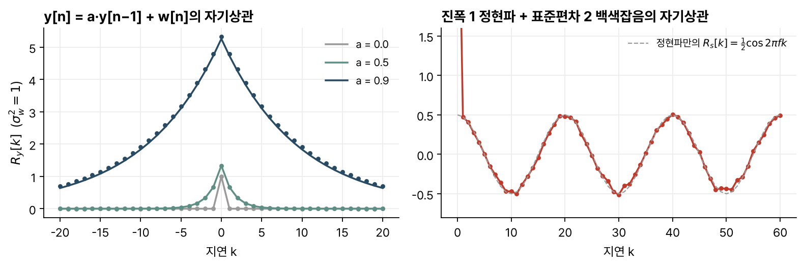
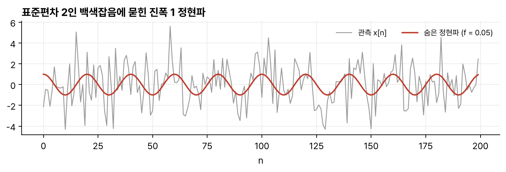

> [!abstract] 한눈에
> 생체 신호는 수식으로 완전히 쓸 수 없는 경우가 많아서, 평균·전력 같은 시간 평균으로 특징을 정한다. 이렇게 다루는 신호를 랜덤 신호라 한다. 필터를 지난 랜덤 신호의 전력을 구하려면 평균과 전력만으로는 부족하고, 서로 다른 시점의 표본이 얼마나 닮았는지를 나타내는 자기상관 함수가 필요하다.

## 시간 평균

이산 신호의 시간 평균은 다음과 같다.

$$
\langle x[n]\rangle = \lim_{N\to\infty}\frac{1}{2N+1}\sum_{n=-N}^{N} x[n] = \mu_x
$$

이 극한이 있는 신호만 다룬다. 주기 신호는 시간 평균이 직류 푸리에 계수이고, 계속 자라는 신호나 길이가 유한한 신호에는 시간 평균이 없다. 특성이 오랫동안 바뀌지 않는 정상(stationary) 신호에 가장 잘 맞는다. 음성처럼 바뀌는 신호도 조음 기관이 성도 공명보다 느리게 움직이므로 짧은 구간에서는 정상 신호로 본다.

시간 평균은 두 성질을 가진다. 신호를 늦춰도 평균이 같고(정상성), 가중합의 평균은 평균의 가중합이다(선형성).

어떤 신호를 랜덤 신호로 볼지는 목적에 달렸다. 통신 시스템을 설계하는 사람에게는 음성의 장기 평균 스펙트럼으로 충분하고, 음성 과학자에게는 조음 기관의 움직임 전체가 필요할 수 있다.

## 전력과 분산

평균 전력은 제곱의 시간 평균이고, 분산은 평균을 뺀 교류 성분의 전력이다.

$$
P_x = \langle x[n]^2\rangle, \qquad \sigma_x^2 = \langle (x[n]-\mu_x)^2\rangle, \qquad P_x = \sigma_x^2 + \mu_x^2
$$

전체 전력은 교류 전력과 직류 전력의 합이다.

확률도 시간 평균의 하나다. 계단 함수 $u$를 쓰면 $P(x[n] \ge X_0) = \langle u(x[n] - X_0)\rangle$이고, 이는 문턱값을 넘는 표본의 비율이다.

**체비쇼프 부등식**은 어떤 랜덤 신호에서도 성립한다.

$$
P(|x[n] - \mu_x| \ge \epsilon) \le \frac{\sigma_x^2}{\epsilon^2}
$$

평균에서 표준편차의 2배 넘게 벗어날 확률은 25% 이하다. 가우스 신호에서는 직접 계산하면 약 4.6%다(강의 자료는 5% 미만이라고만 적는다). 실용적인 한계보다는, 오차의 분산을 줄이면 큰 오차가 드물어진다는 근거로서 최소제곱 추정을 정당화한다.

## 자기상관 함수가 필요한 이유

2점 이동평균 $y[n] = \tfrac12(x[n] + x[n-1])$을 생각한다. 출력 평균은 입력 평균과 같아 평균만으로 구해진다. 출력 전력은

$$
P_y = \tfrac12\big(P_x + \langle x[n]\,x[n-1]\rangle\big)
$$

이어서, 이웃한 표본의 곱의 평균을 알아야 한다. 일반적으로 $N$차 FIR 필터의 출력 전력에는 $0 \le k \le N$인 모든 $\langle x[n]x[n-k]\rangle$가 필요하다.

## 자기상관과 자기공분산

$$
R_x[k] = \langle x[n]\,x[n-k]\rangle, \qquad C_x[k] = \langle (x[n]-\mu_x)(x[n-k]-\mu_x)\rangle = R_x[k] - \mu_x^2
$$

$k$를 지연(lag)이라 한다. 천천히 변하는 신호는 이웃 표본의 부호가 거의 같아 $R_x[1]$이 크고, 평균이 0이고 빨리 변하는 신호는 0에 가깝다.

성질은 다음과 같다.

1. 짝함수다. $R_x[-k] = R_x[k]$.
2. 원점 값은 전력, 자기공분산의 원점 값은 분산이다. $R_x[0] = P_x$, $C_x[0] = \sigma_x^2$.
3. 원점에서 가장 크다. $|R_x[k]| \le R_x[0]$. 코시-슈바르츠 부등식에서 나온다.
4. 주기 성분이 없으면 지연이 커질수록 $C_x[k] \to 0$, $R_x[k] \to \mu_x^2$이다.
5. 자기공분산이 $\sigma_w^2\delta[k]$인 신호를 **백색잡음**(white noise)이라 한다. 모든 주파수에 에너지가 고르게 있어서 붙은 이름이다. 저항의 열잡음이 그 예다.

### 예

- 정현파 $A\sin(2\pi f n + \phi)$의 자기상관은 $\tfrac{A^2}{2}\cos 2\pi f k$다. 위상 $\phi$와 상관없고, 원점 값 $A^2/2$는 정현파의 평균 전력이다. 주기 $N$인 신호의 자기상관도 주기 $N$이다.
- 2점 이동평균의 출력 전력은 $\tfrac12(R_x[0] + R_x[1])$이다. 입력이 평균 0인 백색잡음이면 $R_x[1] = 0$이라 전력이 절반이 된다. 이웃 표본이 강하게 상관돼 $R_x[1] \approx R_x[0]$이면 전력이 거의 줄지 않는다. 같은 필터를 한 번 더 통과시키면 첫 통과보다 덜 줄어든다. 첫 통과가 이웃 표본 사이에 상관을 만들기 때문이다. 단위 분산 백색잡음으로 직접 계산하면 첫 통과 뒤 전력이 0.50, 두 번째 통과 뒤 0.375다.
- 평균 0, 분산 $\sigma_w^2$인 백색잡음을 $y[n] = a\,y[n-1] + w[n]$에 넣으면

$$
R_y[k] = \frac{\sigma_w^2}{1-a^2}\, a^{|k|}
$$

이다. $w[n]$이 과거 출력과 상관이 없다는 사실을 쓰면 $R_y[0]$을 먼저 구하고 $R_y[k] = aR_y[k-1]$로 이어 갈 수 있다. $a$가 1에 가까울수록 상관이 먼 지연까지 남는다(그림 1 왼쪽).

*그림 1. 왼쪽: $y[n] = a\,y[n-1] + w[n]$의 자기상관. 선은 이론값, 점은 400,000개 표본으로 계산한 시간 평균이다. 오른쪽: 진폭 1, 주파수 0.05인 정현파에 표준편차 2인 백색잡음을 더한 신호의 자기상관(20,000개 표본).*

## 상호상관

두 신호의 상호상관은 $R_{xy}[k] = \langle x[n]\,y[n+k]\rangle$이다. 짝함수가 아니고 $R_{xy}[-k] = R_{yx}[k]$이며, $|R_{xy}[k]|^2 \le R_x[0]R_y[0]$을 만족한다. 상호공분산을 두 표준편차로 나눈 상관계수는 $-1$과 $1$ 사이다.

상호공분산이 모든 $k$에서 0이면 두 신호는 무상관이다. 심전도와 60 Hz 간섭, 다른 근육의 근전도는 서로 무상관으로 본다. 심박수와 호흡수는 자율신경계를 거쳐 상관이 있다.

- 주파수가 다른 두 정현파는 무상관이다. 주파수가 같으면 상호상관이 같은 주파수의 정현파이고, 자기상관과 달리 상대 위상에 따라 달라진다.
- $y[n] = x[n - n_0]$이면 $R_{xy}[k] = R_x[k - n_0]$이어서 $k = n_0$에서 가장 크다. 레이더와 소나는 이 최댓값의 위치로 지연을 재고, 박쥐는 자기 소리와 메아리를, 뇌는 두 귀의 신경 출력을 이런 식으로 비교해 시간차를 추정한다.

## 신호 대 잡음비

가슴에서 기록한 신호를 심전도 $s[n]$과 잡음 $d[n]$의 합으로 본다. 둘이 무상관이면 $R_x[k] = R_s[k] + R_d[k]$이고, 2점 이동평균의 출력 전력은

$$
P_y = \tfrac12\big(R_s[0] + R_s[1]\big) + \tfrac12\big(R_d[0] + R_d[1]\big)
$$

이다. 심전도가 천천히 변해 $R_s[1] \approx R_s[0]$이고 잡음이 거의 백색이어서 $R_d[1] \approx 0$이면 $P_y \approx P_s + \tfrac12 P_d$가 된다. 신호 대 잡음비가 $P_s/P_d$에서 $2P_s/P_d$로, 3 dB 좋아진다. 신호와 잡음이 강하게 상관돼 있으면 어떤 필터도 둘에 비슷하게 작용하므로 필터링으로 개선하기 어렵다.

## 잡음 속 주기 신호 찾기

평균 0인 잡음에 묻힌 정현파 $A\cos(2\pi f n + \phi)$를 찾는 두 방법이 있다.

1. 주파수를 알면, 관측 신호와 단위 코사인 $\cos 2\pi f n$의 상호상관을 구한다. 잡음 항은 무상관이라 사라지고 $\tfrac{A}{2}\cos(2\pi f k + \phi)$가 남는다. 위상까지 복원된다.
2. 주파수를 모르면, 자기상관을 구한다. $R_x[k] = R_s[k] + R_d[k]$에서 잡음의 자기상관은 지연이 커지면 0에 가까워지므로, 큰 지연에서는 주기 성분의 자기상관만 남는다. 위상 정보는 잃는다.

그림 2에서 회색 관측 신호만 보면 정현파가 잘 드러나지 않는다. 그림 1 오른쪽의 자기상관에서 지연 0의 값은 정현파 전력 0.5와 잡음 전력 4를 더한 약 4.5여서 세로축 밖에 있고, 지연 1부터는 주기 20의 코사인이 뚜렷하다.

*그림 2. 그림 1 오른쪽에 쓴 신호의 처음 200개 표본. 회색은 관측 신호, 빨강은 그 안에 더한 정현파다.*

## 확률밀도함수

자기상관은 선형 시스템의 출력을 다룰 때 쓰고, $y[n] = x[n]^2$ 같은 무기억 비선형 변환에는 확률밀도함수가 필요하다. 확률밀도함수도 시간 평균 $f_x(X) = \langle\delta(x[n] - X)\rangle$로 정의할 수 있고, 평균은 $\langle x[n]\rangle = \int X f_x(X)\,dX$로 구한다.

단조 함수 $y = g(x)$를 지나면 $f_y(Y) = f_x(X)/|g'(X)|$다. 균일분포 $[0,1]$ 신호를 $-\log(x)/\lambda$로 바꾸면 지수분포 $\lambda e^{-\lambda Y}u(Y)$가 된다. 양자화 오차가 $[-Q/2, Q/2]$에서 균일하면 그 전력은 $Q^2/12$다.

## 유의점

- 여기서 쓰는 평균은 한 신호의 시간 평균이다. 여러 신호를 같은 시점에 평균하는 앙상블 평균과 같다고 보려면 정상성과 에르고딕성을 가정해야 한다.
- 두 신호의 상호공분산이 0이면 무상관이다. 무상관이어도 독립이 아닐 수 있고, 두 신호가 결합 가우스 분포를 따르면 무상관과 독립이 같다. 평균이 0이 아니면 상호상관이 0이 아니어도 무상관일 수 있다.
- 출력 전력은 입력 전력만으로 정해지지 않는다. 같은 전력의 입력이라도 이웃 표본의 상관에 따라 필터를 지난 전력이 달라진다.
- 유한한 길이의 데이터로 구한 자기상관은 추정값이다. 큰 지연일수록 평균하는 표본 수가 줄어 흔들림이 크다.

## 관련 개념

- [[power-spectrum-wiener-filter|전력 스펙트럼과 위너 필터]]: 자기상관의 푸리에 변환과 LTI 시스템을 지난 랜덤 신호
- [[digital-filters-convolution|디지털 필터와 컨볼루션]]: 이 글의 예에 쓴 이동평균과 누설 적분기
- [[expectation-variance-covariance|기댓값, 분산, 공분산]]: 확률변수에서 같은 개념
- [[matched-filter|정합 필터]]: 상호상관으로 알려진 파형을 찾는 필터
- [[quantization-adc|양자화와 ADC]]: 양자화 잡음 전력 $Q^2/12$

## 참고 자료

- MIT OCW, [HST.582J Biomedical Signal and Image Processing (Spring 2007)](https://ocw.mit.edu/courses/hst-582j-biomedical-signal-and-image-processing-spring-2007/), Chapter 11 _Random Signals: Basic Properties_ (B. Delgutte)
- A. Papoulis, S. U. Pillai, _Probability, Random Variables, and Stochastic Processes_, 4th ed.
