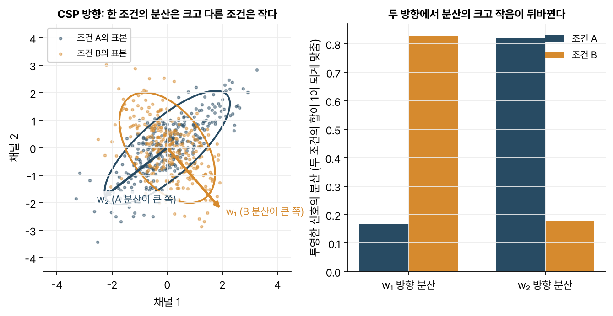
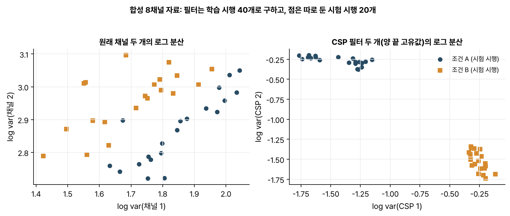

> [!abstract] 한눈에
> 여러 채널의 신호를 가중합 $\mathbf{w}^\top X$로 묶어 하나로 만드는 것을 공간 필터라 한다. **CSP**는 조건 A에서 분산이 크고 조건 B에서 작은 묶음과 그 반대 묶음을 찾는다. 두 조건의 [[covariance-matrix|공분산 행렬]]로 일반화 고유값 문제를 풀면 나온다. 운동상상에서는 한쪽 손을 상상할 때 반대편 운동피질의 리듬이 줄어들기 때문에 이 분산 차이로 어느 손인지 가를 수 있다.

## 공간 필터

뇌파 한 시행은 채널 $C$개, 시간 표본 $T$개로 이뤄진 $C \times T$ 행렬 $X$로 쓸 수 있다. 여기에 가중치 벡터 $\mathbf{w}$($C$개 원소)를 곱하면 채널들이 섞인 신호 하나가 나온다.

$$
y(t) = \mathbf{w}^\top \mathbf{x}(t)
$$

이것을 **공간 필터**라 한다. 시간 축 필터가 주파수를 고른다면 공간 필터는 채널 조합을 고른다. 채널마다 여러 뇌 영역의 활동이 섞여 들어오기 때문에 조합을 잘 고르면 원하는 활동을 더 깨끗하게 꺼낼 수 있다.

## CSP 목적함수

두 조건 A, B의 평균 공간 공분산은 $\Sigma_A, \Sigma_B$로 둔다. 신호를 관심 대역으로 거르고 평균을 뺀 뒤 계산한 값이다. 필터 $\mathbf{w}$를 거친 신호의 분산이 $\mathbf{w}^\top \Sigma \mathbf{w}$이니 CSP는 다음 비를 극대·극소로 만드는 $\mathbf{w}$를 찾는다.

$$
J(\mathbf{w}) = \frac{\mathbf{w}^\top \Sigma_A\, \mathbf{w}}{\mathbf{w}^\top (\Sigma_A + \Sigma_B)\, \mathbf{w}}
$$

이 비의 정류점은 **일반화 고유값 문제**의 해다.

$$
\Sigma_A\, \mathbf{w} = \lambda\, (\Sigma_A + \Sigma_B)\, \mathbf{w}, \qquad 0 \le \lambda \le 1
$$

$\lambda$가 1에 가까운 고유벡터는 A의 분산은 크고 B의 분산은 작은 방향이다. 0에 가까운 쪽은 그 반대다. 보통 양 끝에서 몇 개씩(예: 3쌍) 골라 쓴다.

_그림 1. 합성한 두 채널 자료다. 조건 A(파랑)와 B(주황)의 분산 타원은 방향이 다르다. CSP 방향 $w_1$에서는 B의 분산이 크고 $w_2$에서는 A의 분산이 크다. 오른쪽은 각 방향으로 투영한 분산이다. 두 조건의 분산 합이 1이 되게 $\mathbf{w}$의 크기를 맞췄다._

## 특징과 분류

특징으로는 CSP 필터를 거친 신호마다 시행 분산을 구해 로그를 취한 값을 흔히 쓴다. 로그를 취하면 분산의 곱셈적 차이가 덧셈 차이로 바뀐다. 분포도 정규분포에 가까워져 [[lda|LDA]] 같은 선형 분류기에 잘 맞는다.

_그림 2. 합성 8채널 자료. 소스 두 개의 11 Hz 리듬이 조건에 따라 약해지게 만든 뒤 무작위로 섞었다. 원래 채널 두 개로 보면 조건이 겹친다. 학습 시행으로 구한 CSP 필터 두 개를 쓰면 따로 떼어 둔 시험 시행도 깨끗하게 갈린다._

그림 2는 합성 자료라 이만큼 깨끗할 뿐 실제 뇌파에서는 잡음과 아티팩트, 시행마다의 변동 때문에 훨씬 많이 겹친다.

## 운동상상과 ERD

오른손을 상상하면 왼쪽 감각운동 피질(C3 근처)의 뮤·베타 리듬이 줄어들고(ERD) 왼손이면 오른쪽(C4 근처)에서 줄어든다. 신호를 그 대역으로 걸러 두면 리듬의 세기는 분산으로 나타난다. 그러니 CSP 필터는 어느 쪽 영역의 분산이 줄었는지가 가장 잘 드러나는 채널 조합이다.

## 자주 하는 오해

- **"CSP 필터 가중치가 곧 뇌 활동의 위치다."** 필터는 잡음을 지우려고 엉뚱한 채널에 큰 가중치를 줄 수 있다. 뇌 활동이 두피에 퍼진 모양을 보려면 필터 행렬의 역에서 얻는 **패턴**을 봐야 한다.
- **"전체 자료로 필터를 구해도 된다."** CSP는 라벨을 써서 구하는 변환이라 시험 시행까지 넣어 구하면 평가가 부풀려진다. 필터는 학습 폴드에서만 구한다([[data-leakage|데이터 누수와 검증 단위]]).
- **"채널이 많을수록 좋다."** 시행은 적은데 채널이 많으면 공분산 추정이 불안정해지고 CSP가 잡음에 과적합한다. 이때는 공분산 축소 추정이나 규제를 더한 CSP를 쓴다.
- **"CSP는 주파수와 상관없다."** 분산 차이가 나는 대역으로 먼저 걸러야 의미가 있다. 대역을 여러 개로 나눠 대역마다 CSP를 쓰는 변형(FBCSP)도 있다.

## 관련 개념

- [[covariance-matrix|공분산 행렬]]: CSP의 재료
- [[pca-svd|PCA와 SVD]]: 라벨 없이 분산이 큰 방향을 찾는다. CSP는 라벨을 써서 '분산의 비'가 큰 방향을 찾는다
- [[lda|LDA]]: CSP 특징을 받는 대표적인 분류기

## 참고 자료

- H. Ramoser, J. Müller-Gerking, G. Pfurtscheller, "Optimal spatial filtering of single trial EEG during imagined hand movement," _IEEE Transactions on Rehabilitation Engineering_ 8(4), 441–446 (2000)
- B. Blankertz, R. Tomioka, S. Lemm, M. Kawanabe, K.-R. Müller, "Optimizing spatial filters for robust EEG single-trial analysis," _IEEE Signal Processing Magazine_ 25(1), 41–56 (2008)
- S. Haufe et al., "On the interpretation of weight vectors of linear models in multivariate neuroimaging," _NeuroImage_ 87, 96–110 (2014)
