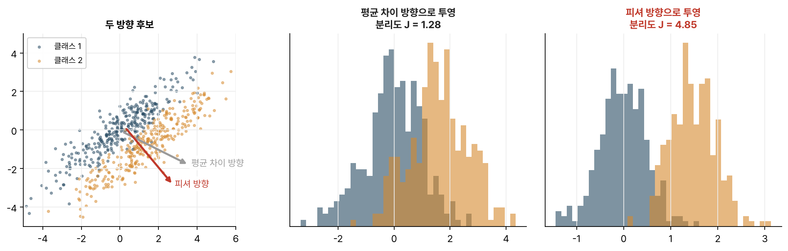

> [!abstract] 한눈에
> **LDA**는 자료를 한 직선 위로 투영했을 때 두 클래스의 평균은 멀고 각 클래스 안의 퍼짐은 작아지도록 그 직선의 방향을 고른다. 답은 $\mathbf{w} \propto S_W^{-1}(\boldsymbol\mu_2 - \boldsymbol\mu_1)$으로 닫힌 꼴이다. 단순히 두 평균을 잇는 방향과 다른 것은 클래스 안의 공분산 $S_W$로 '덜 퍼진 쪽'을 보정하기 때문이다. 계산이 가볍고 과적합이 적어 뇌파 분류의 기본 분류기로 쓰인다.

## 피셔의 기준

두 클래스의 평균을 $\boldsymbol\mu_1, \boldsymbol\mu_2$, 클래스 안 산포 행렬(within-class scatter)을 $S_W = \Sigma_1 + \Sigma_2$라 하자. 방향 $\mathbf{w}$로 투영하면 평균 차이는 $\mathbf{w}^\top(\boldsymbol\mu_2 - \boldsymbol\mu_1)$, 클래스 안 분산의 합은 $\mathbf{w}^\top S_W \mathbf{w}$다. 피셔(Fisher)는 이 둘의 비를 최대로 만드는 방향을 골랐다.

$$
J(\mathbf{w}) = \frac{\left(\mathbf{w}^\top(\boldsymbol\mu_2 - \boldsymbol\mu_1)\right)^2}{\mathbf{w}^\top S_W\, \mathbf{w}}
\qquad\Longrightarrow\qquad
\mathbf{w}^\ast \propto S_W^{-1}(\boldsymbol\mu_2 - \boldsymbol\mu_1)
$$

분자는 클래스 사이가 얼마나 벌어졌는지, 분모는 클래스 안이 얼마나 퍼졌는지다.

## 평균만 잇는 방향과 무엇이 다른가

가장 단순한 생각은 두 평균을 잇는 방향 $\boldsymbol\mu_2 - \boldsymbol\mu_1$으로 투영하는 것이다. 그런데 클래스가 길쭉하게 퍼져 있고 그 방향이 평균 차이와 비스듬하면, 투영한 두 분포가 크게 겹친다. $S_W^{-1}$을 곱하면 퍼짐이 큰 방향의 성분을 줄여, 두 분포가 덜 겹치는 방향으로 돌아간다(그림 1).

*그림 1. 같은 공분산을 가진 두 클래스. 평균 차이 방향(회색)으로 투영하면 많이 겹치고, 피셔 방향(빨강)으로 투영하면 덜 겹친다. 분리도 $J$가 약 1.3에서 4.9로 커진다.*

## 분류기로 쓰기

두 클래스가 같은 공분산 $\Sigma$를 가진 정규분포라고 가정하면, 베이즈 최적 분류 경계가 바로 $\mathbf{w} = \Sigma^{-1}(\boldsymbol\mu_2 - \boldsymbol\mu_1)$에 수직인 초평면이 된다. 그래서 LDA는 투영 방향이자 분류기다. 투영값 $\mathbf{w}^\top \mathbf{x}$를 문턱값(두 클래스 평균의 투영 가운데, 사전확률이 다르면 그만큼 이동)과 비교한다.

뇌파 분류에서 LDA가 오래 쓰인 이유는 다음과 같다.

- 학습이 닫힌 꼴이라 빠르고 결과가 늘 같다.
- 자유도가 작아 시행이 적어도 과적합이 덜하다.
- [[csp|CSP]] 로그 분산처럼 정규분포에 가까운 저차원 특징과 잘 맞는다.

## 자주 하는 오해

- **"LDA는 차원 축소 기법일 뿐이다."** 두 클래스에서는 투영 방향과 분류 경계가 같은 것이다. 클래스가 $K$개면 최대 $K-1$차원으로 줄이는 차원 축소로도 쓴다.
- **"공분산이 같다는 가정이 틀리면 못 쓴다."** 가정이 맞으면 최적이고, 조금 어긋나도 경계가 선형이라 안정적으로 동작하는 경우가 많다. 공분산이 크게 다르면 이차 판별(QDA)을 고려한다.
- **"$S_W$의 역행렬은 언제나 구할 수 있다."** 특징 수가 표본 수보다 많거나 특징끼리 강하게 얽히면 $S_W$가 특이해진다. 대각선에 작은 값을 더하는 축소 LDA(shrinkage LDA)를 쓴다.
- **"PCA와 LDA는 같은 일을 한다."** [[pca-svd|PCA]]는 라벨 없이 분산이 큰 방향을, LDA는 라벨을 써서 클래스가 잘 갈리는 방향을 찾는다. 분산이 큰 방향이 클래스를 가르는 방향이라는 보장은 없다.

## 관련 개념

- [[csp|CSP]]: LDA에 넣을 특징을 만드는 공간 필터
- [[covariance-matrix|공분산 행렬]]: $S_W$의 재료
- [[data-leakage|데이터 누수와 검증 단위]]: 축소 강도 같은 설정도 학습 폴드에서만 고른다

## 참고 자료

- R. A. Fisher, "The use of multiple measurements in taxonomic problems," *Annals of Eugenics* 7(2), 179–188 (1936)
- B. Blankertz, S. Lemm, M. Treder, S. Haufe, K.-R. Müller, "Single-trial analysis and classification of ERP components — a tutorial," *NeuroImage* 56(2), 814–825 (2011)
- T. Hastie, R. Tibshirani, J. Friedman, *The Elements of Statistical Learning*, 2nd ed., §4.3
