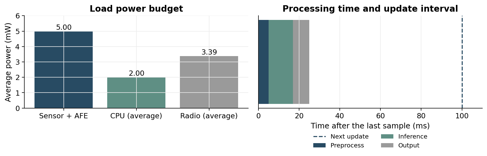

> [!abstract] 한눈에
> 센서 시스템은 데이터율, 메모리, 지연, 전력을 함께 만족해야 한다. 표본 데이터와 전송 프레임, 처리 창과 갱신 간격, 평균 전력과 순간 전력을 구분해 계산한다. 아래 수치는 모두 설계 연습을 위해 정한 값이며 특정 장치의 실측 사양이 아니다.

## 데이터율과 전송 시간

채널 수 $C$, 표본화 주파수 $f_s$, 채널별 표본당 비트 수 $b$이면 가공 전 데이터율은

$$R_{\mathrm{raw}}=Cf_sb$$

이다. 8채널을 500 sample/s, 24 bit로 기록하면 96,000 bit/s, 곧 12,000 byte/s다. MB를 $10^6$ byte로 정의하면 한 시간에 43.2 MB이고, 타임스탬프와 파일 형식의 비용은 아직 포함하지 않았다.

10 ms마다 묶으면 채널마다 5표본이 생겨 payload는 $8\times5\times3=120$ byte다. 패킷당 header와 CRC가 총 20 byte인 가상 링크에서는 140 byte를 1초에 100번 보내므로 112 kbit/s가 필요하다.

| 항목                             | 계산                                    | 값             |
| -------------------------------- | --------------------------------------- | -------------- |
| 유효 표본 데이터율               | $8\times500\times24$                    | 96 kbit/s      |
| 프레임을 포함한 데이터율         | $140\times8\times100$                   | 112 kbit/s     |
| 1 Mbit/s 링크의 프레임 전송 시간 | $140\times8/10^6$                       | 1.12 ms/packet |
| 재시도 없는 송신 시간 비율       | $1.12\,\mathrm{ms}\times100/\mathrm{s}$ | 11.2%          |

이 11.2%에는 preamble, ACK, radio startup, 채널 대기 시간이 없다. 독립적인 프레임 실패 확률이 $p$이고 성공할 때까지 재시도한다면 평균 시도 횟수는 $1/(1-p)$다. $p=0.1$이면 프레임 송신 시간 비율만 약 12.4%로 늘지만, 실제 프로토콜은 재시도 횟수와 마감시간을 제한하므로 손실률도 따로 계산해야 한다.

## 창 길이와 메모리

창 길이 $W$초, 저장 원소 하나의 크기 $q$ byte이면 입력 버퍼는

$$M_{\mathrm{input}}=Cf_sWq$$

byte다. 같은 8채널 신호의 1초 창을 float32로 저장하면 16,000 byte다. 전송할 때 3 byte였던 표본도 코드에서 float32로 바꾸면 4 byte를 차지한다. 원본과 필터 결과, 모델 입력을 각각 복사하면 메모리가 추가된다.

DMA가 한 블록을 채우는 동안 CPU가 이전 블록을 처리하는 double buffering은 블록 버퍼 둘을 요구한다. 입력 창, DMA 버퍼, 모델 activation의 생존 시간이 겹치는 구간에서 최대 사용량을 확인한다.

## 지연과 처리 마감시간

첫 판정에 필요한 데이터 수집 시간, 주기적인 갱신 간격, 필터 지연을 구분한다. 길이 $W=1$ s의 창을 $H=0.1$ s마다 갱신하면 첫 출력에는 약 1초가 필요하지만 이후 출력은 100 ms마다 나올 수 있다. 새 사건의 검출 지연은 창 길이만으로 결정되지 않고 창 안의 위치와 판정 규칙에도 의존한다.

창의 마지막 표본이 들어온 뒤 직렬로 처리하는 가상 시스템의 예산은 다음과 같다.

| 단계             | 예산  |
| ---------------- | ----- |
| 전처리           | 5 ms  |
| 특징 추출·추론   | 12 ms |
| 후처리·통신·표시 | 8 ms  |
| 합계             | 25 ms |

이 경우 첫 표시에 약 1.025 s가 필요하며 ADC·필터 자체 지연과 대기는 별도다. 작업이 겹치지 않는 단일 처리기에서 매번 25 ms가 걸리면 갱신 간격 100 ms 안에 들어간다. 평균 처리 시간이 짧아도 간헐적으로 100 ms를 넘으면 대기열이 늘 수 있으므로 최대 실행시간과 버퍼 넘침을 확인한다.

## 전력과 수명

서로 겹치지 않는 동작 상태들의 시간 비율이 $d_i$이고 $\sum_i d_i=1$이면

$$P_{\mathrm{avg}}=\sum_i d_iP_i$$

다. 센서, CPU, radio처럼 동시에 켜지는 블록은 블록별 평균 전력을 구해 더한다. 각 블록의 active 시간을 더해 시스템 전체 duty cycle로 읽으면 중복 계산이 생긴다.

radio가 active일 때 30 mW, sleep에서 0.03 mW를 쓰고, 위 예의 11.2% 동안만 active라면 평균은 $0.112\times30+0.888\times0.03\approx3.39$ mW다. 센서·앞단 5 mW, CPU 평균 2 mW를 추가하면 부하 전력은 약 10.39 mW다.

3.7 V, 100 mAh 배터리의 정격 에너지는 0.37 Wh다. 변환 효율을 90%로 일정하게 두면 사용 가능 에너지는 0.333 Wh, 예상 수명은 약 32.1시간이다. 이는 온도, 방전 곡선, cutoff, 노화와 재시도를 제외한 계산이다.

순간 전력은 따로 본다. radio startup이나 동시 송신 때 전압이 내려가면 평균 소비가 작아도 reset이 발생할 수 있다. 무선 전력 장치에서도 평균 수신 전력이 충분한 것과 순간 부하를 감당하는 것은 다른 조건이다.

_그림 1. 본문의 가상 조건으로 직접 계산한 부하 전력과 창 수집 이후 처리 시간. 전력 그림은 변환 손실 전의 부하 기준이고, 시간 그림은 ADC·필터 지연과 대기 시간을 제외했다._

## 계산과 전송의 교환관계

원자료 대신 특징을 보내려면 줄어든 통신 에너지와 늘어난 계산 에너지를 비교한다. bit당 통신 에너지 $e_b$가 일정하다는 근사에서

$$E_{\mathrm{compute,extra}}<(B_{\mathrm{raw}}-B_{\mathrm{feature}})e_b$$

이면 특징 계산이 에너지 면에서 유리하다. startup과 ACK가 지배적이면 bit 수만 줄여도 절약이 작을 수 있다. 특징만 저장하면 나중에 필터나 디코더를 바꾸기 어려워지는 점도 함께 평가한다.

## 유의점

- 링크의 최대 bit rate와 지속해서 보낼 수 있는 payload rate를 구분한다.
- 창 길이, 갱신 간격, 필터 지연과 사건 검출 지연을 각각 적는다.
- 전력은 어느 전원 노드에서 측정한 값인지 표시하고 변환 손실을 중복 적용하지 않는다.
- 최적화 전후에는 동일한 입력·출력 조건으로 에너지와 성능을 비교한다.

## 관련 개념

- [[on-device-inference|기기 안 추론과 모델 경량화]]
- [[biosignal-measurement-chain|생체신호 측정 사슬]]
- [[wireless-power-telemetry|무선 전력과 원격 측정]]
- [[low-power-mac|저전력 MAC]]

## 참고 자료

- Google AI Edge, [Build and convert models](https://developers.google.com/edge/litert/microcontrollers/build_convert): 메모리·연산 부하와 duty cycle의 관계.
- 수치 예제는 본문의 명시된 조건으로 직접 계산했다. 실제 부품의 성능이나 배터리 수명을 보장하는 값은 아니다.
