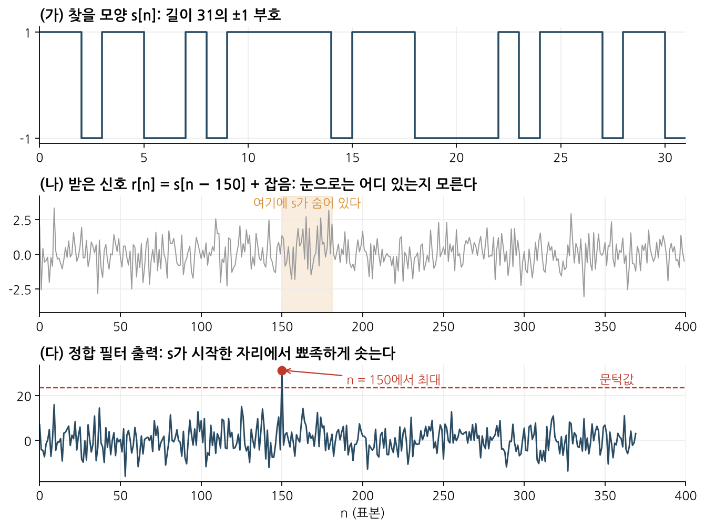
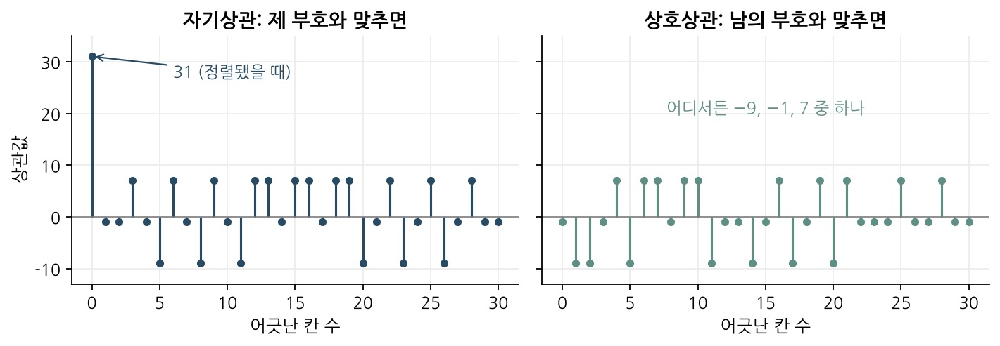
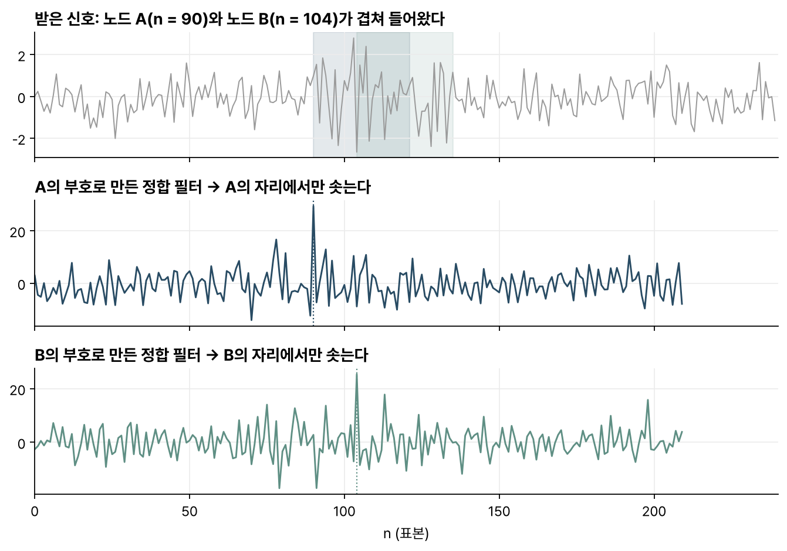
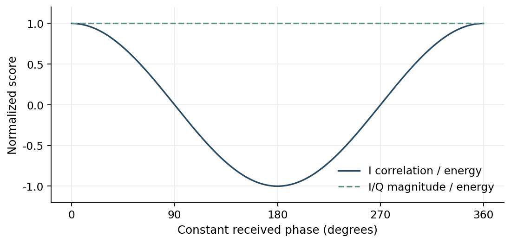

> [!abstract] 한눈에
> 찾으려는 신호의 모양 $s[n]$을 미리 알면, 받은 신호와 $s[n]$을 위치를 옮겨 가며 곱해 더한다. 모양이 맞는 자리에서만 값이 크게 나온다. 이 연산이 **정합 필터**이고, 백색 잡음 속에서는 출력 신호 대 잡음비(SNR)를 가장 크게 만드는 선형 필터다. 송신기마다 서로 닮지 않은 부호를 주면, 신호가 겹쳐 들어와도 각자의 정합 필터로 가려낼 수 있다.

## 정의

받은 신호가 알려진 모양 $s[n]$(길이 $L$)과 잡음 $w[n]$의 합이고, $s$가 언제 시작했는지($n_0$)는 모른다고 하자.

$$
r[n] = s[n - n_0] + w[n]
$$

정합 필터의 출력은 받은 신호와 $s$의 **상관**이다.

$$
y[n] = \sum_{k=0}^{L-1} r[n + k]\, s[k]
$$

필터로 쓰면 임펄스 응답이 $s$를 시간축에서 뒤집은 $h[n] = s[-n]$인 셈이다. '신호에 맞춘(matched)' 필터라는 이름도 여기서 왔다. 복소 신호라면 뒤집은 다음 켤레를 취한다.

_그림 1. (가) 찾을 모양. (나) 잡음과 섞인 받은 신호. 신호의 위치가 눈으로는 보이지 않는다. (다) 정합 필터 출력은 $n = 150$에서만 문턱을 넘는다._

## SNR 이득과 최적성

$y[n]$을 계산할 때 신호 부분과 잡음 부분은 다르게 쌓인다. 모양이 맞는 자리에서 신호 부분은 $\sum s[k]^2$이 되어 $L$개 항이 모두 같은 부호로 더해진다. 잡음은 부호가 무작위라서 서로 상쇄되며, 크기가 $\sqrt{L}$에 비례해서만 자란다. 그림 1처럼 $s[k] = \pm 1$이고 잡음의 표준편차가 $\sigma$라면

$$
\text{신호 봉우리} = L, \qquad \text{잡음의 표준편차} = \sigma\sqrt{L}
$$

이다. 출력 SNR은 입력보다 $L$배 좋아지고, 길이 31인 부호라면 이득은 약 15 dB다. 부호가 길수록 더 큰 잡음 속에서도 신호를 찾을 수 있다.

이 결과가 백색 잡음에서 최적이라는 사실은 코시-슈바르츠 부등식으로 보인다. 출력 SNR은 필터 $h$와 신호 $s$의 내적의 제곱을 $h$ 크기의 제곱으로 나눈 꼴이고, 이 값은 $h$가 $s$와 같은 방향일 때 가장 크다. 연속시간으로 쓰면 최대 SNR은 신호 에너지 $E$와 잡음 전력 밀도 $N_0/2$로 정해진다.

$$
\mathrm{SNR}_{\max} = \frac{2E}{N_0}
$$

이 값은 신호의 모양과 관계없이 에너지만으로 정해진다.

판정은 출력을 문턱값과 비교해서 한다. 문턱을 낮추면 놓치는 일(miss)이 줄고 헛짚는 일(false alarm)이 늘어난다. 실제 시스템에서는 출력의 RMS처럼 잡음 수준을 따라 움직이는 값에 배수를 곱해 문턱으로 쓰는 경우가 많다.

## 여러 송신기 구분과 부호의 상관

여러 송신기가 같은 주파수, 같은 시간대에 신호를 보내면 수신기에는 전부 더해진 신호가 들어온다. 송신기마다 고유한 부호를 붙여 두면, 수신기는 송신기 수만큼 정합 필터를 두고 각자의 부호만 찾아낼 수 있다. **부호 분할 다중 접속**(CDMA)의 원리다. 이를 위해 부호는 두 조건을 갖춰야 한다.

1. 자기상관이 날카로워야 한다. 제 부호와 정확히 맞췄을 때만 크고 한 칸만 어긋나도 작아야 시점을 정확히 짚을 수 있다.
2. 상호상관이 작아야 한다. 남의 부호와는 어떻게 맞춰도 작아야 다른 송신기의 신호를 자기 신호로 잘못 검출하지 않는다.

**Gold code**가 이 두 조건을 잘 맞춘 대표적인 부호 묶음이다. 재료는 길이 $2^n - 1$인 **최대 길이 수열**(m-sequence) 두 개이고, 이 두 수열은 상호상관이 세 값만 갖도록 고른 **선호 쌍**(preferred pair)이어야 한다. 한쪽을 0칸에서 $2^n - 2$칸까지 돌려 가며 다른 쪽과 XOR하면 $2^n - 1$개가 나오고, 원래 두 수열을 더해 $2^n + 1$개가 한 묶음이 된다.

길이 31($n = 5$)이면 31개에 2개를 더한 33개이고, 그중 어느 두 개를 골라도 주기 상호상관은 $-9$, $-1$, $7$ 세 값 중 하나다. 제 부호와 정렬했을 때의 31에 비하면 작다.

_그림 2. 길이 31 Gold code. 왼쪽은 제 부호와의 상관으로 정렬된 0칸에서만 31이다. 오른쪽은 다른 Gold code와의 상관으로 어디서나 작다._

그림 3은 두 송신기의 신호가 겹쳐 들어온 경우다. 받은 신호만 보면 둘이 뒤섞여 있지만, A의 부호로 만든 필터는 A가 시작한 자리에서, B의 부호로 만든 필터는 B가 시작한 자리에서 솟는다.

_그림 3. 겹친 신호에서 노드 A와 B를 각자의 정합 필터로 따로 찾아낸다._

## 복소 상관과 I/Q

복소 기저대역 수신 신호를 $r[n]=I[n]+jQ[n]$라 하면 시작 위치 $m$의 상관은

$$z[m]=\sum_{k=0}^{L-1}r[m+k]s^*[k]$$

다. 실수 부호 $s[k]\in\{-1,1\}$의 경우 I와 Q를 각각 같은 부호로 상관시킨 결과가 $z$의 실수부와 허수부가 된다. 길이 $L$의 causal FIR로 구현하면 $h[k]=s^*[L-1-k]$를 쓰고, 시작 시점 $m$의 정렬 봉우리는 출력 인덱스 $m+L-1$에 나온다.

수신 위상이 일정하지만 알려지지 않아 $r[m+k]=Ae^{j\phi}s[k]+w[m+k]$라면 잡음을 제외한 상관은 $AE_se^{j\phi}$이고, $E_s=\sum_k|s[k]|^2$다. 실수부만 사용하면 $\phi=\pi/2$에서 신호 기여가 0이 되지만, $|z|$ 또는 $|z|^2$를 쓰면 일정한 위상 회전에 무관한 검출 점수를 얻는다.

_그림 4. 잡음 없는 단위 진폭 신호의 상관을 에너지로 정규화한 직접 계산. I만 사용한 점수는 위상에 따라 변하고 I/Q 상관의 크기는 일정하다. 위상은 패킷 안에서 일정하다고 가정했다._

I/Q만으로 여러 송신기가 분리되는 것은 아니다. 부호별 상관이 송신기를 구별하고, I/Q는 각 복소 상관의 위상 정보를 보존한다. 위상을 이미 알고 coherent하게 검출하는 경우와 magnitude로 비동기 위상을 처리하는 경우는 검출 통계량과 문턱 조건도 다르다.

## 주파수 오차와 템플릿 불일치

일정한 위상 차이는 magnitude로 처리할 수 있지만, 주파수 오차 $\Delta f$는 패킷 안에서 위상을 계속 돌린다. 단위 크기 chip과 chip 간격 $T_c$를 가정하면 정렬된 상관의 정규화 크기는

$$\frac{|z|}{AL}=\left|\frac{\sin(\pi L\Delta fT_c)}{L\sin(\pi\Delta fT_c)}\right|$$

다. 분모와 분자가 모두 0인 점은 연속 극한으로 읽는다. 상관을 길게 누적해 얻는 이득은 주파수 오차에 대한 민감도와 함께 평가한다.

chip clock 오차는 부호 경계의 시간을 바꾸므로 이 식의 반송파 주파수 오차와 별도로 다룬다. 여러 시간 지연·위상·clock rate의 템플릿을 비교하면 불일치를 줄일 수 있지만 연산과 검출 후보 수가 늘어난다. 부호 위상을 바꾸는 연산과 반송파 I/Q 회전도 구별한다.

## 문턱과 오류의 단위

복소 백색 원형 Gaussian 잡음에서, 각 표본의 I와 Q 잡음 분산을 각각 $\sigma^2$라 하자. 신호가 없을 때 $z$의 각 성분 분산은 $\sigma^2E_s$이며, 한 번의 비교에 대해

$$P\left(|z|^2>\gamma\mid H_0\right)=\exp\left(-\frac{\gamma}{2\sigma^2E_s}\right)$$

다. 한 위치의 false alarm 확률과 1초 동안 모든 부호·시점에서 발생하는 false event 수는 다르다. 겹치는 창의 점수는 서로 상관되므로, 독립 시행 수를 그대로 곱해 전체 오류율로 쓰지 않는다.

실제 이벤트 검출은 문턱 외에도 봉우리 선택, 중복 제거 시간, 정답과의 허용 시간창을 정해야 한다. event miss, false event, timing error를 나누어 기록하면 낮은 표본별 오류율에 가려진 문제를 찾을 수 있다.

## 유의점

- 정합 필터는 원래 파형을 되살리지 않는다. 출력은 각 위치가 $s$와 얼마나 닮았는지 나타내는 점수이고, 출력 봉우리의 모양은 원래 신호 모양이 아닌 $s$의 자기상관 모양을 따른다.
- 봉우리 높이만으로 보낸 신호의 크기를 판단할 수 없다. 봉우리 높이는 신호 크기 말고도 잡음, 다른 송신기의 간섭, 템플릿과 실제 신호의 어긋남(시계가 조금 빠르거나 느린 경우 등)에 따라 달라진다.
- 정합 필터가 최적이라는 증명은 백색 잡음일 때만 성립한다. 잡음 세기가 주파수에 따라 다르면 먼저 잡음을 백색으로 만든(prewhitening) 뒤 정합해야 한다.
- 상호상관이 작아도 송신기를 얼마든지 늘릴 수는 없다. Gold code는 거의 직교할 뿐 완전히 직교하지는 않아서, 동시에 보내는 송신기가 많아지면 작은 상호상관이 쌓여 잡음처럼 작용하고 오류가 늘어난다.

## 관련 개념

- [[asbit-wireless-sensor-network|논문: ASBIT]]: Gold code와 정합 필터 묶음으로 초소형 칩의 신호를 가르는 사례. 칩 78개를 실측하고 수천 개 규모는 시뮬레이션으로 따졌다
- [[dtft|이산시간 푸리에 변환]]: 주파수 영역에서 정합 필터는 $H(e^{j\omega}) = S^*(e^{j\omega})$ 꼴(시점 이동 제외)로, 신호가 강한 주파수를 더 키운다

## 참고 자료

- J. G. Proakis, M. Salehi, _Digital Communications_, 5th ed., Ch. 4 (최적 수신기와 정합 필터)
- R. Gold, "Optimal binary sequences for spread spectrum multiplexing," _IEEE Transactions on Information Theory_ 13(4), 619–621 (1967)

- MIT OCW, [6.011 Signals, Systems and Inference, lecture notes](https://www.ocw.mit.edu/courses/6-011-signals-systems-and-inference-spring-2018/resources/lecture-notes/), Matched Filtering. 복소 상관·위상·오류 문턱의 식과 그림 4는 명시한 단순 모형으로 직접 유도했다.
