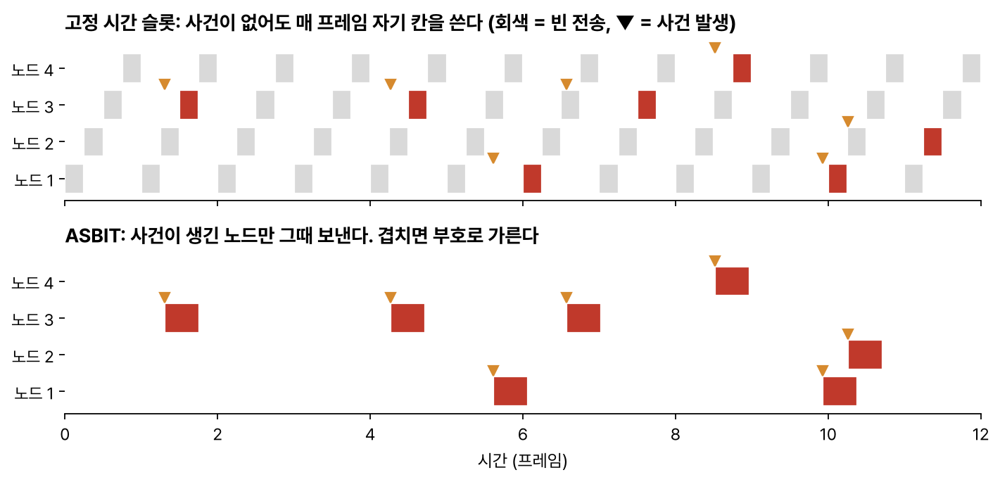
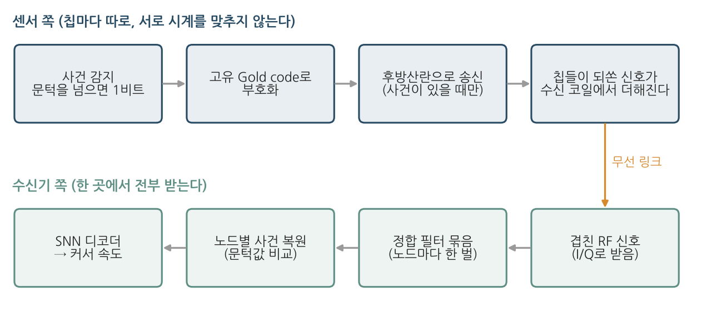
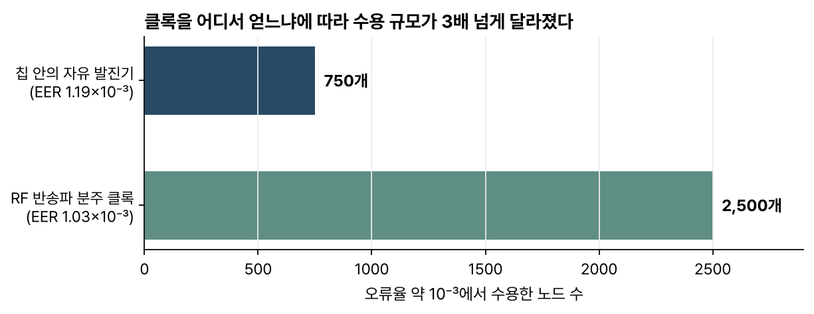

> [!abstract] 한눈에
> 몸속에 심을 초소형 무선 센서를 수천 개로 늘리려면 여러 센서가 한 채널을 어떻게 나눠 쓸지부터 풀어야 한다. 이 논문의 방식(ASBIT)에서 각 센서는 사건이 생겼을 때만 자기만의 Gold code를 붙여 신호를 되쏘고, 수신기는 정합 필터 묶음으로 센서별 사건을 되찾는다. 실제 칩 78개의 측정 신호에 시뮬레이션을 더해 수천 개 규모까지 오류율을 따졌다. 8,000개가 넘는 신경 채널의 전송도 이 방식으로 시뮬레이션했고, 그 출력으로 스파이킹 신경망이 손 움직임을 복원했다.

| | |
|---|---|
| 제목 | An asynchronous wireless network for capturing event-driven data from large populations of autonomous sensors |
| 저자 | Jihun Lee, Ah-Hyoung Lee, Vincent Leung, Farah Laiwalla, Miguel Angel Lopez-Gordo, Lawrence Larson, Arto Nurmikko |
| 게재 | *Nature Electronics* 7, 313–324 (2024) |
| DOI | [10.1038/s41928-024-01134-y](https://doi.org/10.1038/s41928-024-01134-y) |

## 문제

무선 RFID 센서는 배터리 없이 외부 송수신기에서 전력을 받고, 받은 전파를 되쏘는 **후방산란**(backscattering)으로 데이터를 보낸다. 몸에 심기에는 알맞지만 상용 RFID 센서는 몇 개만 넘어도 네트워크로 묶기 어렵다.

저자들은 기존 접속 방식이 희소성을 버린다는 점을 걸림돌로 짚는다. 무작위 접속(random-access) 계열 프로토콜은 사건 데이터를 패킷으로 바꾸면서 고정된 시간 칸이나 대역을 배정하므로, 아무 일도 없는 순간에도 각 센서가 자기 칸과 대역을 차지한다. 신경 스파이크처럼 대부분의 시간이 조용한 데이터에서는 이 낭비가 크다. 임펄스 라디오 같은 대안은 어느 센서가 보냈는지 가려내지 못해서 사건이 겹치면 데이터를 잃는다.

*그림 1. 위: 고정 시간 슬롯에서는 사건이 없어도(회색) 칸이 소비되고, 사건은 다음 자기 칸까지 기다린다. 아래: ASBIT에서는 사건이 생긴 노드만 그때 보내고, 겹친 신호는 부호로 가른다. (논문 서론의 설명을 바탕으로 직접 그림)*

## ASBIT 방식

ASBIT는 *asynchronous sparse binary identification transmission*의 줄임말이고, 이름에 방법이 그대로 담겨 있다.

- **비동기(asynchronous)**: 센서끼리 시계를 맞추지 않는다.
- **희소(sparse)·이진(binary)**: 센서는 신호가 문턱을 넘은 순간만 '1'이라는 사건 하나로 보고한다. 스파이크를 내는 생물의 뉴런이나 빛의 변화만 기록하는 이벤트 카메라에서 가져온 생각이다.
- **식별(identification)**: 보낼 때 칩마다 고유한 [[matched-filter|Gold code]]를 곱하고, 이 부호가 주소 역할을 한다.

일반적인 CDMA와 달리 ASBIT는 부호에 더해 사건의 희소성과 사건 시각까지 자원으로 쓰며, 업링크 대역도 사건을 보고할 때만 차지한다.

*그림 2. 센서 쪽에서는 사건 감지, 부호화, 후방산란 송신이 차례로 일어난다. 수신기 쪽에서는 겹친 신호를 정합 필터 묶음으로 풀어 센서별 사건을 되찾은 뒤 SNN 디코더에 넣는다. (직접 그린 도식)*

수많은 칩이 되쏜 신호는 수신 안테나에서 하나로 더해져 I/Q 신호로 수신기에 들어오고, 개별 칩의 신호는 그 안에 완전히 묻힌다. 수신기는 칩마다 정합 필터를 한 벌씩 두고, 필터 출력이 문턱(출력의 RMS 기준)을 넘으면 그 칩의 사건으로 판정한다.

## 칩과 실험 설계

- **칩**: TSMC 65 nm CMOS 공정의 $300 \times 300\ \mu\text{m}$ 칩이다. 정류기, 레귤레이터, 발진기, Gold code 생성기, 유한 상태 기계(FSM), 후방산란용 BPSK 변조기가 들어 있다. 면적의 상당 부분은 칩 둘레의 전력 수확 코일과 정류·정합 회로 몫이고, 통신 부호를 담은 FSM은 $35 \times 60\ \mu\text{m}$ 정도다.
- **링크**: 약 900 MHz 근접장(유도 결합)을 쓴다. 칩들을 같은 평면에서 둘러싸는 릴레이 코일을 하나 더 두고 송신 코일에서 10 mm(공기 9 mm와 유리 1 mm) 떨어뜨린 3-코일 구성으로 실험했다.
- **시연 설정**: Gold code 패킷을 20 ms마다 한 번 보내도록 했다. 평균 사건율 50 Hz에 해당한다.
- **규모 늘리기**: 만든 칩 78개를 목표 칩 40개와 배경 칩 38개로 나눈 뒤, 배경 칩의 실측 신호를 무작위로 반복 추출해 더해서 200, 500, 1,000개 네트워크를 꾸몄다. 1,000개라면 배경 칩 신호를 922번 더한다. 목표 칩에는 새 사건이 생기지 않으므로 늘어난 배경이 목표 칩의 통신을 얼마나 해치는지만 따로 볼 수 있다.
- **오류의 정의**: 1 ms 구간 안에서 사건을 놓치거나 없는 사건을 잡으면 오류로 센다. 그 비율이 사건 오류율(EER)이다.

## 결과

### 클록 방식과 수용 노드 수

모래알만 한 칩에 정밀한 수정 발진기나 복잡한 클록 안정화 회로를 넣기는 현실적으로 어렵다. 저자들은 두 클록 방식을 비교했다.

1. **칩 안의 자유 발진기**(약 30 MHz): 전력은 적게 들지만 전압과 온도에 따라 주파수가 약 ±1,000 ppm 흔들린다. 그만큼 Gold code 파형이 미세하게 늘거나 줄어 템플릿과 어긋나기 때문에, 클록 값을 조금씩 달리한 정합 필터를 여러 벌 써야 한다. 1,005 ppm(±30 kHz)을 덮는 데 위상 3가지 × 클록 31가지, 모두 93개가 필요했고 복조 계산도 그만큼 늘어난다.
2. **RF 반송파를 나눠 쓰는 클록**: 들어오는 915 MHz 전력 신호를 2로 다섯 번 나눠(약 28.59 MHz) 클록으로 쓴다. 칩마다 위상은 달라도 주파수는 흔들리지 않아서 정합 필터가 최대 3개면 된다. 전력은 더 든다.

평균 사건율 50 Hz, 평균 SNR 1.7 dB에서 오류율 약 $10^{-3}$을 지키며 받아들인 노드 수는 다음과 같았다.

*그림 3. 자유 발진기는 750개(EER $1.19 \times 10^{-3}$), 분주 클록은 2,500개(EER $1.03 \times 10^{-3}$)를 받아들였다. 논문 본문의 수치로 다시 그렸다. 분주 클록 쪽은 다이싱 손실 때문에 65개 칩으로 측정했다.*

### 초당 사건 총량

노드 수와 사건율을 함께 바꿔 보면 오류율은 주로 둘의 곱, 즉 네트워크 전체가 1초에 보내는 사건 수를 따라 움직였다. 분주 클록 칩은 초당 약 10만 개 사건까지 EER $10^{-3}$ 아래를 지켰다. 노드가 적으면 각자 자주 보내도 되고, 많으면 각자 드물게 보내야 한다. 배경 노드의 사건이 충분히 드물 때는 자유 발진기 칩으로도 2,500개까지 오류율 저하 없이 수용할 수 있었다.

### 잡음과 부호 길이

- 측정 신호에 가우시안 잡음을 더해 SNR을 낮추자, 노드가 1,500개일 때 SNR $-16.77$ dB에서도 EER $10^{-3}$ 아래를 지켰다. 저자들은 이 잡음 내성이 Gold code의 부호 이득에서 나온다고 본다.
- Gold code가 짧으면 상관 성질이 나빠지고 너무 길면 패킷끼리 겹치는 간섭이 커져서, 시뮬레이션상 최적은 약 511비트였다. 칩은 13비트 PUF(공정 편차로 생기는 칩 고유값)를 씨앗 삼아 최대 8,191비트까지 만들 수 있지만 이 분석에 따라 511비트만 썼다. 이때 목표 노드 하나의 1초 분량 데이터를 복조하는 데 12 ms가 걸렸다.

### 8,000채널 신경 데이터 전송과 손 움직임 복원

응용 예로는 원숭이 1차 운동피질(M1)과 체성감각피질(S1)의 공개 스파이크 데이터를 썼다. 스파이크 기록은 실제 데이터지만 전송 과정은 시뮬레이션이어서, 칩에서 잰 신호 대신 칩 패킷을 본뜬 합성 Gold code 패킷을 썼다. 수천 채널을 동시에 기록한 실제 데이터가 없으므로 M1의 164개 채널 × 50개 시행을 동시에 보내는 방식으로 노드 8,200개(S1은 8,320개)를 만들었다. ASBIT 전송을 거친 스파이크는 스파이킹 신경망(SNN, Lava-dl)에 넣어 커서의 x 방향 속도를 예측했다.

- 평균 SNR $-0.77$ dB에서 스파이크 오류율(SER)은 M1 $3.23 \times 10^{-4}$, S1 $6.12 \times 10^{-4}$였다.
- 오류 없는 유선을 가정하면 예측 상관 $r_{\text{neural}}$은 M1 0.9324, S1 0.9297이었다(5겹 교차검증).
- SER $10^{-4}$에서는 무선 쪽 성능 $r_{\text{SER}}$이 유선과 거의 같았고, $10^{-3}$에서도 유선 성능의 88.8%(M1), 85.4%(S1)를 유지했다.
- 칩마다 신호 세기를 최대 20 dB까지 다르게 주면(가까운 칩이 더 세게 들리는 문제) 한 노드의 SER은 주로 그 노드 자신의 신호 세기에 따라 정해졌다.
- 학습 때 스파이크 시각을 ±25 ms 안에서 무작위로 흔들었더니(jitter) 상관이 오히려 높아졌다(쌍체 t-검정, M1에서 $P = 0.0033$). 저자들은 이 결과를 스파이크 시각 정보를 살려 보내는 것이 중요하다는 근거로 든다.

## 읽으며 든 질문

- **수천 개 규모는 '재사용한 실측 신호'로 만든 것이다.** 1,000개 네트워크는 배경 칩 38개의 신호를 되풀이해 더한 것이고, 칩 1,000개를 실제로 쓰지는 않았다. 서로 다른 칩 수천 개가 실제로 만드는 간섭이 이 근사와 얼마나 다를지는 열려 있다.
- **SNR 조건이 생체 조직 밖이다.** 실측 SNR 1.7 dB는 공기와 유리를 지나는 벤치 실험에서 얻었다. 두피와 두개골을 지나면 신호가 더 약해질 텐데, 저자들도 실제 한계는 데이터 대역보다 무선 전력 전달 효율과 SAR(전자파 흡수율) 쪽에 있을 것으로 본다.
- **합성 신경 데이터의 독립 가정.** 164개 채널 × 50개 시행으로 만든 채널들은 서로 독립이라고 가정했다. 저자들은 실제 뉴런이 정보를 공유하므로 오히려 오류에 더 강할 것이라고 하지만, 거꾸로 상관된 오류가 생기면 어떻게 될지도 궁금하다.
- **시각 정보는 얼마나 촘촘해야 하나.** 저자들은 스파이크 시각을 살려 보내는 것이 중요하다고 결론짓는다. 그런데 학습 때 시각을 ±25 ms까지 흔들자 오히려 성능이 올랐고, 방법 절에는 디코더 입력을 25 ms 구간으로 묶었다고 적혀 있다(같은 절에 '1 ms 해상도'라는 말도 있어 모든 조건에 적용됐는지는 분명하지 않다). 이렇게 보면 디코딩에 25 ms보다 촘촘한 시각이 꼭 필요하지는 않다는 해석도 가능하다. 전송 성능은 1 ms 단위 오류율로 따졌으므로, 이 기준과 디코더가 실제로 쓰는 시간 해상도 사이의 간격은 더 살펴볼 만하다.
- **감지 앞단이 없는 칩.** 논문이 밝힌 칩 회로 블록에는 신호를 감지해 스파이크로 바꾸는 앞단이 없고, 논문은 그런 회로가 있다고 가정한다. 시연에서는 20 ms마다 패킷을 보내도록 설정했다. 실제 감지 회로를 붙였을 때의 전력·면적과 사건 시각의 흔들림은 아직 검증되지 않았다.
- **발진기 쪽 비용.** 자유 발진기 칩은 전력을 덜 쓰는 대신 정합 필터가 수십 배 필요하다. 이식형 기기에서 칩의 전력과 수신기의 계산·지연 가운데 어느 쪽을 아끼는 편이 나은지는 응용마다 다를 것이다.

## 관련 개념

- [[matched-filter|정합 필터]]: 수신기가 겹친 신호에서 칩별 사건을 찾는 방법, Gold code의 상관 성질
- [[sampling-aliasing|샘플링과 앨리어싱]]: 수신기가 RF 신호를 디지털로 받아들이는 첫 단계
- 이 논문에서 출발해 공개 데이터(CRCNS pmd-1)로 여러 디코더의 스파이크 오류 내성을 따져 본 작업: [spike-error-tolerance-decoders](https://github.com/youjhun/spike-error-tolerance-decoders)

## 참고 자료

- J. Lee et al., "An asynchronous wireless network for capturing event-driven data from large populations of autonomous sensors," *Nature Electronics* 7, 313–324 (2024). [doi:10.1038/s41928-024-01134-y](https://doi.org/10.1038/s41928-024-01134-y)
