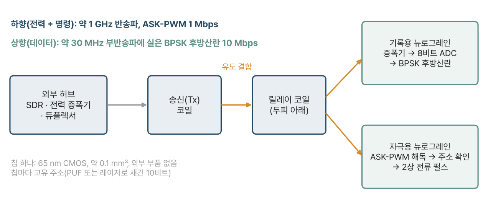
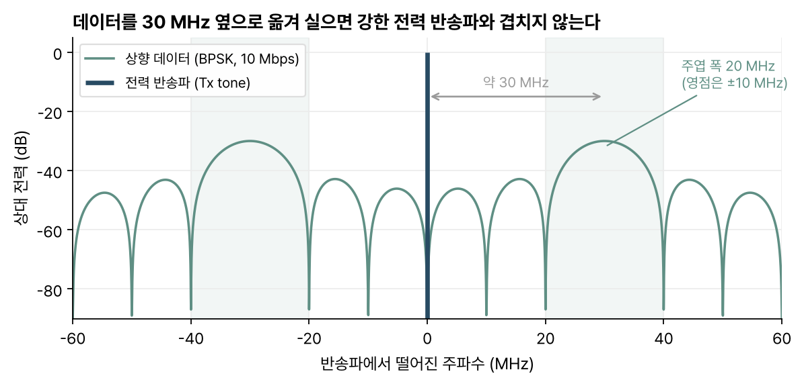
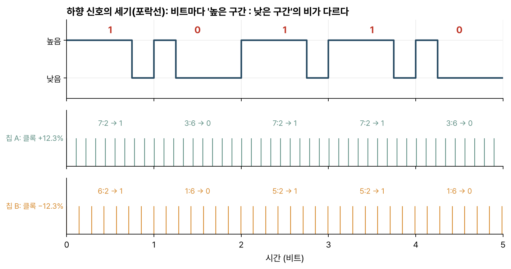
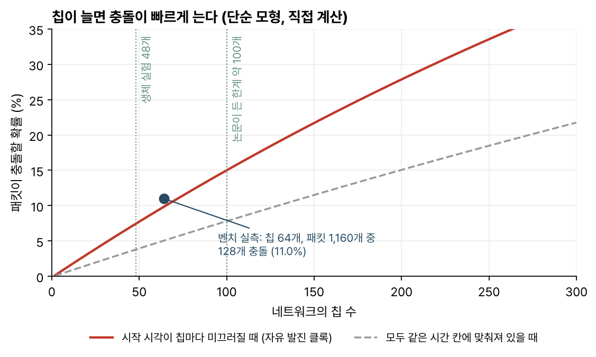

> [!abstract] 한눈에
> 전극 수백 개가 한 덩어리로 묶인 기존 뇌 인터페이스 대신, 서로 떨어진 작은 칩 여럿을 뇌 표면에 놓고 무선으로 묶는 방식을 제안한 논문이다. 칩(뉴로그레인)마다 전력 수확, 신호 기록이나 전류 자극, 통신 회로가 들어 있고 외부 허브와 약 1 GHz 근접장으로 연결된다. 칩끼리는 시간을 나눠 쓰는 TDMA로 채널을 공유한다. 쥐의 피질에서 칩 48개로 뇌파를 기록했고, 자극용 칩으로 피질을 자극해 반응을 확인했다.

| | |
|---|---|
| 제목 | Neural recording and stimulation using wireless networks of microimplants |
| 저자 | Jihun Lee, Vincent Leung, Ah-Hyoung Lee, Jiannan Huang, Peter Asbeck, Patrick P. Mercier, Stephen Shellhammer, Lawrence Larson, Farah Laiwalla, Arto Nurmikko |
| 게재 | *Nature Electronics* 4, 604–614 (2021) |
| DOI | [10.1038/s41928-021-00631-8](https://doi.org/10.1038/s41928-021-00631-8) |

## 어떤 문제를 푸나

Utah 어레이 같은 실리콘 전극이나 ECoG 전극판은 접점 수백 개를 외부 전자 장치에 선으로 잇는다. 채널을 수천 개로 늘리려면 선, 데이터 전송, 이식 방법이 모두 걸린다. 전극 배치도 한 덩어리 안에서만 바꿀 수 있어서 서로 떨어진 여러 부위를 동시에 덮기 어렵다.

저자들은 칩 하나하나를 독립된 무선 노드로 만들고 필요한 곳에 따로 놓는 방법을 택했다. 이전에도 초음파나 유도 결합으로 전력을 받는 밀리미터급 칩은 있었다. 이 논문이 내세우는 것은 그런 칩 여러 개를 하나의 네트워크로 묶어 주소로 구별하고, 기록과 자극을 같은 틀에서 해 보였다는 점이다.

## 시스템 구성

*그림 1. 외부 허브가 송신 코일로 전력과 명령을 보내고, 두피 아래 릴레이 코일이 이를 칩들 쪽으로 모아 준다. 기록 칩은 데이터를 후방산란으로 되쏘고, 자극 칩은 명령을 해독해 전류를 흘린다. (논문 그림 1을 바탕으로 직접 그림)*

- **칩**: TSMC 65 nm RF CMOS로 만든 ASIC이고 외부 부품이 없다. 칩렛 크기는 650 × 650 × 250 μm, 부피는 약 0.1 mm³다. 자극용 칩의 회로 면적은 500 × 500 μm다.
- **전력**: 칩 위의 3회 감은 코일로 약 1 GHz 근접장을 받는다. 3단 정류기는 −10 dBm 입력에서 효율이 최대 48.5%였다. 1 GHz 근처를 고른 것은 칩 크기 안테나의 결합 면적과 조직 흡수 손실을 저울질한 결과라고 한다.
- **상향 링크(칩 → 허브)**: 받은 전파를 되쏘는 후방산란에 BPSK 변조를 얹어 10 Mbps로 보낸다. 데이터는 칩 안의 약 30 MHz 발진기로 한 번 옮겨 싣는다. 그러면 데이터가 강한 전력 반송파에서 30 MHz 떨어진 곳에 실려서 허브가 둘을 쉽게 가른다(그림 2).
- **하향 링크(허브 → 칩)**: 1 Mbps. 전력 신호의 세기를 높였다 낮췄다 하는 ASK에 펄스 폭 변조를 더한 ASK-PWM을 쓴다.
- **주소**: 두 가지를 시험했다. 레이저로 금속선을 끊어 새기는 10비트 주소와, 공정 편차에서 나오는 16–20비트 PUF다. PUF는 면적이 작고 후공정이 없지만 칩마다 주소를 미리 읽어 두어야 한다.
- **기록 앞단**: 직류 결합 방식이라 큰 커패시터가 없다. 입력 환산 잡음 2.2 μV, 대역 500 Hz, 1 kHz·8비트 샘플링이고 면적은 100 × 100 μm다.
- **자극**: 2상 전류 펄스, 위상당 100·200·400 μs, 전류는 칩이 받는 전력에 따라 최대 25 μA다.

*그림 2. 10 Mbps BPSK의 주엽은 폭이 20 MHz라서 30 MHz 옆으로 옮기면 반송파와 겹치지 않는다. 직사각형 펄스를 가정한 이상적인 모양으로 직접 그렸다.*

### 클록이 칩마다 다른 문제와 ASK-PWM

칩은 받은 전력으로 자기 클록을 만든다. 칩마다 코일 위치가 달라 받는 전력이 다르므로 클록도 칩마다 다르다. 벤치 측정에서 30 MHz 기준 ±12.3% 차이가 났다. 이러면 허브가 정한 비트 길이를 칩마다 다르게 센다.

ASK-PWM은 비트 하나를 세기가 높은 구간과 낮은 구간의 조합으로 보내고, 칩은 두 구간의 길이를 비교해 비트를 판정한다. 길이의 절대값을 재지 않고 비만 보므로 클록이 빠르거나 느려도 같은 비트가 나온다(그림 3).

*그림 3. 위는 하향 신호의 세기, 아래 두 줄은 클록이 ±12.3% 다른 두 칩이 각 구간에서 센 클록 수다. 센 수는 달라도 높은 구간이 긴지 짧은지는 같다. 실제 부호 규칙은 보충자료에 있고, 이 그림은 원리만 보이려고 단순화했다.*

## 네트워크: 시간 나눠 쓰기

여러 칩이 한 반송파를 나눠 쓰는 방법으로 주파수 분할(FDMA)과 부호 분할(CDMA)도 검토했다. FDMA는 칩마다 대역을 맞추기 어렵고 CDMA는 정밀한 타이밍 보정이 필요해서, 저자들은 시분할(TDMA)을 골랐다. 두 가지 TDMA를 비교했다.

**자율 TDMA**. 칩끼리 시계를 맞추지 않는다. 칩은 100 ms 동안 데이터를 모아(PUF 주소 포함 820비트) 82 μs짜리 패킷으로 보내고, 보내는 시점은 주소로 정해지는 의사난수다. 회로가 단순한 대신 칩이 많아지면 패킷이 겹친다. 저자들은 약 100개를 한계로 본다.

벤치에서 칩 64개로 잰 결과, 패킷 1,160개 중 128개가 충돌했다(11.0%). 충돌하지 않은 패킷만 보면 비트 오류율이 0.007%였고, 충돌한 패킷의 나머지 부분까지 살려 읽으면 1.82%였다. 오류는 대부분 충돌에서 나왔다.

이 11.0%가 어디서 나오는지 단순한 모형으로 계산해 봤다. 칩마다 클록이 달라서 보내는 시점이 서로 미끄러진다고 보면, 한 패킷이 다른 칩 하나와 겹칠 확률은 $2\tau/T$다($\tau$ = 82 μs, $T$ = 100 ms). 칩이 $N$개면 충돌 확률은 $1-(1-2\tau/T)^{N-1}$이고, $N$ = 64에서 9.8%가 나온다. 실측 11.0%와 가깝다. 같은 식으로 100개면 15%, 생체 실험의 48개면 7.4%다(그림 4).

*그림 4. 직접 계산한 충돌 확률. 빨간 선은 칩마다 시작 시각이 미끄러지는 경우, 회색 점선은 모두 같은 시간 칸에 맞춰진 경우다. 파란 점은 논문의 벤치 실측값이다.*

**호출-응답 TDMA**. 허브가 하향 링크로 주소를 불러 한 칩씩 응답하게 한다. 칩에 하향 해독 회로가 더 들지만 충돌이 없다. 칩 32개 실험에서 호출 40 μs, 응답 100 μs였고, 응답률은 평균 94.7%였다. 90%에 못 미친 칩이 3개 있었는데, 저자들은 선별 없이 쓴 칩의 공정·절단 편차를 이유로 든다. 1,000비트 패킷 967개의 평균 비트 오류율은 0.004%였다. 이 방식으로 100 ms 안에 칩 425개와 주고받을 수 있고, 호출을 더 짧게 만들면 770개까지 늘릴 수 있다고 계산했다.

## 생체 실험

쥐의 피질 표면에 기록 칩 48개를 올렸다(급성 실험). 머리뼈를 열어 둔 상태였고, 저자들은 쥐의 두피와 머리뼈(각 최대 2.5 mm)를 지나면 RF가 2.5 dB 정도 약해진다고 추정한다.

- 칩 48개의 PUF 주소를 모두 구별해 48채널을 동시에 받았다. 잡음이 낮게 기록된 채널은 최대 12개였고 나머지는 칩 위치나 전극 접촉 문제로 잡음이 컸다.
- 케타민 마취에서 나타나는 1 Hz 미만의 느린 파동을 기록했다. 피질 안에 꽂은 유선 자극기로 5 Hz 자극을 주자 자극 뒤 20–70 ms 동안 유발 반응이 잡혔고, 피질 활동을 억누르는 아이소플루레인 마취에서는 반응이 훨씬 작았다. 저자들은 이것을 기록 신호가 잡음이나 자극 잡음이 아니라는 근거로 든다.
- 자극 칩에는 지름 50 μm 텅스텐 선을 붙여 피질 안으로 전류를 넣었다. 칩 하나로 100 Hz 펄스열(최대 25 μA)을 주자 주변 유선 전극에서 자극 뒤 국소 전위(LFP)가 잡혔고, 위상 폭이 길수록 반응이 컸다. 400 Hz 버스트에서는 자극 뒤 발화율이 늘었다.

## 전력 링크와 SAR

릴레이 코일은 작은 단위 코일을 이어 붙인 모양이고, 이웃한 단위 코일의 자속 방향이 반대가 되게 감았다. 이렇게 하면 코일 면적을 옆으로 넓혀도 품질 계수나 결합이 크게 나빠지지 않는다.

효율을 정리하면 다음과 같다.

- 두 코일만 쓰면 효율은 $\eta = \frac{k^2 Q_1 Q_{2L}}{1 + k^2 Q_1 Q_{2L}}$이다. 결합 계수 $k$가 작을 때는 $k^2$에 비례하므로 칩 크기 코일과 손바닥 크기 코일 사이에서는 효율이 매우 낮다.
- 릴레이 코일을 끼우면 송신 → 릴레이, 릴레이 → 칩 두 단계의 곱 $\eta_{1R}\,\eta_{R2}$가 되고, 칩과 같은 평면에 있는 릴레이와의 결합 $k_{R2}$는 $k_{12}$의 10배까지 커질 수 있다. 계산상 두 코일보다 15 dB 넘게 좋았다.
- 시뮬레이션 지도에서 효율은 영장류용 코일이 −36.77~−30.73 dB, 설치류용이 −28.90~−24.88 dB였다. 코일 가장자리 근처가 높고 단위 코일 가운데가 낮다. 측정 효율은 시뮬레이션보다 평균 7.4 dB(영장류), 9.8 dB(쥐) 낮았다.
- 송신 코일 정렬이 어긋나면 손실이 생긴다. 설치류 코일은 y 방향으로 3 mm 어긋나면 0.6 dB, x 방향으로는 6.73 dB를 잃었다.

릴레이 코일 두 개를 같은 RF 원으로 같은 위상에 묶어 칩 69개를 켜 보기도 했다. 위상이 맞을 때 비트 오류율은 0.5%(패킷 865개)였고, 따로 된 두 원으로 위상을 맞추지 않으면 15.9%(733개)로 뛰었다.

전자파 흡수율(SAR)은 시뮬레이션으로 따졌다. 기준은 10 g 평균 10 W/kg이다. 쥐 코일은 입력 0.072 W(18.6 dBm)에서 코일 전체 칩에 충분한 전력을 주면서 최대 SAR이 3.69 W/kg이었다. 영장류 코일은 시뮬레이션 효율대로라면 0.1 W(20 dBm)로 코일 전체를 덮고 최대 SAR이 3.66 W/kg이다.

## 읽으며 든 질문

- **충돌 한계를 어떤 기준으로 정했나.** 자율 TDMA의 한계를 약 100개라고 했는데, 본문에는 몇 % 충돌까지 받아들일지가 없다. 위 모형으로는 100개에서 패킷 7개 중 1개쯤이 겹친다. 충돌한 패킷도 일부는 살려 읽을 수 있으니, 기록 용도에서 실제로 문제가 되는 손실이 어느 정도인지 궁금하다.
- **SAR 계산은 시뮬레이션 효율에 기대고 있다.** 측정 효율이 시뮬레이션보다 7–10 dB 낮았다. 측정 효율로 같은 전력을 칩에 주려면 송신 전력이 그만큼 늘어야 하고, SAR도 함께 오른다. 저자들도 이 7 dB의 원인을 찾는 것을 과제로 든다.
- **생체 기록은 정성 비교에 머문다.** 상용 유선 장비와의 비교는 식염수에서 모양을 견준 것이고, 생체에서 잡음이 낮았던 채널은 48개 중 12개였다. 칩 위치와 전극 접촉이 원인으로 거론되는데, 표면에 놓는 방식에서 접촉을 어떻게 고르게 할지가 다음 단계로 보인다.
- **기록과 자극이 아직 다른 칩이다.** 기록은 자율 TDMA, 자극은 레이저 주소와 하향 명령으로 따로 시연했다. 한 링크에서 두 기능을 함께 돌리는 것은 앞으로의 일로 남았다.
- **본문과 그림 설명의 패킷 수가 다르다.** 호출-응답 실험의 패킷 수가 본문에는 967개, 그림 3 설명에는 947개로 적혀 있다.
- 같은 연구실이 3년 뒤 낸 [[asbit-wireless-sensor-network|ASBIT 논문]]은 칩이 사건이 있을 때만 고유 부호로 보내고 수신기가 정합 필터로 가르는 방식을 쓴다. 시분할의 충돌 한계와 호출 회로 부담을 다른 길로 피한 것으로 읽힌다.

## 관련 개념

- [[matched-filter|정합 필터]]: 후속 연구(ASBIT)에서 칩 신호를 가르는 방법
- [[quantization-adc|양자화와 ADC]]: 칩의 1 kHz·8비트 기록 앞단
- [[sampling-aliasing|샘플링과 앨리어싱]]
- [[onchip-fuse-programming|논문: 퓨즈로 칩 하드웨어 고치기]], [[wireless-microstimulator-network|논문: 무선 미세 자극기 네트워크]]: 같은 연구실의 후속 논문

## 참고 자료

- J. Lee et al., "Neural recording and stimulation using wireless networks of microimplants," *Nature Electronics* 4, 604–614 (2021). [doi:10.1038/s41928-021-00631-8](https://doi.org/10.1038/s41928-021-00631-8)
