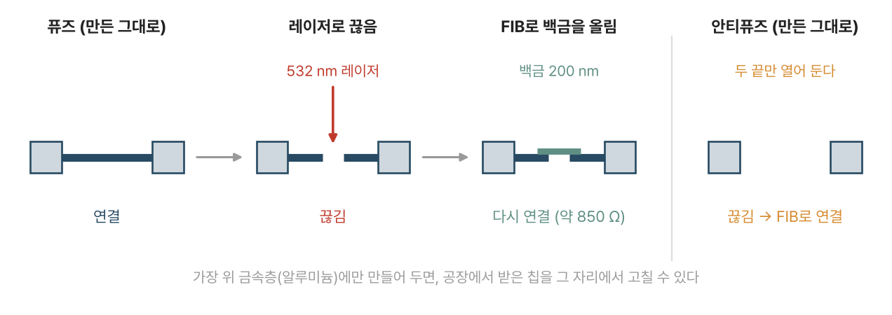
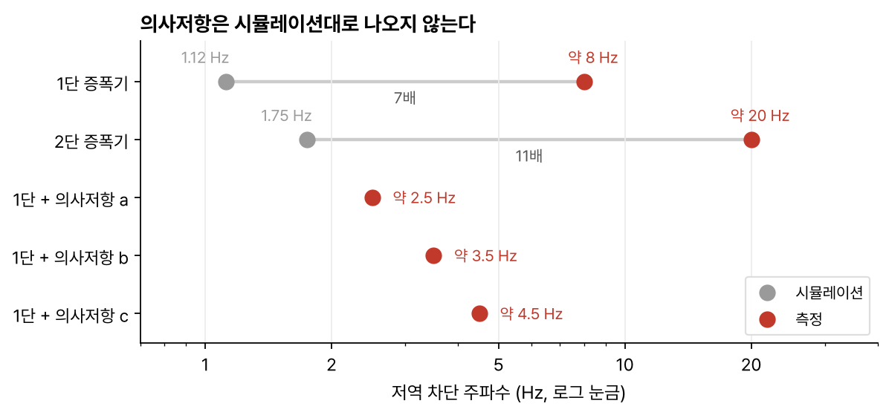
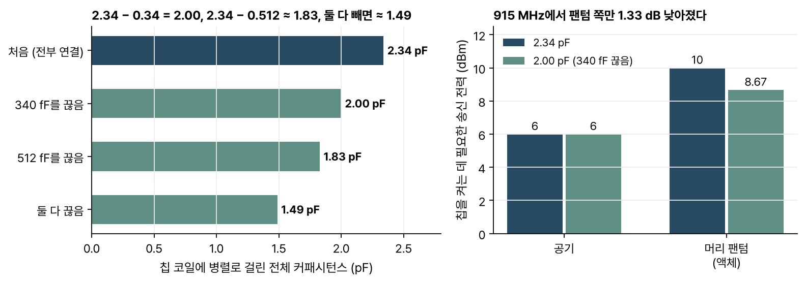

> [!abstract] 한눈에
> 1 mm보다 작은 무선 칩은 배선 패드를 달아 하나하나 시험하기 어렵다. 탐침이나 선이 RF 링크를 흐트러뜨리기 때문이다. 이 논문은 칩 맨 위 금속층에 퓨즈와 안티퓨즈를 미리 넣어 두고, 칩을 받은 뒤 레이저로 끊거나 집속 이온빔(FIB)으로 백금을 올려 잇는 방법을 제안한다. 이렇게 신경 증폭기의 의사저항, 10비트 칩 주소, 전력 수확용 공진 커패시터, 레귤레이터 출력 전압을 바꿔 가며 칩을 시험하고 맞췄다.

| | |
|---|---|
| 제목 | Versatile On-Chip Programming of Circuit Hardware for Wearable and Implantable Biomedical Microdevices |
| 저자 | Ah-Hyoung Lee, Jihun Lee, Vincent Leung, Arto Nurmikko |
| 게재 | *Advanced Science* 10, 2306111 (2023) |
| DOI | [10.1002/advs.202306111](https://doi.org/10.1002/advs.202306111) |

## 어떤 문제를 푸나

[[neurograins-wireless-network|뉴로그레인]] 같은 무선 칩은 전력 관리, 디지털 처리, 통신, 감지나 자극 회로가 모두 칩 하나에 들어 있다. 개발 중에 회로 블록 하나의 성능을 따로 재고 싶어도, 칩 근처에 탐침이나 선을 대면 RF 링크가 흐트러져 측정이 틀어진다. 유선 칩에서 흔히 쓰는 시험용 패드나 전기 퓨즈(E-fuse)는 패드와 쓰기 회로가 필요해서 이런 칩에는 맞지 않는다.

저자들은 칩 설계 단계에서 맨 위 알루미늄 층에 퓨즈를 넣어 두고, 파운드리에서 칩을 받은 뒤 그 자리에서 고치는 방법을 쓴다. 칩 수정에 레이저와 FIB를 쓰는 것은 반도체 업계에서 오래된 기법이다. 저자들은 이것을 무선 생체 칩의 아날로그·RF 회로를 조정하는 데까지 넓혔다는 점을 내세운다.

## 방법: 끊기와 잇기

*그림 1. 퓨즈는 처음에 이어져 있고 레이저로 끊는다. 끊은 퓨즈는 FIB로 백금을 올려 다시 이을 수 있다. 안티퓨즈는 처음에 열려 있고 FIB로 잇는다. (논문 그림 1을 바탕으로 직접 그림)*

- **끊기**: 먼저 355 nm 자외선 레이저로 맨 위 절연막(질화실리콘·산화막, 약 1 μm)을 연다. 이어서 532 nm 녹색 레이저로 알루미늄 선을 자른다. 빔 면적은 12 × 6 μm이고, 펄스 에너지가 0.25 mJ 이상이어야 확실히 끊겼다. 공정이 허용하는 가장 작은 퓨즈(3 × 3 μm)까지 자를 수 있었다.
- **잇기**: FIB(30 keV 갈륨 이온)로 절연막을 6 × 2 μm, 깊이 1.5 μm로 판다. 그 위에 이온빔 유도 증착(IBID)으로 백금을 6 × 1 μm, 두께 200 nm로 올린다. 끊었던 퓨즈를 다시 이은 경우 남은 저항은 약 850 Ω이었다.
- **주의할 점**: 레이저가 기판 쪽으로 최대 4 μm까지 파고들 수 있어서 퓨즈 아래에는 회로를 두지 않았다. 65 nm 공정에는 금속층이 10개쯤 있고 트랜지스터는 맨 아래에 있다.

끊고 다시 잇는 일이 둘 다 되므로 바꾼 설정은 전원이 꺼져도 남고, 필요하면 되돌릴 수도 있다. 대신 칩을 쓰는 도중에는 바꿀 수 없고 칩을 하나씩 처리해야 한다. 저자들도 무선 하향 링크로 설정을 보내는 방식보다 느리다는 점을 단점으로 적었다.

## 결과

### 신경 증폭기: 의사저항은 시뮬레이션과 다르게 나온다

뇌파용 증폭기는 저주파까지 통과시키려고 GΩ급 저항이 필요하다. 이 저항은 PMOS 트랜지스터로 흉내 낸 의사저항(pseudo-resistor)으로 만든다. 2단 용량 결합 증폭기에서 1단 이득은 $C_{in}/C_2$, 저역 차단 주파수는 $1/(2\pi R_1 C_2)$, 고역 차단 주파수는 $G_m/(2\pi C_L A_M)$이다. 의사저항은 누설 전류가 아주 작아서 시뮬레이션이 잘 맞지 않는다.

퓨즈 하나를 끊어 2단을 우회하면 1단과 2단을 따로 잴 수 있다. 재 보니 저역 차단 주파수가 시뮬레이션과 크게 달랐다(그림 2). 2단 증폭기의 이득은 45.02 dB로 시뮬레이션보다 2.05 dB 낮았다. 게이트 바이어스 전압이 600 mV를 넘으면 이득이 크게 떨어졌다.

안티퓨즈 배열로 의사저항 종류를 골라 끼울 수도 있다. 레이아웃에는 의사저항 25종이 들어 있고, 그중 세 종류로 1단 증폭기를 만들어 쟀다. 시뮬레이션에서는 차단 주파수가 뚜렷이 달랐지만 측정값은 약 2.5, 3.5, 4.5 Hz로 서로 비슷했다.

*그림 2. 저역 차단 주파수의 시뮬레이션값(회색)과 측정값(빨강). 의사저항 a·b·c의 시뮬레이션값은 본문에 없어서 측정값만 그렸다. 논문 본문의 수치로 다시 그림.*

이 결과로 4채널 무선 뇌파 칩(500 × 800 μm)을 만들었다. 퓨즈로 게이트 바이어스를 맞추고, FIB로 칩 패드 위에 60 × 60 μm 백금 전극을 올렸다. 915 MHz로 전력을 받으며 식염수에서 250 Hz로 샘플링했고, 저역 차단 주파수는 30 Hz로 감마 대역을 겨냥했다. 식염수에 흘려 넣은 간질 발작 전·발작 파형을 네 채널 모두 기록했다.

### 칩 주소: 10비트 퓨즈

자극 칩에는 10비트 퓨즈 주소를 넣었다. 퓨즈가 이어져 있으면 노드가 접지되어 0이다. 끊으면 공급 전압 쪽 트랜지스터의 누설 전류(150 pA)가 커패시터를 충전해 1이 된다. 충전 시간 상수는 9.27 μs로 잡아서, 전원이 켜진 뒤 충전이 끝나고 나서 디지털 엔진이 주소를 읽게 했다.

칩은 켜지면 960비트를 후방산란으로 보낸다. 미리 정한 32비트 LFSR 수열과 10비트 주소가 반복해서 들어 있어서 레이저로 새긴 주소가 제대로 읽혔는지 확인할 수 있다. 끊은 퓨즈에 백금을 올려 다시 이으면 그 비트가 0으로 돌아왔다. 1 Msps ASK-PWM 하향 링크로 주소가 다른 칩 다섯 개를 하나씩 불러 50 또는 100 μA(peak-to-peak), 위상 폭 100 μs나 1 ms로 자극하게 했다.

저자들은 이전에 쓰던 PUF 주소가 환경에 따라 가끔 비트가 바뀌었는데, 퓨즈 주소는 그런 문제가 없다고 쓴다.

### 공진 커패시터: 놓이는 자리에 맞춰 고르기

전력 수확 효율은 칩 코일, 정합 커패시터, 정류기 임피던스가 만드는 공진에 달려 있다. 칩에 170, 340, 512 fF 커패시터를 퓨즈로 달아 두고 하나씩 떼어 냈다. 전력은 칩의 클록 주파수로 간접적으로 읽었다. 받는 전력이 늘면 클록이 빨라지기 때문이다.

*그림 3. 왼쪽: 전체 커패시턴스 2.34 pF에서 340 fF나 512 fF를 떼면 논문 그림의 범례값(2.00, 1.83, 1.49 pF)이 나온다(뺄셈은 직접 함). 오른쪽: 칩을 켜는 데 필요한 송신 전력. 논문 본문의 수치로 다시 그림.*

- 2.34 pF에서 칩을 켜려면 송신 전력이 공기 중에서 6 dBm, 머리 조직을 흉내 낸 액체 팬텀에서 10 dBm 필요했다.
- 340 fF를 끊자 공기 중에서는 그대로였고 팬텀에서는 915 MHz 기준 1.33 dB 낮아졌다. 512 fF까지 끊으면 공진이 범위를 벗어나 효율이 크게 떨어졌다.
- 송신 코일 가장자리 쪽 칩은 전력을 더 많이 받는다. 가장자리에는 1.49 pF 칩을, 가운데에는 2 pF 칩을 두면 둘이 비슷한 전력을 받았다. 칩 세 개를 섞어 놓았을 때 배치가 나쁘면 모두 켜는 데 약 13 dBm, 커패시턴스에 맞춰 배치하면 약 9 dBm이 들어 4 dB를 줄였다.

### 공급 전압

저전압 레귤레이터(LDO)의 피드백 저항에 퓨즈를 달아 출력 전압을 올리거나 내릴 수 있게 했다. 이 칩에서는 전압을 직접 잴 수 없어서 클록으로 읽었다. 시뮬레이션에서 공급 전압에 따라 클록은 33.5–36.2 MHz, 발진기와 디지털 엔진의 전류는 8.6–15.2 μA로 달라진다.

- 퓨즈 1을 끊자 평균 클록이 34.43에서 35.25 MHz로 올랐고(전압이 올랐다는 뜻), 칩을 켜는 데 필요한 RF 전력이 조금 늘었다.
- 퓨즈 2를 끊자 클록이 평균 0.7 MHz 내려갔고 필요한 RF 전력이 0.33 dB 줄었다.
- 패킷 4,000개로 본 클록 흔들림은 약 1,000 ppm이었고 퓨즈를 끊기 전후가 같았다.

## 읽으며 든 질문

- **시뮬레이션이 이렇게 틀리면 칩마다 다시 맞춰야 하나.** 저역 차단 주파수가 시뮬레이션의 7–11배로 나왔다. 같은 웨이퍼 안에서도 의사저항이 칩마다 다르게 나온다면, 수천 개 칩을 하나씩 레이저로 맞추는 것은 현실적이지 않다. 이 방법이 설계 반복을 빠르게 하는 도구인지, 양산 칩을 개별 보정하는 도구인지에 따라 답이 달라 보인다. 저자들은 둘 다를 가능성으로 든다.
- **10비트로 수천 개를 구별할 수 있나.** 결론에서 퓨즈 주소가 오류 없는 식별자 수천 개로 늘어날 수 있다고 했는데, 10비트는 1,024개다. 수천 개를 쓰려면 비트를 늘려야 하고 그만큼 퓨즈 면적과 레이저 작업이 는다.
- **250 Hz 샘플링과 감마 대역.** 뇌파 칩은 250 Hz로 샘플링하므로 125 Hz 위 성분은 [[sampling-aliasing|앨리어싱]]으로 접혀 들어온다. 저역 차단 30 Hz는 적혀 있는데, 고역 쪽에서 125 Hz 위를 얼마나 막는지는 본문에 없다.
- **공급 전압을 간접적으로만 읽었다.** 레귤레이터 실험에서 전압 변화는 클록 변화로 추정했다. 클록은 전압 말고 온도나 받는 전력에도 반응하므로, 공기 중 고정 조건에서 쟀다고는 해도 직접 측정과 비교해 보고 싶다.

## 관련 개념

- [[neurograins-wireless-network|논문: 뉴로그레인 무선 네트워크]]: 이 칩들의 바탕이 된 시스템
- [[wireless-microstimulator-network|논문: 무선 미세 자극기 네트워크]]: 10비트 퓨즈 주소를 쓴 자극 칩
- [[sampling-aliasing|샘플링과 앨리어싱]], [[quantization-adc|양자화와 ADC]]

## 참고 자료

- A.-H. Lee, J. Lee, V. Leung, A. Nurmikko, "Versatile On-Chip Programming of Circuit Hardware for Wearable and Implantable Biomedical Microdevices," *Advanced Science* 10, 2306111 (2023). [doi:10.1002/advs.202306111](https://doi.org/10.1002/advs.202306111)
