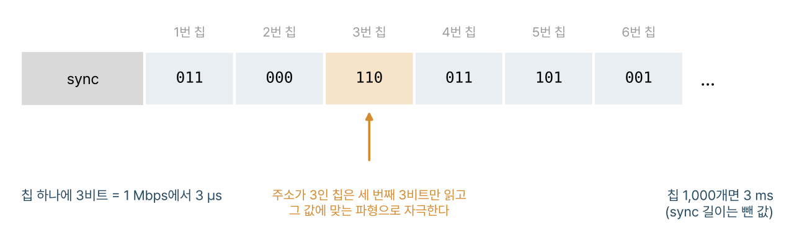
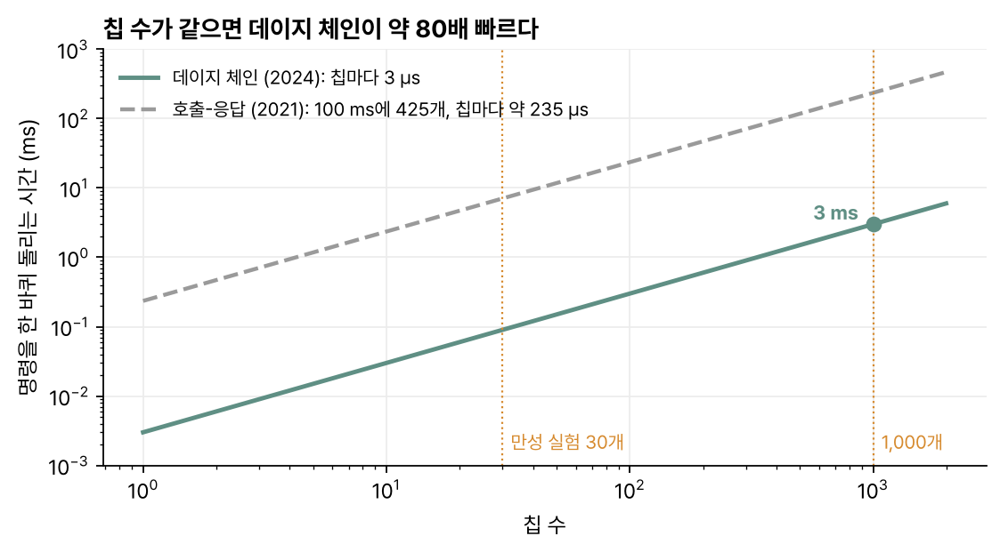
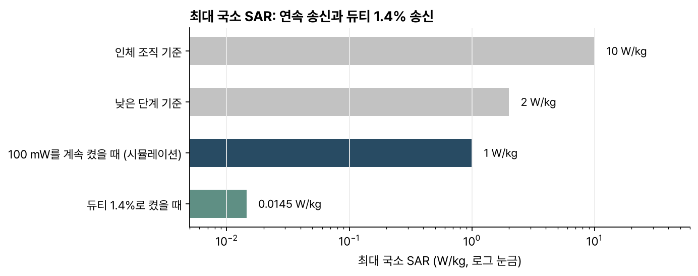
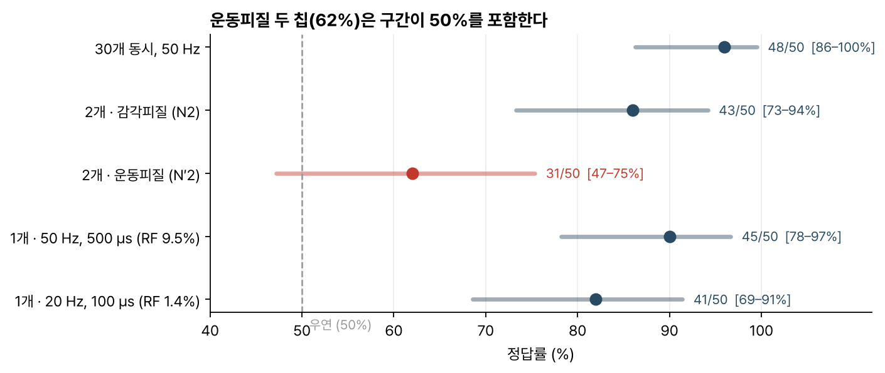

> [!abstract] 한눈에
> 뇌에 정보를 써 넣으려면 여러 지점에 서로 다른 전류를 정해진 시각에 넣어야 한다. 이 논문은 피질 표면에 흩어 놓은 무선 칩 여럿으로 그 일을 한다. 칩은 약 1 GHz RF에서 전력을 얻어 최대 120 μA(peak-to-peak) 2상 전류를 만든다. 외부 송신기는 동기 신호 뒤에 칩마다 3비트 명령을 이어 붙여 1 Mbps로 보내고(데이지 체인), 칩은 자기 주소 순번의 3비트만 읽는다. RF는 자극하는 동안에만 켠다. 쥐 한 마리의 운동·감각 피질에 칩 30개를 심어 석 달 동안 머리·수염 움직임과 레버 과제 반응을 확인했다.

| | |
|---|---|
| 제목 | Patterned electrical brain stimulation by a wireless network of implantable microdevices |
| 저자 | Ah-Hyoung Lee, Jihun Lee, Vincent Leung, Lawrence Larson, Arto Nurmikko |
| 게재 | *Nature Communications* 15, 10093 (2024) |
| DOI | [10.1038/s41467-024-54542-1](https://doi.org/10.1038/s41467-024-54542-1) |

## 문제

체성감각 피질의 손 영역에 국소 전류를 넣으면 촉감이 생기고, 1차 시각 피질에 넣으면 빛 점(phosphene)이 보인다는 보고가 있다. 지금까지는 주로 Utah 어레이 같은 한 덩어리 전극을 썼다. 이 방식은 전극 배치가 고정되어 있고 채널 수가 정해져 있어서 덮을 수 있는 피질이 좁다. 초기 임상에서 한 어레이로 감각을 일으킨 범위가 손가락 한두 개 일부였다는 보고도 있다.

무선 자극 칩은 이전에도 있었지만 대부분 한 번에 한 개만 시연했다. 이 논문은 칩 여러 개를 무선으로 묶어 각각 다른 세기와 시각으로 자극하고, 그것을 깨어 움직이는 동물에서 오래 돌려 보는 것을 목표로 했다. 저자들은 신경과학 연구보다 기술 시연에 가깝다고 밝힌다.

## 칩과 명령 방식

- **칩**: 65 nm 공정, 한 변 300·400·500 μm 세 크기. 동물 실험에는 수율이 좋은 500 μm 칩을 썼다. 무게는 약 300 μg이고 100 μm 간격의 텅스텐 전극 두 개(지름 50 μm, 길이 1,500 μm)를 붙여 피질 안으로 전류를 넣는다.
- **전력**: 두피 위 송신 코일과 두피 아래 릴레이 코일로 피질 8 × 13 mm를 덮는다. 칩은 받은 전력을 그대로 쓰고 과전압 보호 다이오드로 상한만 막는다.
- **하향 명령**: [[neurograins-wireless-network|뉴로그레인]]과 같은 ASK-PWM, 1 Mbps.
- **상향**: 칩이 켜질 때 BPSK 후방산란으로 자기 주소를 한 번 알린다. 클록 주파수도 함께 읽혀서 칩이 받는 전력을 가늠하는 데 쓴다.
- **주소**: 레이저로 금속 퓨즈를 끊어 새긴다([[onchip-fuse-programming|퓨즈 프로그래밍 논문]]).
- **자극 파형**: 3비트 명령으로 7가지를 고른다. 6가지는 진폭과 위상 폭이 다른 단발 자극이고, 1가지는 100 Hz 연속 자극이다. 단발 자극은 명령이 올 때마다 한 번 나가므로 하향 명령의 주기가 곧 자극 주파수다. 2 kHz까지 확인했다.

### 데이지 체인

이전 뉴로그레인 논문의 호출-응답 방식은 칩 주소를 하나씩 불렀다. 이번에는 동기(sync) 수열 뒤에 모든 칩의 3비트 명령을 순서대로 붙여 한 번에 보낸다. 주소가 $N$인 칩은 $N$번째 3비트만 읽는다(그림 1). 명령에 주소를 실을 필요가 없어서 칩 하나에 3 μs면 된다. 칩 1,000개라도 sync를 빼면 3 ms다.

*그림 1. sync 뒤에 칩마다 3비트를 이어 붙인다. 칩은 자기 주소 순번의 3비트만 읽는다. 비트 값은 예시다. (논문 그림 1d와 본문을 바탕으로 직접 그림)*

두 논문의 수치로 칩 수에 따른 명령 시간을 비교해 봤다(그림 2). 2021년 호출-응답은 100 ms 안에 칩 425개와 주고받았으니 칩 하나에 약 235 μs가 든다. 데이지 체인은 3 μs라서 같은 칩 수에서 약 80배 빠르다. 다만 두 방식이 하는 일이 같지는 않다. 호출-응답은 칩이 데이터를 돌려보내는 시간을 포함하고, 데이지 체인은 명령만 보낸다.

*그림 2. 두 논문의 본문 수치로 직접 계산했다. sync 수열의 길이는 본문에 없어서 뺐다.*

### 받는 전력과 주입 전하

칩이 받은 전력을 그대로 쓰므로 RF가 세지면 전류 진폭이 커진다. 그런데 클록도 같이 빨라져서 위상 폭이 짧아진다. 두 효과가 거의 상쇄되어, 송신 전력을 10배 올려도 명령 3의 주입 전하는 13.7%만 늘었다. 전하가 가장 큰 명령 6에서도 38.8% 늘었다.

이 밖의 특성은 다음과 같다.

- 칩마다 클록이 달라도 하향 클록과의 차이가 23% 안이면 명령을 100% 해독했다. 실제 칩들의 클록 차이는 그보다 작았다.
- 2상 펄스의 양쪽 전하 차이는 대개 전체의 2% 아래였고, 명령 5에서 최대 3%까지 났다.

### 듀티 사이클 RF

자극 한 번은 보통 100 μs 정도라서 RF도 그동안만 켜면 된다. 100 Hz 2상 자극에서 위상당 100 μs면 RF 듀티 사이클이 4.6%, 500 μs면 14%였다. 연속으로 켜는 방식보다 평균 RF 전력이 10배 넘게 줄어든다.

## 실험

**식염수**: 칩 24개 아래에 24채널 평면 전극을 깔고, 칩마다 다른 시각에 자극해 전류 패턴으로 BROWN이라는 글자를 썼다.

**마취한 쥐(급성)**: 칩 6개와 16채널 유선 전극을 함께 심었다. 칩 하나로 100 Hz 자극을 주면 LFP와 스파이크가 유발됐다. 칩 1·2·3을 함께 쓰면 칩 1 하나보다 LFP가 컸다. 위상 폭 500 μs가 100 μs보다 LFP를 크게 만들었다. 100 μV 넘는 LFP가 잡힌 전극은 칩 1 하나로 자극하면 5개, 칩 세 개면 최대 10개였다. RF를 켰다 껐다 할 때 생기는 잡음은 약 200 μV, 반치폭 약 2 ms였다.

**깨어 있는 쥐(만성)**: 양쪽 반구에 15개씩 칩 30개를 심고 액정 폴리머(LCP)로 감싼 릴레이 코일로 덮었다. 170 mg짜리 송신 코일을 머리에 붙이고 가는 동축선으로 SDR에 이었다. 쥐는 33 × 33 × 42 cm 상자 안에서 자유롭게 움직였다.

- 운동 피질 칩 하나로 120 μA, 400 Hz, 위상당 500 μs 자극을 0.25초(펄스 100개) 주자 머리가 기울었다. 운동·감각 피질에 걸친 칩 세 개로 400 Hz 자극을 0.5초 주자 수염이 빠르게 떨렸다.
- 두 레버 과제를 훈련시켰다. 자극을 느끼면 왼쪽, 못 느끼면 오른쪽 레버를 누르면 보상을 받는다. 칩 30개를 50 Hz로 함께 자극하면 정답률이 96%였다. 칩 2개만 쓰면 감각 피질 쪽(N2) 86%, 운동 피질 쪽(N′2) 62%였다.
- 칩 하나(N1)만 쓴 경우 50 Hz·위상당 500 μs(RF 듀티 9.5%)에서 90%, 20 Hz·100 μs(1.4%)에서 82%였다.
- 릴레이 코일 공진(S11)은 70일 뒤에도 날카롭게 남았다. 칩들의 후방산란 크기는 55일 동안 안정했다. 쥐가 가만히 있을 때 모든 칩을 켜는 송신 전력은 평균 17.78 dBm이었고, 앞발로 머리를 긁을 때는 최대 3.4 dB 더 필요했다. 상자 안 위치에 따른 차이는 없었다.
- 칩과 코일을 단 쥐와 대조군 쥐의 이동 거리, 머리 회전 속도는 통계적으로 다르지 않았다(p = 0.85, 0.83).

### SAR

시뮬레이션에서 쥐용 3-코일 시스템에 100 mW를 계속 넣으면 최대 국소 SAR(10 g 평균)이 1 W/kg이다. 인체 조직 기준 10 W/kg의 10분의 1이다. 만성 실험의 최대 송신 전력은 103.5 mW였고, 듀티 1.4%면 평균 1.45 mW, SAR로는 0.0145 W/kg이 된다(그림 3). 영장류처럼 조직이 두꺼우면 효율이 10분의 1로 떨어질 수 있는데, 듀티 9.3%(기존 영장류·인간 연구의 값)를 가정하면 평균 0.93 W/kg으로 낮은 단계 기준 2 W/kg 아래라고 저자들은 계산한다.

*그림 3. 최대 국소 SAR. 100 mW를 계속 켠 값은 논문의 시뮬레이션, 듀티 1.4% 값은 논문이 그 비율로 줄여 계산한 값이다. 논문 본문의 수치로 다시 그림.*

## 읽으며 든 질문

- **운동 피질 두 칩의 62%는 우연과 구별될까.** 정답률은 조건마다 시행 50회에서 나왔다. 시행이 서로 독립이고 우연 수준이 50%라고 보고 정확 이항 구간을 계산하면, 62%(31/50)의 95% 구간은 47–75%로 50%를 포함한다. 양측 [[p-value|p-value]]는 0.12다. 나머지 조건은 모두 50%와 뚜렷이 떨어진다(그림 4). 저자들은 감각·운동 피질의 차이를 자극 위치에 따라 지각이 달랐다는 근거로 드는데, 두 칩 조건 하나만으로는 그렇게 말하기에 시행 수가 적어 보인다. 자극 시행과 무자극 시행의 비율이 본문에 없어서 우연 수준이 정확히 50%인지도 확인하지 못했다.

*그림 4. 시행 50회가 독립이라고 보고 직접 계산한 정확 이항(Clopper–Pearson) 95% 구간. 빨간색은 구간이 50%를 포함하는 조건이다.*

- **만성 실험은 쥐 한 마리다.** 방법 절에 따르면 수술한 쥐는 두 마리이고, 한 마리는 급성, 한 마리는 만성 실험에 썼다. 석 달 안정성과 행동 결과는 개체 하나의 결과다.
- **다르지 않았다는 것과 같다는 것은 다르다.** 이동 거리와 머리 회전 속도가 대조군과 통계적으로 다르지 않았다는 결과(p = 0.85, 0.83)는 차이를 찾지 못했다는 뜻이다. 같다고 말하려면 동등성 검정이나 차이의 신뢰구간이 필요하다. 이 비교도 쥐 한 마리씩이다.
- **3 ms는 명령 시간이다.** 칩 1,000개를 3 ms에 돌린다는 계산에는 sync 수열이 빠져 있다. 자극 자체에 드는 시간(위상당 100–500 μs)과 칩이 켜지기까지의 시간도 별도다. 칩이 전력을 저장하지 않고 RF가 켜진 동안만 일한다면, 많은 칩을 동시에 자극할 때 RF를 켜 두는 시간이 어떻게 정해지는지 더 알고 싶다.
- **전력 여유가 빠듯해 보인다.** 칩은 최소 −3 dBm을 받아야 하고, 시뮬레이션 효율은 −19.22~−20.91 dB, 칩 각도에 따라 최대 2 dB가 더 빠진다. 18 dBm에서 −20.91 dB면 칩에 −2.91 dBm이 들어가서 기준과 거의 같다. 각도 손실까지 더하면 기준 아래인데 실측에서는 18 dBm으로 모든 칩이 켜졌다. 시뮬레이션이 보수적이었는지, 각도가 큰 칩이 적었는지는 본문만으로 알 수 없다.

## 관련 개념

- [[neurograins-wireless-network|논문: 뉴로그레인 무선 네트워크]]: 같은 칩 플랫폼의 기록 쪽 논문
- [[onchip-fuse-programming|논문: 퓨즈로 칩 하드웨어 고치기]]: 이 칩의 주소를 새기는 방법
- [[p-value|p-value]], [[bootstrap|부트스트랩과 표준오차]]: 정답률과 구간을 읽는 법

## 참고 자료

- A.-H. Lee, J. Lee, V. Leung, L. Larson, A. Nurmikko, "Patterned electrical brain stimulation by a wireless network of implantable microdevices," *Nature Communications* 15, 10093 (2024). [doi:10.1038/s41467-024-54542-1](https://doi.org/10.1038/s41467-024-54542-1)
