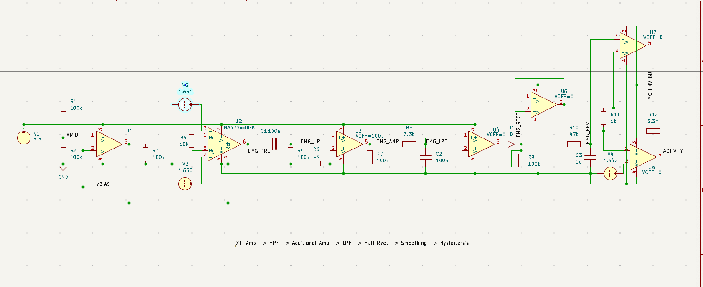
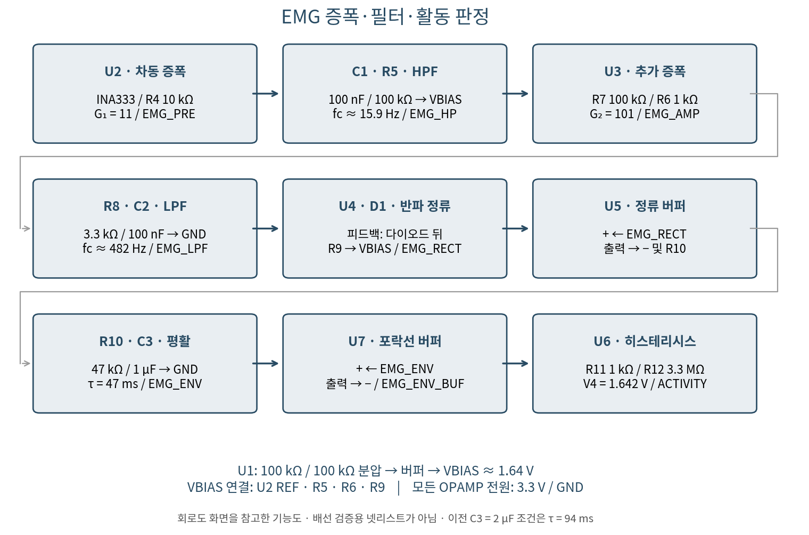
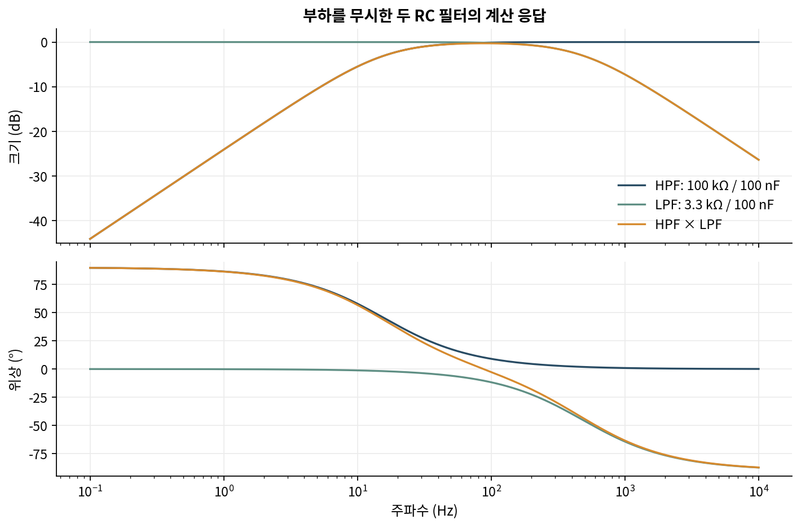
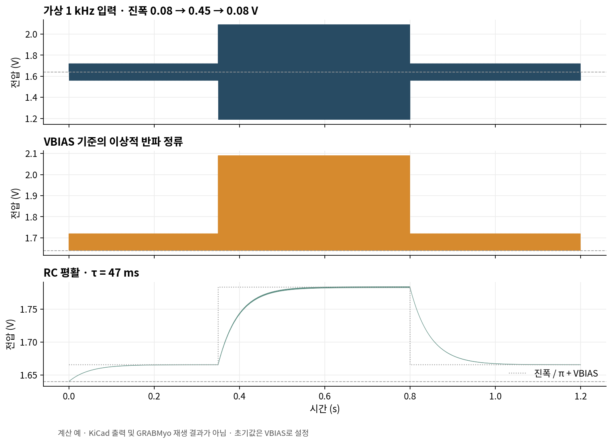
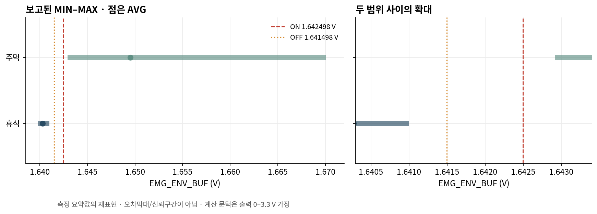
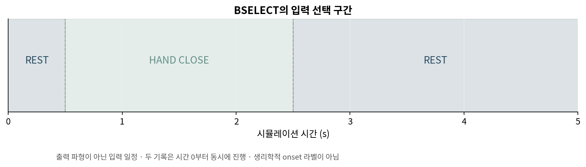
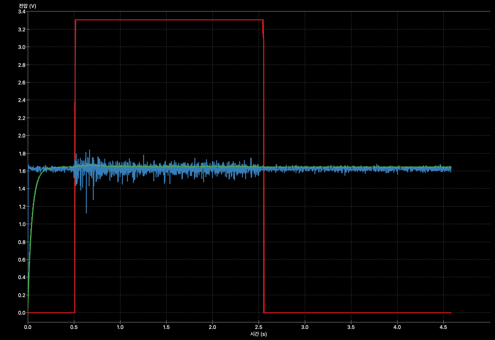

## 질문

단일 3.3 V 전원에서 작은 양·음 차동 신호를 증폭하고, 빠르게 부호가 바뀌는 EMG에서 활동 여부를 추출한다. 기준전압과 출력 포화, 필터의 부하, 정류 후 평균, 비교 문턱을 순서대로 계산한다.

현재 결과는 한 사람의 두 공개 기록을 이용한 기능 시험이다. 질문에서 시작한 계산과 설명은 [[emg-afe-design-reasoning|EMG 회로 설계의 질문과 계산]], 입력 파일과 측정 절차는 [[emg-afe-replay-validation|EMG 재생과 검증]]에 연결한다.

## 데이터와 방법

시험 입력을 DC, 사인파, 진폭이 구간별로 바뀌는 사인파, 공개 EMG 기록 순으로 확장했다. 회로도 화면과 실습 중 보고한 측정값을 근거로 정리했다. 네이티브 `.kicad_sch`와 전체 출력 CSV를 확보한 상태는 아니므로, 화면에서 읽은 배선·부품값과 실제 넷리스트의 완전한 동일성을 보증하지 않는다.


*회로도 자료. 실습에서 제공된 KiCad 화면이다. C3=1 µF, U3 VOFF=100 µV와 보정 후 문턱 저항값을 읽을 수 있다. 원본 설계 파일 대신 화면을 보존했으며 단자별 역할은 아래 표에 적었다.*


*그림 1. 2026-11-26 제공된 회로도 화면을 참고해 블록과 기준전압 연결을 다시 그렸다. 최신 화면의 C3는 1 µF이며, 앞선 실험에는 2 µF도 사용했다. 전기적 배선의 기준은 아래 단자 표와 원본 KiCad 넷리스트다.*

| 블록 | 구성과 역할 | 출력 이름 |
| --- | --- | --- |
| 기준전압 | R1·R2 각 100 kΩ 분압, U1 버퍼, R3 100 kΩ 부하 | VMID, VBIAS |
| 차동 증폭 | U2 INA333, R4 10 kΩ을 RG 핀 1–8 사이에 연결, 이득 11 | EMG_PRE |
| HPF | C1 100 nF 직렬, R5 100 kΩ을 VBIAS로 연결 | EMG_HP |
| 추가 증폭 | U3 비반전, R7 100 kΩ 피드백, R6 1 kΩ을 VBIAS로 연결, 이득 101 | EMG_AMP |
| LPF | R8 3.3 kΩ 직렬, C2 100 nF를 GND로 연결 | EMG_LPF |
| 반파 정류 | U4, D1, R9 100 kΩ을 VBIAS로 연결 | EMG_RECT |
| 정류 버퍼 | U5 전압 팔로어, 정류 노드와 평활 회로 사이 분리 | U5 출력 |
| 평활 | R10 47 kΩ 직렬, C3 1 µF를 GND로 연결 | EMG_ENV |
| 포락선 버퍼 | U7 전압 팔로어, 평활 회로와 판정 회로 사이 분리 | EMG_ENV_BUF |
| 활동 판정 | U6, 입력 R11 1 kΩ, 양의 피드백 R12 3.3 MΩ, V4 1.642 V | ACTIVITY |

U1·U3·U4·U5·U6·U7은 현재 KiCad 기본 OPAMP 모델이다. 최신 화면에서 U3는 `VOFF=100u`, U4·U5·U6·U7은 `VOFF=0`으로 표시된다. U1의 VOFF는 화면에 명시되지 않았으며, 초기 기본값과 관찰된 VBIAS 오차를 별도로 기록한다. 앞서 검토한 TLV172·OPA333의 패키지 핀과 기본 OPAMP 심볼 핀은 서로 바꾸어 쓰지 않는다.

VBIAS는 단일전원 회로의 신호 기준점이다. U2의 REF, R5·R6·R9의 기준 끝을 여기에 연결한다. 각 OPAMP의 전원은 3.3 V와 GND이며, 신호의 기준전압과 음전원 핀을 구분한다.

| 기본 OPAMP 심볼 핀 | 현재 회로의 기능 |
| --- | --- |
| 1 | 비반전 입력 + |
| 2 | 반전 입력 − |
| 3 | 양전원 3.3 V |
| 4 | 음전원 GND |
| 5 | 출력 |

U4의 + 입력은 EMG_LPF, 출력은 D1의 A, D1의 K는 EMG_RECT다. U4의 − 입력은 다이오드 뒤 EMG_RECT로 되먹임한다. U5는 + 입력만 EMG_RECT에서 받고, 자기 출력과 − 입력을 연결하며 그 출력으로 R10을 구동한다. U7도 + 입력만 EMG_ENV에서 받고 출력과 − 입력을 연결한다.

U6의 + 입력은 R11과 R12의 접점, − 입력은 V4의 + 단자다. R11의 반대쪽은 EMG_ENV_BUF, R12의 반대쪽은 ACTIVITY다. V4의 − 단자는 GND다. 양의 피드백 연결은 음의 피드백을 쓰는 버퍼와 다르다.

### 분압기와 부하

부하가 없는 100 kΩ·100 kΩ 분압기의 VMID는 1.65 V이고 직렬 전류는 16.5 μA다. 100 kΩ 부하를 아래 저항에 병렬로 직접 연결하면 아래쪽 등가 저항은 50 kΩ, VMID는 1.1 V가 된다. 전체 전류는 22 μA이며 아래쪽 두 가지로 각각 11 μA가 흐른다.

버퍼는 분압기로부터 큰 부하 전류를 가져가지 않고 전원을 통해 출력 전류를 공급한다. 이번 기본 모델의 입력 오프셋 때문에 버퍼 출력은 약 1.64 V였고, 이후 계산에는 실제 VBIAS를 사용했다. 기준전압 버퍼의 오차와 실제 부품 선정은 추가 검토 대상이다.

### INA333의 이득과 단자

$$
G_1=1+\frac{100\,k\Omega}{R_G}=11,\qquad
v_{PRE}=V_{BIAS}+G_1(v_{IN+}-v_{IN-}).
$$

100 kΩ은 내부 이득 설정 저항 50 kΩ 두 개에서 나온다. 외부에는 RG 저항 하나만 두 RG 핀 사이에 놓는다. 분압기의 100 kΩ 저항들과 역할이 다르다.

TI INA333.LIB의 모델 선언은 다음과 같다.

```spice
.SUBCKT INA333 IN+ IN- VCC VEE OUT REF RG+ RG-
```

| 심볼 핀 | 이번 실험의 모델 단자 |
| --- | --- |
| 1 RG | 7 RG+ |
| 2 IN− | 2 IN− |
| 3 IN+ | 1 IN+ |
| 4 V− | 4 VEE |
| 5 REF | 6 REF |
| 6 OUT | 5 OUT |
| 7 V+ | 3 VCC |
| 8 RG | 8 RG− |

심볼 핀 번호와 모델 단자 순서는 자동으로 일치하지 않는다. 단일 외부 RG만 연결하는 이번 구성에서는 두 RG 끝의 교환이 저항 연결 자체를 바꾸지 않는다. 회로도에서 보이는 연결은 생성된 넷리스트와 대조했다.

## 결과

아래 값은 이상적 계산, 실습에서 보고한 측정값, 화면에서 읽은 근사값을 구분한다. 입력 재생 생성 코드는 보존하지만 전체 회로의 시뮬레이터 출력 CSV는 아직 없으며, 관찰값을 실제 부품의 성능 보증으로 사용하지 않는다.

### DC와 차동 입력

1.651 V와 1.650 V를 넣으면 차동 입력은 1 mV다. 안정된 TRAN 결과에서 EMG_PRE와 VBIAS 사이에 약 11 mV 차이가 나타났다. 두 입력이 같으면 출력이 REF 근처로 돌아오는지를 별도로 확인한다.

한쪽 입력을 1.650 V 중심, 진폭 1 mV, 주파수 100 Hz 사인파로 두고 다른 쪽을 DC 1.650 V로 두었을 때 출력 진폭은 약 11 mV, 주기는 약 10 ms였다. 두 입력을 같은 사인파로 만들면 출력의 교류 성분이 크게 줄었다.

100 Hz에서 50 ms 지연은 정확히 다섯 주기다. 지연된 입력이 시작한 이후 두 파형이 같은 위상이 되어 차동 성분이 줄었다. 지연을 5 ms로 바꾸면 반 주기 차이가 생겨 차동 입력 진폭은 2 mV, 출력 진폭은 약 22 mV가 되었다. 임의의 EMG 파형에는 정수 주기 지연에 의한 이 일치를 일반화하지 않는다.

### 고역통과

VBIAS가 충분히 일정하고 다음 단계가 출력을 거의 로딩하지 않는 조건에서, 기준전압에 대한 변화량의 전달함수는 다음과 같다.

$$
H(s)=\frac{sRC}{1+sRC},\quad \tau=RC=10\,ms,\quad
f_c=\frac{1}{2\pi RC}\approx15.9\,Hz.
$$

| 주파수 | 계산한 진폭 비율 | 관찰·해석 |
| --- | --- | --- |
| 100 Hz | 0.9876 | 전후 진폭이 거의 같고 작은 위상 차이가 보임 |
| 15.9 Hz | 약 0.707 | 차단주파수에서의 계산값; 별도 측정 미완료 |
| 1 Hz | 약 0.0627 | 필터 뒤의 느린 출렁임이 크게 줄어듦 |

커패시터 전류는 $i=C\,d(v_{PRE}-v_{HP})/dt$다. 커패시터 양단 전압의 변화율과 입력 전압의 변화율을 구분한다. HPF의 출력은 입력 봉우리보다 앞설 수 있지만 입력이 시작되기 전에 반응하지 않는다. 100 Hz에서 계산한 위상은 약 +9°이며, 주기적인 사인파의 봉우리 간격으로 환산하면 약 0.25 ms다.

필터 뒤의 DC 기준은 0 V가 아니라 저항이 연결된 VBIAS다. 입력의 기준과 출력의 기준이 이미 같고 입력이 통과대역 사인파라면, 시간이 더 지나도 파형의 차이는 작다.

### 추가 증폭과 오프셋

$$
G_2=1+\frac{100\,k\Omega}{1\,k\Omega}=101,\qquad
v_{AMP}=V_{BIAS}+101(v_{HP}-V_{BIAS}).
$$

100 Hz에서 HPF 감쇠까지 포함한 이상적인 출력 진폭은 $1\,mV\times11\times0.9876\times101\approx1.097$ V다. 유한한 OPAMP 이득과 주파수 응답에 의한 오차는 이 계산에 포함하지 않았다.

기본 OPAMP의 VOFF가 10 mV인 조건에서 출력 아래쪽이 0 V 근처에서 잘렸다. 입력 오프셋의 출력 환산값은 약 1.01 V다. 모델의 오프셋 부호가 출력을 낮추는 경우 VBIAS 약 1.64 V에서 중심이 약 0.63 V로 내려가며, 약 ±1.1 V 신호의 하단이 전원 범위를 벗어나는 설명과 부합했다.

추가 증폭기의 VOFF를 0으로 바꾼 뒤 보고된 출력 범위는 약 0.541–2.72 V였다. 중심은 약 1.6305 V, 진폭은 약 1.0895 V다. 중심과 VBIAS의 남은 차이를 모두 입력 오프셋으로 단정하지 않는다. 기본 모델의 유한 개방루프 이득과 출력 특성 등을 따로 확인해야 한다.

VOFF=100 μV 조건에서는 출력 중심이 약 10.1 mV 이동할 것으로 예상했다. 보고된 최대·최소값은 반올림 정밀도가 달라 이동량을 정밀 검증하지 못했다. 같은 안정 구간의 CSV나 충분한 유효숫자로 비교하는 작업이 남아 있다.

### OP 계산과 안정화

초기 OP 로그에는 dynamic gmin, true gmin, source stepping의 실패와 transient OP로의 전환이 있었다. 이 결과에서 두 입력이 같은데 출력과 REF가 수 mV 달랐고, 입력 증가 시 출력이 감소하는 등 예상과 다른 값이 나왔다.

로그의 내부 노드 xu2.mid는 약 0.0324 V였다. 모델 내부에서 이 노드는 안정된 DC 조건에 약 전원 중간값이 되므로 충분히 안정되지 않은 상태를 의심했다. 초기 OP를 건너뛰는 TRAN으로 시간을 흘린 뒤 예상한 차동 이득을 관찰했다. 정확한 수렴 실패 원인과 OP 설정의 해결은 아직 확정하지 않았다.

OP는 시간축이 없는 정상상태 계산이다. TRAN의 특정 시점과 동일하게 취급하지 않는다. transient OP 종료 메시지만으로 충분한 안정화를 확정하지 않고, TRAN에서 시간이 더 지나도 결과가 유지되는지 확인한다. 회로도 OP 오버레이가 TRAN 마지막 값으로 갱신된다고 가정하지 않는다.

### 저역통과와 진폭

R8=3.3 kΩ, C2=100 nF에서 $\tau=330$ µs, $f_c\approx482.3$ Hz다. 다음 단의 입력 임피던스가 충분히 크다는 가정에서 1 kHz 사인파의 진폭 비는 다음과 같다.

$$
|H_{LP}(j2\pi f)|=\frac1{\sqrt{1+(2\pi fRC)^2}}\approx0.4344.
$$

실습에서 전후 PP 비가 약 0.43으로 관찰됐다. 이는 그 주파수의 전압 진폭이 약 43% 남는다는 의미이며, 모든 EMG 성분이 같은 비율로 줄어드는 것은 아니다. HPF와 LPF를 통과하는 성분도 주파수에 따른 크기·위상 변화를 받는다.

많은 주기가 한 화면에 겹치면 파형이 채워진 띠처럼 보이고 봉우리 경계가 고르지 않을 수 있다. 초기 과도, solver 시간 간격, 화면 표시와 실제 변조를 분리하려면 몇 주기를 확대하고 최대 시간 간격을 줄인 실행과 비교해야 한다. 화면만으로 잡음이라고 확정하지 않았다.


*그림 2. 부하를 무시한 HPF·LPF의 전달함수로 계산한 크기·위상이다. 실제 INA333·U3의 응답과 정류 단계는 포함하지 않았다.*

### 정류와 평활

입력 $v_{LPF}=V_{BIAS}+x(t)$에 대해 반파 정류의 이상적 목표는 다음과 같다.

$$
v_{RECT}=V_{BIAS}+\max(x(t),0).
$$

입력이 VBIAS 위에 있을 때 D1이 도통하고 U4의 되먹임이 다이오드 전압강하를 보상한다. 입력이 VBIAS 아래로 내려가면 다이오드가 꺼지고 R9가 EMG_RECT를 VBIAS로 당긴다. 실제 다이오드의 도통은 A와 K 사이 전압·전류 관계로 정해지며 고정된 0.7 V 스위치로 모델링하지 않는다.


*그림 3. 변화하는 진폭의 가상 입력에 이상적인 반파 정류와 47 ms RC 평활을 적용한 계산 예다. KiCad 실측 파형이나 GRABMyo 재생 출력이 아니다. 1.64 V 기준은 그림용 값이다.*

U5를 넣기 전에는 C3가 다이오드 OFF 구간에 R10과 R9를 통해 방전하면서 EMG_RECT까지 올리는 로딩이 관찰됐다. C3=1 µF에서 이 경로의 저항은 약 147 kΩ이고 시간상수는 약 147 ms다. 버퍼를 추가한 뒤 정류 노드의 바닥이 VBIAS 근처로 돌아왔다. U5 출력과 입력 노드를 직접 이어 붙이지 않도록 배선을 분리했다.

U5 뒤의 저역통과는 $\tau=R10\,C3$다. 1 µF일 때 47 ms·약 3.39 Hz, 2 µF일 때 94 ms·약 1.69 Hz다. 큰 C는 같은 전압 변화에 더 많은 전하를 요구하므로 반응을 느리게 하고 리플을 줄인다. 47 ms는 생리학적으로 유일한 값이 아니라 평활과 추종 속도를 비교하기 위한 초기 설계값이다.

정현파의 이상적 반파 정류분 $\max(A\sin\omega t,0)$의 주기 평균은 $A/\pi$다. 전파 정류 평균 $2A/\pi$, RMS $A/\sqrt2$, 피크 $A$와 구분한다. 현재 포락선은 정류 파형을 RC로 평활한 활동 지표이며 peak-hold나 근육 힘의 직접 측정값은 아니다.

### 히스테리시스의 손 계산

U7 버퍼는 47 kΩ 평활 회로가 U6의 저항망에 로딩되는 것을 줄인다. 전환 순간의 근사 $V_+=V_-=V_4$, 입력 전류 0을 사용하면 다음 KCL을 얻는다.

$$
\frac{V_{in}-V_4}{R_{11}}+\frac{V_{out}-V_4}{R_{12}}=0,
\qquad
V_{trip}=V_4+\frac{R_{11}}{R_{12}}(V_4-V_{out}).
$$

출력이 LOW인 동안 켜짐 문턱이, HIGH인 동안 꺼짐 문턱이 적용된다. $r=R_{11}/R_{12}$로 쓰면

$$
V_{ON}=V_4+r(V_4-V_L),\quad
V_{OFF}=V_4+r(V_4-V_H),
$$

$$
\begin{aligned}
\Delta V&=V_{ON}-V_{OFF}\\
&=\{V_4+r(V_4-V_L)\}-\{V_4+r(V_4-V_H)\}\\
&=r(V_H-V_L).
\end{aligned}
$$

공통된 기준 항이 상쇄되고 출력 swing에 저항비를 곱한 값이 남는다. V4는 주로 문턱의 위치를, 저항비는 두 문턱의 간격을 정한다. 실제 출력 swing이 0–3.3 V와 다르면 그 실제 값을 넣어야 한다.

| 조건 | R11 | R12 | V4 | 켜짐 / 꺼짐 계산값 | 폭 |
| --- | --- | --- | --- | --- | --- |
| 초기 가상 사인파 | 10 kΩ | 820 kΩ | 1.720 V | 1.74098 / 1.70073 V | 40.244 mV |
| EMG 보정 후 | 1 kΩ | 3.3 MΩ | 1.642 V | 1.642498 / 1.641498 V | 1.000 mV |

실제 구현에서는 입력 바이어스 전류, 오프셋, 저항 공차와 잡음을 문턱 오차에 포함해야 한다. 여기의 3.3 MΩ 설정은 기본 모델에서 기능을 시험한 값이며 실제 비교기의 선정·오차 예산 검증은 아직 없다.

### 공개 EMG와 문턱 보정

GRABMyo v1.1.0의 Participant 1, Session 1, Trial 1, F1 채널을 사용했다. gesture16은 HAND CLOSE, gesture17은 REST이며 각각 5초·2048 Hz·10240샘플이다. WFDB 헤더로 물리 단위를 환산하고 입력을 $1.650+e(t)$ V로 재생했다. 반대쪽 입력은 1.650 V로 유지해 차동 입력이 $e(t)$가 되도록 했다.

원 자료에는 10–500 Hz 대역통과와 60 Hz notch가 포함돼 있다. 이번 변환에서는 추가 정규화·필터링·평균 제거를 하지 않았지만 미가공 전극 신호를 재현한 것은 아니다. 데이터 단위·해시·재생 코드는 [[emg-afe-replay-validation|재생과 검증]]에 기록한다.

| 별도 실행의 EMG_ENV_BUF | MIN | AVG | MAX |
| --- | --- | --- | --- |
| 휴식 | 1.63980 V | 1.64027 V | 1.64100 V |
| 주먹 | 1.64292 V | 1.64949 V | 1.67007 V |

같은 0.5–2초 구간으로 요청해 보고받은 값이다. 원본 출력 CSV가 없으므로 측정 구간과 모든 모델 매개변수를 독립 재확인하지 못했다. 최신 회로의 C3=1 µF 조건에서 이 표를 새로 측정했다고 해석하지 않는다.

평균 차이는 9.22 mV다. 이 구간에서 휴식 MAX와 주먹 MIN 사이에는 1.92 mV 간격이 있었다. 간격의 중앙 1.64196 V를 약 1.642 V로 잡고 1 mV 폭의 두 문턱을 그 안에 배치했다. 이는 이 두 기록에 맞춘 보정이며 일반적인 EMG 문턱이 아니다.


*그림 4. 보고된 MIN·AVG·MAX와 계산한 문턱을 다시 그렸다. 범위 막대는 신뢰구간이나 확률분포가 아니다. 1.642 V 회로 기준전압과 약 1.640 V 신호 기준전압은 역할이 다르다.*

기존 약 1.741 V 켜짐 문턱은 주먹 기록의 MAX 1.67007 V보다 높았다. ACTIVITY가 나오지 않은 결과를 평활 속도 부족으로 먼저 설명했으나, 문턱이 너무 높은 조건만으로 켜지지 않는 현상을 설명할 수 있었다. C를 줄이기 전에 입력·포락선·문턱의 크기를 대조했다.

### 휴식–주먹–휴식 전환

두 입력을 병렬로 계산하고 behavioral source로 선택하는 서브회로를 추가했다. 0–0.5초 REST, 0.5–2.5초 HAND CLOSE, 2.5초 이후 REST를 선택했다. 각 기록의 시간축을 재시작하지 않으며 원본 주먹의 0.5–2.5초 구간을 사용하는 기능 시험이다.


*그림 5. 코드에서 지정한 입력 선택 구간이다. 실제 측정 출력이나 연속 생리학적 onset 기록이 아니며, 출력 전환 시각을 이 그림에서 추정하지 않는다.*

보고된 실행 화면에서 ACTIVITY는 초반 휴식에 LOW, 주먹 선택 뒤 HIGH, 2.5초 휴식 복귀 뒤 약 2.55초 부근에 LOW로 돌아왔다. 정확한 상승·하강 지연은 CSV 또는 교차 시각 측정으로 확정하지 않았다. 두 기록을 바꾸는 경계의 불연속이 HPF에 과도응답을 줄 수 있어 실제 근육 반응 시간으로 사용하지 않는다.


*실행 자료. 제공된 결과 화면의 빨강은 ACTIVITY, 파랑은 EMG_AMP, 초록은 평활 파형으로 앞선 표시 설정과 함께 해석했다. 선택 입력의 0.5–2.5초 구간에서 HIGH가 유지되고 휴식 복귀 뒤 LOW로 돌아온다. 출력 CSV를 재구성한 그림은 아니다.*

꺼지기 직전 출력이 약 3.15 V까지 내려갔다 회복하는 작은 골짜기도 관찰됐다. 이 구간은 0 V로 꺼진 펄스와 다르다. 기본 OPAMP의 연속 응답, 입력 리플, 수치 계산의 기여를 아직 분리하지 않았으며 $V_+-V_-$와 최대 계산 간격을 함께 비교하는 검증을 남겼다. 약 3.3 V를 조금 넘는 모델 출력도 실물 전원 한계의 성능으로 해석하지 않는다.

## 한계

- 실제 OPA333·TLV172·비교기 모델로 교체한 검증은 없다. U6는 기본 OPAMP를 비교기로 사용하는 학습 모형이다.
- 문턱을 정한 기록과 성공을 확인한 기록이 같다. 별도 trial·session·participant에서 고정 문턱 성능을 평가하지 않았다.
- 한 채널의 기록을 새 회로의 차동 입력으로 취급해 이상적인 전압원으로 재생했다. 전극 DC 오프셋·소스 임피던스·공통모드·전극 불균형·원치 않는 신호를 함께 검증하지 않았다.
- 원 자료에 이미 필터링이 있다. 회로 대역의 타당성이나 60 Hz 억제 성능을 이 입력만으로 검증할 수 없다.
- 1차 HPF·LPF와 반파 정류가 모든 EMG 정보를 보존하지 않는다. 활동 지표의 목표와 원시 파형 보존의 목표를 구분한다.
- 출력 swing, 온도, 저항 공차, 모델 수렴, 전원·기준전압 잡음과 실제 부하를 포함한 종합 검증은 남아 있다.
- 전체 KiCad 원본·모델 버전 묶음·출력 CSV를 포함한 완전한 재현 패키지는 없다. 입력 생성 스크립트와 이론 그림은 재현할 수 있다.
- ADC·MCU·실제 비교기·제작 보드·인체 연결·자극 회로는 아직 이 프로젝트의 검증 범위에 포함하지 않는다.

## 버전 사이에 바뀐 것

| 단계 | 변경 | 확인한 내용 |
| --- | --- | --- |
| 기준전압 | 직접 부하에서 U1 버퍼로 변경 | 분압기 로딩과 전원 전류 경로 |
| 차동 시험 | DC → 동일·반대 위상 사인파 | 이득 11과 입력 차이의 증폭 |
| 초기 분석 | OP 단독 → 안정된 TRAN 비교 | 수렴 실패와 실제 배선 오류 구분 |
| HPF·증폭 | C1·R5, U3 이득 101 추가 | VBIAS 기준, 위상, 오프셋 포화 |
| LPF | R8·C2 추가 | 1 kHz에서 진폭 약 43% |
| 정류 | U4·D1·R9 추가 | VBIAS 위 반파와 다이오드 뒤 피드백 |
| 평활 | R10·C3, U5 추가 | 1/2 µF의 시간상수와 OFF 구간 역방향 로딩 |
| 판정 | U6 → 양의 피드백, U7 추가 | 문턱 폭과 입력 소스 임피던스 분리 |
| 실제 기록 | 사인파 → GRABMyo F1 재생 | 작은 실제 진폭과 기존 문턱의 불일치 |
| 문턱 | 1.72 V·40 mV 폭 → 1.642 V·1 mV 폭 | 두 기록 범위에 맞춘 보정 |
| 전환 시험 | 별도 재생 → REST/HAND/REST 선택 | 한 실행에서 OFF–ON–OFF 확인 |
| 파일 로드 | 기존 파일명 → v2 파일명 | 새 모델 로드 성공, 갱신·캐시 영향 의심 |

회로 그림의 교차선만 보고 RG와 입력의 단락을 의심했으나 기존 넷리스트는 분리되어 있었다. 모델 핀 표와 넷리스트로 확인한 결과를 우선했다. 새 모델 로드 오류를 파일·모델 필드의 역전으로 해석했지만 속성 화면은 올바르게 설정돼 있었다. 같은 코드가 새 파일명에서 실행된 관찰을 남기고, 정확한 캐시 내부 원인은 확정하지 않았다.

## 배운 개념

- [[thevenin-node-analysis|KCL과 신호원 등가]]: 부하에 의한 분압 변화와 버퍼의 역할.
- [[op-amp-circuit-families|연산증폭기 기본 회로]]: 음의 피드백, 유한 이득, 기준전압을 둔 비반전 증폭.
- [[op-amp-biosignal-front-end|생체신호 앞단]]: 이득 분배, 데이터시트 조건과 출력 오차 예산.
- [[difference-amplifier-cmrr|차동 증폭기와 CMRR]]: 두 입력의 차이와 공통 성분.
- [[first-order-rc-rl|RC·RL 1차 회로]]: 시간상수, 과도응답과 주파수 응답.
- [[emg|EMG 측정 원리]]: 전극 신호와 실제 측정 사슬.

- [[emg-afe-design-reasoning|설계 질문과 계산]]: 기준전압·소자·필터·이득·정류·판정의 유도.
- [[emg-afe-replay-validation|재생과 검증]]: 단위 환산·PWL·측정·검증 구간.

## 참고 자료

- Texas Instruments, [INA333 데이터시트](https://www.ti.com/lit/ds/symlink/ina333.pdf), 핀 기능, 이득식과 REF 연결.
- Texas Instruments, [INA333 모델 배포 페이지](https://www.ti.com/product/INA333#design-tools-simulation), PSpice Model Rev. G, 모델 헤더 Final 1.3, 2022-12-12.
- Texas Instruments, [OPA333 / OPA2333 데이터시트](https://www.ti.com/lit/ds/symlink/opa333.pdf), 실제 부품 선정 시 확인할 사양의 예. 이번 기본 OPAMP 시뮬레이션의 모델이 아니다.
- KiCad, [Schematic Editor 9.0](https://docs.kicad.org/9.0/en/eeschema/eeschema.html#simulator), 모델 단자 대응, OP·TRAN, 출력 로그와 커서.
- ngspice, [사용자 설명서](https://ngspice.sourceforge.io/docs/ngspice-manual.pdf), operating point와 transient operating point 계산.

- Jiang, N., Pradhan, A., He, J. [GRABMyo v1.1.0](https://physionet.org/content/grabmyo/1.1.0/), PhysioNet (2024), DOI: 10.13026/89dm-f662, CC BY 4.0.
- Pradhan, A., He, J., Jiang, N. [Multi-day dataset of forearm and wrist electromyogram for hand gesture recognition and biometrics](https://doi.org/10.1038/s41597-022-01836-y), Scientific Data 9, 733 (2022).
- KiCad, [Simulation_SPICE.sp](https://gitlab.com/kicad/libraries/kicad-symbols/-/blob/7.0.11/Simulation_SPICE.sp), 기본 OPAMP의 VOFF·GAIN·POLE 정의 예. 실제 설치본과 버전을 대조해야 한다.
