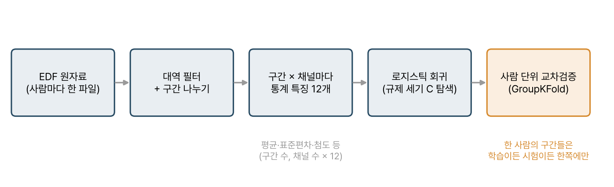

> [!abstract] 한눈에
> 공개된 휴식기 뇌파 자료로 조현병 환자와 건강한 대조군을 가르는 분류기를 만들어 본 실습이다. 뇌파를 짧은 구간으로 자르고, 채널마다 통계 특징 12개를 뽑아, 로지스틱 회귀로 분류했다. 이 실습에서 가장 중요했던 것은 모델이 아니라 **검증을 사람 단위로 나누는 것**이었다.

## 데이터

폴란드 RepOD 저장소에 공개된 「EEG in schizophrenia」 자료를 썼다. 조현병 환자 14명과 건강한 대조군 14명의 휴식기 뇌파가 사람마다 EDF 파일 하나로 들어 있다.

## 흐름

*그림 1. 원자료에서 사람 단위 검증까지.*

1. **전처리**: 대역 필터를 걸고 일정한 길이의 구간(epoch)으로 자른다. 결과는 (구간 수, 채널 수, 시간 표본 수) 배열이다.
2. **특징**: 구간마다, 채널마다 통계값 12개를 뽑는다. 평균, 표준편차, 분산, 최솟값과 최댓값, 그 위치, 봉우리 간 진폭, RMS, 1차 차분의 절댓값 합, 왜도, 첨도다. 이어 붙이면 구간 하나가 (채널 수 × 12)차원 벡터가 된다.
3. **분류**: 로지스틱 회귀. 규제 세기 $C$는 격자 탐색으로 고른다.
4. **검증**: 사람 단위 교차검증(GroupKFold). 한 사람의 구간들은 학습이든 시험이든 한쪽에만 들어간다.

## 왜 사람 단위인가

한 사람에게서 나온 구간 수백 개는 서로 아주 닮았다. 사람마다 뇌파의 고유한 지문이 있기 때문이다. 구간 단위로 섞어 나누면 같은 사람의 구간이 학습과 시험 양쪽에 들어가고, 모델은 조현병의 특징이 아니라 '이 사람'을 외워서 맞힌다. 이렇게 나온 높은 정확도는 처음 보는 환자에게는 아무 의미가 없다. 자세한 이야기는 [[data-leakage|데이터 누수와 검증 단위]]에 정리했다.

규제 세기를 고르는 격자 탐색도 같은 원칙을 따라야 한다. 탐색 안의 검증 분할 역시 사람 단위여야 하고, 바깥의 시험 폴드는 탐색에 쓰지 않는다.

## 함께 배운 것

- **EDF 형식과 MNE**: 의료용 생체 신호 파일을 읽고, 채널과 표본 주파수를 다루는 법
- **CNN 커널의 주파수 성격**: 같은 자료에 1차원 CNN도 써 봤다. 커널 길이가 3 표본처럼 짧으면 그 필터는 주파수를 거의 가르지 못한다. 길이 $L$인 필터의 주파수 분해능은 대략 $f_s/L$이기 때문이다. 커널은 '학습되는 필터'라서, 길이를 정하는 순간 볼 수 있는 주파수의 세밀함이 정해진다.

## 한계와 다음 단계

- 실습이라 체계적인 결과 보고가 없다. 다시 한다면 사람 단위 정확도와 신뢰구간, 우연 수준(라벨을 섞은 순열 검정)을 함께 보고하겠다.
- 28명은 기계학습에 매우 적은 수다. 사람 단위로 나누면 폴드마다 시험 인원이 몇 명뿐이라 결과가 크게 흔들린다.
- 통계 특징 12개는 주파수 정보를 거의 담지 않는다. 대역 전력 같은 스펙트럼 특징이 더 자연스러운 출발점이다.

## 관련 개념

- [[data-leakage|데이터 누수와 검증 단위]]
- [[sampling-aliasing|샘플링과 앨리어싱]], [[dft-fft|DFT와 FFT]]: 대역 필터와 스펙트럼 특징의 바탕

## 참고 자료

- E. Olejarczyk, W. Jernajczyk, "Graph-based analysis of brain connectivity in schizophrenia," *PLOS ONE* 12(11), e0188629 (2017)
- 자료: RepOD, 「EEG in schizophrenia」, [doi:10.18150/repod.0107441](https://doi.org/10.18150/repod.0107441)
