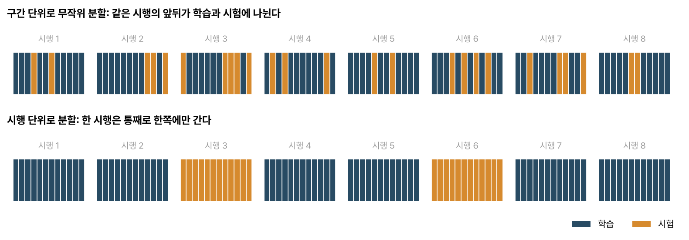
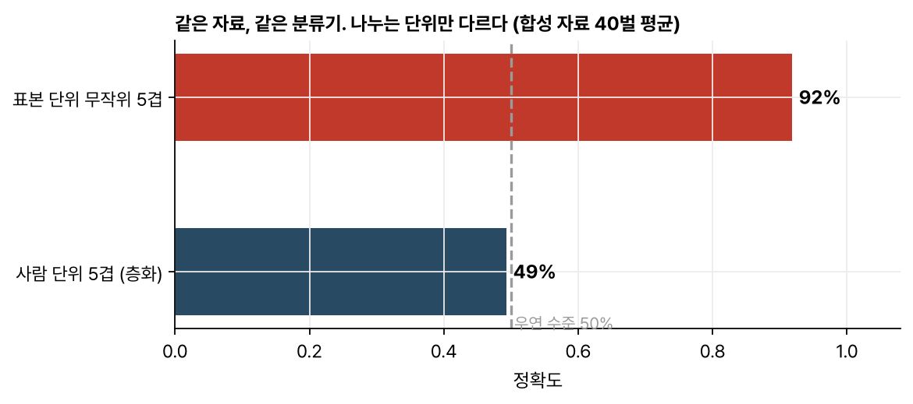

> [!abstract] 한눈에
> **데이터 누수**는 시험 자료에 대한 정보가 어떤 길로든 학습 과정에 들어가, 처음 보는 자료에서는 나올 수 없는 성능이 나오는 일이다. 신경 신호에서 가장 흔한 길은 **나누는 단위**다. 한 시행이나 한 사람에게서 나온 표본들은 서로 닮았기 때문에, 그것을 표본 단위로 섞어 학습과 시험에 나누면 모델은 패턴이 아니라 '그 시행, 그 사람'을 외워서 맞힌다. 교차검증은 **서로 독립인 단위**로 나눠야 한다.

## 정의

모델 평가가 묻는 질문은 "처음 보는 자료에서 얼마나 잘하나"다. 시험 자료는 그 '처음 보는 자료'의 대역이다. 시험 자료에 대한 정보가 학습에 조금이라도 쓰이면 이 대역이 깨지고, 평가 점수는 실제 쓰임새보다 높게 나온다. 이것이 데이터 누수(data leakage)다.

누수는 대개 눈에 띄지 않는다. 코드는 잘 돌고, 점수는 좋고, 문제는 실제로 써 볼 때 드러난다.

## 누수가 들어오는 길

1. **나누는 단위가 틀렸다.** 시간 순서가 있는 신호를 짧은 구간으로 자른 뒤 구간 단위로 무작위로 섞어 나누면, 같은 시행의 바로 옆 구간이 학습과 시험에 갈라져 들어간다(그림 1). 이웃한 구간은 거의 같으므로 시험이 사실상 학습 자료의 복사본이 된다.
2. **전처리를 전체 자료에 맞췄다.** 표준화의 평균·분산, [[pca-svd|PCA]]의 주성분, [[csp|CSP]] 필터, 특징 선택을 학습·시험을 나누기 **전에** 전체 자료로 계산하면 시험 자료의 정보가 변환 안에 들어간다. 이런 것은 학습 폴드에서만 맞추고 시험 폴드에는 그 변환을 적용만 해야 한다.
3. **시험 폴드에서 무언가를 골랐다.** 하이퍼파라미터, 변환 지수, 출력 보정값을 시험 결과를 보고 고르면 그 선택 자체가 누수다. 고르는 일은 학습 자료 안의 별도 검증 세트(중첩 교차검증)에서 해야 한다.
4. **미래가 과거에 들어왔다.** 실시간으로 쓸 디코더라면 입력 창이 현재보다 뒤의 표본을 포함해서는 안 된다.

*그림 1. 파랑은 학습, 주황은 시험. 위: 구간 단위로 섞으면 한 시행 안에서 학습과 시험이 번갈아 나온다. 아래: 시행 단위로 나누면 한 시행은 통째로 한쪽에만 간다.*

## 사람 단위로 나눠야 하는 이유

뇌파는 사람마다 두개골 두께, 전극 위치, 기저 리듬이 달라서 **사람마다 고유한 지문**이 있다. 환자군과 대조군을 가르는 문제에서, 한 사람의 구간 수백 개를 구간 단위로 섞어 나누면 모델은 "이 지문은 환자 쪽에서 봤다"를 외워서 맞힌다. 정작 처음 보는 사람에게는 쓸모가 없다.

그림 2는 이것을 합성 자료로 보인 것이다. 사람마다 라벨과 무관한 고유 패턴이 있고, 집단 사이의 진짜 차이는 아주 작게 넣었다. 같은 자료, 같은 분류기(1-최근접 이웃)인데 나누는 단위만 다르다.

*그림 2. 합성 자료(40명, 사람당 표본 20개). 표본 단위로 섞으면 90%가 넘지만, 사람 단위로 나누면 우연 수준인 50% 근처다. 앞의 숫자는 사람을 외운 결과다.*

그래서 사람을 일반화하려는 모델은 **사람 단위**(leave-subject-out, GroupKFold)로, 같은 사람의 다른 시행에 일반화하려는 모델은 **시행 단위**로 나눈다. 평가 단위는 "실제로 쓸 때 처음 마주칠 단위"와 같아야 한다.

## 예: 스파이크 오류 내성 프로젝트

[[projects/spike-error-tolerance/index|스파이크 오류 내성 프로젝트]]의 자료는 496개 시행을 10 ms 구간으로 이어 붙인 것이다. 처음에는 구간 단위로 폴드를 나눴는데, 그러면 한 시행의 앞부분이 학습에, 뒷부분이 시험에 들어간다. 손의 궤적은 한 시행 안에서 연속적으로 이어지므로 시험 점수가 실제보다 좋게 나온다. 폴드를 시행 단위로 다시 나누고, 200 ms 입력 창도 시행 경계를 넘지 않게 만들었다. 출력 보정값을 시험 폴드에서 재던 부분도 학습 폴드에서 맞추도록 고쳤다.

## 자주 하는 오해

- **"무작위로 섞어 나누면 공정하다."** 표본들이 서로 독립일 때만 그렇다. 시계열, 같은 사람의 반복 측정, 같은 시행의 구간은 독립이 아니다.
- **"교차검증을 했으니 누수는 없다."** 교차검증은 나누는 틀일 뿐이다. 무엇을 단위로 나누고 무엇을 어디서 맞췄는지가 누수를 정한다.
- **"전처리는 라벨을 안 쓰니 전체에 맞춰도 된다."** 라벨을 안 쓰는 표준화나 PCA도 시험 자료의 분포를 변환에 담는다. 효과가 작을 때도 있지만, 공정한 평가의 원칙은 '학습 폴드에서만 맞춘다'이다.
- **"사람 단위로 나눴는데 우연보다 낮게 나왔으니 뭔가 틀렸다."** 사람 수가 적거나 폴드의 집단 비율이 기울면 우연 수준보다 낮게 나오기도 한다. 폴드마다 집단 비율을 맞추고(층화), 여러 번 반복해 평균을 본다.

## 관련 개념

- [[pca-svd|PCA와 SVD]], [[csp|CSP]]: 학습 폴드에서만 맞춰야 하는 대표적인 변환
- [[schizophrenia-eeg|EEG로 조현병 분류하기 (실습)]]: 사람 단위 교차검증을 쓴 실습
- [[bootstrap|부트스트랩과 표준오차]]: 신뢰구간에서도 같은 '독립 단위' 문제가 나온다

## 참고 자료

- S. Kaufman, S. Rosset, C. Perlich, O. Stitelman, "Leakage in data mining: formulation, detection, and avoidance," *ACM Transactions on Knowledge Discovery from Data* 6(4), 15 (2012)
- S. Kapoor, A. Narayanan, "Leakage and the reproducibility crisis in machine-learning-based science," *Patterns* 4(9), 100804 (2023)
