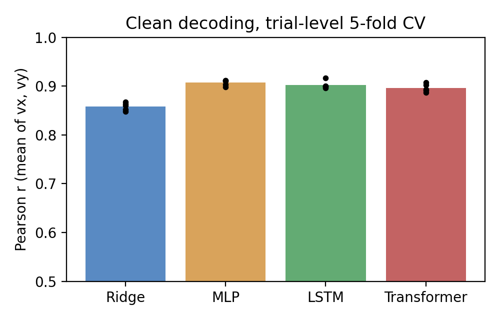
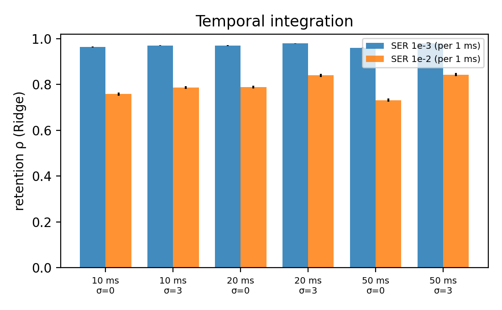
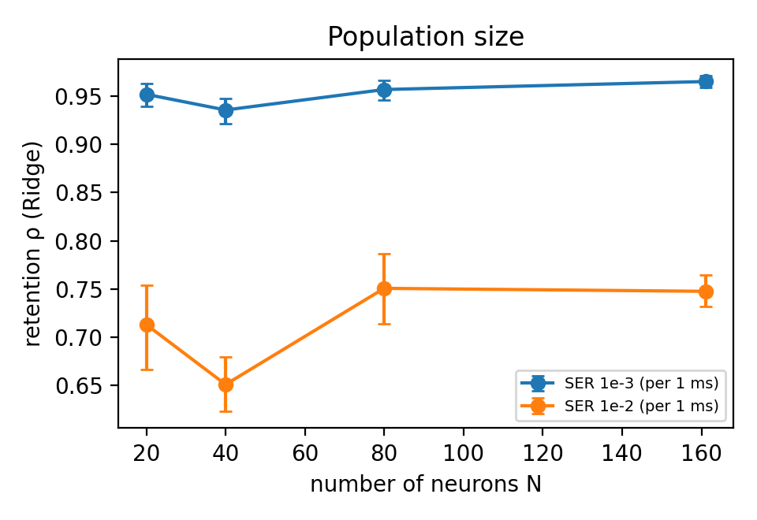

> [!abstract] 한눈에
> 무선으로 신경 신호를 보내면 스파이크가 빠지거나(놓침) 없던 것이 생긴다(거짓 검출). 이 비율을 스파이크 오류율(SER)이라 한다. 공개된 원숭이 운동피질 자료로 디코더 네 가지(Ridge, MLP, LSTM, Transformer)가 SER을 얼마나 견디는지 쟀다. 결론을 가장 크게 바꾼 것은 디코더가 아니라 **SER을 어떻게 정의하느냐**였다. 오류를 1 ms 구간 단위로 세면, 깨끗한 자료의 성능을 95% 정도 지키는 데 SER $10^{-3}$ 안팎이 필요했다.

- 코드와 보고서: [github.com/youjhun/spike-error-tolerance-decoders](https://github.com/youjhun/spike-error-tolerance-decoders) (보고서 v3)
- 출발점이 된 논문: [[asbit-wireless-sensor-network|수천 개 센서를 위한 비동기 무선 네트워크 (ASBIT)]]

## 질문

[[asbit-wireless-sensor-network|ASBIT]] 같은 무선 센서 네트워크는 센서마다 사건이 생겼을 때만 부호를 붙여 보낸다. 그래서 전송 오류가 신호의 일그러짐이 아니라 **스파이크의 놓침이나 거짓 검출**로 나타난다. 링크가 지켜야 할 오류율은 결국 그 뒤의 디코더가 오류를 얼마나 흡수하느냐에 달려 있다. 이 프로젝트는 그 흡수량을 재고, 디코더의 어떤 성질이 그것을 정하는지 묻는다.

## 데이터와 방법

- **데이터**: CRCNS pmd-1(Perich, Lawlor, Kording, Miller), 원숭이 한 마리의 한 세션. 1차 운동피질(M1) 67개와 배측 전운동피질(PMd) 94개, 모두 161개 단위, 순차 뻗기 과제 496시행. 10 ms 구간으로 나뉘어 있고, 단위-구간의 93.9%가 비어 있다(평균 발화율 6.41 Hz, 한 구간에 평균 9.8개 단위가 발화).
- **입력**: 시행마다 따로 만든 인과적 200 ms 창(10 ms 구간 20개 × 161단위 = 3,220차원). 창은 시행 경계를 넘지 않는다.
- **검증**: **시행 단위** 5겹 교차검증. 한 시행의 구간들은 학습과 시험 중 한쪽에만 들어간다(이유는 [[data-leakage|데이터 누수와 검증 단위]]에 정리했다).
- **디코더**: Ridge 회귀, MLP, 2층 LSTM, 3층 인과 Transformer. 미래 구간을 보지 못하도록 Transformer에는 인과 마스크를 씌웠다.
- **오류 주입**: 디코더는 깨끗한 자료로 한 번만 학습하고, 시험 시행에만 오류를 넣는다(폴드와 SER 수준마다 5번씩).
- **지표**: 손 속도($v_x, v_y$)와 예측의 [[pearson-spearman|피어슨 상관]] $r$, 그리고 유지율 $\rho = r_{\text{SER}} / r_{\text{clean}}$.

### SER의 두 정의

| | 오류를 무엇으로 나누나 | 뉴런 하나에 더해지는 거짓 스파이크 |
|---|---|---|
| 스파이크 단위 (v2 보고서) | 실제 스파이크 수 | 발화율 × SER/2 |
| 1 ms 구간 단위 (ASBIT 논문의 정의로 읽은 것) | 1 ms 구간 수 | 약 1000 × SER (Hz) |

이 자료의 발화율에서는 두 정의가 더하는 거짓 스파이크의 수가 **두 자릿수 넘게** 차이 난다. SER $10^{-2}$에서 스파이크 단위는 뉴런당 0.03 Hz, 1 ms 단위는 9.9 Hz를 더한다. 평균 발화율(6.41 Hz)보다 많다.

## 결과

### 깨끗한 자료

*그림 1. 시행 단위 5겹 교차검증의 피어슨 $r$($v_x$, $v_y$ 평균). 점은 폴드별 값. (저장소의 결과 그림)*

| | Ridge | MLP | LSTM | Transformer |
|---|---|---|---|---|
| $r$ | 0.858 | 0.907 | 0.903 | 0.896 |

### 오류를 넣었을 때: 정의가 결론을 가른다

*그림 2. 왼쪽: 디코더별 유지율. 점선은 스파이크 단위, 실선은 1 ms 구간 단위. 오른쪽: 각 정의가 뉴런마다 더하는 거짓 스파이크(Hz). 붉은 점선은 실제 평균 발화율. (저장소의 결과 그림)*

| 유지율 $\rho$ | SER $10^{-3}$ (1 ms 단위) | SER $10^{-2}$ (1 ms 단위) | SER $10^{-2}$ (스파이크 단위) |
|---|---|---|---|
| Ridge | 0.964 | 0.756 | 0.998 |
| MLP | 0.942 | 0.602 | |
| LSTM | 0.948 | 0.542 | |
| Transformer | 0.949 | 0.547 | |

- 스파이크 단위로 세면 모든 디코더가 SER $10^{-1}$까지 0.97 이상을 지킨다. "디코더는 오류에 아주 강하다"는 이전 결론은 이 정의에서 나왔다.
- 1 ms 단위로 세면 이야기가 달라진다. SER $10^{-3}$에서 94–96%, $10^{-2}$에서는 54–76%로 떨어진다.
- 깨끗한 자료에서 가장 정확한 신경망 디코더들이 오류에는 더 약했다. SER $3 \times 10^{-3}$부터는 Ridge의 절대 성능이 가장 높다(0.774 대 MLP 0.760).
- 1 ms 단위의 성능 하락은 $10^{-4}$부터 모든 수준에서 Benjamini–Hochberg 보정 뒤에도 유의했다([[multiple-comparisons-fdr|다중비교와 FDR]]).

### 시간으로 모으면 일부 회복된다

*그림 3. Ridge, 1 ms 단위 오류. 구간 폭(10/20/50 ms)과 출력 평활화(σ, 구간 단위)를 바꿨다. (저장소의 결과 그림)*

10 ms 구간을 20 ms로 합치고 출력을 평활화하면 SER $10^{-2}$의 유지율이 0.758에서 0.840으로 올랐고, 깨끗한 자료의 정확도는 0.858에서 0.873으로 오히려 조금 올랐다. 서로 독립인 오류는 여러 주파수에 고르게 퍼지므로 저역통과 성격의 묶음이 일부를 걸러 낸다는 해석과 맞는다. 다만 잃은 것의 일부만 돌아온다.

### 뉴런 수를 늘려도 내성은 오르지 않았다

*그림 4. 단위를 무작위로 $N$개 골라 Ridge 유지율을 쟀다(부분집합 5개씩). (저장소의 결과 그림)*

깨끗한 자료의 정확도는 $N = 20$에서 0.57, $N = 161$에서 0.86으로 크게 올랐지만, SER $10^{-2}$ 유지율은 0.71에서 0.75로 신뢰구간이 겹친다. 이전 보고서의 "뉴런이 많으면 오류가 희석된다"는 설명은 지지되지 않았다. 단위를 하나 더할 때마다 신호와 함께 **그 단위만의 거짓 스파이크**도 더해지기 때문일 수 있지만, 이것을 확인하려면 무작위 부분집합이 아니라 집단 구조 자체를 조작하는 실험이 필요하다.

## 무엇을 말할 수 있나

1 ms 단위 정의가 맞다면, 이 자료에서 깨끗한 성능의 약 95%를 지키려면 SER이 $10^{-3}$ 이하여야 한다. ASBIT 논문이 BMI에 쓸 만하다고 본 오류율($10^{-3}$ 안팎)과 비슷한 자리다. 디코더 쪽의 대책(넓은 구간, 평활화, 더 강한 규제)으로는 한 자릿수를 다 벌지 못했다. 그래서 **오류 예산의 대부분은 링크와 전력 전달 쪽에서 나와야 할 것**이라는 가설을 세웠다. 아직 가설이다.

## 한계

- 원숭이 한 마리, 한 세션이다. 세션을 넘는 검증이 없다.
- 오류는 서로 독립이고 모든 채널에서 같은 비율이라고 가정했다. 실제 링크에서는 칩마다 신호 세기가 달라 오류가 고르지 않다.
- SNN을 학습하지 않았고 ASBIT 링크를 흉내 내지도 않았다. 논문과의 비교는 정성적이다.
- 자료가 10 ms 구간이라 1 ms 오류를 구간 안을 나눠 흉내 냈다.
- 논문의 SER 분모는 본문을 읽고 추정한 것이라 확인이 필요하다.
- Ridge 규제 세기가 탐색 범위의 끝($10^4$)에서 골라졌다. 범위를 넓혀야 한다.
- 신뢰구간은 폴드 × 오류 추출 25개 값을 섞어 냈는데, 같은 폴드 안의 추출들은 같은 디코더와 같은 시험 세트를 공유해 독립이 아니다. 그래서 구간이 실제보다 좁다([[bootstrap|부트스트랩과 표준오차]]의 '독립 단위' 문제).

## 버전 사이에 바뀐 것 (v2 → v3)

틀렸던 주장을 지우지 않고 남긴다.

- **철회: "SNN보다 30점 더 강건하다".** v2는 스파이크 단위로 잰 유지율을, 1 ms 단위로 잰 것으로 보이는 논문의 SNN 결과와 비교했다. 정의가 달라 비교가 성립하지 않는다.
- **정정: SNN이 정밀한 스파이크 간격을 쓴다는 설명.** 논문의 SNN은 1 ms 스파이크를 25 ms 구간으로 묶고 ±25 ms 흔들림으로 학습한다. v2의 '시각 대 발화율' 설명은 틀렸다.
- **철회: "뉴런이 많으면 오류가 희석된다".** 위의 그림 4처럼 지지되지 않았다.
- **본문에서 뺌: Transformer attention 해석.** v2는 attention이 최근 구간에 몰린다고 해석했지만, 구간당 가중치가 0.06–0.07로 균등 분배(0.05)와 큰 차이가 없어 근거가 약했다.
- **분석 정리**: 시험 폴드에서 고른 변환 지수를 뺐고, 기본 출력 평활화를 없앴고, 오류 추출을 한 번에서 다섯 번으로 늘렸고, 신뢰구간과 BH 보정을 더했다.

## 이 프로젝트에서 배운 것

- [[data-leakage|데이터 누수와 검증 단위]]: 구간 단위로 섞어 나누면 성능이 부풀려지는 이유
- [[multiple-comparisons-fdr|다중비교와 FDR]]: SER 수준마다 검정할 때의 보정
- [[bootstrap|부트스트랩과 표준오차]]: 신뢰구간과, 독립이 아닌 반복이 그것을 좁히는 문제
- [[matched-filter|정합 필터]]: 오류가 생기는 쪽, 수신기가 스파이크를 되찾는 방법

## 참고 자료

- J. Lee et al., "An asynchronous wireless network for capturing event-driven data from large populations of autonomous sensors," *Nature Electronics* 7, 313–324 (2024). [doi:10.1038/s41928-024-01134-y](https://doi.org/10.1038/s41928-024-01134-y)
- M. G. Perich, P. N. Lawlor, K. P. Kording, L. E. Miller, "Extracellular neural recordings from macaque primary and dorsal premotor motor cortex during a sequential reaching task," CRCNS.org (pmd-1). [doi:10.6080/K0FT8J72](https://doi.org/10.6080/K0FT8J72)
