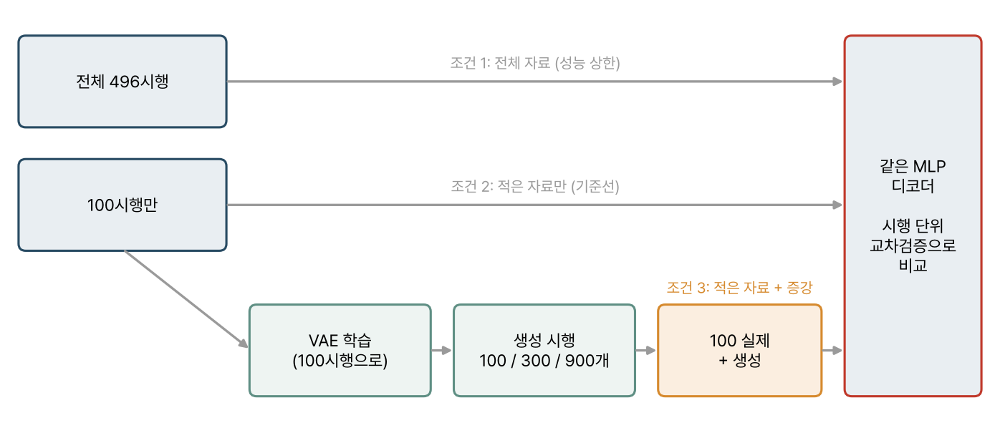

> [!warning] 아직 결과가 없다
> 이 페이지에는 실험 설계만 있고 돌려 본 결과는 아직 없다. 결과가 나오면 페이지를 고치되, 처음 세운 가설과 어긋난 부분은 지우지 않고 남긴다.

## 질문

[[projects/spike-error-tolerance/index|스파이크 오류 내성 프로젝트]]에서 쓴 자료는 496시행이다. 실제 환자에게 디코더를 맞출 때 얻을 수 있는 시행은 이보다 훨씬 적어서 수십에서 100개 남짓이다. 여기서 다음 질문이 나온다.

> 실제 자료가 100시행뿐일 때, 변분 오토인코더(VAE)로 만든 가짜 (스파이크, 속도) 쌍을 섞으면 디코더 성능이 오르는가?

오른다면 디코더를 맞추는 시간도, 환자의 피로도 줄일 수 있다.

## 설계

*그림 1. 세 조건을 같은 디코더와 같은 시행 단위 교차검증으로 비교한다.*

- **조건 1 (상한)**: 496시행 전부로 학습
- **조건 2 (기준선)**: 100시행만으로 학습
- **조건 3 (증강)**: 100시행으로 VAE를 학습한 뒤, 생성한 시행 100 / 300 / 900개를 섞어 학습

**생성할 것.** 200 ms 스파이크 창(10 ms 구간 20개 × 161단위)과 거기 맞는 손 속도($v_x, v_y$)를 쌍으로 만든다. 인코더가 스파이크 창을 잠재 벡터로 압축하면 디코더가 그 벡터에서 스파이크 창과 속도를 함께 복원한다. 스파이크 개수는 음수가 될 수 없어서 출력에 softplus를 쓰고, 속도는 선형 출력으로 둔다.

**누수 주의.** VAE 학습에는 조건 3의 학습 폴드에 들어간 100시행만 쓴다. 시험 시행이 VAE 학습에 섞이면 생성 자료를 거쳐 정보가 샌다([[data-leakage|데이터 누수와 검증 단위]]).

## 생성 자료 품질 점검

증강 실험에 앞서 생성 자료의 품질을 따로 잰다.

1. **통계**: 생성 스파이크의 희소도와 평균 발화율이 실제 자료(빈 구간 93.9%, 6.41 Hz)에 가까운가
2. **스파이크와 속도의 연결**: 생성 자료로만 학습한 Ridge 디코더가 실제 시험 자료에서 의미 있는 상관을 내는가
3. **잠재 공간**: 실제 자료와 생성 자료의 잠재 벡터가 같은 영역에 겹치는가

## 사전 판정 기준

무엇을 성공으로 볼지는 결과를 보기 전에 정해 둔다.

- **증강이 효과 있다**: 조건 3의 성능이 조건 2보다 높고, 차이의 신뢰구간이 0을 포함하지 않는다(시행 단위 폴드 기준).
- **효과 없다**: 차이의 신뢰구간이 0을 포함한다.
- **해롭다**: 생성 자료를 늘릴수록 성능이 조건 2보다 낮아진다. 이 경우는 생성 분포가 실제와 어긋났다는 신호로 본다.

생성 비율(1:1, 1:3, 1:9)을 바꿔 가며 성능이 꺾이는 지점이 있는지도 본다.

## 다음 단계 후보

- **조건부 VAE**: 속도를 조건으로 넣어 "이 움직임에 맞는 스파이크"를 생성한다. 스파이크와 속도의 연결이 지금보다 강해질 것으로 예상한다.
- **오류를 섞은 증강**: 생성 자료에 스파이크 오류를 넣고, 오류가 있는 조건에서도 증강이 도움이 되는지 확인한다. 오류 내성 프로젝트와 직접 이어지는 실험이다.

## 관련 개념

- [[projects/spike-error-tolerance/index|운동 디코더의 스파이크 오류 내성]]: 같은 자료와 검증 틀
- [[data-leakage|데이터 누수와 검증 단위]]

## 참고 자료

- D. P. Kingma, M. Welling, "Auto-encoding variational Bayes," *International Conference on Learning Representations* (2014)
